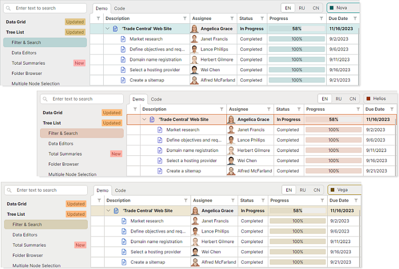
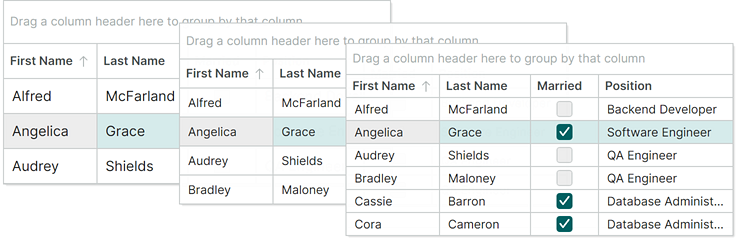
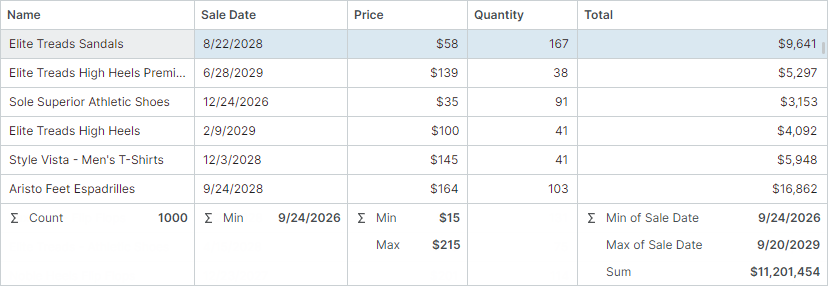
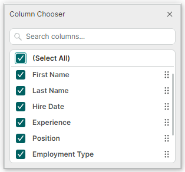
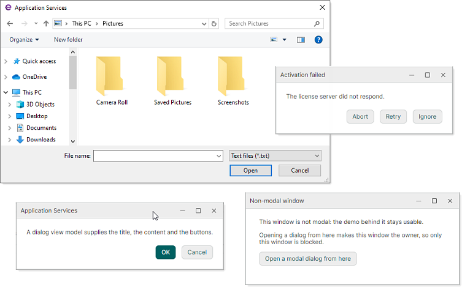
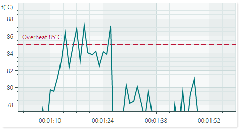
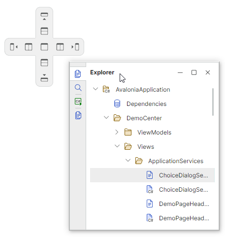
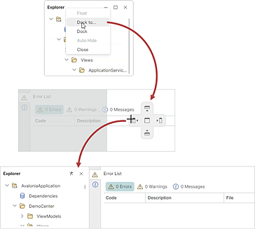
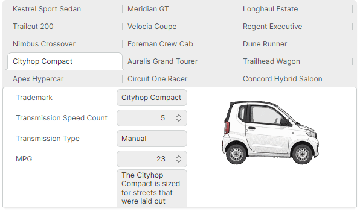
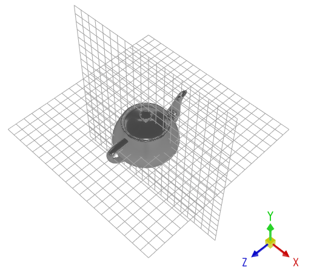

# Версия 1.5

## 1.5.86

### Цветовые палитры для темы DeltaDesign

В новой версии появились цветовые палитры для визуальной темы DeltaDesign. Цветовая палитра — это предопределённый набор цветов, применяемый к базовой теме, который позволяет пользователям быстро переключать оформление и акцентные цвета.



Применение палитры динамически обновляет цвета ключевых элементов интерфейса, в том числе:

- Фон окон, панелей и контейнеров.
- Фон редакторов в различных состояниях.
- Фон строк и ячеек в контролах, работающих с данными.
- Выделение, подсветку элементов под курсором и акценты контрола с фокусом.
- И многое другое.


### Настраиваемая плотность интерфейса в теме DeltaDesign

Теперь можно делать компоновку приложения более компактной или более просторной, настраивая плотность интерфейса в теме `DeltaDesign`. При изменении плотности автоматически масштабируются отступы элементов и размеры шрифтов в соответствии с требованиями интерфейса.



Доступные режимы:

- `Compact` — Уменьшает отступы и размеры шрифтов, чтобы разместить больше информации на экране.

- `Standard` (по умолчанию) — Сбалансированные отступы и типографика по умолчанию.

- `Spacious` — Увеличивает отступы и размеры шрифтов для более свободной и удобочитаемой компоновки.

Документация: [Плотность интерфейса](../controls/themes/ui-density.md)


### DataGrid и TreeList

#### Общие итоги

Контролы DataGrid и TreeList теперь умеют вычислять общие итоги по своим строкам и отображать результаты в панели итогов в нижней части контрола.



- Панель итогов — Оба контрола отображают панель итогов с агрегатными значениями, вычисленными по всем строкам.
- Встроенные типы итогов — Sum, Min, Max, Count и Average.
- Несколько итогов для колонки — Каждая колонка может отображать несколько саммари, вычисленных по значениям этой колонки.
- Итоги по другим колонкам — Можно вычислить итог по одной колонке и отобразить результат в ячейке итогов другой колонки.
- Управление итогами во время работы — Пользователи могут добавлять и удалять итоги с помощью встроенного выпадающего меню и диалога Summary Editor.
- Пользовательские итоги — Если встроенных типов недостаточно, можно обработать событие `CustomSummary`, чтобы вычислять собственные значения итогов.
- Итоги включаются в экспорт в XLSX и PDF.


#### Улучшения перетаскивания строк

Изначально контролы DataGrid и TreeList не позволяют бросать строки в пустую область (область ниже всех строк). Начиная с версии 1.5, можно обработать событие `DragOver`, чтобы разрешить бросание строк в пустую область. Строки, брошенные в эту область, добавляются в конец всех строк. 

``` cs 
private void ProductsInStockGrid_DragOver(object sender, DataGridDragEventArgs e)
{
    if (e.DropPosition == DropPosition.EmptyArea)
        e.Effects = Avalonia.Input.DragDropEffects.Move;
}
```

Событие `DragOver` можно также обработать, чтобы принудительно изменить способ вставки строк при бросании. Например, следующий обработчик события `DragOver` всегда добавляет строки в конец контрола.

``` cs
private void ProductsInStockGrid_DragOver(object sender, DataGridDragEventArgs e)
{
    e.DropPosition = DropPosition.EmptyArea;
    e.Effects = Avalonia.Input.DragDropEffects.Move;
}
```

#### 'Select All' в окне выбора колонок

В окне выбора колонок (Column Chooser) контролов DataGrid и TreeList появилась команда `(Select All)`.

Теперь пользователи могут выбрать или снять выбор со всех колонок одним действием, а не отмечать каждую колонку по отдельности.




#### Сервисы приложения

В этом выпуске появились сервисы приложения (Application Services) — набор платформенно-независимых сервисов для работы с окнами, диалогами и настройками внешнего вида всего приложения непосредственно из ViewModel, без ссылок на типы окон Avalonia.



Из кода ViewModel можно вызывать сервисы, чтобы:

- Открывать окна
- Показывать диалоги `Save File` и `Open File`
- Отображать окна сообщений и собственные модальные диалоги
- Определять активное окно
- Настраивать параметры текущей визуальной темы Eremex

Сервисы отделяют ViewModel от UI-фреймворка. Доступ к сервисам осуществляется через чётко определённые интерфейсы. Платформенно-зависимую работу (создание окон, определение владельцев, показ диалогов и т. д.) сервис выполняет внутри себя. 

Доступные сервисы приложения:


##### Сервисы взаимодействия с пользователем

| Сервис | Описание |
|---------|---------|
| [`IMessageBoxService`](../API/Eremex.AvaloniaUI.Controls.ApplicationServices/IMessageBoxService.md) | Показывает стандартные окна сообщений с фиксированными наборами кнопок, определёнными перечислением [`MessageBoxButtons`](../API/Eremex.AvaloniaUI.Controls/MessageBoxButtons.md) (Ok, Ok&vert;Cancel, Yes&vert;No&vert;Cancel, Yes&vert;No, Abort&vert;Retry&vert;Ignore и Retry&vert;Cancel). |
| [`IDialogService`](../API/Eremex.AvaloniaUI.Controls.ApplicationServices/IDialogService.md) | Показывает диалоги из кода ViewModel, чтобы ViewModel могла задать пользователю вопрос, не ссылаясь ни на какой тип окна. Диалог управляется _ViewModel диалога_. Вы также можете реализовать View, которое отображается как содержимое диалога. Это View находится с помощью атрибута [`ViewLocatorAttribute`](../API/Eremex.AvaloniaUI.Controls.ApplicationServices/ViewLocatorAttribute.md), применённого к ViewModel диалога. |
| [`IChoiceDialogService`](../API/Eremex.AvaloniaUI.Controls.ApplicationServices/IChoiceDialogService.md) | Показывает диалог с произвольным набором кнопок и возвращает результат нажатой кнопки. |
| [`IWindowService`](../API/Eremex.AvaloniaUI.Controls.ApplicationServices/IWindowService.md) | Показывает немодальные окна из кода ViewModel, чтобы ViewModel могла открыть окно, не ссылаясь ни на какой тип окна. Аналог для модальных диалогов — [`IDialogService`](../API/Eremex.AvaloniaUI.Controls.ApplicationServices/IDialogService.md). |

##### Файловые сервисы

| Сервис | Описание |
|---------|---------|
| [`IOpenFileDialogService`](../API/Eremex.AvaloniaUI.Controls.ApplicationServices/IOpenFileDialogService.md) | Показывает системный диалог `Open File` из кода ViewModel в синхронном или асинхронном режиме. |
| [`ISaveFileDialogService`](../API/Eremex.AvaloniaUI.Controls.ApplicationServices/ISaveFileDialogService.md) | Показывает системный диалог `Save File` из кода ViewModel в синхронном или асинхронном режиме. |

##### Инфраструктурные сервисы

| Сервис | Описание |
|---------|---------|
| [`IWindowsManager`](../API/Eremex.AvaloniaUI.Controls.ApplicationServices/IWindowsManager.md) | Отслеживает активное окно приложения. Сервисы диалогов используют сервис [`IWindowsManager`](../API/Eremex.AvaloniaUI.Controls.ApplicationServices/IWindowsManager.md), чтобы получить владельца по умолчанию для создаваемых диалогов. |
| [`IAppearanceService`](../API/Eremex.AvaloniaUI.Controls.ApplicationServices/IAppearanceService.md) | Предоставляет список настроек визуальной темы и применяет выбранный вариант темы. |

### Диаграммы

#### Расширенная настройка линий с помощью LineStyle

Объекты диаграмм теперь предоставляют расширенные параметры типа [`LineStyle`](../API/Eremex.AvaloniaUI.Charts/LineStyle.md) для настройки линий. [`LineStyle`](../API/Eremex.AvaloniaUI.Charts/LineStyle.md) предоставляет свойства, дающие полный контроль над отрисовкой линий. 



Эти свойства включают:

- [`Thickness`](../API/Eremex.AvaloniaUI.Charts/LineStyle/Thickness.md) — Толщина обводки.
- [`Dashes`](../API/Eremex.AvaloniaUI.Charts/LineStyle/Dashes.md) — Шаблон штриха для штриховых линий.
- [`DashOffset`](../API/Eremex.AvaloniaUI.Charts/LineStyle/DashOffset.md) — Смещение, с которого начинается шаблон штриха.
- [`LineCap`](../API/Eremex.AvaloniaUI.Charts/LineStyle/LineCap.md) — Форма концов линии.
- [`LineJoin`](../API/Eremex.AvaloniaUI.Charts/LineStyle/LineJoin.md) — Стиль соединения концов двух последовательных линий.
- [`MiterLimit`](../API/Eremex.AvaloniaUI.Charts/LineStyle/MiterLimit.md) — Ограничение толщины соединения на острых углах.

Новая настройка линий доступна для:

- Линий графиков в следующих Series View: все Line и Area Series View, Lollipop Series View, Range Area Series View, Polar Line и Polar Range Area Series View, а также Smith Line Series View.
- Постоянных линий (Constant Lines) в поддерживаемых Series View

    Свойство `ConstantLine.Thickness` устарело. Вместо него используйте параметр [`LineStyle.Thickness`](../API/Eremex.AvaloniaUI.Charts/LineStyle/Thickness.md).

### Docking UI

Компонент [`DockManager`](../API/Eremex.AvaloniaUI.Controls.Docking/DockManager.md) теперь предоставляет новое событие [`CustomizeDockGuide`](../API/Eremex.AvaloniaUI.Controls.Docking/DockManager/CustomizeDockGuide.md), которое позволяет динамически скрывать определённые направляющие докинга и отдельные элементы направляющих во время работы приложения.




#### Поддержка Wayland

В нативных сессиях Wayland в Linux отдельные окна приложения не могут узнавать или задавать собственное положение на экране. Чтобы поддержать операции докинга в Wayland, панели предоставляют команду **Dock To** в контекстном меню. Выберите эту команду, чтобы показать направляющие докинга, а затем щёлкните направляющую, чтобы закрепить панель в нужном месте.

[](../images/docking-wayland-dockto-command.png)

Чтобы сделать закреплённую панель плавающей в Wayland, щёлкните правой кнопкой мыши по заголовку панели и выберите **Float** в контекстном меню.

Исправленные проблемы:

- Панель документа внутри плавающей группы не активируется, когда пользователь начинает перетаскивать эту группу.
- Плавающие панели нельзя изменить в размере в Astra Linux.


### MxTabControl

В этом выпуске добавлено несколько новых параметров, позволяющих точнее управлять размером и отрисовкой заголовков вкладок при нехватке места.



- Растягивание вкладок — новое свойство `StretchTabsToFill` растягивает вкладки на всю полосу вкладок, даже если вкладок мало.
- Размер вкладок — новые свойства [`TabSizeMode`](../API/Eremex.AvaloniaUI.Controls/TabSizeMode.md) и `TabSize` управляют шириной вкладок. Теперь ширину вкладок можно подгонять под содержимое, выравнивать по самой широкой видимой вкладке или задавать одинаковую фиксированную ширину для всех вкладок.
- Режим отображения значков — новое свойство [`TabIconDisplayMode`](../API/Eremex.AvaloniaUI.Controls/TabIconDisplayMode.md) задаёт, когда отображаются значки вкладок (всегда, только когда текст скрыт, или никогда).

Документация: [MxTabControl](../controls/utility-controls/tabcontrol.md)


### Graphics3DControl

[`Graphics3DControl`](../API/Eremex.AvaloniaUI.Controls3D/Graphics3DControl.md) получает новые члены для управления видимостью плоскостей сетки, вращением мышью, проверкой попадания и выбором.

- Видимость плоскостей сетки — Свойство [`Graphics3DControl.GridPlane`](../API/Eremex.AvaloniaUI.Controls3D/Graphics3DControl/GridPlane.md) позволяет включать и выключать видимость отдельных плоскостей сетки (XY, XZ и YZ), когда включено свойство [`Graphics3DControl.ShowGrid`](../API/Eremex.AvaloniaUI.Controls3D/Graphics3DControl/ShowGrid.md).

    

- Режим вращения камеры — Свойство [`Graphics3DControl.RotationMode`](../API/Eremex.AvaloniaUI.Controls3D/Graphics3DControl/RotationMode.md) задаёт точку, вокруг которой камера вращается, когда пользователь вращает сцену перетаскиванием левой кнопкой мыши. Доступные режимы:

    - `AroundCameraTarget` — Камера вращается вокруг своей цели ([`Camera.Target`](../API/Eremex.AvaloniaUI.Controls3D/Camera/Target.md)).
    - `AroundMouseHit` — Камера вращается вокруг точки сцены, над которой находился указатель мыши в момент начала вращения. Этот режим удобен, когда нужно рассмотреть конкретный элемент, не перемещая цель камеры.

    


- Переопределение выбора — Новое событие [`Graphics3DControl.SelectionChanging`](../API/Eremex.AvaloniaUI.Controls3D/Graphics3DControl/SelectionChanging.md) позволяет реагировать на выбор элемента и переопределять поведение по умолчанию. По умолчанию контрол выбирает ближайшую модель и сетку под точкой щелчка. Обработайте событие [`SelectionChanging`](../API/Eremex.AvaloniaUI.Controls3D/Graphics3DControl/SelectionChanging.md), чтобы выбрать другой элемент. Чтобы получить всех кандидатов под точкой, используйте аргумент события `HitTestResults`.

- Проверка попадания — Новый метод [`Graphics3DControl.CalcHitInfo`](../API/Eremex.AvaloniaUI.Controls3D/Graphics3DControl/CalcHitInfo.md) позволяет определить, какие модели и сетки сцены находятся под заданной точкой. [`CalcHitInfo`](../API/Eremex.AvaloniaUI.Controls3D/Graphics3DControl/CalcHitInfo.md) возвращает все сетки по всем моделям, упорядоченные от ближней к дальней.

    Документация: [Проверка попадания](../controls/graphics3dcontrol/user-interactions-with-3d-models.md#проверка-попадания)


### Библиотека редакторов

У контрола SpinEditor появилось новое свойство [`AllowRoundOutOfRangeValue`](../API/Eremex.AvaloniaUI.Controls.Editors/SpinEditor/AllowRoundOutOfRangeValue.md), которое определяет, округляются ли автоматически введённые пользователем значения вне допустимого диапазона до ближайшего допустимого значения. Диапазон допустимых значений можно ограничить с помощью свойств [`Minimum`](../API/Eremex.AvaloniaUI.Controls.Editors/SpinEditor/Minimum.md) и [`Maximum`](../API/Eremex.AvaloniaUI.Controls.Editors/SpinEditor/Maximum.md).

### Панели инструментов и меню

Исправлена проблема:

- Текст отображения HotKey не обновляется при изменении свойства [`ToolbarItem.HotKey`](../API/Eremex.AvaloniaUI.Controls.Bars/ToolbarItem/HotKey.md).


### Критические изменения

#### DateEditor и SpinEditor - принудительный режим маски

- Редакторы [`DateEditor`](../API/Eremex.AvaloniaUI.Controls.Editors/DateEditor.md) и [`SpinEditor`](../API/Eremex.AvaloniaUI.Controls.Editors/SpinEditor.md) теперь всегда работают в режиме маски — [`MaskType.DateTime`](../API/Eremex.AvaloniaUI.Controls.Editors/MaskType.md) и [`MaskType.Numeric`](../API/Eremex.AvaloniaUI.Controls.Editors/MaskType.md) соответственно. Отключить режим маски ([`MaskType.None`](../API/Eremex.AvaloniaUI.Controls.Editors/MaskType.md)) или включить несовместимый режим маски для этих редакторов больше нельзя.

#### Docking UI — устаревшее свойство

Свойство `ShowAutoHideExpandButton` теперь устарело. Оно не поддерживалось в предыдущих версиях и объявлено устаревшим.

<br>
<br>

<sup>*</sup> Эта страница переведена с использованием технологий машинного перевода.
