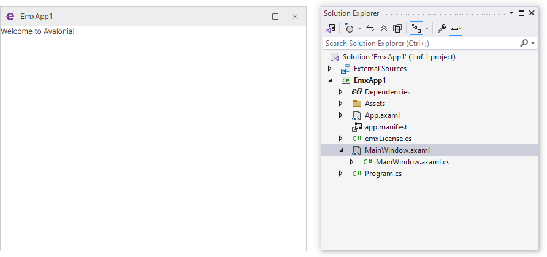
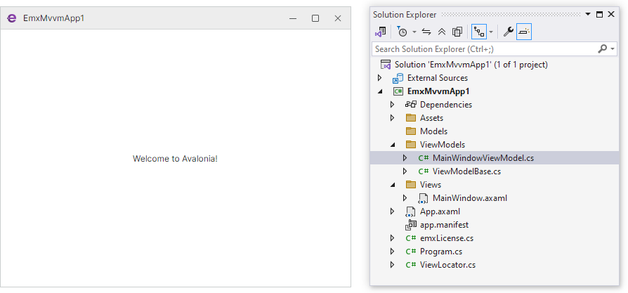
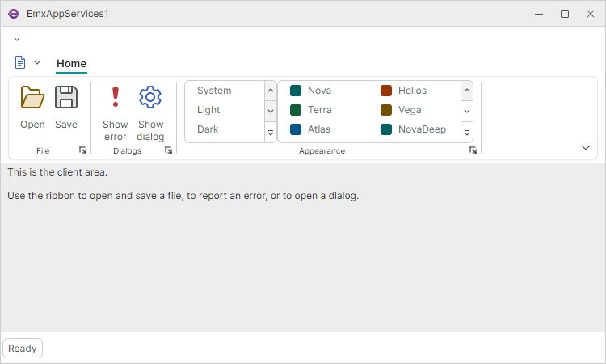
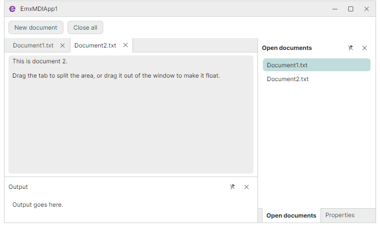
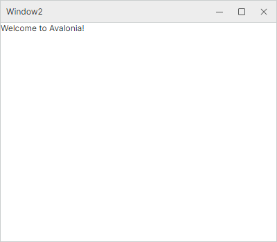

# Шаблоны проектов и элементов проекта

[NuGet-пакет](https://www.nuget.org/profiles/EremexControls) **Eremex.Avalonia.Templates** содержит шаблоны, которые позволяют быстро создавать новые проекты Avalonia UI с библиотекой Eremex Controls и добавлять окна на основе Eremex в существующие проекты.

## Установка шаблонов Eremex Avalonia

Выполните следующую команду:

<code>
dotnet new install Eremex.Avalonia.Templates
</code>

## Обновление шаблонов Eremex Avalonia

Чтобы обновиться до последней версии, выполните команду установки шаблонов:

<code>
dotnet new install Eremex.Avalonia.Templates
</code>

## Шаблоны проектов

Все перечисленные ниже шаблоны проектов добавляют в создаваемый проект необходимые NuGet-пакеты Eremex, наследуют главное окно от [`MxWindow`](../API/Eremex.AvaloniaUI.Controls.Common/MxWindow.md) для поддержки тем и регистрируют визуальную тему `DeltaDesign`.

### Eremex Avalonia .NET App 

Пустое десктопное приложение с NuGet-пакетами Eremex.

**Краткое имя**: `emx.app`

**Команда создания проекта**: <code>
dotnet new emx.app -n AvaloniaApplication1 
</code>

### Eremex Avalonia .NET MVVM App

Пустое приложение на основе MVVM, в котором пользовательский интерфейс и бизнес-логика разделены на слои View и ViewModel. 

**Краткое имя**: `emx.mvvm`

**Команда создания проекта**: <code>
dotnet new emx.mvvm -n AvaloniaApplication1 
</code>

Этот шаблон создаёт проект Avalonia UI с поддержкой MVVM, ссылающийся на библиотеку Eremex Controls. Шаблон разделяет код на слои View (_MainWindow_) и ViewModel (_MainWindowViewModel_).

### Eremex Avalonia .NET App with Application Services

MVVM-приложение, в котором ViewModel получают доступ к диалогам, выбору файлов и управлению визуальными темами через сервисы.

**Краткое имя**: `emx.services`

**Команда создания проекта**: <code>
dotnet new emx.services -n AvaloniaApplication1 
</code>

Этот шаблон создаёт MVVM-приложение, в котором сервисы Eremex, внедрённые во ViewModel, используются, чтобы:

- открывать диалоги открытия и сохранения файлов;
- показывать пользовательский диалог;
- выводить окна сообщений;
- предоставлять выбор темы в интерфейсе Ribbon.

### Eremex Avalonia .NET MDI App

Приложение с многодокументным интерфейсом (MDI) на вкладках, построенное на библиотеке Docking.

**Краткое имя**: `emx.mdi`

**Команда создания проекта**: <code>
dotnet new emx.mdi -n AvaloniaApplication1 
</code>

Этот шаблон создаёт MVVM-приложение с компонентом [`DockManager`](../API/Eremex.AvaloniaUI.Controls.Docking/DockManager.md), который реализует:

- многодокументный интерфейс (MDI) на вкладках;
- создание и закрытие документов из ViewModel.

## Шаблоны элементов проекта

### Eremex Avalonia Window

Пустое окно [`MxWindow`](../API/Eremex.AvaloniaUI.Controls.Common/MxWindow.md) (окно с поддержкой визуальных тем Eremex).

**Краткое имя**: `emx.window`

**Команда создания элемента проекта**: <code>
dotnet new emx.window -n Window2 
</code>

Этот шаблон элемента проекта создаёт новое окно Avalonia на основе [`MxWindow`](../API/Eremex.AvaloniaUI.Controls.Common/MxWindow.md). Шаблон создаёт только два файла, определяющих окно: _Window.axaml_ и _Window.axaml.cs_.

 
 

* Эта страница переведена с использованием технологий машинного перевода.
