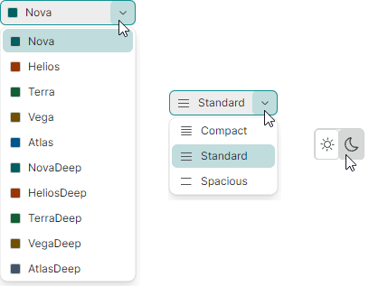
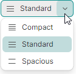
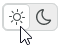

# IAppearanceService {#iappearanceservice}

[`IAppearanceService`](../../API/Eremex.AvaloniaUI.Controls.ApplicationServices/IAppearanceService.md) 提供了一种与平台无关的方式，用于访问 [DeltaDesign 主题](../themes/index.md)支持的外观选项并应用所选选项。它使 ViewModel 能够在运行时更改主题变体、调色板和界面密度，而无需直接引用任何 UI 框架类型。




<!-- TODO
selector for Theme Variants (light, dark)
 -->

主要功能包括：

- 主题变体 — 提供对可用主题变体（`Light` 和 `Dark`）的访问。
- 调色板 — 提供对 `DeltaDesign` 主题附带的[调色板](../themes/index.md#color-palettes-for-deltadesign-theme)的访问，例如 `Nova`、`Helios`、`Terra`、`Vega` 和 `Atlas`。
- 界面密度 — 提供对 `DeltaDesign` 主题中可用[界面密度](../themes/ui-density.md)（`Compact`、`Standard` 和 `Spacious`）的访问。
- 立即应用 — 更改 [`IAppearanceService`](../../API/Eremex.AvaloniaUI.Controls.ApplicationServices/IAppearanceService.md) 的相应选项即可立即更改对应的主题设置。
- 可绑定到选择器 — 该服务便于在界面中创建选择器控件（例如功能区库、组合框或菜单），让用户在运行时切换主题选项。

## 接口定义 {#interface-definition}

```csharp
public interface IAppearanceService : INotifyPropertyChanged
{
    // A list of available theme variants (light/dark).
    IReadOnlyList<IAppearanceOption> ThemeVariants { get; }

    // A list of available color palettes.
    IReadOnlyList<IAppearanceOption> Palettes { get; }

    // A list of available UI densities.
    IReadOnlyList<IAppearanceOption> Densities { get; }

    // The chosen theme variant. Assigning it recolors the running application at once.
    IAppearanceOption SelectedThemeVariant { get; set; }

    // The chosen theme palette. Assigning it recolors the running application at once.
    IAppearanceOption SelectedPalette { get; set; }

    // The chosen density. Assigning it resizes the controls of the running application at once.
    IAppearanceOption SelectedDensity { get; set; }
}
```

## IAppearanceOption {#iappearanceoption}

[`ThemeVariants`](../../API/Eremex.AvaloniaUI.Controls.ApplicationServices/IAppearanceService/ThemeVariants.md)、[`Palettes`](../../API/Eremex.AvaloniaUI.Controls.ApplicationServices/IAppearanceService/Palettes.md) 和 [`Densities`](../../API/Eremex.AvaloniaUI.Controls.ApplicationServices/IAppearanceService/Densities.md) 列表中的每一项都实现了 [`IAppearanceOption`](../../API/Eremex.AvaloniaUI.Controls.ApplicationServices/IAppearanceOption.md) 接口：

```csharp
public interface IAppearanceOption
{
    // The text shown for this choice.
    string Header { get; }
}
```

与其他服务接口一样，[`IAppearanceOption`](../../API/Eremex.AvaloniaUI.Controls.ApplicationServices/IAppearanceOption.md) 接口不包含 UI 框架类型。它只包含一个指定主题选项标题的字符串属性。不过，[`IAppearanceOption`](../../API/Eremex.AvaloniaUI.Controls.ApplicationServices/IAppearanceOption.md) 接口的实际实现会返回更丰富的对象，如下所列：

| [`IAppearanceOption`](../../API/Eremex.AvaloniaUI.Controls.ApplicationServices/IAppearanceOption.md) 实现 | 说明 |
|---|---|
| [`ThemeOption`](../../API/Eremex.AvaloniaUI.Controls.ApplicationServices/ThemeOption.md) 类 | 浅色或深色主题变体。其他属性包括：<br> - [`ThemeOption.Variant`](../../API/Eremex.AvaloniaUI.Controls.ApplicationServices/ThemeOption/Variant.md) — 选择此选项时应用的 Avalonia.Styling.ThemeVariant。 |
| [`PaletteOption`](../../API/Eremex.AvaloniaUI.Controls.ApplicationServices/PaletteOption.md) 类 | 调色板。其他属性包括：<br>- [`PaletteOption.Palette`](../../API/Eremex.AvaloniaUI.Controls.ApplicationServices/PaletteOption/Palette.md) — 选择此选项时应用的调色板（Nova、Helios、Terra、Vega、Atlas 等）；<br> - [`PaletteOption.Accent`](../../API/Eremex.AvaloniaUI.Controls.ApplicationServices/PaletteOption/Accent.md) — 表示调色板强调色的只读画笔。[`PaletteOption.Accent`](../../API/Eremex.AvaloniaUI.Controls.ApplicationServices/PaletteOption/Accent.md) 属性允许您在选择器中显示颜色样本，以便用户在选择调色板之前进行预览。|
| [`DensityOption`](../../API/Eremex.AvaloniaUI.Controls.ApplicationServices/DensityOption.md) 类 | 界面密度。其他属性包括：<br>- [`DensityOption.Density`](../../API/Eremex.AvaloniaUI.Controls.ApplicationServices/DensityOption/Density.md) — 选择此选项时应用的密度（Compact、Standard 或 Spacious）。 |

[`IAppearanceService`](../../API/Eremex.AvaloniaUI.Controls.ApplicationServices/IAppearanceService.md) 实现会返回这些更丰富的对象。例如，[`IAppearanceService.SelectedPalette`](../../API/Eremex.AvaloniaUI.Controls.ApplicationServices/IAppearanceService/SelectedPalette.md) 的实际返回值是一个 [`PaletteOption`](../../API/Eremex.AvaloniaUI.Controls.ApplicationServices/PaletteOption.md) 对象。

## 如何使用 IAppearanceService {#how-to-use-iappearanceservice}

1. 在 ViewModel 中，将 [`IAppearanceService`](../../API/Eremex.AvaloniaUI.Controls.ApplicationServices/IAppearanceService.md) 服务公开为属性。 
2. 在 View 中，将选择器控件绑定到该属性的成员。

### 访问服务 {#access-the-service}

您需要在 ViewModel 中访问 [`IAppearanceService`](../../API/Eremex.AvaloniaUI.Controls.ApplicationServices/IAppearanceService.md) 服务，才能将其公开为属性。

在 ViewModel 中访问 [`IAppearanceService`](../../API/Eremex.AvaloniaUI.Controls.ApplicationServices/IAppearanceService.md) 对象有两种方式：

- 通过 `Service<T>()` 辅助方法。这是获取 Eremex Controls 库附带的已注册应用程序服务的便捷方法。
- 通过构造函数注入。

#### Service<T>() 辅助方法 {#service-helper}

在 ViewModel 中实现一个 `Service<T>()` 辅助方法，通过静态方法 `ApplicationServicesContext.GetRequiredService<T>()` 获取所请求的服务。

```csharp
using Eremex.AvaloniaUI.Controls.ApplicationServices;
using CommunityToolkit.Mvvm.Input;

public partial class MyViewModel : ObservableObject
{
    // Provides access to any registered service
    protected static T Service<T>() where T : class
        => ApplicationServicesContext.GetRequiredService<T>();

    public IAppearanceService Appearance { get; } = Service<IAppearanceService>();
}
```

在 App.axaml.cs 文件中，确保按如下方式使用 [`SimpleServiceProvider`](../../API/Eremex.AvaloniaUI.Controls.ApplicationServices/SimpleServiceProvider.md) 和 [`ApplicationServicesContext`](../../API/Eremex.AvaloniaUI.Controls.ApplicationServices/ApplicationServicesContext.md) 注册 Eremex 应用程序服务：

```csharp
public class App : Application
{
    public override void OnFrameworkInitializationCompleted()
    {
        RegisterApplicationServices();
        //...
    }

    static void RegisterApplicationServices()
    {
        // Register built-in services.
        var serviceProvider = new SimpleServiceProvider();
        ApplicationServicesContext.RegisterApplicationServices(serviceProvider.AddSingleton);
        ApplicationServicesContext.SetCurrent(serviceProvider);
    }
}
```

#### 构造函数注入 {#constructor-injection}

在 ViewModel 中实现一个以 [`IAppearanceService`](../../API/Eremex.AvaloniaUI.Controls.ApplicationServices/IAppearanceService.md) 为参数的构造函数。实例化 ViewModel 时，将服务对象传递给该构造函数。

```csharp
public partial class MainViewModel : ObservableObject
{
    public MainViewModel(IAppearanceService appearance)
    {
        Appearance = appearance;
    }

    public IAppearanceService Appearance { get; }
}
```

### 从 ViewModel 公开服务 {#expose-the-service-from-the-viewmodel}

将 [`IAppearanceService`](../../API/Eremex.AvaloniaUI.Controls.ApplicationServices/IAppearanceService.md) 公开为公共属性。View 中的 UI 控件将直接绑定到它。

以下示例创建一个 [`IAppearanceService`](../../API/Eremex.AvaloniaUI.Controls.ApplicationServices/IAppearanceService.md) 类型的 _Appearance_ 属性，并使用 `Service<T>` 辅助方法对其进行初始化。 

```csharp
public partial class MainViewModel : ObservableObject
{
    public IAppearanceService Appearance { get; }

    public MainViewModel(ThemeVariant? startupThemeVariant = null)
    {
        Appearance = Service<IAppearanceService>();
        Appearance.SelectedThemeVariant = FindTheme(startupThemeVariant);
        //...
    }

    private IAppearanceOption? FindTheme(ThemeVariant? variant)
        => variant is null
            ? null
            : Appearance.ThemeVariants.FirstOrDefault(
                x => string.Equals(x.Header, variant.ToString(), StringComparison.OrdinalIgnoreCase));

    // Provides access to any registered service
    protected static T Service<T>() where T : class
        => ApplicationServicesContext.GetRequiredService<T>();
}
```

### 示例 - 在 View 中创建调色板选择器 {#example-create-a-palette-selector-in-a-view}

此示例创建一个列出可用主题调色板的组合框（[`ComboBoxEditor`](../../API/Eremex.AvaloniaUI.Controls.Editors/ComboBoxEditor.md) 控件）。在控件的下拉菜单中选择某一项时，相应的调色板将应用于应用程序。


在此示例中： 

- [`ComboBoxEditor.ItemsSource`](../../API/Eremex.AvaloniaUI.Controls.Editors/ComboBoxEditor/ItemsSource.md) 绑定到 `Appearance.Palettes`，以在下拉菜单中列出所有可用调色板。
- [`ComboBoxEditor.EditorValue`](../../API/Eremex.AvaloniaUI.Controls.Editors/BaseEditor/EditorValue.md) 绑定到 `Appearance.SelectedPalette`。在控件的下拉菜单中选择一项即可应用相应的主题调色板。
- ComboBoxEditor 的项模板在调色板名称（标题）旁边以色块形式显示调色板的强调色。

```xml
<mxe:ComboBoxEditor x:Name="themePaletteComboBox"
                    ItemsSource="{Binding Appearance.Palettes}"
                    EditorValue="{Binding Appearance.SelectedPalette}"
                    IsTextEditable="False"
                    ApplyItemTemplateToEditBox="True"
                    Width="150" Margin="0,0,10,0">
    <mxe:ComboBoxEditor.ItemTemplate>
        <DataTemplate x:DataType="appsvc:PaletteOption">
            <StackPanel Orientation="Horizontal" Spacing="8">
                <Border Width="12" Height="12" CornerRadius="2" VerticalAlignment="Center"
                        Background="{Binding Accent}"
                        BorderThickness="1"
                        BorderBrush="{DynamicResource Outline/Neutral/Transparent/Medium}"/>
                <TextBlock Text="{Binding Header}" VerticalAlignment="Center"/>
            </StackPanel>
        </DataTemplate>
    </mxe:ComboBoxEditor.ItemTemplate>
</mxe:ComboBoxEditor>
```

完整代码请参阅 [演示应用程序](../../index.md#demo-application) 应用程序。

### 示例 - 创建密度选择器 {#example-create-a-density-selector}

此示例创建一个填充了界面密度选项的组合框（[`ComboBoxEditor`](../../API/Eremex.AvaloniaUI.Controls.Editors/ComboBoxEditor.md) 控件）。当用户选择某一项时，相应的布局将自动应用。




为了在组合框中为密度值显示自定义图像，此示例直接使用 `Eremex.AvaloniaUI.Themes.DeltaDesign.Density` 枚举中的项填充控件。图像由自定义转换器 `NameToImageConverter` 提供，并通过 [`ComboBoxEditor.ItemTemplate`](../../API/Eremex.AvaloniaUI.Controls.Editors/ComboBoxEditor/ItemTemplate.md) 属性显示。

```xml
<mxe:ComboBoxEditor x:Name="densityComboBox"
                    ItemsSource="{mxc:EnumItemsSource EnumType=ddt:Density, ShowImages=True,
                                  NameToImageConverter={views:DensityToIconConverter}}"
                    EditorValueChanged="DensityComboBoxEditor_EditorValueChanged"
                    IsTextEditable="False"
                    Margin="0,0,10,0">
    <mxe:ComboBoxEditor.ItemTemplate>
        <DataTemplate x:DataType="mxc:EnumMemberInfo">
            <StackPanel Orientation="Horizontal" Spacing="8">
                <Image Source="{Binding Image}" Stretch="None" VerticalAlignment="Center"/>
                <TextBlock Text="{Binding Name}" VerticalAlignment="Center"/>
            </StackPanel>
        </DataTemplate>
    </mxe:ComboBoxEditor.ItemTemplate>
</mxe:ComboBoxEditor>
```

完整代码请参阅 [演示应用程序](../../index.md#demo-application) 应用程序。


### 示例 - 创建主题变体选择器 {#example-create-a-theme-variant-selector}

以下代码演示如何使用 [`SegmentedEditor`](../../API/Eremex.AvaloniaUI.Controls.Editors/SegmentedEditor.md) 构建主题变体选择器。

在此示例中：

- [`SegmentedEditor.ItemsSource`](../../API/Eremex.AvaloniaUI.Controls.Editors/SegmentedEditor/ItemsSource.md) 绑定到 ViewModel 中定义的 `ThemeOptions` 列表。`ThemeOptions` 返回可用主题选项（`Light` 和 `Dark`）的列表，不包含默认变体（`ThemeVariant.Default`）。
- [`SegmentedEditor.EditorValue`](../../API/Eremex.AvaloniaUI.Controls.Editors/BaseEditor/EditorValue.md) 绑定到 `Appearance.SelectedThemeVariant`。当选中 [`SegmentedEditor`](../../API/Eremex.AvaloniaUI.Controls.Editors/SegmentedEditor.md) 的项时，该绑定会应用相应的主题变体。
- [`SegmentedEditor.ItemTemplate`](../../API/Eremex.AvaloniaUI.Controls.Editors/SegmentedEditor/ItemTemplate.md) 属性设置为将每个选项显示为 `PathIcon` 的项模板。



``` xml
<mxe:SegmentedEditor ItemsSource="{Binding ThemeOptions}" Width="56"
                     EditorValue="{Binding Appearance.SelectedThemeVariant}">
    <mxe:SegmentedEditor.ItemTemplate>
        <DataTemplate x:DataType="appsvc:ThemeOption">
            <PathIcon Width="16" Height="16" Foreground="{DynamicResource Text/Neutral/Secondary}"
                      ToolTip.Tip="{Binding Header}">
                <PathIcon.Data>
                    <MultiBinding Converter="{views:ThemeVariantToIconDataConverter}">
                        <Binding Path="Variant"/>
                        <DynamicResourceExtension ResourceKey="SunPath"/>
                        <DynamicResourceExtension ResourceKey="MoonPath"/>
                    </MultiBinding>
                </PathIcon.Data>
            </PathIcon>
        </DataTemplate>
    </mxe:SegmentedEditor.ItemTemplate>
</mxe:SegmentedEditor>
```

``` cs
class MainViewModel 
{
    public IAppearanceService Appearance { get; }

    public IReadOnlyList<IAppearanceOption> ThemeOptions =>
        Appearance.ThemeVariants.Where(x => x is ThemeOption { Variant: not null } option
                                    && option.Variant != ThemeVariant.Default).ToList();
}
```


### 在代码中更改主题设置 {#change-theme-settings-in-code}

使用 [`SelectedThemeVariant`](../../API/Eremex.AvaloniaUI.Controls.ApplicationServices/IAppearanceService/SelectedThemeVariant.md)、[`SelectedPalette`](../../API/Eremex.AvaloniaUI.Controls.ApplicationServices/IAppearanceService/SelectedPalette.md) 和 [`SelectedDensity`](../../API/Eremex.AvaloniaUI.Controls.ApplicationServices/IAppearanceService/SelectedDensity.md) 属性在代码中更改主题设置。 

```csharp
public IAppearanceService Appearance { get; } = Service<IAppearanceService>();

public void ChangeThemeSettings() 
{
    // Apply the 'Terra' palette.
    Appearance.SelectedPalette = Appearance.Palettes.First(p => p.Header == "Terra");  
    
    Appearance.SelectedDensity = Appearance.Densities[0]; // Switch to the most compact density.
}
```

<br>
<br>

<sup>*</sup> 本页面使用机器翻译技术翻译。
