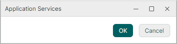
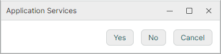

# IDialogService {#idialogservice}

[`IDialogService`](../../API/Eremex.AvaloniaUI.Controls.ApplicationServices/IDialogService.md) 提供了一种与平台无关的方式来显示模态对话框。您可以在 ViewModel 中使用专用的_对话框 ViewModel_ 打开和处理模态对话框，使 ViewModel 与 Avalonia 窗口类型完全解耦。


<!-- TODO
image
app-services-idialogservice 
-->

主要功能包括：

- 由 ViewModel 驱动的对话框 — 对话框完全由 ViewModel 定义。ViewModel 提供对话框的标题、内容和按钮。
- 简单对话框 — 如果只需显示纯文本和一组按钮，则无需定义对话框 View。只需从 [`OkCancelDialogAwareViewModel`](../../API/Eremex.AvaloniaUI.Controls.ApplicationServices/OkCancelDialogAwareViewModel.md) 派生对话框 ViewModel，并为该 ViewModel 的 [`Content`](../../API/Eremex.AvaloniaUI.Controls.ApplicationServices/WindowAwareViewModel/Content.md) 属性赋一个字符串即可。
- 自定义对话框 View — 您可以创建自定义对话框 View，将其呈现为对话框的内部内容。该 View 通过应用于对话框 ViewModel 的 [`ViewLocatorAttribute`](../../API/Eremex.AvaloniaUI.Controls.ApplicationServices/ViewLocatorAttribute.md) 自动定位。 
- 可自定义的按钮集 — 对话框 ViewModel 基类提供标准的 OK/Cancel 按钮，但您可以重写 `CreateButtons`，定义任意带有自定义标题和位置的按钮集。
- 验证支持 — 在对话框 ViewModel 中重写 [`CanOk`](../../API/Eremex.AvaloniaUI.Controls.ApplicationServices/OkCancelDialogAwareViewModel/CanOk.md) 方法，可在输入有效之前禁用默认按钮。
- 嵌套模态对话框 — 对话框可以在自身之上打开另一个模态对话框。
- 对话框结果 — 对话框关闭后，会返回由 [`DialogResult`](../../API/Eremex.AvaloniaUI.Controls.ApplicationServices/DialogResult.md) 枚举指定的结果。

## 接口定义 {#interface-definition}

```csharp
public interface IDialogService
{
    // Show a modal dialog driven by a ViewModel.
    DialogResult ShowDialog<T>(T viewModel, string? caption = null)
        where T : IDialogAwareViewModel;
}
```

| 参数 | 类型 | 说明 |
|-----------|------|-------------|
| `viewModel` | `T` | 对话框 ViewModel。它提供对话框的内容和按钮。该 ViewModel 会被赋给对话框的 Data Context。您可以从已实现 [`IDialogAwareViewModel`](../../API/Eremex.AvaloniaUI.Controls.ApplicationServices/IDialogAwareViewModel.md) 接口的 [`OkCancelDialogAwareViewModel`](../../API/Eremex.AvaloniaUI.Controls.ApplicationServices/OkCancelDialogAwareViewModel.md) 类派生您的 ViewModel。[`OkCancelDialogAwareViewModel`](../../API/Eremex.AvaloniaUI.Controls.ApplicationServices/OkCancelDialogAwareViewModel.md) 包含 OK 和 Cancel 按钮，可以将其替换为自定义按钮集。 |
| `caption` | `string?` | 对话框的标题。设置为 `null` 时，标题取自对话框 ViewModel 的 `Title` 属性（[`IWindowAwareViewModel.Title`](../../API/Eremex.AvaloniaUI.Controls.ApplicationServices/IWindowAwareViewModel/Title.md)）。 |

**返回值：** [`DialogResult`](../../API/Eremex.AvaloniaUI.Controls.ApplicationServices/DialogResult.md) — 关闭对话框所用的按钮；如果用户通过窗口标题栏按钮关闭了对话框，则返回 [`DialogResult.None`](../../API/Eremex.AvaloniaUI.Controls.ApplicationServices/DialogResult.md)。


## 对话框 ViewModel 层次结构 {#dialog-viewmodel-hierarchy}

对话框 ViewModel 必须实现 [`IDialogAwareViewModel`](../../API/Eremex.AvaloniaUI.Controls.ApplicationServices/IDialogAwareViewModel.md) 接口。通常从已实现该接口的 [`OkCancelDialogAwareViewModel`](../../API/Eremex.AvaloniaUI.Controls.ApplicationServices/OkCancelDialogAwareViewModel.md) 类派生对话框 ViewModel。[`OkCancelDialogAwareViewModel`](../../API/Eremex.AvaloniaUI.Controls.ApplicationServices/OkCancelDialogAwareViewModel.md) 类包含 OK 和 Cancel 按钮，您可以将其替换为自定义按钮。 

下图显示了对话框 ViewModel 的基类层次结构：

```
IWindowAwareViewModel
    └── IDialogAwareViewModel
            └── WindowAwareViewModel (abstract class)
                    └── DialogAwareViewModel (abstract class)
                            └── OkCancelDialogAwareViewModel (abstract class)
```

| 类 | 用途 |
|-------|---------|
| [`WindowAwareViewModel`](../../API/Eremex.AvaloniaUI.Controls.ApplicationServices/WindowAwareViewModel.md) | 在窗口中显示的 ViewModel 的基类。它跟踪 ViewModel 所附加的窗口，根据请求关闭窗口，并创建由 [`ViewLocatorAttribute`](../../API/Eremex.AvaloniaUI.Controls.ApplicationServices/ViewLocatorAttribute.md) 特性声明的 View。 |
| [`DialogAwareViewModel`](../../API/Eremex.AvaloniaUI.Controls.ApplicationServices/DialogAwareViewModel.md) | 以模态对话框形式显示的 ViewModel 的基类。该类增加了对对话框按钮的支持。您可以重写 `CreateButtons` 方法来定义自定义按钮集。 |
| [`OkCancelDialogAwareViewModel`](../../API/Eremex.AvaloniaUI.Controls.ApplicationServices/OkCancelDialogAwareViewModel.md) | 提供与虚方法 [`OkCancelDialogAwareViewModel.Ok`](../../API/Eremex.AvaloniaUI.Controls.ApplicationServices/OkCancelDialogAwareViewModel/Ok.md) 和 [`OkCancelDialogAwareViewModel.Cancel`](../../API/Eremex.AvaloniaUI.Controls.ApplicationServices/OkCancelDialogAwareViewModel/Cancel.md) 关联的标准 OK 和 Cancel 按钮。您可以重写 [`CanOk`](../../API/Eremex.AvaloniaUI.Controls.ApplicationServices/OkCancelDialogAwareViewModel/CanOk.md) 方法，根据对话框验证规则禁用 OK 按钮。 |


## 如何使用 IDialogService {#how-to-use-idialogservice}

在 ViewModel 中，调用 [`IDialogService.ShowDialog`](../../API/Eremex.AvaloniaUI.Controls.ApplicationServices/IDialogService/ShowDialog.md) 方法以显示模态对话框。该方法返回对话框结果（用户按下的按钮）。

### 访问服务 {#access-the-service}

在 ViewModel 中访问 [`IDialogService`](../../API/Eremex.AvaloniaUI.Controls.ApplicationServices/IDialogService.md) 对象有两种方式：

- 通过 `Service<T>()` 辅助方法。这是获取 Eremex Controls 库附带的已注册应用程序服务的便捷方法。
- 通过构造函数注入。

#### Service<T>() 辅助方法 {#service-helper}

在 ViewModel 中实现一个 `Service<T>()` 辅助方法，通过静态方法 `ApplicationServicesContext.GetRequiredService<T>()` 获取所请求的服务。

```csharp
using Eremex.AvaloniaUI.Controls.ApplicationServices;
using CommunityToolkit.Mvvm.Input;

public partial class MyViewModel : ObservableObject
{
    // Provides access to any registered service
    protected static T Service<T>() where T : class
        => ApplicationServicesContext.GetRequiredService<T>();

    [RelayCommand]
    private void ShowDialog()
    {
        // Create the dialog view model
        var dialogViewModel = new MyDialogViewModel("Dialog Title", "Dialog content");

        // Resolve the service and show the dialog
        var result = Service<IDialogService>()
            .ShowDialog(dialogViewModel, caption: null);
    }
}
```

在 App.axaml.cs 文件中，确保按如下方式使用 [`SimpleServiceProvider`](../../API/Eremex.AvaloniaUI.Controls.ApplicationServices/SimpleServiceProvider.md) 和 [`ApplicationServicesContext`](../../API/Eremex.AvaloniaUI.Controls.ApplicationServices/ApplicationServicesContext.md) 注册 Eremex 应用程序服务：

```csharp
public class App : Application
{
    public override void OnFrameworkInitializationCompleted()
    {
        RegisterApplicationServices();
        //...
    }

    static void RegisterApplicationServices()
    {
        // Register built-in services.
        var serviceProvider = new SimpleServiceProvider();
        ApplicationServicesContext.RegisterApplicationServices(serviceProvider.AddSingleton);
        ApplicationServicesContext.SetCurrent(serviceProvider);
    }
}
```

#### 构造函数注入 {#constructor-injection}

在 ViewModel 中实现一个以 [`IDialogService`](../../API/Eremex.AvaloniaUI.Controls.ApplicationServices/IDialogService.md) 为参数的构造函数。实例化 ViewModel 时，将服务对象传递给该构造函数。

```csharp
public partial class MyViewModel
{
    private readonly IDialogService _dialogService;

    public MyViewModel(IDialogService dialogService)
    {
        _dialogService = dialogService;
    }

    [RelayCommand]
    private void ShowDialog()
    {
        var dialogViewModel = new MyDialogViewModel("Dialog Title", "Dialog content");
        var result = _dialogService.ShowDialog(dialogViewModel, caption: null);
        //...
    }
}
```

### 创建对话框 ViewModel {#create-a-dialog-viewmodel}

对话框 ViewModel 提供对话框的内容和按钮。最简单的方法是从 [`OkCancelDialogAwareViewModel`](../../API/Eremex.AvaloniaUI.Controls.ApplicationServices/OkCancelDialogAwareViewModel.md) 派生，该类开箱即提供 OK 和 Cancel 按钮。

!!! Tip

    [`OkCancelDialogAwareViewModel`](../../API/Eremex.AvaloniaUI.Controls.ApplicationServices/OkCancelDialogAwareViewModel.md) 允许您将 OK 和 Cancel 按钮替换为自定义按钮集。每个按钮都可以以特定结果（一个 [`DialogResult`](../../API/Eremex.AvaloniaUI.Controls.ApplicationServices/DialogResult.md) 值）关闭对话框。

以下示例演示如何显示带有 OK 和 Cancel 按钮的对话框。ViewModel 通过从 [`OkCancelDialogAwareViewModel`](../../API/Eremex.AvaloniaUI.Controls.ApplicationServices/OkCancelDialogAwareViewModel.md) 类派生来创建。传递给 ViewModel 构造函数的字符串用于初始化对话框的标题和内容。

<!-- TODO image
app-services-idialogservice
 -->


```csharp
using Eremex.AvaloniaUI.Controls.ApplicationServices;

public class MyDialogViewModel : OkCancelDialogAwareViewModel
{
    public MyDialogViewModel(string title, string message) : base(title)
    {
        Content = message;
    }
}
```

要显示此对话框，请使用以下代码：

```csharp
var result = Service<IDialogService>()
    .ShowDialog(new MyDialogViewModel("Dialog Title", "Dialog content"));
```

### 自定义按钮集 {#custom-button-sets}

在对话框 ViewModel 中重写 `CreateButtons` 方法以替换标准按钮集。您可以使用内置的按钮工厂方法（`CreateOk`、`CreateCancel`、`CreateApply`）创建标准的 OK、Cancel 和 Apply 按钮。使用 [`CreateCustom`](../../API/Eremex.AvaloniaUI.Controls.ApplicationServices/DialogButtonViewModel/CreateCustom.md) 方法创建自定义按钮。

以下示例显示一个带有 Yes、No 和 Cancel 按钮的对话框。该对话框由从 [`OkCancelDialogAwareViewModel`](../../API/Eremex.AvaloniaUI.Controls.ApplicationServices/OkCancelDialogAwareViewModel.md) 类派生的 `DialogServiceYesNoCancelViewModel` 表示。重写 `CreateButtons` 方法以创建自定义按钮集。 

Yes 按钮被设置为默认按钮。当用户在对话框中按下 ENTER 键时，会调用默认按钮的命令。内置的 Cancel 按钮启用了 `IsCancel` 选项。按下 ESC 键时，该选项会激活此按钮的命令。

<!-- TODO image
app-services-idialogservice
 -->



```csharp
using CommunityToolkit.Mvvm.Input;
using Eremex.AvaloniaUI.Controls.ApplicationServices;

/// <summary>
/// IDialogService with the Yes, No, and Cancel buttons.
/// </summary>
public partial class DialogServiceYesNoCancelViewModel : OkCancelDialogAwareViewModel
{
    public DialogServiceYesNoCancelViewModel(string title, string message) : base(title)
    {
        Content = message;
    }

    [RelayCommand]
    public void Yes(object parameter) => CloseWindow(DialogResult.Yes);

    [RelayCommand]
    public void No(object parameter) => CloseWindow(DialogResult.No);

    protected override IDialogButtonViewModel[] CreateButtons()
    {
        var buttons = new IDialogButtonViewModel[]
        {
            DialogButtonViewModel.CreateCustom(YesCommand, "Yes", classes: "accent"),
            DialogButtonViewModel.CreateCustom(NoCommand, "No"),
            DialogButtonViewModel.CreateCancel(CancelCommand),
        };
        (buttons[0] as DialogButtonViewModel).IsDefault = true;
        return buttons;
    }
}
```

要显示此对话框，请使用以下代码：

```csharp
var result = Service<IDialogService>().ShowDialog(new DialogServiceYesNoCancelViewModel("Warning", "Save the changes?"));
```


### 自定义按钮标题和位置 {#custom-captions-and-placement}

您可以通过重写 `DialogAwareViewModel.CreateButtons` 方法并在其中使用静态方法 [`DialogButtonViewModel.CreateCustom`](../../API/Eremex.AvaloniaUI.Controls.ApplicationServices/DialogButtonViewModel/CreateCustom.md) 来创建自定义按钮。[`CreateCustom`](../../API/Eremex.AvaloniaUI.Controls.ApplicationServices/DialogButtonViewModel/CreateCustom.md) 方法允许您指定按钮的标题和位置。 

以下示例显示一个带有 Yes、No 和 Cancel 按钮的对话框。使用 _dockType_ 参数将 Yes 和 No 按钮放在 Cancel 按钮的左侧。

<!-- TODO image
app-services-idialogservice
 -->

```csharp
using CommunityToolkit.Mvvm.Input;
using Eremex.AvaloniaUI.Controls.ApplicationServices;

public partial class DialogServiceNoYesCancelViewModel : OkCancelDialogAwareViewModel
{
    public DialogServiceNoYesCancelViewModel(string title, string message) : base(title)
    {
        Content = message;
    }

    [RelayCommand]
    public void Yes(object parameter) => CloseWindow(DialogResult.Yes);

    [RelayCommand]
    public void No(object parameter) => CloseWindow(DialogResult.No);

    protected override IDialogButtonViewModel[] CreateButtons() => new[]
    {
        DialogButtonViewModel.CreateCancel(CancelCommand),
        DialogButtonViewModel.CreateCustom(NoCommand, "No", dockType: DockType.Left),
        DialogButtonViewModel.CreateCustom(YesCommand, "Yes", dockType: DockType.Left),
    };
}
```

要显示此对话框，请使用以下代码：

```csharp
var result = Service<IDialogService>().ShowDialog(new DialogServiceNoYesCancelViewModel("Info", "Custom button placement"));
```


### 自定义对话框内容和验证 {#custom-dialog-content-and-validation}

默认情况下，对话框显示赋给对话框 ViewModel 的 [`Content`](../../API/Eremex.AvaloniaUI.Controls.ApplicationServices/WindowAwareViewModel/Content.md) 属性（[`WindowAwareViewModel.Content`](../../API/Eremex.AvaloniaUI.Controls.ApplicationServices/WindowAwareViewModel/Content.md)）的字符串。您也可以显示自定义内容来代替简单字符串。

要为对话框提供自定义内容：

1. 创建一个 View，其中包含要在对话框中显示的控件。

    添加一个包含所需控件的 `UserControl`。需要时，将其属性绑定到对话框 ViewModel 的属性，使两者保持同步。

2. 将 [`ViewLocatorAttribute`](../../API/Eremex.AvaloniaUI.Controls.ApplicationServices/ViewLocatorAttribute.md) 应用于对话框 ViewModel。

    使用 [`ViewLocatorAttribute`](../../API/Eremex.AvaloniaUI.Controls.ApplicationServices/ViewLocatorAttribute.md) 修饰对话框 ViewModel，并传入所创建 View 的类型。该特性将 View 与 ViewModel 相关联。对话框服务使用它在对话框的客户区（对话框底部按钮的上方）创建并显示该 View。

存在 [`ViewLocatorAttribute`](../../API/Eremex.AvaloniaUI.Controls.ApplicationServices/ViewLocatorAttribute.md) 特性时，基类 [`WindowAwareViewModel`](../../API/Eremex.AvaloniaUI.Controls.ApplicationServices/WindowAwareViewModel.md) 会在打开对话框时自动创建 View。该 View 被赋给 [`Content`](../../API/Eremex.AvaloniaUI.Controls.ApplicationServices/WindowAwareViewModel/Content.md) 属性。ViewModel 永远无需直接引用 View 类型。

!!! Tip 

    您也可以为对话框 ViewModel 手动设置 [`Content`](../../API/Eremex.AvaloniaUI.Controls.ApplicationServices/WindowAwareViewModel/Content.md) 属性，而不使用 [`ViewLocatorAttribute`](../../API/Eremex.AvaloniaUI.Controls.ApplicationServices/ViewLocatorAttribute.md)。

3. （可选）控制对话框 OK 按钮的可用性

    您可以重写对话框 ViewModel 的 CanOk 方法，根据需要禁用/启用 OK 按钮。

#### 示例 {#example}

以下示例显示一个带有文本字段和 OK/Cancel 按钮的对话框。文本字段来自自定义 View（_DialogServiceValidationView_）。重写了 [`CanOk`](../../API/Eremex.AvaloniaUI.Controls.ApplicationServices/OkCancelDialogAwareViewModel/CanOk.md) 方法，使文本字段为空时 OK 按钮保持禁用状态。

<!-- TODO image
app-services-idialogservice
 -->

**ViewModel**

```csharp
using Eremex.AvaloniaUI.Controls.ApplicationServices;

namespace DemoCenter.ViewModels.ApplicationServices;

// The Ok button stays disabled until the UserName field is filled in.
[ViewLocator(typeof(DialogServiceValidationView))]
public class DialogServiceValidationViewModel : OkCancelDialogAwareViewModel
{
    private string userName = string.Empty;

    public DialogServiceValidationViewModel(string title) : base(title)
    {
    }

    public string UserName
    {
        get => userName;
        set
        {
            if (userName == value)
                return;

            userName = value;
            OnPropertyChanged(nameof(UserName));
            OkCommand.NotifyCanExecuteChanged();
        }
    }

    public override bool CanOk(object parameter) => !string.IsNullOrWhiteSpace(UserName);
}
```

**View**

```xml
<UserControl x:Class="DemoCenter.Views.ApplicationServices.DialogServiceValidationView"
             xmlns="https://github.com/avaloniaui"
             xmlns:x="http://schemas.microsoft.com/winfx/2006/xaml"
             xmlns:mxe="https://schemas.eremexcontrols.net/avalonia/editors"
             xmlns:vm="using:DemoCenter.ViewModels.ApplicationServices"
             x:CompileBindings="True"
             x:DataType="vm:DialogServiceValidationViewModel"
             MinWidth="380">

    <StackPanel Margin="20" Spacing="10">
        <TextBlock Text="The Ok button stays disabled until the field is filled in."
                   TextWrapping="Wrap" />
        <mxe:TextEditor EditorValue="{Binding UserName, Mode=TwoWay}" />
    </StackPanel>
</UserControl>
```

**显示对话框**

要显示此对话框，请使用以下代码：

```csharp
var result = Service<IDialogService>().ShowDialog(new DialogServiceValidationViewModel("Custom dialog content and validation"));
```


### 嵌套模态对话框 {#nested-modal-dialogs}

对话框可以在自身之上打开另一个模态对话框。 

以下示例显示一个带有 "Nested dialog" 按钮的对话框。单击此按钮会显示另一个对话框。

<!-- TODO image
app-services-idialogservice
 -->

```csharp
using CommunityToolkit.Mvvm.Input;
using Eremex.AvaloniaUI.Controls.ApplicationServices;

// The primary dialog ViewModel, which contains a button that invokes a nested dialog.
public partial class DialogServiceNestedViewModel : OkCancelDialogAwareViewModel
{
    private readonly IDialogService dialogService;

    public DialogServiceNestedViewModel(string title, IDialogService dialogService) : base(title)
    {
        this.dialogService = dialogService;
        Content = "Press \"Nested dialog\" to open a modal dialog on top of this one. "
            + "The nested dialog blocks this window only.";
    }

    [RelayCommand]
    public void ShowNested(object parameter)
    {
        var nested = new DialogServiceOkCancelViewModel(
            "Nested dialog",
            "This modal dialog is owned by the dialog underneath.");

        dialogService.ShowDialog(nested, caption: null);
    }

    protected override IDialogButtonViewModel[] CreateButtons() => new[]
    {
        DialogButtonViewModel.CreateCustom(ShowNestedCommand, "Nested dialog", dockType: DockType.Left),
        DialogButtonViewModel.CreateOk(OkCommand),
        DialogButtonViewModel.CreateCancel(CancelCommand),
    };
}

// The simplest nested dialog ViewModel
public class DialogServiceOkCancelViewModel : OkCancelDialogAwareViewModel
{
    public DialogServiceOkCancelViewModel(string title, string message) : base(title)
    {
        Content = message;
    }
}
```

要显示此对话框，请使用以下代码：

```csharp
var result = Service<IDialogService>().ShowDialog(new DialogServiceNestedViewModel("Dialog that shows a nested dialog", Service<IDialogService>()));
```


## 突出显示按钮 {#accent-a-button}

您可以突出显示对话框中的特定按钮，使其在视觉上更加醒目。例如，可以突出显示默认按钮以使其醒目。


!!! Tip

    默认按钮是用户按下 ENTER 键时触发的按钮。

要突出显示按钮，请在 [`CreateCustom`](../../API/Eremex.AvaloniaUI.Controls.ApplicationServices/DialogButtonViewModel/CreateCustom.md) 方法的 `classes` 参数中包含 "accent"。

在以下示例中，Yes 按钮被突出显示。该按钮的 [`IsDefault`](../../API/Eremex.AvaloniaUI.Controls.ApplicationServices/DialogButtonViewModel/IsDefault.md) 属性已启用，以将其标记为对话框的默认按钮。


<!-- TODO image
app-services-idialogservice
 -->

```csharp
    protected override IDialogButtonViewModel[] CreateButtons()
    {
        var buttons = new IDialogButtonViewModel[]
        {
            DialogButtonViewModel.CreateCustom(YesCommand, "Yes", classes: "accent"),
            DialogButtonViewModel.CreateCustom(NoCommand, "No"),
            DialogButtonViewModel.CreateCancel(CancelCommand),
        };
        (buttons[0] as DialogButtonViewModel).IsDefault = true;
        return buttons;
    }
```

<br>
<br>

<sup>*</sup> 本页面使用机器翻译技术翻译。
