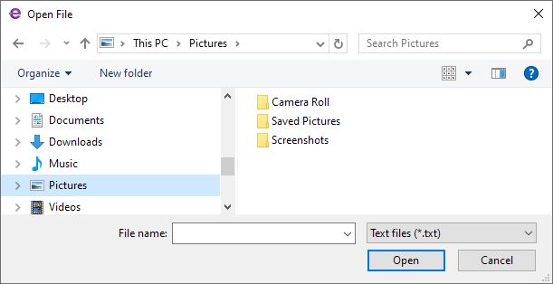
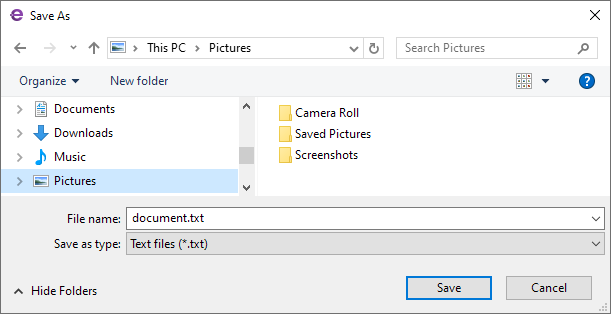

# IOpenFileDialogService 和 ISaveFileDialogService {#iopenfiledialogservice-and-isavefiledialogservice}

[`IOpenFileDialogService`](../../API/Eremex.AvaloniaUI.Controls.ApplicationServices/IOpenFileDialogService.md) 和 [`ISaveFileDialogService`](../../API/Eremex.AvaloniaUI.Controls.ApplicationServices/ISaveFileDialogService.md) 提供了一种与平台无关的方式，用于从 ViewModel 中显示系统的"打开文件"和"保存文件"对话框。ViewModel 与 Avalonia 窗口类型完全解耦。






主要功能包括：

- 平台的"打开文件"和"保存文件"对话框 — 这些服务显示由操作系统提供的文件选择器。
- 同步和异步版本 — 每个服务都提供同步的 `Show` 方法和异步的 `ShowAsync` 方法。 
- 可配置的文件对话框选项 — 您可以自定义文件对话框的标题、文件类型筛选器、起始文件夹、建议的文件名、默认扩展名、覆盖提示以及多选模式。
- 自动设置所有者 — 通过 [`IWindowsManager`](../../API/Eremex.AvaloniaUI.Controls.ApplicationServices/IWindowsManager.md) 服务解析得到的应用程序活动窗口将成为对话框的所有者。

## 接口定义 {#interface-definitions}

### IOpenFileDialogService {#iopenfiledialogservice}

```csharp
public interface IOpenFileDialogService
{
    // Show an Open File dialog and block the calling thread until the user closes the dialog.
    string[] Show(IWindow? owner = null, OpenFileDialogOptions? options = null);

    // Show an Open File dialog without blocking the calling thread.
    Task<string[]> ShowAsync(IWindow? owner = null, OpenFileDialogOptions? options = null);
}
```

| 参数 | 类型 | 说明 |
|-----------|------|-------------|
| `owner` | `IWindow?` | 对话框的所有者。此参数为 `null` 时，应用程序的活动窗口将成为对话框的所有者。 |
| `options` | `OpenFileDialogOptions?` | 对话框配置选项，包括标题、筛选器、起始文件夹、多选等。此参数为 `null` 时，将应用平台默认选项。 |

**返回值：**

- `Show` — 返回所选文件的路径；如果用户取消了对话框或无法解析所有者窗口，则返回空数组。
- `ShowAsync` — 返回一个在对话框关闭时完成的任务，其中包含所选文件的路径。如果用户取消了对话框，则返回空数组。


### ISaveFileDialogService {#isavefiledialogservice}

```csharp
public interface ISaveFileDialogService
{
    // Show a Save File dialog and block the calling thread until the user closes the dialog.
    string? Show(IWindow? owner = null, SaveFileDialogOptions? options = null);

    // Show a Save File dialog without blocking the calling thread.
    Task<string?> ShowAsync(IWindow? owner = null, SaveFileDialogOptions? options = null);
}
```

| 参数 | 类型 | 说明 |
|-----------|------|-------------|
| `owner` | `IWindow?` | 对话框的所有者。此参数为 `null` 时，应用程序的活动窗口将成为对话框的所有者。 |
| `options` | `SaveFileDialogOptions?` | 对话框配置选项，包括标题、筛选器、起始文件夹、建议的文件名。此参数为 `null` 时，将应用平台默认选项。 |

**返回值：**

- `Show` — 返回所选路径；如果用户取消了对话框或无法解析所有者窗口，则返回 `null`。
- `ShowAsync` — 返回一个在对话框关闭时完成的任务，其中包含所选路径；如果用户取消了对话框，则为 `null`。


### 对话框所有者 {#dialog-owner}

`Show` 和 `ShowAsync` 方法的 `owner` 参数的类型为 [`IWindow`](../../API/Eremex.AvaloniaUI.Controls.ApplicationServices/IWindow.md)。[`IWindow`](../../API/Eremex.AvaloniaUI.Controls.ApplicationServices/IWindow.md) 接口是对窗口的抽象，不会将您的代码与 Avalonia 窗口类型绑定。服务实现会在内部将其转换为实际的 Avalonia `Window`。要在代码中获取表示当前活动窗口的 [`IWindow`](../../API/Eremex.AvaloniaUI.Controls.ApplicationServices/IWindow.md) 对象，可以使用 [`IWindowsManager`](../../API/Eremex.AvaloniaUI.Controls.ApplicationServices/IWindowsManager.md) 服务。


## 选项 {#options}

### OpenFileDialogOptions {#openfiledialogoptions}

调用 [`IOpenFileDialogService`](../../API/Eremex.AvaloniaUI.Controls.ApplicationServices/IOpenFileDialogService.md) 的 `Show` 和 `ShowAsync` 方法时，可以使用 `options` 参数自定义文件对话框选项。该参数的类型为 [`OpenFileDialogOptions`](../../API/Eremex.AvaloniaUI.Controls.ApplicationServices/OpenFileDialogOptions.md) 类。

```csharp
public class OpenFileDialogOptions
{
    public string? Title { get; set; }
    public bool? AllowMultiple { get; set; }
    public string? DefaultFolder { get; set; }
    public string? Filter { get; set; }
}
```

| 属性 | 说明 |
|----------|-------------|
| [`Title`](../../API/Eremex.AvaloniaUI.Controls.ApplicationServices/OpenFileDialogOptions/Title.md) | 对话框的标题。 |
| [`AllowMultiple`](../../API/Eremex.AvaloniaUI.Controls.ApplicationServices/OpenFileDialogOptions/AllowMultiple.md) | 设置为 `true` 时，允许用户一次选择多个文件。默认为 `false`。 |
| [`DefaultFolder`](../../API/Eremex.AvaloniaUI.Controls.ApplicationServices/OpenFileDialogOptions/DefaultFolder.md) | 对话框最初显示的文件夹的完整路径。 |
| [`Filter`](../../API/Eremex.AvaloniaUI.Controls.ApplicationServices/OpenFileDialogOptions/Filter.md) | 文件类型筛选器。未设置时显示所有文件。示例：`"Images\|*.png;*.jpg\|All files\|*.*"`。 |

### SaveFileDialogOptions {#savefiledialogoptions}

```csharp
public class SaveFileDialogOptions
{
    public string? Title { get; set; }
    public string? Filter { get; set; }
    public IReadOnlyList<FileDialogFileType>? FilterFileTypes { get; set; }
    public string? DefaultFolder { get; set; }
    public FileDialogFolder? DefaultWellKnownFolder { get; set; }
    public string? DefaultExtension { get; set; }
    public string? InitialFileName { get; set; }
    public bool ShowOverwritePrompt { get; set; }
}
```

| 属性 | 说明 |
|----------|-------------|
| [`Title`](../../API/Eremex.AvaloniaUI.Controls.ApplicationServices/OpenFileDialogOptions/Title.md) | 对话框的标题。 |
| [`Filter`](../../API/Eremex.AvaloniaUI.Controls.ApplicationServices/OpenFileDialogOptions/Filter.md) | 字符串形式的文件类型筛选器。示例：`"Images\|*.png;*.jpg\|All files\|*.*"`。使用 `FilterFileTypes` 时将忽略此属性。 |
| `FilterFileTypes` | 以 [`FileDialogFileType`](../../API/Eremex.AvaloniaUI.Controls.ApplicationServices/FileDialogFileType.md) 对象集合形式表示的文件类型筛选器。设置后优先于 [`Filter`](../../API/Eremex.AvaloniaUI.Controls.ApplicationServices/OpenFileDialogOptions/Filter.md)。 |
| [`DefaultFolder`](../../API/Eremex.AvaloniaUI.Controls.ApplicationServices/OpenFileDialogOptions/DefaultFolder.md) | 以完整路径表示的默认文件夹。优先于 `DefaultWellKnownFolder`。 |
| `DefaultWellKnownFolder` | 以已知文件夹表示的默认文件夹：Desktop、Documents、Downloads、Music、Pictures 或 Videos。设置了 [`DefaultFolder`](../../API/Eremex.AvaloniaUI.Controls.ApplicationServices/OpenFileDialogOptions/DefaultFolder.md) 时将忽略此属性。 |
| `DefaultExtension` | 不含点或通配符的默认文件扩展名。示例：`"xml"`。 |
| `InitialFileName` | 对话框中建议的初始文件名。 |
| `ShowOverwritePrompt` | 此属性为 `true` 时，如果目标文件已存在，对话框会向用户发出警告。 |


## 如何使用文件对话框服务 {#how-to-use-the-file-dialog-services}

在 ViewModel 中，调用文件对话框服务的 `Show` 或 `ShowAsync`。通过这些方法的返回值可以获取用户所选的一个或多个路径。

### 访问服务 {#access-the-service}

在 ViewModel 中访问 [`IOpenFileDialogService`](../../API/Eremex.AvaloniaUI.Controls.ApplicationServices/IOpenFileDialogService.md) 或 [`ISaveFileDialogService`](../../API/Eremex.AvaloniaUI.Controls.ApplicationServices/ISaveFileDialogService.md) 对象有两种方式：

- 通过 `Service<T>()` 辅助方法。这是获取 Eremex Controls 库附带的已注册应用程序服务的便捷方法。
- 通过构造函数注入。

#### Service<T>() 辅助方法 {#service-helper}

在 ViewModel 中实现一个 `Service<T>()` 辅助方法，通过静态方法 `ApplicationServicesContext.GetRequiredService<T>()` 获取所请求的服务。

```csharp
using Eremex.AvaloniaUI.Controls.ApplicationServices;
using CommunityToolkit.Mvvm.Input;

public partial class MyViewModel : ObservableObject
{
    // Provides access to any registered service
    protected static T Service<T>() where T : class
        => ApplicationServicesContext.GetRequiredService<T>();

    [RelayCommand]
    private async Task OpenFile()
    {
        var files = await Service<IOpenFileDialogService>().ShowAsync(
            options: new OpenFileDialogOptions
            {
                Title = "Open file",
                Filter = "Text files|*.txt|All files|*.*",
            });
    }
}
```

在 App.axaml.cs 文件中，确保按如下方式使用 [`SimpleServiceProvider`](../../API/Eremex.AvaloniaUI.Controls.ApplicationServices/SimpleServiceProvider.md) 和 [`ApplicationServicesContext`](../../API/Eremex.AvaloniaUI.Controls.ApplicationServices/ApplicationServicesContext.md) 注册 Eremex 应用程序服务：

```csharp
public class App : Application
{
    public override void OnFrameworkInitializationCompleted()
    {
        RegisterApplicationServices();
        //...
    }

    static void RegisterApplicationServices()
    {
        // Register built-in services.
        var serviceProvider = new SimpleServiceProvider();
        ApplicationServicesContext.RegisterApplicationServices(serviceProvider.AddSingleton);
        ApplicationServicesContext.SetCurrent(serviceProvider);
    }
}
```

#### 构造函数注入 {#constructor-injection}

在 ViewModel 中实现一个以服务为参数的构造函数。实例化 ViewModel 时，将服务对象传递给该构造函数。

```csharp
public partial class MyViewModel
{
    private readonly IOpenFileDialogService _openFileDialogService;

    public MyViewModel(IOpenFileDialogService openFileDialogService)
    {
        _openFileDialogService = openFileDialogService;
    }

    [RelayCommand]
    private async Task OpenFile()
    {
        var files = await _openFileDialogService.ShowAsync(
            options: new OpenFileDialogOptions
            {
                Title = "Open file",
                Filter = "Text files|*.txt|All files|*.*",
            });
    }
}
```

### 示例 - 同步打开文件 {#example-open-a-file-synchronously}

```csharp
[RelayCommand]
private void OpenFileSync()
{
    var files = Service<IOpenFileDialogService>().Show(options: new OpenFileDialogOptions
    {
        Title = "Open File",
        Filter = "Images|*.png;*.jpg|All files|*.*"
    });
    
}
```

### 示例 - 异步打开文件 {#example-open-a-file-asynchronously}

```csharp
[RelayCommand]
private async Task OpenFileAsync()
{
    var files = await Service<IOpenFileDialogService>().ShowAsync(options: new OpenFileDialogOptions
    {
        Title = "Open File",
        Filter = "Text files|*.txt|All files|*.*"
    });
}
```

### 示例 - 打开多个文件 {#example-open-multiple-files}

将 [`OpenFileDialogOptions.AllowMultiple`](../../API/Eremex.AvaloniaUI.Controls.ApplicationServices/OpenFileDialogOptions/AllowMultiple.md) 属性设置为 `true`，以允许用户选择多个文件。

```csharp
[RelayCommand]
private void OpenMultipleFilesSync()
{
    var files = Service<IOpenFileDialogService>().Show(options: new OpenFileDialogOptions
    {
        Title = "Open File",
        AllowMultiple = true,
        Filter = "Text files|*.txt|All files|*.*"
    });
}
```

### 示例 - 同步保存文件 {#example-save-a-file-synchronously}

```csharp
[RelayCommand]
private void SaveFileSync()
{
    var path = Service<ISaveFileDialogService>().Show(options: new SaveFileDialogOptions
    {
        Title = "Save File",
        Filter = "Images|*.png;*.jpg|All files|*.*"
    });
    
}
```

### 示例 - 异步保存文件 {#example-save-a-file-asynchronously}

```csharp
[RelayCommand]
private async Task SaveFileAsync()
{
    var path = await Service<ISaveFileDialogService>().ShowAsync(options: new SaveFileDialogOptions
    {
        Title = "Save File",
        Filter = "Text files|*.txt|All files|*.*",
        DefaultExtension = "txt",
        InitialFileName = "document.txt",
        ShowOverwritePrompt = true,
    });

}
```

<br>
<br>

<sup>*</sup> 本页面使用机器翻译技术翻译。
