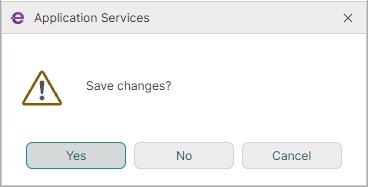

# IMessageBoxService {#imessageboxservice}

[`IMessageBoxService`](../../API/Eremex.AvaloniaUI.Controls.ApplicationServices/IMessageBoxService.md) 提供了一种与平台无关的方式，用于从 ViewModel 中显示标准消息框。ViewModel 与 Avalonia 窗口类型完全解耦。



主要功能包括：

- 固定按钮集 — 消息框可以显示由 [`MessageBoxButtons`](../../API/Eremex.AvaloniaUI.Controls/MessageBoxButtons.md) 枚举定义的固定按钮集（例如 Ok、Ok&vert;Cancel、Yes&vert;No&vert;Cancel、Yes&vert;No、Abort&vert;Retry&vert;Ignore 和 Retry&vert;Cancel）
- 自动解析所有者 — 该服务可以通过 [`IWindowsManager`](../../API/Eremex.AvaloniaUI.Controls.ApplicationServices/IWindowsManager.md) 服务自动解析所有者窗口。需要时，您也可以为消息框显式指定所有者。
- 获取消息框结果 — 消息框关闭后，会返回由 [`DialogResult`](../../API/Eremex.AvaloniaUI.Controls.ApplicationServices/DialogResult.md) 枚举指定的结果。


## 接口定义 {#interface-definition}

```csharp
public interface IMessageBoxService
{
    // Show a message box with an explicit owner.
    DialogResult Show(IWindow? owner, string text, string caption, MessageBoxButtons buttons, MessageBoxIcon icon);
    
    // Show a message box with the default owner (the active window detected through the `IWindowsManager` service).
    DialogResult Show(string text, string caption, MessageBoxButtons buttons, MessageBoxIcon icon);
}
```


## 使用 IMessageBoxService {#use-imessageboxservice}

在 ViewModel 中，调用服务对象的 [`IMessageBoxService.Show`](../../API/Eremex.AvaloniaUI.Controls.ApplicationServices/IMessageBoxService/Show.md) 方法以显示消息框。该方法返回消息框结果（用户按下的按钮）。

不带 _owner_ 参数的 [`IMessageBoxService.Show`](../../API/Eremex.AvaloniaUI.Controls.ApplicationServices/IMessageBoxService/Show.md) 方法会将活动窗口指定为消息框的所有者。活动窗口通过 [`IWindowsManager`](../../API/Eremex.AvaloniaUI.Controls.ApplicationServices/IWindowsManager.md) 服务获取。

### 访问服务 {#access-the-service}

在 ViewModel 中访问 [`IMessageBoxService`](../../API/Eremex.AvaloniaUI.Controls.ApplicationServices/IMessageBoxService.md) 对象有两种方式：

- 通过 `Service<T>()` 辅助方法。这是获取 Eremex Controls 库附带的已注册应用程序服务的便捷方法。
- 通过构造函数注入。


#### Service<T>() 辅助方法 {#service-helper}

在 ViewModel 中实现一个 `Service<T>()` 辅助方法，通过静态方法 `ApplicationServicesContext.GetRequiredService<T>()` 返回所请求的服务。

```csharp
using Eremex.AvaloniaUI.Controls.ApplicationServices;
using CommunityToolkit.Mvvm.Input;

public partial class MyViewModel : ObservableObject
{

    // Provides access to any registered service
    protected static T Service<T>() where T : class
        => ApplicationServicesContext.GetRequiredService<T>();

    [RelayCommand]
    private void ShowInformation()
    {
        // Resolve the service directly from the Service<T>() method
        var result = Service<IMessageBoxService>()
            .Show("Save changes?", "Question",
                  MessageBoxButtons.Ok, MessageBoxIcon.Question);
    }
}
```

在 App.axaml.cs 文件中，确保按如下方式使用 [`SimpleServiceProvider`](../../API/Eremex.AvaloniaUI.Controls.ApplicationServices/SimpleServiceProvider.md) 和 [`ApplicationServicesContext`](../../API/Eremex.AvaloniaUI.Controls.ApplicationServices/ApplicationServicesContext.md) 注册 Eremex 应用程序服务：

```csharp
public class App : Application
{
    public override void OnFrameworkInitializationCompleted()
    {
        RegisterApplicationServices();
        //...
    }

    static void RegisterApplicationServices()
    {
        // Register built-in services.
        var serviceProvider = new SimpleServiceProvider();
        ApplicationServicesContext.RegisterApplicationServices(serviceProvider.AddSingleton);
        ApplicationServicesContext.SetCurrent(serviceProvider);
    }

}
```

#### 构造函数注入 {#constructor-injection}

在 ViewModel 中实现一个以 [`IMessageBoxService`](../../API/Eremex.AvaloniaUI.Controls.ApplicationServices/IMessageBoxService.md) 为参数的构造函数。实例化 ViewModel 时，将服务对象传递给该构造函数。

```csharp
public partial class MyViewModel
{
    private readonly IMessageBoxService _messageBoxService;
    public MyViewModel(IMessageBoxService messageBoxService)
    {
        _messageBoxService = messageBoxService;
    }
    [RelayCommand]
    private void ShowMessage()
    {
        var result = _messageBoxService.Show(
            "Save changes?", "Question", MessageBoxButtons.Ok, MessageBoxIcon.Question
        );
        //...
    }
}
```


对于带有自定义按钮标题的消息框，请改用 [`IChoiceDialogService`](../../API/Eremex.AvaloniaUI.Controls.ApplicationServices/IChoiceDialogService.md)。对于完全自定义的对话框，请使用 [`IDialogService`](../../API/Eremex.AvaloniaUI.Controls.ApplicationServices/IDialogService.md)。

<br>
<br>

<sup>*</sup> 本页面使用机器翻译技术翻译。
