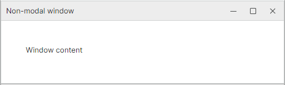

# IWindowService {#iwindowservice}

[`IWindowService`](../../API/Eremex.AvaloniaUI.Controls.ApplicationServices/IWindowService.md) 提供了一种与平台无关的方式，用于从 ViewModel 中显示非模态窗口。ViewModel 与 Avalonia 窗口类型完全解耦。

<!-- TODO
image
app-services-iwindowservice
-->

主要功能包括：

- 显示非模态窗口。
- 由 ViewModel 驱动的窗口 — 所显示的窗口由自定义 ViewModel 定义。您可以使用 ViewModel 的 [`Content`](../../API/Eremex.AvaloniaUI.Controls.ApplicationServices/WindowAwareViewModel/Content.md) 属性，或使用应用于窗口 ViewModel 的 [`ViewLocatorAttribute`](../../API/Eremex.AvaloniaUI.Controls.ApplicationServices/ViewLocatorAttribute.md) 来指定目标窗口的内容。
- 自动设置所有者 — 应用程序的活动窗口将成为目标窗口的所有者。活动窗口通过 [`IWindowsManager`](../../API/Eremex.AvaloniaUI.Controls.ApplicationServices/IWindowsManager.md) 服务自动解析。


## 接口定义 {#interface-definition}

```csharp
public interface IWindowService
{
    // Show a non-modal window driven by a ViewModel.
    void Show<T>(T viewModel, string? caption = null)
        where T : IWindowAwareViewModel;
}
```

| 参数 | 类型 | 说明 |
|-----------|------|-------------|
| `viewModel` | `T` | 要显示的目标窗口的 ViewModel。`viewModel` 对象必须实现 [`IWindowAwareViewModel`](../../API/Eremex.AvaloniaUI.Controls.ApplicationServices/IWindowAwareViewModel.md) 接口。您可以从 [`WindowAwareViewModel`](../../API/Eremex.AvaloniaUI.Controls.ApplicationServices/WindowAwareViewModel.md) 类派生窗口的 ViewModel，该类已实现此接口并增加了 View 定位基础结构。 |
| `caption` | `string?` | 窗口标题。设置为 `null` 时，标题取自 ViewModel 的 `Title` 属性（[`IWindowAwareViewModel.Title`](../../API/Eremex.AvaloniaUI.Controls.ApplicationServices/IWindowAwareViewModel/Title.md)）。 |

[`Show`](../../API/Eremex.AvaloniaUI.Controls.ApplicationServices/WindowService/Show.md) 方法在显示窗口后立即返回，不会等待窗口关闭。

**异常：**

- `ArgumentNullException` — 如果 `viewModel` 参数为 `null`。


## 如何使用 IWindowService {#how-to-use-iwindowservice}

1. 为目标非模态窗口创建一个 ViewModel。例如，可以从 [`WindowAwareViewModel`](../../API/Eremex.AvaloniaUI.Controls.ApplicationServices/WindowAwareViewModel.md) 类派生。
2. 使用以下方式之一指定目标窗口的内容：
    
    - 定义一个表示目标窗口内容的 View（`UserControl`）。为 ViewModel 设置 [`ViewLocatorAttribute`](../../API/Eremex.AvaloniaUI.Controls.ApplicationServices/ViewLocatorAttribute.md)，将该 ViewModel 与所创建的 View 关联起来。
    - 显式设置窗口 ViewModel 的 [`Content`](../../API/Eremex.AvaloniaUI.Controls.ApplicationServices/WindowAwareViewModel/Content.md) 属性（[`WindowAwareViewModel.Content`](../../API/Eremex.AvaloniaUI.Controls.ApplicationServices/WindowAwareViewModel/Content.md)）。

3. 在需要显示目标窗口的 ViewModel 中，调用 [`IWindowService.Show`](../../API/Eremex.AvaloniaUI.Controls.ApplicationServices/IWindowService/Show.md) 方法，并将目标窗口的 ViewModel 传递给 [`Show`](../../API/Eremex.AvaloniaUI.Controls.ApplicationServices/WindowService/Show.md) 方法。[`Show`](../../API/Eremex.AvaloniaUI.Controls.ApplicationServices/WindowService/Show.md) 方法会立即返回，所显示的窗口将保持打开，直到用户将其关闭。

### 访问服务 {#access-the-service}

在 ViewModel 中访问 [`IWindowService`](../../API/Eremex.AvaloniaUI.Controls.ApplicationServices/IWindowService.md) 对象有两种方式：

- 通过 `Service<T>()` 辅助方法。这是获取 Eremex Controls 库附带的已注册应用程序服务的便捷方法。
- 通过构造函数注入。

#### Service<T>() 辅助方法 {#service-helper}

在 ViewModel 中实现一个 `Service<T>()` 辅助方法，通过静态方法 `ApplicationServicesContext.GetRequiredService<T>()` 获取所请求的服务。

```csharp
using Eremex.AvaloniaUI.Controls.ApplicationServices;
using CommunityToolkit.Mvvm.Input;

public partial class MyViewModel : ObservableObject
{
    // Provides access to any registered service
    protected static T Service<T>() where T : class
        => ApplicationServicesContext.GetRequiredService<T>();

    [RelayCommand]
    private void ShowWindow()
    {
        // Resolve the service and show the window
        Service<IWindowService>().Show(
            new MyWindowViewModel("Non-modal window"));
    }
}
```

在 App.axaml.cs 文件中，确保按如下方式使用 [`SimpleServiceProvider`](../../API/Eremex.AvaloniaUI.Controls.ApplicationServices/SimpleServiceProvider.md) 和 [`ApplicationServicesContext`](../../API/Eremex.AvaloniaUI.Controls.ApplicationServices/ApplicationServicesContext.md) 注册 Eremex 应用程序服务：

```csharp
public class App : Application
{
    public override void OnFrameworkInitializationCompleted()
    {
        RegisterApplicationServices();
        //...
    }

    static void RegisterApplicationServices()
    {
        // Register built-in services.
        var serviceProvider = new SimpleServiceProvider();
        ApplicationServicesContext.RegisterApplicationServices(serviceProvider.AddSingleton);
        ApplicationServicesContext.SetCurrent(serviceProvider);
    }
}
```

#### 构造函数注入 {#constructor-injection}

在 ViewModel 中实现一个以 [`IWindowService`](../../API/Eremex.AvaloniaUI.Controls.ApplicationServices/IWindowService.md) 为参数的构造函数。实例化 ViewModel 时，将服务对象传递给该构造函数。

```csharp
public partial class MyViewModel
{
    private readonly IWindowService _windowService;

    public MyViewModel(IWindowService windowService)
    {
        _windowService = windowService;
    }

    [RelayCommand]
    private void ShowWindow()
    {
        _windowService.Show(new MyWindowViewModel("Non-modal window"));
    }
}
```

### 创建窗口的 ViewModel {#create-a-windows-viewmodel}

您需要为要显示的非模态窗口创建一个 ViewModel。该 ViewModel 必须实现 [`IWindowAwareViewModel`](../../API/Eremex.AvaloniaUI.Controls.ApplicationServices/IWindowAwareViewModel.md) 接口。最简单的方法是从 [`WindowAwareViewModel`](../../API/Eremex.AvaloniaUI.Controls.ApplicationServices/WindowAwareViewModel.md) 类派生 ViewModel，该类已实现 [`IWindowAwareViewModel`](../../API/Eremex.AvaloniaUI.Controls.ApplicationServices/IWindowAwareViewModel.md) 接口并负责 View 定位。


#### 使用 ViewLocatorAttribute 定义窗口内容 {#define-the-windows-content-using-viewlocatorattribute}

1. 创建一个 View（`UserControl`），其中包含要在目标窗口中显示的控件。
2. 使用 [`ViewLocatorAttribute`](../../API/Eremex.AvaloniaUI.Controls.ApplicationServices/ViewLocatorAttribute.md) 修饰窗口的 ViewModel，并传入 View 的类型。

调用 [`IWindowService.Show`](../../API/Eremex.AvaloniaUI.Controls.ApplicationServices/IWindowService/Show.md) 方法时，ViewModel 会创建一个 Avalonia 窗口，实例化指定的 View（`UserControl`），并将其作为窗口内容放入窗口中。ViewModel 永远无需直接引用 View 类型。


#### 示例 {#example}

以下示例使用 [`IWindowService`](../../API/Eremex.AvaloniaUI.Controls.ApplicationServices/IWindowService.md) 服务显示一个非模态窗口，其内容由自定义 View 指定。
完整代码请参阅 [演示应用程序](../../index.md#demo-application) 应用程序。




**非模态窗口的 ViewModel**

```csharp
using Eremex.AvaloniaUI.Controls.ApplicationServices;

[ViewLocator(typeof(WindowServiceWindowView))]
public class WindowServiceWindowViewModel : WindowAwareViewModel
{
    private string statusText;

    public string StatusText
    {
        get => statusText;
        private set
        {
            if (statusText == value)
                return;

            statusText = value;
            OnPropertyChanged(nameof(StatusText));
        }
    }
}
```

**非模态窗口的内容（View）**

```xml
<UserControl x:Class="DemoCenter.Views.ApplicationServices.WindowServiceWindowView"
             xmlns="https://github.com/avaloniaui"
             xmlns:x="http://schemas.microsoft.com/winfx/2006/xaml"
             xmlns:vm="using:DemoCenter.ViewModels.ApplicationServices"
             x:CompileBindings="True"
             x:DataType="vm:WindowServiceWindowViewModel"
             MinWidth="420">

    <StackPanel Margin="20" Spacing="12">
        <TextBlock Text="Window content"
                   TextWrapping="Wrap" />
        
    </StackPanel>
</UserControl>
```

**显示窗口**

```csharp
[RelayCommand]
private void ShowWindow()
{
    string windowTitle = "Non-modal window";
    Service<IWindowService>().Show(new WindowServiceWindowViewModel(windowTitle));
}
```

#### 直接定义窗口内容 {#define-the-windows-content-directly}

使用 ViewModel 的 [`Content`](../../API/Eremex.AvaloniaUI.Controls.ApplicationServices/WindowAwareViewModel/Content.md) 属性（[`WindowAwareViewModel.Content`](../../API/Eremex.AvaloniaUI.Controls.ApplicationServices/WindowAwareViewModel/Content.md)）显式提供窗口内容。


```csharp
using Eremex.AvaloniaUI.Controls.ApplicationServices;

public class MyWindowViewModel : WindowAwareViewModel
{
    public MyWindowViewModel(string title) : base(title)
    {
        Content = "Window content";
    }
}
```

要显示此窗口，请使用以下代码：

```csharp
Service<IWindowService>().Show(new MyWindowViewModel("Non-modal window"));
```

### 窗口标题 {#windows-title}

可以使用以下方式之一指定窗口标题：

1. 设置 [`IWindowService.Show`](../../API/Eremex.AvaloniaUI.Controls.ApplicationServices/IWindowService/Show.md) 方法的 `caption` 参数。
2. 设置窗口 ViewModel 的 `Title` 属性。当 [`IWindowService.Show`](../../API/Eremex.AvaloniaUI.Controls.ApplicationServices/IWindowService/Show.md) 方法的 `caption` 参数为 `null` 时，此属性生效。


### 所有者窗口 {#owner-window}

所有者通过 [`IWindowsManager`](../../API/Eremex.AvaloniaUI.Controls.ApplicationServices/IWindowsManager.md) 服务自动确定。该服务返回的应用程序活动窗口将成为目标窗口的所有者。

<br>
<br>

<sup>*</sup> 本页面使用机器翻译技术翻译。
