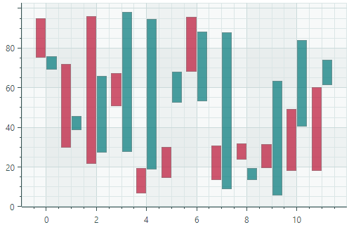

# 并排范围条形系列视图 {#side-by-side-range-bar-series-view}

并排范围条系列视图 ([`CartesianSideBySideRangeBarSeriesView`](../../../API/Eremex.AvaloniaUI.Charts/CartesianSideBySideRangeBarSeriesView.md)) 在数据系列的两个 Y 值之间绘制矩形条。

## 并排范围条形系列视图的数据 {#data-for-the-side-by-side-range-bar-series-view}

您可以使用以下数据适配器为并排范围条形系列视图提供数据：

数字 _X_ 值：

- [`NumericRangeDataAdapter`](../../../API/Eremex.AvaloniaUI.Charts/NumericRangeDataAdapter.md)

日期和时间 _X_ 值：

- [`DateTimeRangeDataAdapter`](../../../API/Eremex.AvaloniaUI.Charts/DateTimeRangeDataAdapter.md)
- [`TimeSpanRangeDataAdapter`](../../../API/Eremex.AvaloniaUI.Charts/TimeSpanRangeDataAdapter.md)

定性 _X_ 值：

- [`QualitativeRangeDataAdapter`](../../../API/Eremex.AvaloniaUI.Charts/QualitativeRangeDataAdapter.md)

 
 

* 本页面使用机器翻译技术翻译。
