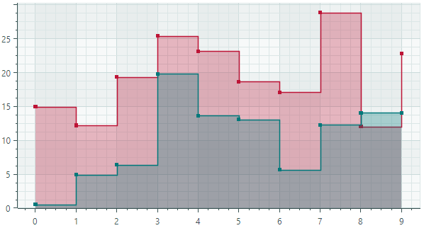
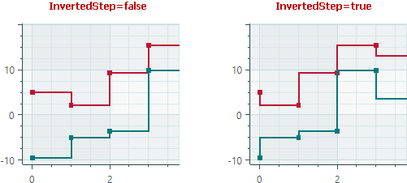

# 阶梯面积系列视图 {#step-area-series-view}

阶梯面积系列视图（Step Area Series View，[`CartesianStepAreaSeriesView`](../../../API/Eremex.AvaloniaUI.Charts/CartesianStepAreaSeriesView.md)）使用水平和垂直线段连接各点，并绘制填充区域。



## 阶梯面积系列视图的数据 {#data-for-the-step-area-series-view}

可以使用以下数据适配器为阶梯面积系列视图提供数据：

数值型 _X_ 值：

- [`SortedNumericDataAdapter`](../../../API/Eremex.AvaloniaUI.Charts/SortedNumericDataAdapter.md)
- [`FormulaDataAdapter`](../../../API/Eremex.AvaloniaUI.Charts/FormulaDataAdapter.md)

日期和时间型 _X_ 值：

- [`SortedDateTimeDataAdapter`](../../../API/Eremex.AvaloniaUI.Charts/SortedDateTimeDataAdapter.md)
- [`SortedTimeSpanDataAdapter`](../../../API/Eremex.AvaloniaUI.Charts/SortedTimeSpanDataAdapter.md)

定性 _X_ 值：

- [`QualitativeDataAdapter`](../../../API/Eremex.AvaloniaUI.Charts/QualitativeDataAdapter.md)

## 阶梯面积系列视图设置 {#step-area-series-view-settings}

- [`Color`](../../../API/Eremex.AvaloniaUI.Charts/CartesianPointSeriesView/Color.md) — 指定绘制系列所用的颜色。
- [`CrosshairMode`](../../../API/Eremex.AvaloniaUI.Charts/CartesianSortedLineSeriesView/CrosshairMode.md) — 指定十字线的图表标签是吸附到最近的数据点，还是显示插值。请参阅[在十字线图表标签中显示精确值或插值](../crosshair.md#show-an-exact-or-interpolated-value-in-crosshair-series-labels)。
- [`InvertedStep`](../../../API/Eremex.AvaloniaUI.Charts/CartesianStepLineSeriesView/InvertedStep.md) — 指定相邻数据点之间阶梯线段的绘制顺序。如果 [`InvertedStep`](../../../API/Eremex.AvaloniaUI.Charts/CartesianStepLineSeriesView/InvertedStep.md) 为 `false`（默认值），阶梯先绘制水平线段，再绘制垂直线段。如果 [`InvertedStep`](../../../API/Eremex.AvaloniaUI.Charts/CartesianStepLineSeriesView/InvertedStep.md) 为 `true`，阶梯先绘制垂直线段，再绘制水平线段。

    

- [`MarkerImage`](../../../API/Eremex.AvaloniaUI.Charts/CartesianPointSeriesView/MarkerImage.md) — 获取或设置用作自定义点标记的图像。如果未指定图像，则显示默认的方形标记。可以使用 `SvgImage` 类的实例指定 SVG 图像。

    [`MarkerImage`](../../../API/Eremex.AvaloniaUI.Charts/CartesianPointSeriesView/MarkerImage.md) 属性使用 `[Content]` 特性声明，因此可以直接在 &lt;CartesianStepAreaSeriesView&gt; 标记之间定义图像。

    ``` xml
    <mxc:CartesianStepAreaSeriesView>
        <SvgImage Source="avares://Demo/Assets/circle.svg" />
    </mxc:CartesianStepAreaSeriesView>
    ```

    SVG 文件为 SVG 元素预定义了颜色。要使这些颜色与数据系列的颜色一致，可以采用以下任一方法：
    
    - 事先手动编辑源 SVG 图像文件
    - 使用 [`MarkerImageCss`](../../../API/Eremex.AvaloniaUI.Charts/CartesianPointSeriesView/MarkerImageCss.md) 属性动态自定义 SVG 元素的[样式](https://developer.mozilla.org/en-US/docs/Web/SVG/Reference/Element/style)。这些样式在渲染点标记时应用。

- [`MarkerImageCss`](../../../API/Eremex.AvaloniaUI.Charts/CartesianPointSeriesView/MarkerImageCss.md) — 指定 [CSS 样式](https://developer.mozilla.org/en-US/docs/Web/SVG/Reference/Element/style)，用于在运行时自定义由 [`MarkerImage`](../../../API/Eremex.AvaloniaUI.Charts/CartesianPointSeriesView/MarkerImage.md) 属性定义的 SVG 图像。主要用途是将 SVG 元素的颜色替换为系列颜色（[`Color`](../../../API/Eremex.AvaloniaUI.Charts/CartesianPointSeriesView/Color.md)）。在 CSS 代码中使用 `{0}` 占位符插入 [`Color`](../../../API/Eremex.AvaloniaUI.Charts/CartesianPointSeriesView/Color.md) 属性的值。

    例如，当 [`MarkerImage`](../../../API/Eremex.AvaloniaUI.Charts/CartesianPointSeriesView/MarkerImage.md) 属性包含带有 circle 元素的 SVG 图像时，以下 CSS 代码将 `circle` 设置为橙色填充（使用系列颜色）和深红色边框：

    ``` xml
    <mxc:CartesianStepAreaSeriesView Color="orange" MarkerImageCss="circle {{fill:{0};stroke:darkred;}}">
        <SvgImage Source="avares://Demo/Assets/circle.svg" />
    </mxc:CartesianStepAreaSeriesView>
    ```
    
    另请参阅：[示例 - 创建棒棒糖系列视图并使用自定义 SVG 标记](lollipop-series-view.md#example-create-a-lollipop-series-view-and-use-custom-svg-data-point-markers)。

- [`MarkerSize`](../../../API/Eremex.AvaloniaUI.Charts/CartesianPointSeriesView/MarkerSize.md) — 指定点标记的大小。
- [`ShowInCrosshair`](../../../API/Eremex.AvaloniaUI.Charts/CrosshairSeriesViewBase/ShowInCrosshair.md) — 指定当前系列在十字线图表标签中是否可见。请参阅[自定义十字线的图表标签](../crosshair.md#hide-a-series-in-the-crosshair)。
- [`ShowMarkers`](../../../API/Eremex.AvaloniaUI.Charts/CartesianLineSeriesViewBase/ShowMarkers.md) — 启用或禁用点标记。
- `Thickness` — 指定线条粗细。
- [`Transparency`](../../../API/Eremex.AvaloniaUI.Charts/CartesianStepAreaSeriesView/Transparency.md) — 介于 `0` 和 `1` 之间的值，用于指定填充区域的透明度：
    - `0` 表示完全不透明
    - `1` 表示完全透明


<br>
<br>

<sup>*</sup> 本页面使用机器翻译技术翻译。
