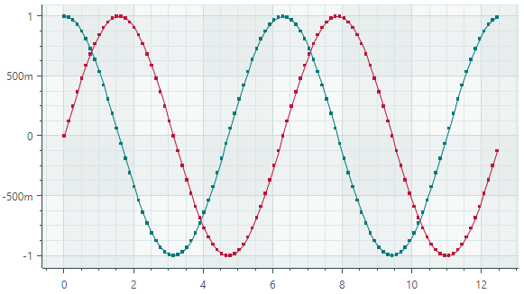
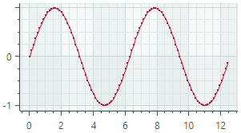
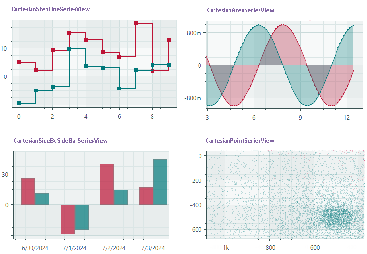

# 图表入门 - MVVM 模式 {#get-started-with-charts-mvvm-pattern}

您可以使用 MVVM 设计模式向图表控件填充数据。当您需要显示多个数据系列时，这非常有用。

本教程演示如何使用 MVVM 模式在 [`CartesianChart`](../../API/Eremex.AvaloniaUI.Charts/CartesianChart.md) 控件中创建并绘制两个折线图表。本示例中折线图表的数据是使用数学函数（正弦和余弦）计算的。 
您可以在演示应用程序的_Cartesian Chart&rarr;Line_模块中找到本教程的完整代码。



## 定义视图模型 {#define-view-models}

首先定义为图表控件提供数据和系列设置的视图模型。

- _CartesianLineSeriesViewViewModel_ — 将设置为图表控件数据上下文的主视图模型。主视图模型公开 _CartesianLineSeriesViewViewModel.Series_ 属性，该属性指定数据系列视图模型的集合。

- _SeriesViewModel_ — 数据系列的视图模型。


``` cs
// The main View Model
public partial class CartesianLineSeriesViewViewModel : ChartsPageViewModel
{
    static double Sin(double argument) => Math.Sin(argument);
    static double Cos(double argument) => Math.Cos(argument);

    const int ItemCount = 100;
    const double Step = 4 * Math.PI / ItemCount;

    // A collection of View Models used to create data series.
    [ObservableProperty] ObservableCollection<SeriesViewModel> series = new()
    {
        new SeriesViewModel { Color = Color.FromArgb(255, 189, 20, 54), DataAdapter = new FormulaDataAdapter(0, Step, ItemCount, Sin)},
        new SeriesViewModel { Color = Color.FromArgb(255, 0, 120, 122), DataAdapter = new FormulaDataAdapter(0, Step, ItemCount, Cos)},
    };
}

// A View Model for a data series.
public partial class SeriesViewModel : ObservableObject
{
    [ObservableProperty] string axisXKey;
    [ObservableProperty] string axisYKey;
    [ObservableProperty] Color color;
    [ObservableProperty] ISeriesDataAdapter dataAdapter;
}
```

_CartesianLineSeriesViewViewModel.Series_ 集合使用两个系列视图模型进行初始化。 Cartesian Chart 会将它们呈现为两个数据系列。

数据系列的视图模型 (_SeriesViewModel_) 向图表控件中的系列公开指定数据和颜色的属性：

- _Color_ — 绘制数据系列所用的颜色。
- _DataAdapter_ — 为系列提供数据的 [`ISeriesDataAdapter`](../../API/Eremex.AvaloniaUI.Charts/ISeriesDataAdapter.md) 对象。
  
Eremex 图表附带多个数据适配器，适用于各种数据类型（数字、日期时间和定性）。所有数据适配器均实现 [`ISeriesDataAdapter`](../../API/Eremex.AvaloniaUI.Charts/ISeriesDataAdapter.md) 接口。
  
本教程使用 [`Eremex.AvaloniaUI.Charts.FormulaDataAdapter`](../../API/Eremex.AvaloniaUI.Charts/FormulaDataAdapter.md) 对象。它指定一个以 _Step_ 增量返回数字 _Y_ 值的函数。
  
其他数据适配器的一些示例包括：
  - [`SortedNumericDataAdapter`](../../API/Eremex.AvaloniaUI.Charts/SortedNumericDataAdapter.md) — 供应按 _X_ 值排序的（数字 _X_、数字 _Y_）对。
  - [`QualitativeDataAdapter`](../../API/Eremex.AvaloniaUI.Charts/QualitativeDataAdapter.md) — 提供（字符串_X_，数字_Y_）对。

有关详细信息，请参阅以下主题：[笛卡尔图表](cartesian-chart.md)。

## 创建图表控件 {#create-a-chart-control}

在 XAML 中，创建 [`CartesianChart`](../../API/Eremex.AvaloniaUI.Charts/CartesianChart.md) 控件并初始化其 [`CartesianChart.SeriesSource`](../../API/Eremex.AvaloniaUI.Charts/CartesianChart/SeriesSource.md) 和 [`CartesianChart.SeriesTemplate`](../../API/Eremex.AvaloniaUI.Charts/CartesianChart/SeriesTemplate.md) 属性：

- [`CartesianChart.SeriesSource`](../../API/Eremex.AvaloniaUI.Charts/CartesianChart/SeriesSource.md) — 表示数据系列的视图模型的集合（存储 _SeriesViewModel_ 对象的 _CartesianLineSeriesViewViewModel.Series_ 集合）。
  
假设图表控件的数据上下文设置为 _CartesianLineSeriesViewViewModel_ 对象。

- [`CartesianChart.SeriesTemplate`](../../API/Eremex.AvaloniaUI.Charts/CartesianChart/SeriesTemplate.md) - 从系列视图模型创建 [`CartesianSeries`](../../API/Eremex.AvaloniaUI.Charts/CartesianSeries.md) 对象的模板。 [`CartesianSeries`](../../API/Eremex.AvaloniaUI.Charts/CartesianSeries.md) 类封装 [`CartesianChart`](../../API/Eremex.AvaloniaUI.Charts/CartesianChart.md) 控件中的单个数据系列。

``` xml
<mxc:CartesianChart Grid.Column="0" Classes="DemoChart" 
 SeriesSource="{Binding Series}" x:Name="chart1">
    <mxc:CartesianChart.SeriesTemplate>
        <DataTemplate x:DataType="vm:SeriesViewModel">
            <mxc:CartesianSeries DataAdapter="{Binding DataAdapter}">
                <mxc:CartesianLineSeriesView Color="{Binding Color}"
                                             ShowMarkers="True"
                                             MarkerSize="4">
                    <mxc:CartesianLineSeriesView.LineStyle>
                        <mxc:LineStyle Thickness="2" />
                    </mxc:CartesianLineSeriesView.LineStyle>
                </mxc:CartesianLineSeriesView>
            </mxc:CartesianSeries>
        </DataTemplate>
    </mxc:CartesianChart.SeriesTemplate>
</mxc:CartesianChart>
```

创建 [`CartesianSeries`](../../API/Eremex.AvaloniaUI.Charts/CartesianSeries.md) 对象时，初始化以下属性以指定系列数据和视图：

- [`CartesianSeries.DataAdapter`](../../API/Eremex.AvaloniaUI.Charts/Series/DataAdapter.md) — 提供数据的数据适配器。将此属性设置为视图模型中定义的 _DataAdapter_ 属性。
- [`CartesianSeries.View`](../../API/Eremex.AvaloniaUI.Charts/CartesianSeries/View.md) — 系列视图，决定数据系列的视觉表示。

## 自定义系列视图 {#customize-a-series-view}

[`CartesianSeries.View`](../../API/Eremex.AvaloniaUI.Charts/CartesianSeries/View.md) 属性指定数据系列的视觉表示。在 XAML 中，您可以指定视图作为 [`CartesianSeries`](../../API/Eremex.AvaloniaUI.Charts/CartesianSeries.md) 对象的内容。

``` xml
<mxc:CartesianSeries DataAdapter="{Binding DataAdapter}">
    <mxc:CartesianLineSeriesView Color="{Binding Color}"
                                    ShowMarkers="True"
                                    MarkerSize="4">
        <mxc:CartesianLineSeriesView.LineStyle>
            <mxc:LineStyle Thickness="2" />
        </mxc:CartesianLineSeriesView.LineStyle>
    </mxc:CartesianLineSeriesView>
</mxc:CartesianSeries>
```

在本教程中，使用 [`CartesianLineSeriesView`](../../API/Eremex.AvaloniaUI.Charts/CartesianLineSeriesView.md) 对象初始化 [`CartesianSeries.View`](../../API/Eremex.AvaloniaUI.Charts/CartesianSeries/View.md) 属性，以将数据渲染为连接底层数据点的线条。



要在项目中以不同方式呈现数据，请使用其他系列视图（[`SeriesViewBase`](../../API/Eremex.AvaloniaUI.Charts/SeriesViewBase.md) 类后代）。下面显示了可用系列视图的一些示例：




系列视图包含允许您更改系列显示样式的设置。

``` xml
<mxc:CartesianLineSeriesView Color="{Binding Color}"
                             ShowMarkers="True"
                             MarkerSize="4">
    <mxc:CartesianLineSeriesView.LineStyle>
        <mxc:LineStyle Thickness="2" />
    </mxc:CartesianLineSeriesView.LineStyle>
</mxc:CartesianLineSeriesView>                             
```

例如，[`CartesianLineSeriesView`](../../API/Eremex.AvaloniaUI.Charts/CartesianLineSeriesView.md) 类公开以下属性：

- [`Color`](../../API/Eremex.AvaloniaUI.Charts/CartesianPointSeriesView/Color.md) — 绘制系列所用的颜色。
- [`CrosshairMode`](../../API/Eremex.AvaloniaUI.Charts/CartesianSortedLineSeriesView/CrosshairMode.md) — 指定当十字线功能处于活动状态且 [`ShowInCrosshair`](../../API/Eremex.AvaloniaUI.Charts/CrosshairSeriesViewBase/ShowInCrosshair.md) 选项为 `true` 时是否显示插值 _Y_ 值或最近点的 _Y_ 值。
- [`MarkerSize`](../../API/Eremex.AvaloniaUI.Charts/CartesianPointSeriesView/MarkerSize.md) — 指定点标记的大小。
- [`MarkerImage`](../../API/Eremex.AvaloniaUI.Charts/CartesianPointSeriesView/MarkerImage.md) — 允许您指定自定义图像用作数据点标记。要分配 SVG 图像，请使用 `SvgImage` 类对象。
- [`MarkerImageCss`](../../API/Eremex.AvaloniaUI.Charts/CartesianPointSeriesView/MarkerImageCss.md) — CSS 代码，允许您自定义指定 SVG 图像 ([`MarkerImage`](../../API/Eremex.AvaloniaUI.Charts/CartesianPointSeriesView/MarkerImage.md)) 中元素的颜色。
- [`ShowInCrosshair`](../../API/Eremex.AvaloniaUI.Charts/CrosshairSeriesViewBase/ShowInCrosshair.md) — 指定是否在垂直十字线与图形的交叉点处显示图表的 _Y_ 值。
- [`ShowMarkers`](../../API/Eremex.AvaloniaUI.Charts/CartesianLineSeriesViewBase/ShowMarkers.md) — 启用或禁用点标记。
- [`LineStyle`](../../API/Eremex.AvaloniaUI.Charts/LineStyle.md) — 指定线条样式（线条粗细、虚线样式等）。

<!-- TODO
Desribe MarkerImage and MarkerImageCss in greater detail.
 -->


## 创建图表轴 {#create-chart-axes}

如果您不手动定义笛卡尔轴（X 轴和 Y 轴），[`CartesianChart`](../../API/Eremex.AvaloniaUI.Charts/CartesianChart.md) 控件会自动创建它们。如果要在 XAML 中自定义轴，请将 [`AxisX`](../../API/Eremex.AvaloniaUI.Charts/AxisX.md) 和/或 [`AxisY`](../../API/Eremex.AvaloniaUI.Charts/AxisY.md) 对象添加到 [`CartesianChart.AxesX`](../../API/Eremex.AvaloniaUI.Charts/CartesianChart/AxesX.md)/[`CartesianChart.AxesY`](../../API/Eremex.AvaloniaUI.Charts/CartesianChart/AxesY.md) 集合，然后修改轴设置。

<!-- TODO
how to define an axis for the second series

检查文本：如果您不手动定义笛卡尔轴（X 轴和 Y 轴），则会自动创建它们。如果要在 XAML 中自定义轴，请将它们添加到 [`CartesianChart.AxesX`](../../API/Eremex.AvaloniaUI.Charts/CartesianChart/AxesX.md) 和 [`CartesianChart.AxesY`](../../API/Eremex.AvaloniaUI.Charts/CartesianChart/AxesY.md) 集合中，然后修改这些轴的设置。
 -->


``` xml
 <mxc:CartesianChart Grid.Column="0" Classes="DemoChart" SeriesSource="{Binding Series}" x:Name="chart1">
    <!-- ... -->
    <mxc:CartesianChart.AxesX>
        <mxc:AxisX ShowTitle="True"  />
    </mxc:CartesianChart.AxesX>
    <mxc:CartesianChart.AxesY>
        <mxc:AxisY ShowTitle="False" />
    </mxc:CartesianChart.AxesY>
</mxc:CartesianChart>
``` 

以下列表显示了笛卡尔轴的基本设置：

- [`ConstantLines`](../../API/Eremex.AvaloniaUI.Charts/Axis/ConstantLines.md) 和 [`ConstantLinesSource`](../../API/Eremex.AvaloniaUI.Charts/Axis/ConstantLinesSource.md) — 允许您在特定值处绘制常数线。另请参见 [`Strips`](../../API/Eremex.AvaloniaUI.Charts/Axis/Strips.md) 和 [`StripsSource`](../../API/Eremex.AvaloniaUI.Charts/Axis/StripsSource.md)。
- [`EnableScrolling`](../../API/Eremex.AvaloniaUI.Charts/Axis/EnableScrolling.md) — 允许用户通过鼠标拖动操作滚动轴。
- [`EnableZooming`](../../API/Eremex.AvaloniaUI.Charts/Axis/EnableZooming.md) — 允许用户缩放轴。
- [`MinorCount`](../../API/Eremex.AvaloniaUI.Charts/Axis/MinorCount.md) — 指定次刻度线和网格线的数量。
- [`Position`](../../API/Eremex.AvaloniaUI.Charts/CartesianAxis/Position.md) — 指定轴的位置。可用选项包括：`Near`（X 轴显示在底部，Y 轴显示在图表左边缘）和 `Far`（X 轴显示在顶部，Y 轴显示在图表右边缘）。
- `Range` — 值范围设置。
- [`ScaleOptions`](../../API/Eremex.AvaloniaUI.Charts/ScaleOptions.md) — 指定比例设置。
- [`ShowAxisLine`](../../API/Eremex.AvaloniaUI.Charts/Axis/ShowAxisLine.md) — 指定轴线的可见性。
- [`ShowInterlacing`](../../API/Eremex.AvaloniaUI.Charts/Axis/ShowInterlacing.md) — 指定是否在主网格线之间绘制交错带状线。
- [`ShowLabels`](../../API/Eremex.AvaloniaUI.Charts/Axis/ShowLabels.md) — 指定与主要刻度线对应的标签的可见性。
- [`ShowMajorGridlines`](../../API/Eremex.AvaloniaUI.Charts/Axis/ShowMajorGridlines.md) — 指定与主要刻度线对应的网格线的可见性。
- [`ShowMajorTickmarks`](../../API/Eremex.AvaloniaUI.Charts/Axis/ShowMajorTickmarks.md) — 指定主要刻度线的可见性。
- [`ShowMinorGridlines`](../../API/Eremex.AvaloniaUI.Charts/Axis/ShowMinorGridlines.md) — 指定与小刻度线对应的网格线的可见性。
- [`ShowMinorTickmarks`](../../API/Eremex.AvaloniaUI.Charts/Axis/ShowMinorTickmarks.md) — 指定小刻度线的可见性。
- [`ShowTitle`](../../API/Eremex.AvaloniaUI.Charts/CartesianAxis/ShowTitle.md) — 指定轴标题的可见性（[`Title`](../../API/Eremex.AvaloniaUI.Charts/CartesianAxis/Title.md) 属性）。
- [`Strips`](../../API/Eremex.AvaloniaUI.Charts/Axis/Strips.md) 和 [`StripsSource`](../../API/Eremex.AvaloniaUI.Charts/Axis/StripsSource.md) — 允许您填充特定值之间的范围。另请参见 [`ConstantLines`](../../API/Eremex.AvaloniaUI.Charts/Axis/ConstantLines.md) 和 [`ConstantLinesSource`](../../API/Eremex.AvaloniaUI.Charts/Axis/ConstantLinesSource.md)。
- [`Thickness`](../../API/Eremex.AvaloniaUI.Charts/Axis/Thickness.md) — 轴线的粗细。
- [`Title`](../../API/Eremex.AvaloniaUI.Charts/CartesianAxis/Title.md) — 获取或设置轴的标题。
- [`TitlePosition`](../../API/Eremex.AvaloniaUI.Charts/CartesianAxis/TitlePosition.md) — 指定轴标题的位置。


## 结果 {#result}

运行该应用程序以查看本教程的结果。 [`CartesianChart`](../../API/Eremex.AvaloniaUI.Charts/CartesianChart.md) 控件使用线系列视图显示两个数据系列。


## 完整代码 {#complete-code}

您可以在演示应用程序的_Cartesian Chart&rarr;Line_模块中找到本教程的完整代码。

<br>
<br>

<sup>*</sup> 本页面使用机器翻译技术翻译。
