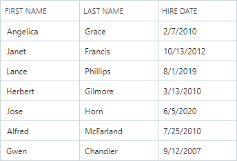
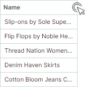
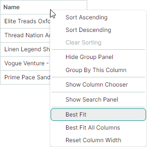
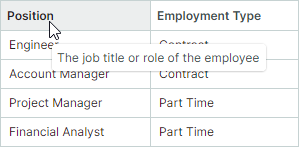
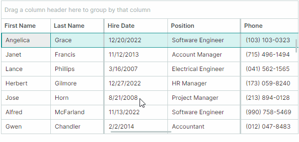
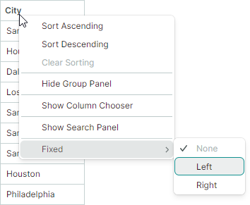
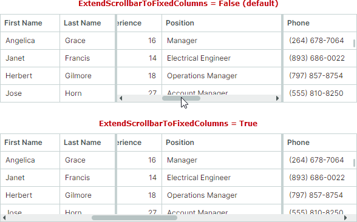

# 列 {#columns}

DataGrid 支持绑定列和未绑定列。绑定列显示所绑定数据源中字段的值。[未绑定列](data-binding/unbound-columns.md)可用于显示自定义数据。



DataGrid 列提供了用于自定义列标题、单元格编辑器、排序/分组设置及其他选项的属性。

## 创建列 {#create-columns}

[`GridColumn`](../../API/Eremex.AvaloniaUI.Controls.DataGrid/GridColumn.md) 类表示 [`DataGridControl`](../../API/Eremex.AvaloniaUI.Controls.DataGrid/DataGridControl.md) 中的列。[`GridColumn`](../../API/Eremex.AvaloniaUI.Controls.DataGrid/GridColumn.md) 和 [`TreeListColumn`](../../API/Eremex.AvaloniaUI.Controls.TreeList/TreeListColumn.md)（[`TreeListControl`](../../API/Eremex.AvaloniaUI.Controls.TreeList/TreeListControl.md) 中的列）均派生自 [`ColumnBase`](../../API/Eremex.AvaloniaUI.Controls.DataControl/ColumnBase.md) 类。因此，DataGrid 和 TreeList 控件中的列共享许多 API 成员。

要访问网格列集合，请使用 [`DataGridControl.Columns`](../../API/Eremex.AvaloniaUI.Controls.DataGrid/DataGridControl/Columns.md) 属性。

将 DataGrid 控件绑定到数据源时，控件不会自动创建列。可以通过以下四种方式创建列：

- **手动创建列**

    可以在 [`DataGridControl.Columns`](../../API/Eremex.AvaloniaUI.Controls.DataGrid/DataGridControl/Columns.md) 集合中（在 XAML 或代码隐藏中）手动定义所有 DataGrid 列。使用这种方式，可以在代码中按名称访问所创建的列对象。

    以下示例创建两个 DataGrid 列，并自定义第二列值的显示格式：

    ``` xml
    xmlns:mxdg="https://schemas.eremexcontrols.net/avalonia/datagrid"

    <mxdg:DataGridControl Name="dataGrid1" >                
        <mxdg:DataGridControl.Columns>
            <mxdg:GridColumn Name="colName" FieldName="Name" />
            <mxdg:GridColumn Name="colBirthdate" FieldName="Birthdate" >
                <mxdg:GridColumn.EditorProperties>
                    <mxe:TextEditorProperties DisplayFormatString="yyyy-MM-dd"/>
                </mxdg:GridColumn.EditorProperties>
            </mxdg:GridColumn>
        </mxdg:DataGridControl.Columns>
    </mxdg:DataGridControl>
    ```


- **自动生成列**

    启用 [`DataGridControl.AutoGenerateColumns`](../../API/Eremex.AvaloniaUI.Controls.DataGrid/DataGridControl/AutoGenerateColumns.md) 选项后，将控件绑定到数据源时会自动生成缺少的列。可以对业务对象的属性应用特定的特性（来自 `System.ComponentModel` 和 `System.ComponentModel.DataAnnotations` 命名空间），以控制列的自动生成，并自定义自动生成列的设置（例如列的显示名称和顺序）。

- **手动创建与自动生成相结合**

    可以将上述两种方式结合使用：在 [`DataGridControl.Columns`](../../API/Eremex.AvaloniaUI.Controls.DataGrid/DataGridControl/Columns.md) 集合中手动创建所需的列，然后启用 [`DataGridControl.AutoGenerateColumns`](../../API/Eremex.AvaloniaUI.Controls.DataGrid/DataGridControl/AutoGenerateColumns.md) 选项，由 DataGrid 生成其他列。

- **从 View Model 生成列**

    DataGrid 可以根据 View Model 中定义的列源创建列。在这种情况下，请使用 `ColumnsSource` 和 [`ColumnTemplate`](../../API/Eremex.AvaloniaUI.Controls.DataGrid/DataGridControl/ColumnTemplate.md) 属性。请参阅[从 View Model 生成列](#generate-columns-from-a-view-model)。


有关自动生成列的信息，请参阅[自动生成列](#automatic-column-generation)。

## 将列绑定到数据 {#bind-columns-to-data}

通过 [`GridColumn.FieldName`](../../API/Eremex.AvaloniaUI.Controls.DataControl/ColumnBase/FieldName.md) 属性，可以将列绑定到基础数据表中的字段，或绑定到业务对象的 public 属性。绑定后，列会从数据源中检索值。

DataGrid 还允许创建未绑定列，这类列的值需要通过 [`DataGridControl.CustomUnboundColumnData`](../../API/Eremex.AvaloniaUI.Controls.DataGrid/DataGridControl/CustomUnboundColumnData.md) 事件手动提供。有关详细信息，请参阅[未绑定列](data-binding/unbound-columns.md)。

不建议将多个 DataGrid 列绑定到同一个数据字段/属性。

以下示例创建 DataGrid 列并将其绑定到数据。

``` xml
xmlns:mxdg="https://schemas.eremexcontrols.net/avalonia/datagrid"

<mxdg:DataGridControl Grid.Column="3" Width="200" Name="dataGrid1" HorizontalAlignment="Stretch">
    <mxdg:DataGridControl.Columns>
        <mxdg:GridColumn Name="colFirstName" FieldName="FirstName" Header="First Name" 
         Width="*" AllowSorting="False"  />
        <mxdg:GridColumn Name="colLastName" FieldName="LastName" Header="Last Name" Width="*"/>
        <mxdg:GridColumn Name="colCity" FieldName="City" Header="City" Width="*" ReadOnly="True" />
        <mxdg:GridColumn Name="colPhone" FieldName="Phone" Header="Phone" Width="*"/>
    </mxdg:DataGridControl.Columns>
</mxdg:DataGridControl>
```

``` csharp
using Eremex.AvaloniaUI.Controls.DataGrid;

GridColumn colFirstName = new GridColumn() 
 { FieldName = "FirstName", Header = "First Name", AllowSorting = false, 
   Width= new GridLength(1, GridUnitType.Star) };
dataGrid1.Columns.Add(colFirstName);
```

## 自动生成列 {#automatic-column-generation}

将 [`AutoGenerateColumns`](../../API/Eremex.AvaloniaUI.Controls.DataGrid/DataGridControl/AutoGenerateColumns.md) 属性设置为 `true`（默认值为 `false`），可以为数据源中的属性启用自动生成列。当 [`AutoGenerateColumns`](../../API/Eremex.AvaloniaUI.Controls.DataGrid/DataGridControl/AutoGenerateColumns.md) 设置为 `true` 时，DataGrid 控件会获取数据源的 public 属性，生成列并将其绑定到这些属性。如果控件的 [`Columns`](../../API/Eremex.AvaloniaUI.Controls.DataGrid/DataGridControl/Columns.md) 集合中已包含绑定到特定属性/字段的列，则不会再自动生成绑定到同一属性/字段的列。

[`AutoGeneratingColumn`](../../API/Eremex.AvaloniaUI.Controls.DataGrid/DataGridControl/AutoGeneratingColumn.md) 和 [`AutoGeneratedColumns`](../../API/Eremex.AvaloniaUI.Controls.DataGrid/DataGridControl/AutoGeneratedColumns.md) 事件可用于自定义自动生成的列。当自动生成的列即将添加到 [`Columns`](../../API/Eremex.AvaloniaUI.Controls.DataGrid/DataGridControl/Columns.md) 集合时，会触发 [`AutoGeneratingColumn`](../../API/Eremex.AvaloniaUI.Controls.DataGrid/DataGridControl/AutoGeneratingColumn.md) 事件。将该事件的 `e.Cancel` 参数设置为 `true` 可阻止将列添加到集合中。

所有列自动生成完成后，会触发 [`AutoGeneratedColumns`](../../API/Eremex.AvaloniaUI.Controls.DataGrid/DataGridControl/AutoGeneratedColumns.md) 事件。

为控件分配另一个数据源时，DataGrid 会先删除之前自动生成的列，然后为新数据源自动生成列。

### 使用特性自定义自动生成列的设置 {#use-attributes-to-customize-settings-of-auto-generated-columns}

可以对业务对象（数据源记录）的属性应用特定的特性（来自 `System.ComponentModel` 和 `System.ComponentModel.DataAnnotations` 命名空间），以自定义相应自动生成的 DataGrid 列的可见性、视图和行为设置。支持的特性如下所述：

#### `Browsable` 特性 {#browsable-attribute}

`System.ComponentModel.BrowsableAttribute` 特性控制列的自动生成。对特定属性应用 **Browsable(false)** 特性，可阻止自动生成相应的列。

``` csharp
using CommunityToolkit.Mvvm.ComponentModel;
using System.ComponentModel;

public partial class MyBusinessObject : ObservableObject
{
    [ObservableProperty]
    [property: Browsable(false)]
    public int serviceId = "";
}
```

`System.ComponentModel.BrowsableAttribute` 特性等效于使用带 `AutoGenerateField` 参数的 `System.ComponentModel.DataAnnotations.DisplayAttribute` 特性。

#### `Display` 特性 {#display-attribute}
`System.ComponentModel.DataAnnotations.DisplayAttribute` 是一个通用特性，用于控制列的自动生成以及自动生成列的显示设置。该特性具有以下受 DataGrid 控件支持的参数：

- `AutoGenerateField` — 指定是否自动生成相应的列。

- `Order` — 指定自动生成列的可见位置（[`ColumnBase.VisibleIndex`](../../API/Eremex.AvaloniaUI.Controls.DataControl/ColumnBase/VisibleIndex.md)）。

- `Name` — 指定自动生成列的标题（[`ColumnBase.Header`](../../API/Eremex.AvaloniaUI.Controls.DataControl/DataControlColumnBase/Header.md)）。

- `ShortName` — 等效于 `Name` 参数。

- `GroupName` — 指定与自动生成列关联的带区名称。
如果 [`DataGridControl.AutoGenerateBands`](../../API/Eremex.AvaloniaUI.Controls.DataGrid/DataGridControl/AutoGenerateBands.md) 选项为 `true`（默认值），则使用此特性值初始化 [`GridColumn.BandName`](../../API/Eremex.AvaloniaUI.Controls.DataControl/ColumnBase/BandName.md) 属性。

    当 Data Grid 遇到 `DisplayAttribute.GroupName` 时，会检查是否存在名称匹配的带区（[`GridBand.BandName`](../../API/Eremex.AvaloniaUI.Controls.DataControl/DataControlBandBase/BandName.md)）。如果不存在，控件会自动创建该带区，并使用 `DisplayAttribute.GroupName` 的值初始化其 [`GridBand.BandName`](../../API/Eremex.AvaloniaUI.Controls.DataControl/DataControlBandBase/BandName.md) 属性。

    `DisplayAttribute.GroupName` 参数还支持嵌套带区。使用“/”字符分隔父带区和子带区（例如“ParentBandName/ChildBandName”）。
    要将“/”作为字面字符包含在内，请使用“//”。

 
``` csharp
using CommunityToolkit.Mvvm.ComponentModel;
using System.ComponentModel.DataAnnotations;

public partial class MyBusinessObject : ObservableObject
{
    [ObservableProperty]
    [property: Display(Name = "Birth date", Order=2, GroupName="General")]
    public DateTime? birthdate = null;

    [ObservableProperty]
    [property: Display(GroupName = "Details/Address")]
    public string country { get; set; }

    [ObservableProperty]
    [property: Display(GroupName = "Details/Contact")]
    public string phone { get; set; }
}
```

#### `DisplayName` 特性 {#displayname-attribute}

`System.ComponentModel.DisplayNameAttribute` 特性可用于初始化自动生成列的标题（[`ColumnBase.Header`](../../API/Eremex.AvaloniaUI.Controls.DataControl/DataControlColumnBase/Header.md)）。

``` csharp
using CommunityToolkit.Mvvm.ComponentModel;
using System.ComponentModel;

public partial class MyBusinessObject : ObservableObject
{
    [ObservableProperty]
    [property: DisplayName("Birth date")]
    public DateTime? birthdate = null;
}
```

`System.ComponentModel.DisplayNameAttribute` 特性等效于使用带 `Name` 或 `ShortName` 参数的 `System.ComponentModel.DataAnnotations.DisplayAttribute` 特性。

#### `Editable` 特性 {#editable-attribute}

对属性应用 `System.ComponentModel.EditableAttribute` 特性会创建不可编辑的列。用户无法打开就地编辑器，因此也无法选择和复制文本。

``` csharp
using CommunityToolkit.Mvvm.ComponentModel;
using System.ComponentModel;

public partial class MyBusinessObject : ObservableObject
{
    [ObservableProperty]
    [property: Editable(false)]
    public int parentId = -1;
}
```

#### `Readonly` 特性 {#readonly-attribute}

对属性应用 `System.ComponentModel.ReadonlyAttribute` 特性会创建只读列。用户可以在只读列中选择和复制文本，但不能编辑值。

``` csharp
using CommunityToolkit.Mvvm.ComponentModel;
using System.ComponentModel;

public partial class MyBusinessObject : ObservableObject
{
    [ObservableProperty]
    [property: ReadOnly(true)]
    public int id = -1;
}
```

## 从 View Model 生成列 {#generate-columns-from-a-view-model}


可以使用 View Model 中定义的列源为 DataGrid 控件填充列。列源是一个业务对象集合，会根据指定的模板从中生成 [`GridColumn`](../../API/Eremex.AvaloniaUI.Controls.DataGrid/GridColumn.md) 对象。以下 API 成员支持从 View Model 生成列：

- [`DataGridControl.ColumnsSource`](../../API/Eremex.AvaloniaUI.Controls.DataGrid/DataGridControl/ColumnsSource.md) — 业务对象集合，用于根据 [`ColumnTemplate`](../../API/Eremex.AvaloniaUI.Controls.DataGrid/DataGridControl/ColumnTemplate.md) 模板生成网格列。

- [`DataGridControl.ColumnTemplate`](../../API/Eremex.AvaloniaUI.Controls.DataGrid/DataGridControl/ColumnTemplate.md) — 根据列源中存储的业务对象初始化 [`GridColumn`](../../API/Eremex.AvaloniaUI.Controls.DataGrid/GridColumn.md) 对象的模板。

### 示例 - 从列源生成列 {#example-generate-columns-from-a-column-source}

以下代码片段取自“Large Data”演示，展示了如何根据列源（[`DataGridControl.ColumnsSource`](../../API/Eremex.AvaloniaUI.Controls.DataGrid/DataGridControl/ColumnsSource.md)）创建和初始化 Data Grid 列。

``` xml
<mxdg:DataGridControl ItemsSource="{Binding Items}" ColumnsSource="{Binding Columns}" AutoGenerateColumns="True" BorderThickness="0,0,1,0"
                      CustomUnboundColumnData="DataGridControl_CustomUnboundColumnData" PropertyChanged="DataGridControl_PropertyChanged">
    <mxdg:DataGridControl.ColumnTemplate>
        <views:DataGridLargeDataViewColumnTemplate/>
    </mxdg:DataGridControl.ColumnTemplate>
</mxdg:DataGridControl>
```

``` cs
public class DataGridLargeDataViewColumnTemplate : ITemplate<object, GridColumn>
{
    public GridColumn Build(object param)
    {
        var largeDataColumn = (LargeDataColumn)param;
        var gridColumn = new GridColumn() 
        { 
            FieldName = largeDataColumn.FieldName,
            Header = largeDataColumn.Header
        };
        if (!largeDataColumn.FieldName.Contains("Id"))
        {
            gridColumn.UnboundDataType = largeDataColumn.DataType;

            if (largeDataColumn.FieldName.Contains("ComboBox"))
                gridColumn.EditorProperties = new ComboBoxEditorProperties() { ItemsSource = EmployeesData.EmployeeNames };
            else if (largeDataColumn.FieldName.Contains("Numeric"))
                gridColumn.EditorProperties = new SpinEditorProperties() { MaskType = MaskType.Numeric, Mask = "c" };
        }
        return gridColumn;
    }
}
```

完整示例请参阅 Data Grid 控件的 Large Data 演示。

## 移动列 {#move-columns}

使用 [`GridColumn.VisibleIndex`](../../API/Eremex.AvaloniaUI.Controls.DataControl/ColumnBase/VisibleIndex.md) 属性指定列的可视位置。要隐藏列，请将其 [`GridColumn.VisibleIndex`](../../API/Eremex.AvaloniaUI.Controls.DataControl/ColumnBase/VisibleIndex.md) 属性设置为 **-1**，或将 [`IsVisible`](../../API/Eremex.AvaloniaUI.Controls.DataControl/ColumnBase/IsVisible.md) 属性设置为 `false`。

控件的默认行为允许用户重新排列列。使用以下属性可禁止移动列：

- [`DataGridControl.AllowColumnMoving`](../../API/Eremex.AvaloniaUI.Controls.DataGrid/DataGridControl/AllowColumnMoving.md) — 指定用户是否可以移动任何列。
- [`GridColumn.AllowMoving`](../../API/Eremex.AvaloniaUI.Controls.DataControl/ColumnBase/AllowMoving.md) — 指定用户是否可以移动特定列。

## 调整列宽 {#resize-columns}

可以使用以下属性控制 DataGrid 中的列宽：

- [`GridColumn.Width`](../../API/Eremex.AvaloniaUI.Controls.DataControl/ColumnBase/Width.md) — 以 `GridLength` 值指定的列宽。
- [`GridColumn.MinWidth`](../../API/Eremex.AvaloniaUI.Controls.DataControl/ColumnBase/MinWidth.md) — 列的最小宽度。
- [`GridColumn.MaxWidth`](../../API/Eremex.AvaloniaUI.Controls.DataControl/ColumnBase/MaxWidth.md) — 列的最大宽度。


[`Width`](../../API/Eremex.AvaloniaUI.Controls.DataControl/ColumnBase/Width.md) 属性的类型为 `GridLength`。可以将列宽设置为：

- 固定宽度（像素数）。
- 可用空间的加权比例（_星号_表示法）。
- Auto 值 — 激活自动计算列宽，使其适应列标题和可见值。当用户垂直滚动控件时，控件可能会增大列宽，以适应滚动过程中出现的新单元格值。

``` xml
xmlns:mxdg="https://schemas.eremexcontrols.net/avalonia/datagrid"

<mxdg:DataGridControl Name="dataGrid1">
    <mxdg:DataGridControl.Columns>
        <mxdg:GridColumn Name="colFirstName" FieldName="FirstName" Header="First Name" Width="*"/>
        <mxdg:GridColumn Name="colLastName" FieldName="LastName" Header="Last Name" Width="2*"/>
        <mxdg:GridColumn Name="colPhone" FieldName="Phone" Header="Phone" Width="*"/>
    </mxdg:DataGridControl.Columns>
</mxdg:DataGridControl>
```

以下属性控制用户调整列宽的操作。

- [`DataGridControl.AllowColumnResizing`](../../API/Eremex.AvaloniaUI.Controls.DataGrid/DataGridControl/AllowColumnResizing.md) — 指定用户是否可以调整任何列的宽度。
- [`GridColumn.AllowResizing`](../../API/Eremex.AvaloniaUI.Controls.DataControl/ColumnBase/AllowResizing.md) — 指定用户是否可以调整特定列的宽度。

## 最佳调整（Best Fit） {#best-fit}

最佳调整（Best Fit）功能会将列宽调整为最佳宽度，即完整显示列内容（值和标题）而不截断所需的最小宽度。


最佳调整以**像素**为单位计算列的最佳宽度，并将这些值分配给 [`TreeListColumn.Width`](../../API/Eremex.AvaloniaUI.Controls.DataControl/ColumnBase/Width.md) 属性，替换之前设置的任何宽度。

!!! Note "注意"

    最佳调整会用计算出的绝对像素值替换原始列宽。如果列之前的宽度设置为 `Auto` 或星号值（`*`），也会被替换为绝对像素宽度。可以使用[重置列宽命令](#reset-column-width-user-modifications)恢复原始宽度。

用户可以通过以下方式调用最佳调整功能：

- 双击列标题的右边缘。

    

- 右键单击列标题，然后从上下文菜单中选择 _Best Fit_ 或 _Best Fit All Columns_ 命令。

    

    - _Best Fit_ 命令 — 将所选列调整为最佳宽度。
    - _Best Fit All Columns_ 命令 — 将所有列调整为最佳宽度。


### 启用和禁用最佳调整操作 {#enable-and-disable-best-fit-operations}

最佳调整功能默认处于启用状态。可以使用以下属性为所有列或单个列控制最佳调整操作。

- [`DataGridControl.AllowBestFit`](../../API/Eremex.AvaloniaUI.Controls.DataGrid/DataGridControl/AllowBestFit.md)（默认值为 `true`）— 指定是否为所有网格列启用最佳调整操作。可以使用 [`GridColumn.AllowBestFit`](../../API/Eremex.AvaloniaUI.Controls.DataControl/ColumnBase/AllowBestFit.md) 属性为单个列覆盖此全局设置。
- [`GridColumn.AllowBestFit`](../../API/Eremex.AvaloniaUI.Controls.DataControl/ColumnBase/AllowBestFit.md)（默认值为 `null`）— 指定是否为特定列启用最佳调整操作。如果 [`GridColumn.AllowBestFit`](../../API/Eremex.AvaloniaUI.Controls.DataControl/ColumnBase/AllowBestFit.md) 属性设置为 `null`，则实际设置由全局 [`DataGridControl.AllowBestFit`](../../API/Eremex.AvaloniaUI.Controls.DataGrid/DataGridControl/AllowBestFit.md) 属性决定。

### 最佳调整模式 {#best-fit-mode}

可以使用 [`DataGridControl.BestFitMode`](../../API/Eremex.AvaloniaUI.Controls.DataGrid/DataGridControl/BestFitMode.md) 和 [`GridColumn.BestFitMode`](../../API/Eremex.AvaloniaUI.Controls.DataControl/ColumnBase/BestFitMode.md) 属性控制最佳调整操作所处理的行值范围。

``` xaml
<mxdg:DataGridControl BestFitMode="Full" >
```

#### 可用的最佳调整计算模式 {#available-best-fit-calculation-modes}

- [`BestFitMode.Fast`](../../API/Eremex.AvaloniaUI.Controls.DataControl/BestFitMode.md) 模式 — 仅测量唯一行值的宽度，在大多数情况下可显著提升最佳调整的性能。

    !!! Note "注意"

        - 如果目标单元格的显示文本依赖于其他单元格，则 `Fast` 模式不适用。在这种情况下，需要切换到 `Full` 模式。

        - 如果使用单元格模板（[`GridColumn.CellTemplate`](../../API/Eremex.AvaloniaUI.Controls.DataControl/ColumnBase/CellTemplate.md)）分配自定义编辑器，或者单元格显示由数据源触发的验证错误（请参阅 [`ShowItemsSourceErrors`](../../API/Eremex.AvaloniaUI.Controls.DataControl/DataControlBase/ShowItemsSourceErrors.md)），`Fast` 模式可能无法正确计算列宽。

- [`BestFitMode.Full`](../../API/Eremex.AvaloniaUI.Controls.DataControl/BestFitMode.md) 模式 — 测量所有行值（包括重复值）的宽度。此模式比 `Fast` 慢，但在使用单元格模板或验证错误时能够正确计算列宽。

#### 自动（默认）最佳调整计算模式 {#automatic-default-best-fit-calculation-mode}

- 大多数情况下默认使用 `Fast` 模式。
- 在以下情况下，会自动将 `Full` 作为默认模式：
    - 使用单元格模板（[`GridColumn.CellTemplate`](../../API/Eremex.AvaloniaUI.Controls.DataControl/ColumnBase/CellTemplate.md)）为列分配编辑器。
    - 控件的 [`DataControlBase.ShowItemsSourceErrors`](../../API/Eremex.AvaloniaUI.Controls.DataControl/DataControlBase/ShowItemsSourceErrors.md) 属性设置为 `true`，并且在数据源级别（使用验证特性、`IDataErrorInfo` 接口或 `INotifyDataErrorInfo` 接口）对列应用了验证错误。

#### 选择最佳调整计算模式 {#choose-best-fit-calculation-mode}

使用以下属性为所有列或单个列指定最佳调整计算模式：

- [`DataGridControl.BestFitMode`](../../API/Eremex.AvaloniaUI.Controls.DataGrid/DataGridControl/BestFitMode.md) — 为所有网格列指定全局最佳调整计算模式。
当 [`DataGridControl.BestFitMode`](../../API/Eremex.AvaloniaUI.Controls.DataGrid/DataGridControl/BestFitMode.md) 设置为 `null`（初始值）时，最佳调整计算模式将[自动](#automatic-default-best-fit-calculation-mode)确定。使用 [`GridColumn.BestFitMode`](../../API/Eremex.AvaloniaUI.Controls.DataControl/ColumnBase/BestFitMode.md) 属性可为特定列覆盖此全局设置。

- [`GridColumn.BestFitMode`](../../API/Eremex.AvaloniaUI.Controls.DataControl/ColumnBase/BestFitMode.md) — 为单个列设置最佳调整计算模式，覆盖 [`DataGridControl.BestFitMode`](../../API/Eremex.AvaloniaUI.Controls.DataGrid/DataGridControl/BestFitMode.md) 属性。如果 [`GridColumn.BestFitMode`](../../API/Eremex.AvaloniaUI.Controls.DataControl/ColumnBase/BestFitMode.md) 属性为 `null`（初始值），则实际设置由控件的 [`DataGridControl.BestFitMode`](../../API/Eremex.AvaloniaUI.Controls.DataGrid/DataGridControl/BestFitMode.md) 属性决定。

### 在代码中调用最佳调整操作 {#call-best-fit-operations-in-code}

使用以下方法将网格列调整为最佳宽度：

- [`DataGridControl.BestFit(GridColumn column)`](../../API/Eremex.AvaloniaUI.Controls.DataGrid/DataGridControl/BestFit.md) — 将指定列调整为完整显示其内容所需的宽度。
- [`DataGridControl.BestFitAllColumns()`](../../API/Eremex.AvaloniaUI.Controls.DataGrid/DataGridControl/BestFitAllColumns.md) — 将所有列调整为完整显示其内容所需的宽度。

要在 DataGrid 控件初始化时执行最佳调整操作，请在 `DataGridControl.AttachedToVisualTree` 事件处理程序中调用 [`BestFit`](../../API/Eremex.AvaloniaUI.Controls.DataGrid/DataGridControl/BestFit.md) 或 [`BestFitAllColumns`](../../API/Eremex.AvaloniaUI.Controls.DataGrid/DataGridControl/BestFitAllColumns.md) 方法。

## 重置用户对列宽的修改 {#reset-column-width-user-modifications}

用户更改列宽（通过拖动或使用最佳调整）后，列的上下文菜单中会出现 _Reset Column Width_ 命令。此命令会撤销用户对列宽所做的更改，恢复用户修改之前在 XAML 或代码隐藏中为列设置的原始宽度。


### 相关 API {#related-api}

- [`DataGridControl.AllowResetColumnWidth`](../../API/Eremex.AvaloniaUI.Controls.DataGrid/DataGridControl/AllowResetColumnWidth.md)（默认值为 `true`）— 指定列的上下文菜单中是否提供 _Reset Column Width_ 命令。如果禁用此属性，用户将无法通过界面撤销对列宽的调整。[`DataGridControl.AllowResetColumnWidth`](../../API/Eremex.AvaloniaUI.Controls.DataGrid/DataGridControl/AllowResetColumnWidth.md) 不影响使用 [`DataGridControl.ResetColumnWidth`](../../API/Eremex.AvaloniaUI.Controls.DataGrid/DataGridControl/ResetColumnWidth.md) 方法重置列宽。
- [`DataGridControl.ResetColumnWidth`](../../API/Eremex.AvaloniaUI.Controls.DataGrid/DataGridControl/ResetColumnWidth.md) 方法 — 将列恢复为原始宽度，即用户进行任何修改之前在 XAML 或代码隐藏中定义的宽度。

## 列标题 {#column-headers}

DataGrid 列标题显示在标题面板中。可以使用 [`DataGridControl.ShowColumnHeaders`](../../API/Eremex.AvaloniaUI.Controls.DataGrid/DataGridControl/ShowColumnHeaders.md) 属性隐藏此面板。

面板的高度会自动调整以适应列标题的内容。使用 [`HeaderPanelMinHeight`](../../API/Eremex.AvaloniaUI.Controls.DataGrid/DataGridControl/HeaderPanelMinHeight.md) 属性可限制面板的最小高度。

列标题最初显示一个标题文本（文本标签），即 [`ColumnBase.Header`](../../API/Eremex.AvaloniaUI.Controls.DataControl/DataControlColumnBase/Header.md) 属性的文本表示形式。如果未设置 [`ColumnBase.Header`](../../API/Eremex.AvaloniaUI.Controls.DataControl/DataControlColumnBase/Header.md) 属性，列标题将根据列的字段名（[`ColumnBase.FieldName`](../../API/Eremex.AvaloniaUI.Controls.DataControl/ColumnBase/FieldName.md)）生成。

使用 [`ColumnBase.HeaderTemplate`](../../API/Eremex.AvaloniaUI.Controls.DataControl/DataControlColumnBase/HeaderTemplate.md) 属性指定用于呈现列标题的模板。通过该模板可以显示图像和自定义控件，并以自定义方式呈现文本。

以下代码在列标题文本之前显示一个图像。`<TextBlock Text="{Binding}">` 表达式显示列的 [`Header`](../../API/Eremex.AvaloniaUI.Controls.DataControl/DataControlColumnBase/Header.md) 属性的内容：

``` xml
xmlns:mxdg="https://schemas.eremexcontrols.net/avalonia/datagrid"

<mxdg:DataGridControl Name="DataGrid" HeaderPanelMinHeight="50">
    <mxdg:GridColumn FieldName="Number" Header="Position" HeaderVerticalAlignment="Bottom">
        <mxdg:GridColumn.HeaderTemplate>
            <DataTemplate>
                <StackPanel Orientation="Horizontal">
                    <Image Source="/info24x24.png" Width="24" Height="24" Margin="0,0,5,0"></Image>
                    <TextBlock Text="{Binding}" VerticalAlignment="Center"/>
                </StackPanel>
            </DataTemplate>
        </mxdg:GridColumn.HeaderTemplate>
    </mxdg:GridColumn>
</mxdg:DataGridControl>
```

使用 [`ColumnBase.HeaderHorizontalAlignment`](../../API/Eremex.AvaloniaUI.Controls.DataControl/DataControlColumnBase/HeaderHorizontalAlignment.md) 和 [`ColumnBase.HeaderVerticalAlignment`](../../API/Eremex.AvaloniaUI.Controls.DataControl/DataControlColumnBase/HeaderVerticalAlignment.md) 属性在水平和垂直方向上对齐列标题的内容。

## 列排序 {#column-sorting}

用户可以单击列标题或使用列标题的上下文菜单，按该列对 DataGrid 进行排序。有关详细信息，请参阅[数据排序](sorting.md)。

## 列分组 {#column-grouping}

用户可以按任意数量的列对数据进行分组。要按某列分组，用户可以将该列拖放到分组面板，或使用列标题上下文菜单中的相应命令。有关详细信息，请参阅以下主题：[数据分组](grouping.md)。

## 列值 {#column-values}

要了解如何检索特定行的单元格值，请参阅[行](rows.md)。

## 列标题工具提示 {#column-header-tooltips}

使用 [`HeaderToolTip`](../../API/Eremex.AvaloniaUI.Controls.DataControl/DataControlColumnBase/HeaderToolTip.md) 属性为列标题指定自定义工具提示。无论列标题文本是否被截断，鼠标悬停在列标题上时都会显示自定义工具提示。

``` xml
<mxdg:GridColumn FieldName="Position" HeaderToolTip="The job title or role of the employee"/>
```



如果未为列分配自定义工具提示，则在标题文本被截断时，列标题会显示默认工具提示。默认工具提示显示完整的、未截断的标题文本。


## 固定列 {#fixed-columns}

如果列的总宽度超过控件的视区，会出现滚动条以便水平滚动。DataGrid 允许将单个列固定（钉住）到左边缘或右边缘。水平滚动时，这些列保持不动，而非固定列正常滚动。




!!! tip "提示"

    列的总宽度是各列宽度（请参阅 [`GridColumn.Width`](../../API/Eremex.AvaloniaUI.Controls.DataControl/ColumnBase/Width.md)）之和。要显示水平滚动条，请设置各列的宽度，使其总和超过视区宽度。使用固定列时，请勿对列宽使用星号表示法（“*”）。

要固定列或将其恢复为正常状态，请将 [`GridColumn.FixedMode`](../../API/Eremex.AvaloniaUI.Controls.DataControl/ColumnBase/FixedMode.md) 属性设置为以下值之一：

- `Left` — 将列固定到左边缘。
- `Right` — 将列固定到右边缘。
- `None` — 取消固定列。

``` xml
<mxdg:GridColumn FieldName="FirstName" FixedMode="Left"/>
<mxdg:GridColumn FieldName="Phone" FixedMode="Right"/>
```

### _Fixed_ 菜单 {#fixed-menu}

用户可以在运行时通过列的上下文菜单中内置的 _Fixed_ 子菜单固定列。将控件的 [`ShowColumnMenuFixedItem`](../../API/Eremex.AvaloniaUI.Controls.DataGrid/DataGridControl/ShowColumnMenuFixedItem.md) 属性设置为 `true` 可启用此 _Fixed_ 子菜单：



### 固定列的位置 {#fixed-column-position}

当列被固定（钉住）或恢复为正常状态时，其可见位置（与 [`GridColumn.VisibleIndex`](../../API/Eremex.AvaloniaUI.Controls.DataControl/ColumnBase/VisibleIndex.md) 属性同步）会自动更新。

- 固定到左侧：该列放在现有左侧固定列之后。
- 固定到右侧：该列放在现有右侧固定列之前。
- 取消左侧固定：该列成为第一个可滚动列。
- 取消右侧固定：该列成为最后一个可滚动列。

### 固定列的宽度 {#fixed-column-width}

要更改固定列的宽度，请将 [`GridColumn.Width`](../../API/Eremex.AvaloniaUI.Controls.DataControl/ColumnBase/Width.md) 属性设置为绝对像素值，或设置为 `Auto` 以根据单元格内容自动计算。固定列不支持使用星号表示法（按比例调整大小）设置列宽。

固定宽度为 `star` 的列时，其宽度会自动重置为 120 像素。

### 水平滚动条显示模式 {#horizontal-scrollbar-display-mode}

默认情况下，水平滚动条仅横跨可滚动列显示。启用 [`ExtendScrollbarToFixedColumns`](../../API/Eremex.AvaloniaUI.Controls.DataGrid/DataGridControl/ExtendScrollbarToFixedColumns.md) 属性后，水平滚动条将横跨所有列（包括固定列）显示。




### 相关 API {#related-api_1}

- [`DataGridControl.FixedColumnSeparatorWidth`](../../API/Eremex.AvaloniaUI.Controls.DataGrid/DataGridControl/FixedColumnSeparatorWidth.md) — 指定将固定列与可滚动列分隔开的分隔线的宽度。

## 另请参阅 {#see-also}

- [未绑定列](data-binding/unbound-columns.md)


<br>
<br>

<sup>*</sup> 本页面使用机器翻译技术翻译。
