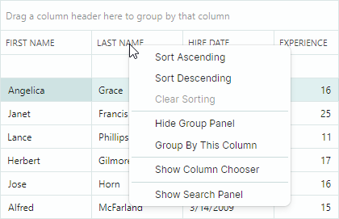
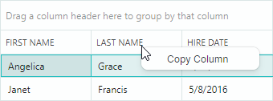
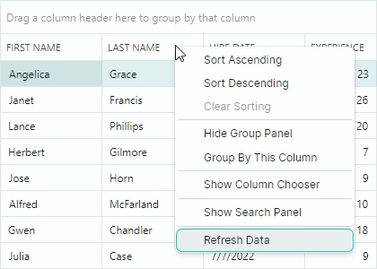
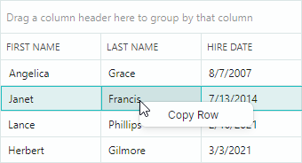
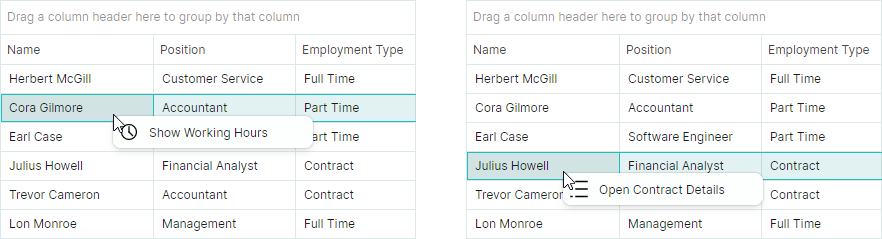
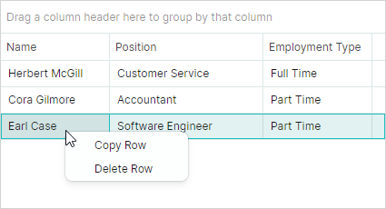
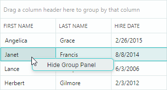
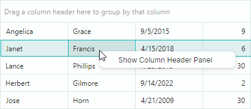

## 上下文菜单 {#context-menus}

Data Grid 为特定元素提供内置的上下文菜单。本主题介绍如何替换和修改这些菜单，以及如何为没有内置上下文菜单的 Data Grid 元素显示自定义弹出菜单。

## 内置列标题上下文菜单 {#built-in-column-header-context-menu}

右键单击列标题会显示内置的列标题菜单。该菜单包含用于对数据进行排序和分组、显示搜索面板以及显示列选择器的命令。



通过 [`DataGridControl.ColumnMenu`](../../API/Eremex.AvaloniaUI.Controls.DataGrid/DataGridControl/ColumnMenu.md) 属性可以访问和自定义此菜单。

要替换默认菜单，请将 [`Eremex.AvaloniaUI.Controls.Bars.PopupMenu`](../../API/Eremex.AvaloniaUI.Controls.Bars/PopupMenu.md) 对象分配给 [`DataGridControl.ColumnMenu`](../../API/Eremex.AvaloniaUI.Controls.DataGrid/DataGridControl/ColumnMenu.md) 属性。

要自定义现有的列标题菜单（添加新项或删除默认项），请在菜单初始化后（例如在 DataGrid 的 `Initialized` 事件处理程序中）访问该菜单，然后进行修改。

### 数据上下文 {#data-context}

列标题菜单及其项（[`ToolbarButtonItem`](../../API/Eremex.AvaloniaUI.Controls.Bars/ToolbarButtonItem.md) 对象）的 `DataContext` 属性指定调用该菜单的 [`GridColumn`](../../API/Eremex.AvaloniaUI.Controls.DataGrid/GridColumn.md) 对象。

### 示例 - 如何替换默认的列标题菜单 {#example-how-to-replace-the-default-column-header-menu}

以下代码创建一个包含 _Copy Column_ 菜单项的自定义列标题菜单，并将该菜单项绑定到 ViewModel 中定义的 _CopyColumnDataCommand_ 命令。



请注意以下代码中菜单项的 [`Command`](../../API/Eremex.AvaloniaUI.Controls.Bars/ToolbarItem/Command.md) 和 [`CommandParameter`](../../API/Eremex.AvaloniaUI.Controls.Bars/ToolbarItem/CommandParameter.md) 属性的初始化方式。表达式 `CommandParameter="{Binding FieldName}"` 指定绑定到菜单项 `DataContext` 的 [`FieldName`](../../API/Eremex.AvaloniaUI.Controls.DataControl/ColumnBase/FieldName.md) 属性（[`GridColumn.FieldName`](../../API/Eremex.AvaloniaUI.Controls.DataControl/ColumnBase/FieldName.md)）。

[`GridColumn`](../../API/Eremex.AvaloniaUI.Controls.DataGrid/GridColumn.md) 的 `DataContext` 与 Data Grid 的 `DataContext`（本示例中为 _ViewModel_ 对象）相同。因此，可以使用表达式 `Command="{Binding DataContext.CopyColumnCommand}"` 访问 View Model 及其 _CopyColumnCommand_ 命令。

``` xml
xmlns:mxdg="https://schemas.eremexcontrols.net/avalonia/datagrid"
xmlns:mxe="https://schemas.eremexcontrols.net/avalonia/editors"
xmlns:mxb="https://schemas.eremexcontrols.net/avalonia/bars"

<mxdg:DataGridControl Name="dataGrid1">
    <mxdg:DataGridControl.ColumnMenu>
        <mxb:PopupMenu>
            <mxb:ToolbarButtonItem
                Header="Copy Column"
                Command="{Binding DataContext.CopyColumnCommand}"
                CommandParameter="{Binding FieldName}">
            </mxb:ToolbarButtonItem>
        </mxb:PopupMenu>
    </mxdg:DataGridControl.ColumnMenu>
</mxdg:DataGridControl>
```
``` csharp
public MainView()
{
    DataContext = new ViewModel();
}

public partial class ViewModel : ObservableObject
{
    [RelayCommand]
    void CopyColumn(string fieldName)
    {
        //...
    }
}
```

### 示例 - 如何修改现有的列标题菜单 {#example-how-to-modify-the-existing-column-header-menu}

以下示例向默认的列标题菜单添加一个自定义命令。

该示例处理 `DataGridControl.Initialized` 事件，在默认列标题菜单初始化后访问该菜单，并向其中添加 _Refresh Data_ 命令。



``` xml
xmlns:mxdg="https://schemas.eremexcontrols.net/avalonia/datagrid"
xmlns:mxe="https://schemas.eremexcontrols.net/avalonia/editors"
xmlns:mxb="https://schemas.eremexcontrols.net/avalonia/bars"

<mxdg:DataGridControl Name="dataGrid1" Initialized="OnInitialized">
    ...
</mxdg:DataGridControl>
```
``` csharp
using Eremex.AvaloniaUI.Controls.Bars;

private void OnInitialized(object sender, System.EventArgs e)
{
    ToolbarButtonItem btn1 = new ToolbarButtonItem();
    btn1.Header = "Refresh Data";
    btn1.ShowSeparator = true;
    btn1.Command = new RelayCommand<DataGridControl>(UpdateDataGrid);
    btn1.CommandParameter = dataGrid1;
    dataGrid1.ColumnMenu.Items.Add(btn1);
}

[RelayCommand]
void UpdateDataGrid(DataGridControl dataGrid)
{
    //...
}
```


## 行单元格菜单 {#row-cell-menu}

Data Grid 支持行单元格的内置上下文菜单（请参阅 `DataGridControlBase.RowCellMenu` 属性）。该菜单最初为空，因此处于隐藏状态。要显示行单元格菜单，请在 XAML 或代码隐藏中向其添加项。

### 数据上下文 {#data-context_1}

行单元格菜单及其项的 `DataContext` 包含一个 `Eremex.AvaloniaUI.Controls.DataControl.Visuals.CellData` 对象，可用于访问与上下文相关的信息：

- `CellData.DataControl` — 返回调用该菜单的容器控件（[`DataGridControl`](../../API/Eremex.AvaloniaUI.Controls.DataGrid/DataGridControl.md)）。
- `CellData.Row` — 返回所单击行的基础数据对象。

### 示例 - 如何为所有行显示相同的上下文菜单命令 {#example-how-to-show-the-same-context-menu-commands-for-all-rows}

以下示例为所有行的行单元格菜单（`DataGridControlBase.RowCellMenu`）添加“_Copy Row_”命令。



下面的 XAML 代码将弹出菜单分配给 [`DataGridControl.RowCellMenu`](../../API/Eremex.AvaloniaUI.Controls.DataGrid/DataGridControl/RowCellMenu.md) 属性。该弹出菜单包含一个项（[`ToolbarButtonItem`](../../API/Eremex.AvaloniaUI.Controls.Bars/ToolbarButtonItem.md)），绑定到 View Model（Data Grid 的 `DataContext`）中定义的 _CopyRowCommand_ 命令。

``` xml
xmlns:mxdg="https://schemas.eremexcontrols.net/avalonia/datagrid"
xmlns:mxe="https://schemas.eremexcontrols.net/avalonia/editors"
xmlns:mxb="https://schemas.eremexcontrols.net/avalonia/bars"

<mxdg:DataGridControl Name="dataGrid1">
    <mxdg:DataGridControl.RowCellMenu>
        <mxb:PopupMenu>
            <mxb:PopupMenu.Items>
                <mxb:ToolbarButtonItem Header="Copy Row"
                 Command="{Binding DataControl.DataContext.CopyRowCommand}"
                 CommandParameter="{Binding Row}"/>
            </mxb:PopupMenu.Items>
        </mxb:PopupMenu>
    </mxdg:DataGridControl.RowCellMenu>
</mxdg:DataGridControl>
```
``` csharp
public partial class MainView : UserControl
{
    ViewModel viewModel = new ViewModel();
    public MainView()
    {
        DataContext = viewModel;
        InitializeComponent();
    }
}

public partial class ViewModel : ObservableObject
{
    public ViewModel() { }
    [RelayCommand]
    void CopyRow(object row)
    {
        //...
    }
}
```

### 示例 - 如何为不同的行显示不同的上下文菜单命令 {#example-how-to-show-different-context-menu-commands-for-different-rows}

本示例中的 Data Grid 控件显示 _Employee_ 对象列表。该示例初始化行的上下文菜单（`DataGridControlBase.RowCellMenu`），并为不同的数据行显示不同的菜单项。



对于兼职员工所在的行（_Employee.IsPartTime_ 属性返回 _true_），上下文菜单显示 _Show Working Hours_ 菜单项。

对于合同工所在的行（_Employee.IsContract_ 属性返回 _true_），上下文菜单显示 _Open Contract Details_ 菜单项。

下面的 XAML 代码向上下文菜单添加两个项（“_Show Working Hours_”和“_Open Contract Details_”）。这些项的可见性由业务对象的 _IsPartTime_ 和 _IsContract_ 属性动态控制。

``` xml
xmlns:mxdg="https://schemas.eremexcontrols.net/avalonia/datagrid"
xmlns:mxb="https://schemas.eremexcontrols.net/avalonia/bars"

<mxdg:DataGridControl Name="dataGrid1" AutoGenerateColumns="True" ItemsSource="{Binding Employees}">
    <mxdg:DataGridControl.RowCellMenu>
        <mxb:PopupMenu>
            <mxb:PopupMenu.Items>
                <mxb:ToolbarButtonItem
                    Header="Show Working Hours"
                    Command="{Binding DataControl.DataContext.ShowWorkingHoursCommand}"
                    CommandParameter="{Binding Row}"
                    Glyph="{SvgImage 'avares://AvaloniaApplication3/Assets/time.svg'}"
                    GlyphSize="20,20"
                    IsVisible="{Binding Row.IsPartTime}">
                </mxb:ToolbarButtonItem>
                <mxb:ToolbarButtonItem
                    Header="Open Contract Details"
                    Command="{Binding DataControl.DataContext.OpenContractDetailsCommand}"
                    CommandParameter="{Binding Row}"
                    Glyph="{SvgImage 'avares://AvaloniaApplication3/Assets/details.svg'}"
                    GlyphSize="20,20"
                    IsVisible="{Binding Row.IsContract}"
                    >
                </mxb:ToolbarButtonItem>
            </mxb:PopupMenu.Items>
        </mxb:PopupMenu>
    </mxdg:DataGridControl.RowCellMenu>
</mxdg:DataGridControl>
```
``` csharp
public partial class MainView : UserControl
{
    MainViewModel viewModel = new MainViewModel();

    public MainView()
    {
        DataContext = viewModel;

        viewModel.Employees.Add(new Employee() { 
            Name = "Herbert McGill", EmploymentType=EmploymentType.FullTime, 
            Position= "Customer Service" 
        });
        viewModel.Employees.Add(new Employee() { 
            Name = "Cora Gilmore", EmploymentType = EmploymentType.PartTime, 
            Position = "Accountant" 
        });
        viewModel.Employees.Add(new Employee() { 
            Name = "Earl Case", EmploymentType = EmploymentType.PartTime, 
            Position = "Software Engineer" 
        });
        viewModel.Employees.Add(new Employee() { 
            Name = "Julius Howell", EmploymentType = EmploymentType.Contract, 
            Position = "Financial Analyst" 
        });
        viewModel.Employees.Add(new Employee() { 
            Name = "Trevor Cameron", EmploymentType = EmploymentType.Contract, 
            Position = "Accountant" 
        });
        viewModel.Employees.Add(new Employee() { 
            Name = "Lon Monroe", EmploymentType = EmploymentType.FullTime, 
            Position = "Management" 
        });

        InitializeComponent();
    }
}

public partial class MainViewModel : ViewModelBase
{
    public MainViewModel() { }

    public ObservableCollection<Employee> Employees { get; } = new();

    [RelayCommand]
    void OpenContractDetails(Employee emp)
    {
        if(emp.EmploymentType == EmploymentType.Contract)
        {
            //...
        }
    }

    [RelayCommand]
    void ShowWorkingHours(Employee emp)
    {
        if(emp.EmploymentType == EmploymentType.PartTime)
        {
            //...
        }
    }
}

public partial class Employee : ObservableObject
{
    [ObservableProperty]
    public string name = "";

    [ObservableProperty]
    public string position = "";

    [ObservableProperty]
    public EmploymentType employmentType;

    [Browsable(false)]
    public bool IsContract => EmploymentType == EmploymentType.Contract;

    [Browsable(false)]
    public bool IsPartTime => EmploymentType == EmploymentType.PartTime;
}

public enum EmploymentType
{
    [Display(Name = "Full Time")]
    FullTime,
    [Display(Name = "Part Time")]
    PartTime,
    Contract
}
```


### 示例 - 如何根据 ViewModel 生成上下文菜单命令 {#example-how-to-generate-context-menu-commands-from-a-viewmodel}

此示例演示如何使用 ViewModel 中定义的项填充 DataGrid 控件的行单元格菜单。



行单元格菜单（[`DataGridControl.RowCellMenu`](../../API/Eremex.AvaloniaUI.Controls.DataGrid/DataGridControl/RowCellMenu.md)）中的项（[`ToolbarButtonItem`](../../API/Eremex.AvaloniaUI.Controls.Bars/ToolbarButtonItem.md) 对象）来自 [`PopupMenu.ItemsSource`](../../API/Eremex.AvaloniaUI.Controls.Bars/PopupMenu/ItemsSource.md) 集合指定的项源。本示例使用以下绑定表达式，将 [`PopupMenu.ItemsSource`](../../API/Eremex.AvaloniaUI.Controls.Bars/PopupMenu/ItemsSource.md) 属性绑定到主 View Model 中定义的 _MenuItems_ 集合：

``` xml
<mxb:PopupMenu ItemsSource="{Binding DataControl.DataContext.MenuItems}">
```

当为 DataGrid 单元格显示 [`PopupMenu`](../../API/Eremex.AvaloniaUI.Controls.Bars/PopupMenu.md) 时，菜单的 `DataContext` 包含一个 `Eremex.AvaloniaUI.Controls.DataControl.Visuals.CellData` 对象。`CellData` 对象公开 `DataControl` 属性，通过该属性可以访问显示菜单的控件。
主 View Model 被分配给该控件的 `DataContext`。因此，`DataControl.DataContext.MenuItems` 语法引用的是主 View Model 中定义的 _MenuItems_ 集合。

`CellData` 对象还包含其他属性，可用于访问与单元格相关的信息（列、行对象等）。

菜单项通过样式进行初始化。菜单项的 `DataContext` 是 [`PopupMenu.ItemsSource`](../../API/Eremex.AvaloniaUI.Controls.Bars/PopupMenu/ItemsSource.md) 集合中的元素。在本示例中，[`PopupMenu.ItemsSource`](../../API/Eremex.AvaloniaUI.Controls.Bars/PopupMenu/ItemsSource.md) 属性存储 _MenuItemViewModel_ 对象的集合。以下代码段将 [`ToolbarButtonItem.Header`](../../API/Eremex.AvaloniaUI.Controls.Bars/ToolbarItem/Header.md) 和 [`ToolbarButtonItem.Command`](../../API/Eremex.AvaloniaUI.Controls.Bars/ToolbarItem/Command.md) 属性分别绑定到 _MenuItemViewModel.Header_ 和 _MenuItemViewModel.Command_ 属性。

``` xml
<mxb:PopupMenu.Styles>
    <Style Selector="mxb|ToolbarButtonItem">
        <Setter Property="Header" Value="{Binding Header}"/>
        <Setter Property="Command" Value="{Binding Command}"  />
    </Style>
</mxb:PopupMenu.Styles>
```

[`ToolbarButtonItem`](../../API/Eremex.AvaloniaUI.Controls.Bars/ToolbarButtonItem.md) 的命令需要知道被右键单击的是哪一行。为了将数据行传递给命令，XAML 代码按如下方式设置 [`ToolbarButtonItem.CommandParameter`](../../API/Eremex.AvaloniaUI.Controls.Bars/ToolbarItem/CommandParameter.md) 属性：

``` xml
xmlns:mxvis="clr-namespace:Eremex.AvaloniaUI.Controls.DataControl.Visuals;
 assembly=Eremex.Avalonia.Controls"

<mxb:PopupMenu.Styles>
    <Style Selector="mxb|ToolbarButtonItem">
        ...
        <Setter Property="CommandParameter" 
         Value="{Binding $parent[mxvis:CellControl].DataContext.Row}"  />
    </Style>
</mxb:PopupMenu.Styles>
```

其中，`$parent[mxvis:CellControl]` 表达式在逻辑树中向上查找 `CellControl` 对象（它是 [`ToolbarButtonItem`](../../API/Eremex.AvaloniaUI.Controls.Bars/ToolbarButtonItem.md) 的 `DataContext` 的父级）。`CellControl.DataContext` 对象包含一个 `Eremex.AvaloniaUI.Controls.DataControl.Visuals.CellData` 对象，通过其 `CellData.Row` 属性可以访问数据行。

完整代码如下所示。

``` xml
xmlns:mxdg="https://schemas.eremexcontrols.net/avalonia/datagrid"
xmlns:mxb="https://schemas.eremexcontrols.net/avalonia/bars"
xmlns:mxvis="clr-namespace:Eremex.AvaloniaUI.Controls.DataControl.Visuals;
 assembly=Eremex.Avalonia.Controls"

<mxdg:DataGridControl Name="dataGrid1" AutoGenerateColumns="True" ItemsSource="{Binding Employees}">
    <mxdg:DataGridControl.RowCellMenu>
        <mxb:PopupMenu ItemsSource="{Binding DataControl.DataContext.MenuItems}">
            <mxb:PopupMenu.Styles>
                <Style Selector="mxb|ToolbarButtonItem">
                    <Setter Property="Header" Value="{Binding Header}"/>
                    <Setter Property="Command" Value="{Binding Command }"  />
                    <Setter Property="CommandParameter" 
                     Value="{Binding $parent[mxvis:CellControl].DataContext.Row}"  />
                </Style>
            </mxb:PopupMenu.Styles>
        </mxb:PopupMenu>
    </mxdg:DataGridControl.RowCellMenu>
</mxdg:DataGridControl>
```
``` csharp
public partial class MainView : UserControl
{
    MainViewModel viewModel = new MainViewModel();

    public MainView()
    {
        DataContext = viewModel;

        viewModel.Employees.Add(new Employee() { 
            Name = "Herbert McGill", EmploymentType=EmploymentType.FullTime, 
            Position= "Customer Service" 
        });
        viewModel.Employees.Add(new Employee() { 
            Name = "Cora Gilmore", EmploymentType = EmploymentType.PartTime, 
            Position = "Accountant" 
        });
        viewModel.Employees.Add(new Employee() { 
            Name = "Earl Case", EmploymentType = EmploymentType.PartTime, 
            Position = "Software Engineer" 
        });

        InitializeComponent();
    }
}

public partial class MainViewModel : ViewModelBase
{
    public ObservableCollection<Employee> Employees { get; } = new();

    public MainViewModel()
    {
        MenuItemViewModel menuItem1 = new MenuItemViewModel();
        menuItem1.Header = "Copy Row";
        menuItem1.Command = new RelayCommand<object>(CopyRow);
        MenuItems.Add(menuItem1);

        MenuItemViewModel menuItem2 = new MenuItemViewModel();
        menuItem2.Header = "Delete Row";
        menuItem2.Command = new RelayCommand<object>(DeleteRow);
        MenuItems.Add(menuItem2);

    }

    public ObservableCollection<MenuItemViewModel> MenuItems { get; } = new();

    [RelayCommand]
    void CopyRow(object row)
    {
        //...
    }
    [RelayCommand]
    void DeleteRow(object row)
    {
        //...
    }
}

public partial class MenuItemViewModel : ObservableObject
{
    [ObservableProperty]
    string? header;

    [ObservableProperty]
    ICommand? command;
}

public partial class Employee : ObservableObject
{
    [ObservableProperty]
    public string name = "";

    [ObservableProperty]
    public string position = "";

    [ObservableProperty]
    public EmploymentType employmentType;

    [Browsable(false)]
    public bool IsContract => EmploymentType == EmploymentType.Contract;

    [Browsable(false)]
    public bool IsPartTime => EmploymentType == EmploymentType.PartTime;
}

public enum EmploymentType
{
    [Display(Name = "Full Time")]
    FullTime,
    [Display(Name = "Part Time")]
    PartTime,
    Contract
}
```

## 在显示时自定义菜单 {#customize-menus-on-showing}

可以处理 [`PopupMenu.Opening`](../../API/Eremex.AvaloniaUI.Controls.Bars/PopupMenu/Opening.md) 事件来动态自定义 DataGrid 的上下文菜单。该事件在 [`PopupMenu`](../../API/Eremex.AvaloniaUI.Controls.Bars/PopupMenu.md) 即将显示时发生。

## 示例 - 如何为第一列显示上下文菜单 {#example-how-to-show-a-context-menu-for-the-first-column}

以下示例将一个空的 [`PopupMenu`](../../API/Eremex.AvaloniaUI.Controls.Bars/PopupMenu.md) 分配给 `DataGridControlBase.RowCellMenu` 属性，然后处理 [`PopupMenu.Opening`](../../API/Eremex.AvaloniaUI.Controls.Bars/PopupMenu/Opening.md) 事件：当用户右键单击 DataGrid 第一个可见列中的单元格时，向菜单中添加项。当用户在其他列中右键单击时，菜单保持为空（因此不会显示）。

创建的菜单包含“_Show/Hide Group Panel_”复选按钮，用于切换 DataGrid 分组面板的可见性（`DataGridControlBase.ShowGroupPanel` 属性）。



``` xml
<mxdg:DataGridControl Name="dataGrid1" ...>
    <mxdg:DataGridControl.RowCellMenu>
        <mxb:PopupMenu Opening="RowCellMenuOpening"/>
    </mxdg:DataGridControl.RowCellMenu>
</mxdg:DataGridControl>
```
``` csharp
using Eremex.AvaloniaUI.Controls.DataControl.Visuals;

void RowCellMenuOpening(object sender, CancelEventArgs e)
{
    if (sender == null) return;
    PopupMenu menu = sender as PopupMenu;
    menu.Items.Clear();

    CellData cellData = menu.DataContext as CellData;
    DataGridControl control = cellData.DataControl as DataGridControl;
    GridColumn column = cellData.Column as GridColumn;
    //// Access the underlying data row, when required.
    //object dataRow = cellData.Row;

    if(column.VisibleIndex == 0)
    {
        ToolbarCheckItem btn1 = new ToolbarCheckItem();
        btn1.IsChecked = control.ShowGroupPanel;
        btn1.Header = (control.ShowGroupPanel) ? "Hide Group Panel" : "Show Group Panel";
        btn1.Command = new RelayCommand<DataGridControl>(ShowGroupPanelCommand);
        btn1.CommandParameter = control;
        menu.Items.Add(btn1);
    }
}

[RelayCommand]
void ShowGroupPanelCommand(DataGridControl dataGrid)
{
    dataGrid.ShowGroupPanel = !dataGrid.ShowGroupPanel;
}
```

## 使用 ToolbarManager 的附加属性为控件显示上下文菜单 {#show-a-context-menu-for-controls-using-a-toolbarmanagers-attached-property}

[`Eremex.AvaloniaUI.Controls.Bars.ToolbarManager`](../../API/Eremex.AvaloniaUI.Controls.Bars/ToolbarManager.md) 组件提供 `ContextPopup` 附加属性，可用于为任何控件（包括 DataGrid）分配上下文菜单。对于没有默认上下文菜单的 DataGrid 区域以及默认菜单为空的区域，将显示此上下文菜单。

### 示例 - 如何使用 _ToolbarManager.ContextPopup_ 附加属性分配上下文菜单 {#example-how-to-assign-a-context-menu-using-the-toolbarmanagercontextpopup-attached-property}

以下代码使用 `ToolbarManager.ContextPopup` 附加属性为 DataGrid 控件指定上下文菜单。该菜单包含 _Show Column Header Panel_/_Hide Column Header Panel_ 复选菜单项，用于切换 [`DataGridControl.ShowColumnHeaders`](../../API/Eremex.AvaloniaUI.Controls.DataGrid/DataGridControl/ShowColumnHeaders.md) 选项。



``` xml
<mxdg:DataGridControl Name="dataGrid1">
    <mxdg:DataGridControl.Styles>
        <Style Selector="mxdg|DataGridControl">
            <Setter Property="mxb:ToolbarManager.ContextPopup" >
                <Template>
                    <mxb:PopupMenu Tag="dataGrid1">
                        <mxb:ToolbarCheckItem Header="Show Column Header Panel" 
                         IsChecked="{Binding $parent[mxdg:DataGridControl].ShowColumnHeaders, Mode=TwoWay}" 
                         IsVisible="{Binding !$parent[mxdg:DataGridControl].ShowColumnHeaders}"/>
                        <mxb:ToolbarCheckItem Header="Hide Column Header Panel" 
                         IsChecked="{Binding $parent[mxdg:DataGridControl].ShowColumnHeaders, Mode=TwoWay}" 
                         IsVisible="{Binding $parent[mxdg:DataGridControl].ShowColumnHeaders}"/>
                    </mxb:PopupMenu>
                </Template>
            </Setter>
        </Style>
    </mxdg:DataGridControl.Styles>
</mxdg:DataGridControl>
```


<br>
<br>

<sup>*</sup> 本页面使用机器翻译技术翻译。
