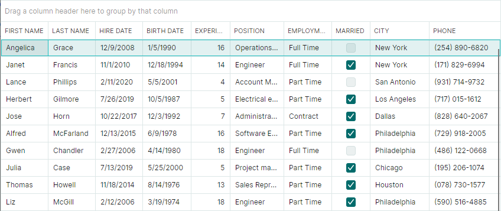
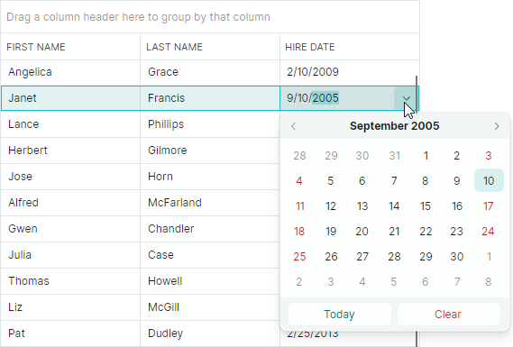

# 数据绑定 {#data-binding}

通过继承的 [`DataControlBase.ItemsSource`](../../../API/Eremex.AvaloniaUI.Controls.DataControl/DataControlBase/ItemsSource.md) 属性，可以将 Data Grid 绑定到数据源（例如业务对象的集合）。绑定后，控件会从数据源中检索项，并将其显示为[行](../rows.md)。

Data Grid 将数据源字段（业务对象的属性）显示为[列](../columns.md)。如果未创建任何列，则行中不显示任何数据。
链接到数据源中现有字段的列称为绑定列。这些列的 [`GridColumn.FieldName`](../../../API/Eremex.AvaloniaUI.Controls.DataControl/ColumnBase/FieldName.md) 属性设置为数据源中存在的字段名。

您还可以创建[未绑定列](unbound-columns.md)（也称为计算列），用于显示（或编辑并显示）数据源中不存在的值。

## 自动生成列 {#generate-columns-automatically}

启用 [`DataGridControl.AutoGenerateColumns`](../../../API/Eremex.AvaloniaUI.Controls.DataGrid/DataGridControl/AutoGenerateColumns.md) 选项后，在运行时初始化 Data Grid 时会自动为数据源的所有属性/字段生成列。如果禁用了 [`AutoGenerateColumns`](../../../API/Eremex.AvaloniaUI.Controls.DataGrid/DataGridControl/AutoGenerateColumns.md) 选项，可以通过 [`PopulateColumns`](../../../API/Eremex.AvaloniaUI.Controls.DataGrid/DataGridControl/PopulateColumns.md) 方法在代码中调用自动生成列。

自动生成列时，Data Grid 控件会触发两个事件，您可以处理这些事件来取消生成列或自定义列设置：

- [`DataGridControl.AutoGeneratingColumn`](../../../API/Eremex.AvaloniaUI.Controls.DataGrid/DataGridControl/AutoGeneratingColumn.md) — 在列即将添加到 [`DataGridControl.Columns`](../../../API/Eremex.AvaloniaUI.Controls.DataGrid/DataGridControl/Columns.md) 集合时触发。使用此事件可以阻止将列添加到网格，或自定义列的设置。
- [`DataGridControl.AutoGeneratedColumns`](../../../API/Eremex.AvaloniaUI.Controls.DataGrid/DataGridControl/AutoGeneratedColumns.md) — 在所有列自动生成完成后触发。

## 示例 - 绑定 DataGrid 并自动生成列 {#example-bind-the-datagrid-and-generate-columns-automatically}

以下代码将 Data Grid 绑定到 _EmployeeInfo_ 对象的集合，并启用 [`AutoGenerateColumns`](../../../API/Eremex.AvaloniaUI.Controls.DataGrid/DataGridControl/AutoGenerateColumns.md) 属性，为 _EmployeeInfo_ 类公开的所有 public 属性自动生成列。



``` xml
xmlns:mxdg="https://schemas.eremexcontrols.net/avalonia/datagrid"
...
<mxdg:DataGridControl x:Name="dataGrid" ItemsSource="{Binding Employees}" 
 AutoGenerateColumns="True" BorderThickness="1,1">
</mxdg:DataGridControl>
```
``` cs
public partial class MainViewModel : ViewModelBase
{
    [ObservableProperty]
    IList<EmployeeInfo> employees;

    public MainViewModel()
    {
        //Generate sample data.
        Employees = EmployeesData.GenerateEmployeeInfo();
    }
}

public class EmployeeInfo
{
    public string FirstName { get; set; }
    public string LastName { get; set; }
    public DateTime BirthDate { get; set; }
    public DateTime HiredAt { get; set; }
    public int Experience { get; set; }
    public string Position { get; set; }
    public EmploymentType EmploymentType { get; set; }
    public bool Married { get; set; }
    public string City { get; set; }
    public string Phone { get; set; }
}
```


## 在 Data Grid 中显示特定的列集 {#display-a-specific-set-of-columns-in-data-grid}

如果需要在 Data Grid 中显示特定的一组字段/属性，可以执行以下任一操作：

- 自动生成列，然后在 [`DataGridControl.Columns`](../../../API/Eremex.AvaloniaUI.Controls.DataGrid/DataGridControl/Columns.md) 集合中手动访问并删除不需要的列。也可以使用 [`GridColumn.IsVisible`](../../../API/Eremex.AvaloniaUI.Controls.DataControl/ColumnBase/IsVisible.md) 选项隐藏不需要的列。

- 在数据源级别隐藏特定属性，然后使用自动生成列。要阻止为业务对象的特定属性生成列，请对源属性应用 `Browsable` 或 `Display(AutoGenerateField)` 特性。有关详细信息，请参阅以下主题：[列](../columns.md)。

- 手动创建网格列。

## 手动创建列 {#create-columns-manually}

可以在 [`DataGridControl.Columns`](../../../API/Eremex.AvaloniaUI.Controls.DataGrid/DataGridControl/Columns.md) 集合中手动创建列（绑定列或未绑定列）。Data Grid 控件中的列由 [`GridColumn`](../../../API/Eremex.AvaloniaUI.Controls.DataGrid/GridColumn.md) 类封装。创建列时，请初始化 [`GridColumn.FieldName`](../../../API/Eremex.AvaloniaUI.Controls.DataControl/ColumnBase/FieldName.md) 属性，将列绑定到所绑定数据源中的 public 属性/字段。

将 [`DataGridControl.AutoGenerateColumns`](../../../API/Eremex.AvaloniaUI.Controls.DataGrid/DataGridControl/AutoGenerateColumns.md) 选项设置为 `false`，可以仅显示已创建的列，并阻止自动生成其他列。

有关详细信息，请参阅[列](../columns.md)和[未绑定列](unbound-columns.md)主题。

## 示例 - 绑定 DataGrid 并手动创建列 {#example-bind-the-datagrid-and-generate-columns-manually}

以下代码在 [`DataGridControl.Columns`](../../../API/Eremex.AvaloniaUI.Controls.DataGrid/DataGridControl/Columns.md) 集合中创建三列。对于“HIRE DATE”列，使用 [`DateEditor`](../../../API/Eremex.AvaloniaUI.Controls.Editors/DateEditor.md) 就地编辑器显示该列的值。



``` xml
xmlns:mxdg="https://schemas.eremexcontrols.net/avalonia/datagrid"
xmlns:mxe="https://schemas.eremexcontrols.net/avalonia/editors"
...
<mxdg:DataGridControl x:Name="dataGrid" ItemsSource="{Binding Employees}" 
 AutoGenerateColumns="False" BorderThickness="1,1">
    <mxdg:GridColumn FieldName="FirstName" Width="*" MinWidth="80"/>
    <mxdg:GridColumn FieldName="LastName" Width="*" MinWidth="80"/>
    <mxdg:GridColumn FieldName="HiredAt" Header="Hire Date" Width="*" MinWidth="80">
        <mxdg:GridColumn.EditorProperties>
            <mxe:DateEditorProperties/>
        </mxdg:GridColumn.EditorProperties>
    </mxdg:GridColumn>
</mxdg:DataGridControl>
```
``` cs
public partial class MainViewModel : ViewModelBase
{
    [ObservableProperty]
    IList<EmployeeInfo> employees;

    public MainViewModel()
    {
        Employees = EmployeesData.GenerateEmployeeInfo();
    }
}
public class EmployeeInfo
{
    public string FirstName { get; set; }
    public string LastName { get; set; }
    public DateTime BirthDate { get; set; }
    public DateTime HiredAt { get; set; }
    public int Experience { get; set; }
    public string Position { get; set; }
    public EmploymentType EmploymentType { get; set; }
    public bool Married { get; set; }
    public string City { get; set; }
    public string Phone { get; set; }
}
```

## 相关 API {#related-api}

### 属性 {#properties}

- [`DataGridControl.Columns`](../../../API/Eremex.AvaloniaUI.Controls.DataGrid/DataGridControl/Columns.md) — 网格列的集合。
- [`DataGridControl.AutoGenerateColumns`](../../../API/Eremex.AvaloniaUI.Controls.DataGrid/DataGridControl/AutoGenerateColumns.md) — 指定 Data Grid 是否在运行时自动为数据源公开的 public 属性/字段生成列。
- [`GridColumn.FieldName`](../../../API/Eremex.AvaloniaUI.Controls.DataControl/ColumnBase/FieldName.md) — 指定列所绑定的字段/属性的名称。

### 方法 {#methods}

- [`PopulateColumns`](../../../API/Eremex.AvaloniaUI.Controls.DataGrid/DataGridControl/PopulateColumns.md) — 为所绑定数据源公开的 public 字段/属性生成列。

### 事件 {#events}

- [`DataGridControl.AutoGeneratingColumn`](../../../API/Eremex.AvaloniaUI.Controls.DataGrid/DataGridControl/AutoGeneratingColumn.md) — 在列即将添加到 [`DataGridControl.Columns`](../../../API/Eremex.AvaloniaUI.Controls.DataGrid/DataGridControl/Columns.md) 集合时触发。使用此事件可以阻止将列添加到网格，或自定义列的设置。
- [`DataGridControl.AutoGeneratedColumns`](../../../API/Eremex.AvaloniaUI.Controls.DataGrid/DataGridControl/AutoGeneratedColumns.md) — 在所有列自动生成完成后触发。

# 另请参阅 {#see-also}
- [列](../columns.md)
- [未绑定列](unbound-columns.md)
- [数据编辑](../data-editing/index.md)


<br>
<br>

<sup>*</sup> 本页面使用机器翻译技术翻译。
