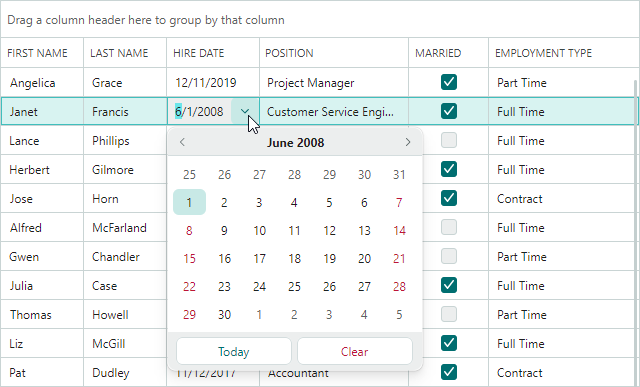
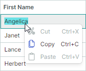
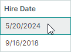

# 数据编辑 {#data-editing}

## 默认使用的 Eremex 就地编辑器 {#default-in-place-eremex-editors}

DataGrid 控件的默认行为是使用 Eremex 就地编辑器来显示和编辑常见数据类型的单元格值。



下表列出了与各数据类型关联的 Eremex 编辑器：

- 布尔值 — [`CheckEditor`](../../../API/Eremex.AvaloniaUI.Controls.Editors/CheckEditor.md)
- Double 类型值 — [`SpinEditor`](../../../API/Eremex.AvaloniaUI.Controls.Editors/SpinEditor.md)
- 枚举值 — [`ComboBoxEditor`](../../../API/Eremex.AvaloniaUI.Controls.Editors/ComboBoxEditor.md)
- 带有 `TypeConverter` 特性、且其 `TypeConverter.GetStandardValuesSupported` 方法返回 `true` 的属性 — [`ComboBoxEditor`](../../../API/Eremex.AvaloniaUI.Controls.Editors/ComboBoxEditor.md)
- 其他值 — [`TextEditor`](../../../API/Eremex.AvaloniaUI.Controls.Editors/TextEditor.md)

您可以为 DataGrid 列显式指定单元格编辑器，以覆盖默认的编辑器分配方式，并自定义就地编辑器的设置。本主题将提供关于编辑器分配的更多详细信息。

当某个单元格开始编辑操作时，您可以访问并修改当前活动的就地编辑器。详情请参阅 [访问活动的 Eremex 就地编辑器](#access-the-active-in-place-eremex-editor) 一节。

## 分配 Eremex 就地编辑器 {#assign-in-place-eremex-editors}

要为单元格（列）显式分配 Eremex 就地编辑器，请使用 [`GridColumn.EditorProperties`](../../../API/Eremex.AvaloniaUI.Controls.DataControl/ColumnBase/EditorProperties.md) 属性。

您可以将 [`EditorProperties`](../../../API/Eremex.AvaloniaUI.Controls.DataControl/ColumnBase/EditorProperties.md) 属性设置为以下对象之一，用来指定就地编辑器的类型（这些对象都是 [`BaseEditorProperties`](../../../API/Eremex.AvaloniaUI.Controls.Editors/BaseEditorProperties.md) 的派生类）：

- [`ButtonEditorProperties`](../../../API/Eremex.AvaloniaUI.Controls.Editors/ButtonEditorProperties.md) — 包含 [`ButtonEditor`](../../../API/Eremex.AvaloniaUI.Controls.Editors/ButtonEditor.md) 控件专用的设置。
- [`CheckEditorProperties`](../../../API/Eremex.AvaloniaUI.Controls.Editors/CheckEditorProperties.md) — 包含 [`CheckEditor`](../../../API/Eremex.AvaloniaUI.Controls.Editors/CheckEditor.md) 控件专用的设置。
- [`ComboBoxEditorProperties`](../../../API/Eremex.AvaloniaUI.Controls.Editors/ComboBoxEditorProperties.md) — 包含 [`ComboBoxEditor`](../../../API/Eremex.AvaloniaUI.Controls.Editors/ComboBoxEditor.md) 控件专用的设置。
- [`DateEditorProperties`](../../../API/Eremex.AvaloniaUI.Controls.Editors/DateEditorProperties.md) — 包含 [`DateEditor`](../../../API/Eremex.AvaloniaUI.Controls.Editors/DateEditor.md) 控件专用的设置。
- [`HyperlinkEditorProperties`](../../../API/Eremex.AvaloniaUI.Controls.Editors/HyperlinkEditorProperties.md) — 包含 [`HyperlinkEditor`](../../../API/Eremex.AvaloniaUI.Controls.Editors/HyperlinkEditor.md) 控件专用的设置。
- [`MemoEditorProperties`](../../../API/Eremex.AvaloniaUI.Controls.Editors/MemoEditorProperties.md) — 包含 [`MemoEditor`](../../../API/Eremex.AvaloniaUI.Controls.Editors/MemoEditor.md) 控件专用的设置。
- [`PopupColorEditorProperties`](../../../API/Eremex.AvaloniaUI.Controls.Editors/PopupColorEditorProperties.md) — 包含 [`PopupColorEditor`](../../../API/Eremex.AvaloniaUI.Controls.Editors/PopupColorEditor.md) 控件专用的设置。
- [`SegmentedEditorProperties`](../../../API/Eremex.AvaloniaUI.Controls.Editors/SegmentedEditorProperties.md) — 包含 [`SegmentedEditor`](../../../API/Eremex.AvaloniaUI.Controls.Editors/SegmentedEditor.md) 控件专用的设置。
- [`SpinEditorProperties`](../../../API/Eremex.AvaloniaUI.Controls.Editors/SpinEditorProperties.md) — 包含 [`SpinEditor`](../../../API/Eremex.AvaloniaUI.Controls.Editors/SpinEditor.md) 控件专用的设置。
- [`TextEditorProperties`](../../../API/Eremex.AvaloniaUI.Controls.Editors/TextEditorProperties.md) — 包含 [`TextEditor`](../../../API/Eremex.AvaloniaUI.Controls.Editors/TextEditor.md) 控件专用的设置。

假设您将 [`EditorProperties`](../../../API/Eremex.AvaloniaUI.Controls.DataControl/ColumnBase/EditorProperties.md) 属性设置为一个 [`SpinEditorProperties`](../../../API/Eremex.AvaloniaUI.Controls.Editors/SpinEditorProperties.md) 对象。在显示模式下（单元格编辑未激活时），DataGrid 控件会使用 [`SpinEditorProperties`](../../../API/Eremex.AvaloniaUI.Controls.Editors/SpinEditorProperties.md) 对象的设置，在目标列的单元格中模拟一个 [`SpinEditor`](../../../API/Eremex.AvaloniaUI.Controls.Editors/SpinEditor.md)。在单元格开始编辑操作之前，不会创建真正的 [`SpinEditor`](../../../API/Eremex.AvaloniaUI.Controls.Editors/SpinEditor.md)。当用户开始编辑单元格时，DataGrid 控件会在获得焦点的单元格中创建一个真正的 [`SpinEditor`](../../../API/Eremex.AvaloniaUI.Controls.Editors/SpinEditor.md) 就地编辑器。编辑操作完成后，控件会销毁这个真正的 [`SpinEditor`](../../../API/Eremex.AvaloniaUI.Controls.Editors/SpinEditor.md)，并在该单元格中重新开始模拟 [`SpinEditor`](../../../API/Eremex.AvaloniaUI.Controls.Editors/SpinEditor.md)。要了解如何访问真正的单元格编辑器，请参阅 [访问活动的 Eremex 就地编辑器](#access-the-active-in-place-eremex-editor)。

### 示例 - 如何在 DataGrid 列中使用 ButtonEditor 作为就地编辑器 {#example-how-to-use-buttoneditor-as-an-in-place-editor-in-a-datagrid-column}

以下代码将 [`ButtonEditor`](../../../API/Eremex.AvaloniaUI.Controls.Editors/ButtonEditor.md) 就地编辑器分配给 DataGrid 列。

``` xml
xmlns:mxdg="https://schemas.eremexcontrols.net/avalonia/datagrid" 
xmlns:mxe="https://schemas.eremexcontrols.net/avalonia/editors"

<mxdg:DataGridControl.Columns>
    <mxdg:GridColumn Header="Name" FieldName="Name">
        <mxdg:GridColumn.EditorProperties>
            <mxe:ButtonEditorProperties>
                <mxe:ButtonEditorProperties.Buttons>
                    <mxe:ButtonSettings Content="Clear" 
                     Command="{Binding 
                      $parent[mxdg:CellControl].DataControl.DataContext.ClearValueCommand}"/>
                </mxe:ButtonEditorProperties.Buttons>
            </mxe:ButtonEditorProperties>
        </mxdg:GridColumn.EditorProperties>
    </mxdg:GridColumn>
</mxdg:DataGridControl.Columns>
```

## 使用模板分配 Eremex 就地编辑器 {#assign-in-place-eremex-editors-using-templates}

您可以使用模板将 Eremex 编辑器分配给 DataGrid 列。单元格模板允许您为同一列中的不同行提供不同的编辑器。

!!! Note 

    使用模板存在以下限制：

    - 通过单元格模板提供的显示文本不会用于数据的排序、分组和筛选。
    - 单元格模板不会被[导出](../export.md)。


要在单元格模板中为列提供就地编辑器，请使用 [`GridColumn.CellTemplate`](../../../API/Eremex.AvaloniaUI.Controls.DataControl/ColumnBase/CellTemplate.md) 属性。

请将模板中定义的 Eremex 编辑器的 `x:Name` 属性设置为 **"PART_Editor"**。这将确保编辑器的值（[`BaseEditor.EditorValue`](../../../API/Eremex.AvaloniaUI.Controls.Editors/BaseEditor/EditorValue.md)）自动绑定到该列的字段。此外，编辑器的外观设置（边框可见性以及激活和非激活状态下的前景色）将由 DataGrid 控件进行管理。

``` xml
xmlns:mxdg="https://schemas.eremexcontrols.net/avalonia/datagrid"
xmlns:mxe="https://schemas.eremexcontrols.net/avalonia/editors"
...
<mxdg:GridColumn Header="Phone" FieldName="Phone">
    <mxdg:GridColumn.CellTemplate>
        <DataTemplate>
            <mxe:ButtonEditor x:Name="PART_Editor">
                <mxe:ButtonEditor.Buttons>
                    <mxe:ButtonSettings Content="..."/>
                </mxe:ButtonEditor.Buttons>
            </mxe:ButtonEditor>
        </DataTemplate>
    </mxdg:GridColumn.CellTemplate>
</mxdg:GridColumn>
```


## 自定义编辑器 {#custom-editors}

您可以使用单元格模板将自定义编辑器嵌入到 DataGrid 列中。以下两种方式均可使用：

- 直接为特定列分配编辑器。
- 根据列所绑定对象的数据类型，动态为列分配编辑器。

详情请参阅 [自定义编辑器](custom-editors.md) 主题。


## 获取和设置单元格值 {#get-and-set-cell-values}

使用以下 API 来获取和设置单元格值：

- [`DataGridControl.GetCellValue`](../../../API/Eremex.AvaloniaUI.Controls.DataGrid/DataGridControl/GetCellValue.md)
- [`DataGridControl.SetCellValue`](../../../API/Eremex.AvaloniaUI.Controls.DataGrid/DataGridControl/SetCellValue.md)

<!-- TODO
- [`DataGridControl.GetCellDisplayText`](../../../API/Eremex.AvaloniaUI.Controls.DataGrid/DataGridControl/GetCellDisplayText.md) -->


## 访问活动的 Eremex 就地编辑器 {#access-the-active-in-place-eremex-editor}

- [`ActiveEditor`](../../../API/Eremex.AvaloniaUI.Controls.DataControl/DataControlBase/ActiveEditor.md) 属性 — 返回当前活动的就地编辑器。
  
  当 Eremex 就地编辑器被分配给 DataGrid 列时（无论是隐式分配，还是通过 [`EditorProperties`](../../../API/Eremex.AvaloniaUI.Controls.DataControl/ColumnBase/EditorProperties.md) 属性和模板显式分配），控件会在显示模式下（单元格编辑未激活时）在该列的单元格中模拟指定的就地编辑器。此时并不存在真正的就地编辑器。在显示模式下模拟单元格编辑器可以提升应用程序的性能。

  当用户开始编辑某个单元格时，控件会创建一个真正的就地编辑器。此时，您可以使用控件的 [`ActiveEditor`](../../../API/Eremex.AvaloniaUI.Controls.DataControl/DataControlBase/ActiveEditor.md) 属性来访问真正的 Eremex 编辑器实例。当单元格失去焦点时，真正的编辑器会被销毁，[`ActiveEditor`](../../../API/Eremex.AvaloniaUI.Controls.DataControl/DataControlBase/ActiveEditor.md) 属性将返回 `null`。

- [`ShownEditor`](../../../API/Eremex.AvaloniaUI.Controls.DataGrid/DataGridControl/ShownEditor.md) 事件 — 在为单元格创建了就地编辑器且编辑操作已开始后触发。您可以通过该事件的 [`Editor`](../../../API/Eremex.AvaloniaUI.Controls.DataGrid/DataGridEditorEventArgs/Editor.md) 参数或控件的 [`ActiveEditor`](../../../API/Eremex.AvaloniaUI.Controls.DataControl/DataControlBase/ActiveEditor.md) 属性来访问活动编辑器。

## 显示单元格编辑器 {#show-cell-editors}

- [`ShowEditor`](../../../API/Eremex.AvaloniaUI.Controls.DataControl/DataControlBase/ShowEditor.md) 方法 — 在获得焦点的单元格中激活单元格编辑器。
- [`ShowingEditor`](../../../API/Eremex.AvaloniaUI.Controls.DataGrid/DataGridControl/ShowingEditor.md) 事件 — 允许您在特定情况下阻止用户激活单元格编辑器。在处理 [`ShowingEditor`](../../../API/Eremex.AvaloniaUI.Controls.DataGrid/DataGridControl/ShowingEditor.md) 事件时，将事件参数 [`Cancel`](../../../API/Eremex.AvaloniaUI.Controls.DataGrid/DataGridShowingEditorEventArgs/Cancel.md) 设置为 `true` 即可禁止编辑器激活。请参阅 [使单元格不可编辑（防止复制）](#make-cells-non-editable-prevent-copying)。


### 由用户显示单元格编辑器 {#show-cell-editors-by-users}

当单元格编辑功能启用后，单击某行的单元格会激活该单元格的编辑器。使用 [`DataControlBase.EditorShowMode`](../../../API/Eremex.AvaloniaUI.Controls.DataControl/DataControlBase/EditorShowMode.md) 属性来指定哪种鼠标操作会触发编辑器。您可以将该属性设置为以下值之一：

- [`EditorShowMode.PointerPressed`](../../../API/Eremex.AvaloniaUI.Controls.DataControl/EditorShowMode.md)（默认值）— 在按下鼠标按钮时激活单元格编辑器。

    当启用了[行拖放](../row-drag-and-drop.md)且 [`RowDragMode`](../../../API/Eremex.AvaloniaUI.Controls.DataControl/RowDragMode.md) 设置为 [`RowDragMode.Row`](../../../API/Eremex.AvaloniaUI.Controls.DataControl/RowDragMode.md) 时，不支持 [`EditorShowMode.PointerPressed`](../../../API/Eremex.AvaloniaUI.Controls.DataControl/EditorShowMode.md) 模式。在此配置下，默认模式为 [`EditorShowMode.PointerPressedInFocusedCell`](../../../API/Eremex.AvaloniaUI.Controls.DataControl/EditorShowMode.md)。

- [`EditorShowMode.PointerPressedInFocusedCell`](../../../API/Eremex.AvaloniaUI.Controls.DataControl/EditorShowMode.md) — 在获得焦点的单元格中按下鼠标按钮时激活单元格编辑器。

    如果行拖放处于激活状态，且控件的 [`RowDragMode`](../../../API/Eremex.AvaloniaUI.Controls.DataControl/RowDragMode.md) 属性设置为 [`RowDragMode.Row`](../../../API/Eremex.AvaloniaUI.Controls.DataControl/RowDragMode.md)，则此模式为默认模式。

- [`EditorShowMode.PointerReleased`](../../../API/Eremex.AvaloniaUI.Controls.DataControl/EditorShowMode.md) — 在释放鼠标按钮时激活单元格编辑器。
- [`EditorShowMode.PointerReleasedInFocusedCell`](../../../API/Eremex.AvaloniaUI.Controls.DataControl/EditorShowMode.md) — 在获得焦点的单元格中释放鼠标按钮时激活单元格编辑器。


## 关闭活动的就地编辑器 {#close-the-active-in-place-editor}

- [`CloseEditor`](../../../API/Eremex.AvaloniaUI.Controls.DataControl/DataControlBase/CloseEditor.md) 方法 — 保存对单元格编辑器所做的更改并关闭编辑器。
- [`HideEditor`](../../../API/Eremex.AvaloniaUI.Controls.DataControl/DataControlBase/HideEditor.md) 方法 — 关闭单元格编辑器，但不保存任何更改。

- [`HiddenEditor`](../../../API/Eremex.AvaloniaUI.Controls.DataGrid/DataGridControl/HiddenEditor.md) 事件 — 在活动的单元格编辑器关闭后触发。


## 保存在就地编辑器中所做的更改 {#save-the-changes-made-in-an-in-place-editor}

- [`CloseEditor`](../../../API/Eremex.AvaloniaUI.Controls.DataControl/DataControlBase/CloseEditor.md) 方法 — 保存对单元格编辑器所做的更改并关闭编辑器。
- [`PostEditor`](../../../API/Eremex.AvaloniaUI.Controls.DataControl/DataControlBase/PostEditor.md) 方法 — 保存对活动单元格编辑器所做的更改，但不关闭编辑器。

## 使单元格只读（可复制） {#make-cells-read-only-copyable}

您可以将列的单元格设为只读，同时仍允许用户复制单元格的值。要实现此效果：

- 将该列的 [`ReadOnly`](../../../API/Eremex.AvaloniaUI.Controls.DataControl/ColumnBase/ReadOnly.md) 属性设置为 `true`。
- 保持该列的 [`AllowEditing`](../../../API/Eremex.AvaloniaUI.Controls.DataControl/ColumnBase/AllowEditing.md) 属性为 `true`（默认值）。

``` xml
<mxdg:GridColumn FieldName="FirstName" ReadOnly="True"/>
```




## 使单元格不可编辑（防止复制） {#make-cells-non-editable-prevent-copying}


### 整个表格 {#entire-grid}

要使整个表格不可编辑，请将控件的 [`AllowEditing`](../../../API/Eremex.AvaloniaUI.Controls.DataControl/DataControlBase/AllowEditing.md) 属性设置为 `false`。

``` xml
<mxdg:DataGridControl x:Name="dataGrid" AllowEditing="False">
```

### 特定列 {#specific-columns}

要使特定列中的所有单元格不可编辑，可采用以下方法之一：

- 将该列的 `AllowEditing` 属性设置为 `false`。

    ``` xml
    <mxdg:GridColumn FieldName="HireDate" AllowEditing="False"/>
    ```

    

- 将该列的 [`AllowFocus`](../../../API/Eremex.AvaloniaUI.Controls.DataControl/ColumnBase/AllowFocus.md) 属性设置为 `false`。此设置可阻止该列获得焦点。

### 特定单元格 {#specific-cells}

要使单个单元格不可编辑，请处理 [`ShowingEditor`](../../../API/Eremex.AvaloniaUI.Controls.DataGrid/DataGridControl/ShowingEditor.md) 事件。该事件会在单元格编辑器即将被激活时触发。将事件参数 [`Cancel`](../../../API/Eremex.AvaloniaUI.Controls.DataGrid/DataGridShowingEditorEventArgs/Cancel.md) 设置为 `true` 即可阻止单元格编辑器被激活。

``` cs
private void DataGrid_ShowingEditor(object sender, DataGridShowingEditorEventArgs e)
{
    DataGridControl grid = sender as DataGridControl;
    // Your condition to prevent cell editor activation
    if(grid.FocusedRowIndex == 0) 
        e.Cancel = true;
}
```

<br>
<br>

<sup>*</sup> 本页面使用机器翻译技术翻译。
