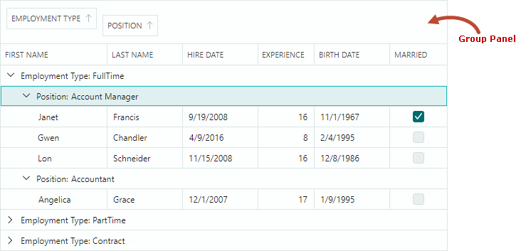
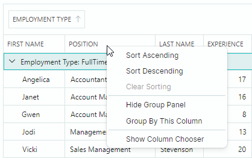
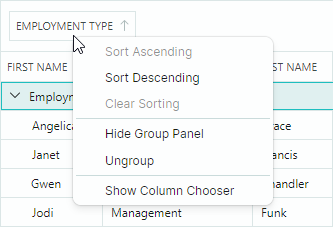
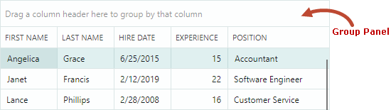
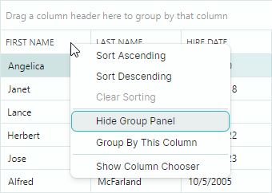
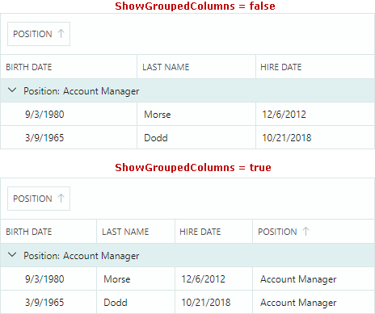
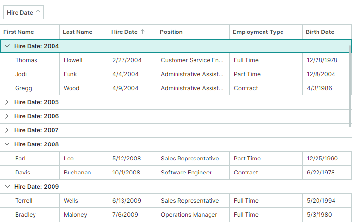

# 分组 {#grouping}

Data Grid 可以按一列或多列对数据进行分组。数据分组会将列值相同的行合并到同一个数据组中。



用户可以通过以下方式对数据进行分组：

- 将列标题拖动到分组面板。
- 右键单击列标题，然后选择“Group By This Column”（按此列分组）命令。

    

要取消数据分组，用户可以执行以下任一操作：

- 将分组列标题从分组面板中拖出。
- 右键单击分组列标题，然后选择“Ungroup”（取消分组）命令。

    

按某列分组时，该列的数据会被[排序](sorting.md)。用户可以单击分组列标题来切换排序顺序。


## 分组面板 {#group-panel}

网格控件的分组面板显示分组列的标题。用户可以将列标题拖动到分组面板上，按该列进行分组。



使用 DataGrid 的 [`ShowGroupPanel`](../../API/Eremex.AvaloniaUI.Controls.DataGrid/DataGridControl/ShowGroupPanel.md) 属性指定分组面板的可见性。用户可以通过列标题的上下文菜单隐藏和恢复分组面板：



## 分组列 {#group-columns}

按某列分组时，该列会从网格移动到分组面板中。将 [`ShowGroupedColumns`](../../API/Eremex.AvaloniaUI.Controls.DataGrid/DataGridControl/ShowGroupedColumns.md) 属性设置为 `true`，可以同时在分组面板和网格中显示分组列。下图演示了 [`ShowGroupedColumns`](../../API/Eremex.AvaloniaUI.Controls.DataGrid/DataGridControl/ShowGroupedColumns.md) 设置的效果：



## 禁止分组 {#prevent-grouping}

可以禁用列的 [`AllowSorting`](../../API/Eremex.AvaloniaUI.Controls.DataControl/ColumnBase/AllowSorting.md) 属性，以阻止用户对该列执行排序和分组操作。

通过 [`DataGridControl.AllowSorting`](../../API/Eremex.AvaloniaUI.Controls.DataGrid/DataGridControl/AllowSorting.md) 属性，可以禁止用户对任何列执行[排序](sorting.md)和分组操作。

如果某列不支持排序（例如，该列显示图像数据，或绑定到未实现 `IComparable` 接口的对象），则无法按该列对数据进行分组。您可以更改此默认行为，具体请参阅以下部分：[自定义分组逻辑](#customize-grouping-logic)。

## 自定义分组逻辑 {#customize-grouping-logic}

分组列始终按 [`ColumnBase.SortDirection`](../../API/Eremex.AvaloniaUI.Controls.DataControl/ColumnBase/SortDirection.md) 属性指定的升序或降序进行[排序](sorting.md)。

在分组操作期间，网格行会根据分组列的编辑值或显示值合并成组。默认的分组和排序逻辑取决于列的就地编辑器以及所绑定属性的数据类型：

- 按编辑值分组/排序 — 除嵌入了 ComboBoxEditor 的列之外的所有列。
- 按显示文本分组/排序 — 嵌入了 ComboBoxEditor 的列。
- 不分组/排序 — 绑定到未实现 `IComparable` 接口的对象的列。例如，图像数据类型未实现此接口，因此默认情况下相应的列不支持排序和分组操作。要强制对这些列进行排序和分组，请为其实现[自定义排序](sorting.md#custom-sorting)和[自定义分组](#custom-grouping)。


[`ColumnBase.SortMode`](../../API/Eremex.AvaloniaUI.Controls.DataControl/ColumnBase/SortMode.md) 属性可用于更改列的排序/分组模式。可用选项如下：

- [`SortMode.Value`](../../API/Eremex.AvaloniaUI.Controls.DataControl/SortMode.md) — 按单元格编辑值排序/分组。
- [`SortMode.DisplayText`](../../API/Eremex.AvaloniaUI.Controls.DataControl/SortMode.md) — 按单元格显示文本排序/分组。
- [`SortMode.Custom`](../../API/Eremex.AvaloniaUI.Controls.DataControl/SortMode.md) — 启用自定义排序和分组。将 [`SortMode`](../../API/Eremex.AvaloniaUI.Controls.DataControl/SortMode.md) 属性设置为 `Custom`，然后处理 [`DataGridControl.CustomColumnGroup`](../../API/Eremex.AvaloniaUI.Controls.DataGrid/DataGridControl/CustomColumnGroup.md) 和/或 [`DataGridControl.CustomColumnSort`](../../API/Eremex.AvaloniaUI.Controls.DataGrid/DataGridControl/CustomColumnSort.md) 事件，以实现自定义分组和/或自定义排序逻辑。有关详细信息，请参阅以下链接：

    - [自定义排序](sorting.md#custom-sorting)
    - [自定义分组](#custom-grouping)

### 自定义分组 {#custom-grouping}

要为特定列实现自定义分组规则，请将列的 [`ColumnBase.SortMode`](../../API/Eremex.AvaloniaUI.Controls.DataControl/ColumnBase/SortMode.md) 属性设置为 `Custom`，并处理 [`DataGridControl.CustomColumnGroup`](../../API/Eremex.AvaloniaUI.Controls.DataGrid/DataGridControl/CustomColumnGroup.md) 事件。

[`CustomColumnGroup`](../../API/Eremex.AvaloniaUI.Controls.DataGrid/DataGridControl/CustomColumnGroup.md) 事件会针对每个分组列触发，用于比较相邻的网格行对。处理此事件时，需要指定是否将这两行合并到同一组中。

以下事件参数可用于识别分组行和值，并设置比较结果：

- `Column` — 当前正在处理的分组列。
- `SourceItemIndex1` 和 `SourceItemIndex2` — 与当前正在处理的网格行对应的项（业务对象）在所绑定项源（[`DataGridControl.ItemsSource`](../../API/Eremex.AvaloniaUI.Controls.DataControl/DataControlBase/ItemsSource.md)）中的索引。
- `Value1` 和 `Value2` — 当前正在处理的网格行中分组列的值。
- `Result` — 自定义比较的结果。将 `Result` 设置为 `true` 可将这两行放入同一组；如果这两行需要放入不同的组，请将 `Result` 设置为 `false`。将 `Result` 设置为 `null` 则应用默认的分组逻辑。


<!-- TODO
Result can be set to null. What's this for?
 -->

为了提高控件性能，[`CustomColumnGroup`](../../API/Eremex.AvaloniaUI.Controls.DataGrid/DataGridControl/CustomColumnGroup.md) 事件只会将一行与少量相邻的网格行（按当前排序顺序）进行比较，而不会针对任意两行网格行的所有可能组合触发。如果需要更改默认的行排序逻辑，使特定行彼此相邻，请处理 `ColumnView.CustomColumnSort` 事件。

#### 示例 - 按日期时间列分组时按年份分组 {#example-group-by-years-when-you-group-by-a-date-time-column}

假设 Data Grid 控件包含显示 DateTime 值的 _HireDate_ 列。按此列分组时，控件的默认分组行为是将 DateTime 值相同的行合并在一起。

此示例应用自定义分组规则：按 _HireDate_ 值的年份部分对行进行分组。为此，将 _HireDate_ 列的 `SortOrder` 属性设置为 `Custom`，并处理以下事件：

- [`DataGridControl.CustomColumnGroup`](../../API/Eremex.AvaloniaUI.Controls.DataGrid/DataGridControl/CustomColumnGroup.md) — 实现自定义分组逻辑。
- [`DataGridControl.CustomGroupValueDisplayText`](../../API/Eremex.AvaloniaUI.Controls.DataGrid/DataGridControl/CustomGroupValueDisplayText.md) — 在分组行中显示日期时间值的年份部分。请参阅[分组行文本](#group-row-text)。

为便于演示，启用了 [`ShowGroupedColumns`](../../API/Eremex.AvaloniaUI.Controls.DataGrid/DataGridControl/ShowGroupedColumns.md) 属性，以便同时在分组面板和网格中显示已分组的 _HireDate_ 列。



``` cs
dataGrid.Columns["HireDate"].SortMode = Eremex.AvaloniaUI.Controls.DataControl.SortMode.Custom;
dataGrid.CustomColumnGroup += DataGrid_CustomColumnGroup;
dataGrid.CustomGroupValueDisplayText += DataGrid_CustomGroupValueDisplayText;        
dataGrid.ShowGroupedColumns = true;

private void DataGrid_CustomColumnGroup(object sender, DataGridCustomColumnGroupEventArgs e)
{
    if (e.Column.FieldName != "HireDate")
        return;
    DateTime employeeHireDate1 = (DateTime)e.Value1;
    DateTime employeeHireDate2 = (DateTime)e.Value2;
    e.Result = employeeHireDate1.Year == employeeHireDate2.Year;
}

private void DataGrid_CustomGroupValueDisplayText(object sender, DataGridCustomGroupValueDisplayTextEventArgs e)
{
    if (e.Column.FieldName != "HireDate")
        return;
    DateTime hireDate = (DateTime)e.Value;
    e.DisplayText = hireDate.Year.ToString();
}
```


## 在代码中分组 {#group-in-code}

要在代码中按一列或多列对数据进行分组，请执行以下操作：

1. 对这些列进行排序，并将其放在已排序列集合的开头。可以使用 [`SortIndex`](../../API/Eremex.AvaloniaUI.Controls.DataControl/ColumnBase/SortIndex.md) 和 [`SortDirection`](../../API/Eremex.AvaloniaUI.Controls.DataControl/ColumnBase/SortDirection.md) 属性对列进行排序。有关详细信息，请参阅[排序](sorting.md)。
2. 将 [`DataGridControl.GroupCount`](../../API/Eremex.AvaloniaUI.Controls.DataGrid/DataGridControl/GroupCount.md) 属性设置为分组列的数量。

以下代码按两列对数据进行分组。

``` csharp
GridColumn column1 = dataGrid.Columns["EmploymentType"];
GridColumn column2 = dataGrid.Columns["Position"];

if(column1 != null && column2 != null)
{
    dataGrid.BeginDataUpdate();
    column1.SortIndex = 0;
    column2.SortIndex = 1;
    column2.SortDirection = System.ComponentModel.ListSortDirection.Descending;
    dataGrid.GroupCount = 2;
    dataGrid.EndDataUpdate();
}
```

<!--TODO
Add the ClearGrouping method after BeginDataUpdate in the example above
the ClearGrouping member need to be published
-->

此示例使用 [`BeginDataUpdate`](../../API/Eremex.AvaloniaUI.Controls.DataGrid/DataGridControl/BeginDataUpdate.md) 和 [`EndDataUpdate`](../../API/Eremex.AvaloniaUI.Controls.DataControl/DataControlBase/EndDataUpdate.md) 方法，以避免在更改多个分组/排序设置时进行不必要的更新。Data Grid 仅在调用 [`EndDataUpdate`](../../API/Eremex.AvaloniaUI.Controls.DataControl/DataControlBase/EndDataUpdate.md) 方法之后才会更新。

如果不使用 [`BeginDataUpdate`](../../API/Eremex.AvaloniaUI.Controls.DataGrid/DataGridControl/BeginDataUpdate.md) 和 [`EndDataUpdate`](../../API/Eremex.AvaloniaUI.Controls.DataControl/DataControlBase/EndDataUpdate.md) 方法，每次更改任何分组/排序设置后，Data Grid 都会更新。

每次调用 [`BeginDataUpdate`](../../API/Eremex.AvaloniaUI.Controls.DataGrid/DataGridControl/BeginDataUpdate.md) 方法之后，都必须调用 [`EndDataUpdate`](../../API/Eremex.AvaloniaUI.Controls.DataControl/DataControlBase/EndDataUpdate.md) 方法。


## 分组行 {#group-rows}

数据分组后，分组行用于构成行层次结构。分组行显示相应分组列的值。分组行在所绑定的项源中并不存在。

### 识别分组行 {#identify-group-rows}

在代码中可以通过[行索引](rows.md#identify-and-get-rows)识别网格行。分组行的行索引为负数，而数据行的行索引为非负数。

[`FocusedRowIndex`](../../API/Eremex.AvaloniaUI.Controls.DataGrid/DataGridControl/FocusedRowIndex.md) 属性可用于获取当前获得焦点的分组行或数据行，或将焦点移动到特定的分组行或数据行。以下代码将焦点移动到第一个分组行：

``` cs
// If data is grouped, focus the first group row.
if (dataGrid.GroupCount > 0)
    dataGrid.FocusedRowIndex = -1;
```

另请参阅：[遍历分组行](#traverse-through-group-rows)。

### 展开和折叠分组行 {#expand-and-collapse-group-rows}

用户可以通过以下方式展开和折叠分组行：

- 单击分组行的展开按钮

- 按键盘上的“+”/“-”和“&rarr;”/“&larr;”键


在代码中，可以使用以下 API 成员控制分组行的展开：

- [`AutoExpandAllGroups`](../../API/Eremex.AvaloniaUI.Controls.DataGrid/DataGridControl/AutoExpandAllGroups.md) — 指定每次数据分组操作后是否自动展开分组行。
- [`CollapseAllGroups`](../../API/Eremex.AvaloniaUI.Controls.DataGrid/DataGridControl/CollapseAllGroups.md) — 折叠所有分组行。
- [`CollapseGroupRow`](../../API/Eremex.AvaloniaUI.Controls.DataGrid/DataGridControl/CollapseGroupRow.md) — 折叠一个分组行。
- [`ExpandAllGroups`](../../API/Eremex.AvaloniaUI.Controls.DataGrid/DataGridControl/ExpandAllGroups.md) — 展开所有分组行。
- [`ExpandGroupRow`](../../API/Eremex.AvaloniaUI.Controls.DataGrid/DataGridControl/ExpandGroupRow.md) — 展开一个分组行。
- [`IsGroupRow`](../../API/Eremex.AvaloniaUI.Controls.DataGrid/DataGridControl/IsGroupRow.md) — 指定特定行是否为分组行。
- [`IsGroupRowExpanded`](../../API/Eremex.AvaloniaUI.Controls.DataGrid/DataGridControl/IsGroupRowExpanded.md) — 指定分组行是否已展开。


### 遍历分组行 {#traverse-through-group-rows}

分组行拥有子数据行；如果按两列或更多列对数据进行分组，分组行还可以拥有其他分组行。

使用以下方法遍历分组行及其子行：

- [`GetGroupChildRowCount`](../../API/Eremex.AvaloniaUI.Controls.DataGrid/DataGridControl/GetGroupChildRowCount.md) — 获取指定分组行的直接子行数。如果指定的行是数据行，此方法返回 `-1`，因为数据行没有子行。

    不带参数的 [`GetGroupChildRowCount`](../../API/Eremex.AvaloniaUI.Controls.DataGrid/DataGridControl/GetGroupChildRowCount.md) 方法返回根级别的分组行数。如果数据未分组，此重载返回 `-1`。

- [`GetGroupChildRowIndex`](../../API/Eremex.AvaloniaUI.Controls.DataGrid/DataGridControl/GetGroupChildRowIndex.md) — 返回指定子行的[行索引](rows.md#get-and-set-row-values)。[`GetGroupChildRowIndex`](../../API/Eremex.AvaloniaUI.Controls.DataGrid/DataGridControl/GetGroupChildRowIndex.md) 方法有两个重载：

    - [`GetGroupChildRowIndex(int rowIndex, int childIndex)`](../../API/Eremex.AvaloniaUI.Controls.DataGrid/DataGridControl/GetGroupChildRowIndex.md) — 获取指定分组行所拥有的子行的行索引。该子行必须是指定分组行的直接子行。`rowIndex` 参数指定父分组行，`childIndex` 参数指定目标子行在其同级行中的可视位置。
    
    - [`GetGroupChildRowIndex(int childIndex)`](../../API/Eremex.AvaloniaUI.Controls.DataGrid/DataGridControl/GetGroupChildRowIndex.md) — 获取显示在 `childIndex` 位置的根分组行的行索引。`childIndex` 参数标识目标根分组行在其他根分组行中的可视位置。

- [`GetParentRowIndex`](../../API/Eremex.AvaloniaUI.Controls.DataGrid/DataGridControl/GetParentRowIndex.md) — 获取行的父分组行的[行索引](rows.md#get-and-set-row-values)。对于没有父行的行，此方法返回 [`DataGridControl.InvalidRowIndex`](../../API/Eremex.AvaloniaUI.Controls.DataGrid/DataGridControl/InvalidRowIndex.md) 常量。

### 分组行值 {#group-row-values}

使用 [`GetGroupRowValue`](../../API/Eremex.AvaloniaUI.Controls.DataGrid/DataGridControl/GetGroupRowValue.md) 方法检索特定分组行的分组值。

<!--TODO
there is no GetGroupRowValue(Int32, GridColumn) overload with the GridColumn parameter

Add example
-->

### 分组行文本 {#group-row-text}

分组行中显示的默认文本由相应分组列的值决定。[`CustomGroupValueDisplayText`](../../API/Eremex.AvaloniaUI.Controls.DataGrid/DataGridControl/CustomGroupValueDisplayText.md) 事件允许您为分组行指定自定义显示文本。
此事件会针对每个分组行重复触发。使用事件参数识别当前正在处理的分组行及其值。要指定自定义显示值，请设置 [`DisplayText`](../../API/Eremex.AvaloniaUI.Controls.DataGrid/DataGridCustomColumnDisplayTextEventArgsBase/DisplayText.md) 事件参数。


<br>
<br>

<sup>*</sup> 本页面使用机器翻译技术翻译。
