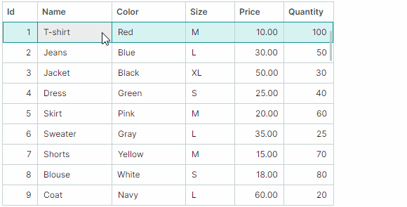
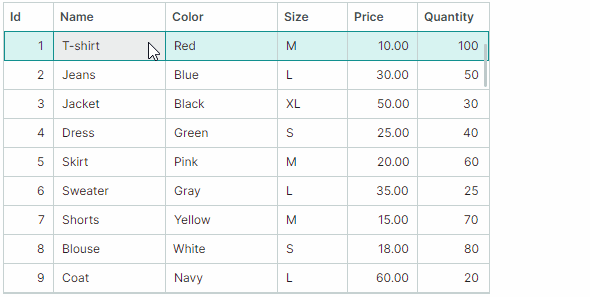
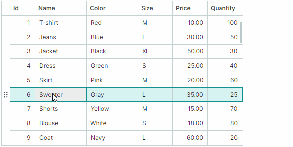
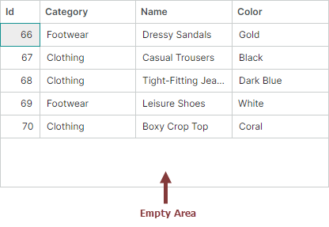
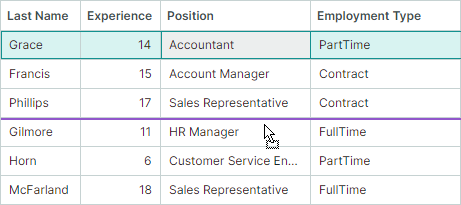

# 行拖放 {#row-drag-and-drop}

Data Grid 支持在网格控件内部拖放行，也支持将行拖放到外部控件。



拖动行时会显示行预览。但是，如果启用了基于平台的行拖放（[在应用程序之间拖动行](#enable-row-drag-and-drop-between-applications)时需要启用），则不提供行预览。

## 启用行拖放 {#enable-row-drag-and-drop}

将 [`DataGridControl.AllowDragDrop`](../../API/Eremex.AvaloniaUI.Controls.DataGrid/DataGridControl/AllowDragDrop.md) 属性设置为 `true` 可启用行拖放。在此模式下，用户可以在 Data Grid 控件内部以及向控件外部拖动行。
拖放操作会将行移动到另一个位置，同时也会更改数据源中相应业务对象的位置。

如果将行拖动到外部控件，Data Grid 的默认行为是从当前控件中移除该行，并从控件的数据源中删除相应的业务对象。有关如何防止行和业务对象被删除的信息，请参阅[控件之间的行拖放](#row-drag-and-drop-between-controls)。

如果使用 [`DataControlBase.SelectionMode`](../../API/Eremex.AvaloniaUI.Controls.DataControl/DataControlBase/SelectionMode.md) 属性启用了多行选择，则支持同时拖放多行（请参阅[行 - 多行选择（高亮）](rows.md#multiple-row-selection-highlight)）。

Data Grid 在拖放期间不支持自动复制操作。按下 CTRL 键不起作用。


### 启用应用程序之间的行拖放 {#enable-row-drag-and-drop-between-applications}

要允许在应用程序之间拖动行，请为作为拖放操作源的控件启用 [`UsePlatformRowDragDrop`](../../API/Eremex.AvaloniaUI.Controls.DataGrid/DataGridControl/UsePlatformRowDragDrop.md) 属性。

!!! Tip "提示"

    [`UsePlatformRowDragDrop`](../../API/Eremex.AvaloniaUI.Controls.DataGrid/DataGridControl/UsePlatformRowDragDrop.md) 属性会启用由 Avalonia 平台处理拖放操作的模式。在基于平台的行拖动操作期间不显示行预览。

## 行拖动模式 – 在单元格中开始拖动操作或使用专用拖动手柄 {#row-drag-mode-start-drag-operations-in-cells-or-use-special-drag-handles}

Data Grid 支持两种行拖放模式，区别在于拖放操作的启动方式。您可以使用控件的 [`RowDragMode`](../../API/Eremex.AvaloniaUI.Controls.DataControl/RowDragMode.md) 属性选择所需的模式。

- [`RowDragMode.Row`](../../API/Eremex.AvaloniaUI.Controls.DataControl/RowDragMode.md) 模式（默认）— 用户可以在行的任意单元格中启动拖放操作。

    


    在此模式下，单元格编辑器的默认激活方式如下：
    
    1. 用户需要先使单元格获得焦点。
    
    2. 然后在获得焦点的单元格内单击，即可激活单元格编辑器。
    
    要通过单击一次激活单元格编辑器，请启用在释放鼠标按键时激活单元格编辑器。为此，请将控件的 [`DataControlBase.EditorShowMode`](../../API/Eremex.AvaloniaUI.Controls.DataControl/DataControlBase/EditorShowMode.md) 属性设置为 [`EditorShowMode.PointerReleased`](../../API/Eremex.AvaloniaUI.Controls.DataControl/EditorShowMode.md)。

- [`RowDragMode.DragHandle`](../../API/Eremex.AvaloniaUI.Controls.DataControl/RowDragMode.md) 模式 — 用户可以通过拖动专用拖动手柄来启动拖放操作。拖动手柄显示在行指示器区域中；激活 [`RowDragMode.DragHandle`](../../API/Eremex.AvaloniaUI.Controls.DataControl/RowDragMode.md) 模式后，该区域会自动显示在行的左侧。

    

    在 `DragHandle` 模式下，默认情况下在单元格内按下一次即可激活单元格编辑器。您可以使用控件的 [`DataControlBase.EditorShowMode`](../../API/Eremex.AvaloniaUI.Controls.DataControl/DataControlBase/EditorShowMode.md) 属性更改此行为。

    启用多行选择后，每个选定的行都会显示拖动手柄。


**相关 API：**

- [`RowIndicatorWidth`](../../API/Eremex.AvaloniaUI.Controls.DataGrid/DataGridControl/RowIndicatorWidth.md) — 指定显示拖动手柄的行指示器区域的宽度。


## 拖放已排序和已分组的数据 {#drag-and-drop-of-sorted-and-grouped-data}

当网格控件的数据已[排序](sorting.md)或[分组](grouping.md)时，默认禁用行拖放操作。将 [`DataGridControl.AllowDragDropSortedRows`](../../API/Eremex.AvaloniaUI.Controls.DataGrid/DataGridControl/AllowDragDropSortedRows.md) 属性设置为 `true`，可在已排序/已分组的控件中启用拖放操作。

如果数据已排序，并且将某行拖动到另一行之前或之后的位置，控件会自动更新被拖动行在排序列中的值，以保持当前的排序顺序。被拖动行在排序列中的值会被设置为目标行的相应值。

## 使用事件处理拖放操作 {#handle-drag-and-drop-operations-with-events}

Data Grid 控件提供了用于管理和响应行拖放操作的事件。

### 开始拖放 {#start-drag-and-drop}

当拖放操作即将开始时，会触发 [`DataGridControl.StartDrag`](../../API/Eremex.AvaloniaUI.Controls.DataGrid/DataGridControl/StartDrag.md) 事件。使用以下事件参数获取有关当前拖放操作的信息。

- `e.Data` — 指定包含当前拖放操作数据的 [`DragDropData`](../../API/Eremex.AvaloniaUI.Controls.DataControl/DragDropData.md) 对象。
- `e.DragElement` — 正在被拖动的控件内部可视元素。
- `e.Effects` — 指定拖放效果。将此参数设置为 `DragDropEffects.None` 可取消当前的拖放操作。拖放效果还决定鼠标指针的图标。
- `e.Items` — 与被拖动行对应的数据源项（业务对象）数组。如果拖动的是组行，则 `e.Items` 数组包含该组行内显示的数据行所对应的业务对象。要确定拖动的是否为组行，请参阅 `e.DragRowIndexes`。
- `e.DragRowIndexes` — 被拖动行的索引数组。数据行的索引为非负数，而组行的索引为负数。有关详细信息，请参阅以下主题：[识别和获取行](rows.md#identify-and-get-rows)


#### 示例 - 禁止对特定数据行启动拖放操作 {#example-prevent-a-drag-and-drop-operation-from-starting-for-specific-data-rows}

以下 [`StartDrag`](../../API/Eremex.AvaloniaUI.Controls.DataGrid/DataGridControl/StartDrag.md) 事件处理程序会对 _Position_ 列中包含“Manager”字符串的行禁用拖放操作。

``` cs
private void DataGrid_StartDrag(object sender, DataGridStartDragEventArgs e)
{
    // It is assumed that items in the grid's data source are EmployeeInfo objects. 
    // The EmployeeInfo class contains the Position property of the string type.
    foreach(EmployeeInfo item in e.Items)
    {
        if(item.Position.Contains("Manager"))
        {
            e.Effects = Avalonia.Input.DragDropEffects.None;
            return;
        }
    }
}
```

#### 示例 - 禁止拖放组行 {#example-prevent-drag-and-drop-operations-for-group-rows}

以下示例通过处理 [`StartDrag`](../../API/Eremex.AvaloniaUI.Controls.DataGrid/DataGridControl/StartDrag.md) 事件来禁用组行的拖放操作。组行的索引为负数，因此 [`StartDrag`](../../API/Eremex.AvaloniaUI.Controls.DataGrid/DataGridControl/StartDrag.md) 事件处理程序会检查 `e.DragRowIndexes` 数组中是否包含负索引。

``` cs
private void DataGrid_StartDrag(object sender, DataGridStartDragEventArgs e)
{
    foreach(int rowIndex in e.DragRowIndexes)
        if(rowIndex < 0) e.Effects = Avalonia.Input.DragDropEffects.None;
}
```

### 处理拖动经过阶段 {#handle-the-drag-over-stage}

当用户将一行（或多行）拖过另一行时，会反复引发 [`DataGridControl.DragOver`](../../API/Eremex.AvaloniaUI.Controls.DataGrid/DataGridControl/DragOver.md) 事件。通过该事件的参数，可以获取与当前拖放操作相关的信息：

- `e.Items` — 与被拖动行对应的数据源项（业务对象）数组。如果拖动的是组行，则 `e.Items` 数组包含该组内所有数据行的业务对象。
- `e.TargetRowIndex` — 被拖动行当前所经过的行的[索引](rows.md#identify-and-get-rows)。
- `e.DropPosition` — 获取或设置相对于目标行的潜在放置位置。可用选项包括：
    - [`DropPosition.Before`](../../API/Eremex.AvaloniaUI.Controls.DataControl/DropPosition.md) — 被拖动的行在放置后，将添加到同一层级、目标行之前。
    - [`DropPosition.After`](../../API/Eremex.AvaloniaUI.Controls.DataControl/DropPosition.md) — 被拖动的行在放置后，将添加到同一层级、目标行之后。
    - [`DropPosition.Inside`](../../API/Eremex.AvaloniaUI.Controls.DataControl/DropPosition.md) — 被拖动的行在放置后，将作为目标组行的子项添加。在组行上方拖动时，此选项有效。
    - [`DropPosition.EmptyArea`](../../API/Eremex.AvaloniaUI.Controls.DataControl/DropPosition.md)（v1.5 新增）— 行被拖动到所有网格行下方的空白区域上。
    
        
    
        当行被拖动到空白区域上时，`e.Effects` 参数的初始值为 `DragDropEffects.None`，因此不允许将行放置在此处。
    
        将 `e.Effects` 参数设置为 `DragDropEffects.Move` 或 `DragDropEffects.Copy`，即可允许将行放置到空白区域。行放置到该区域后，会插入到所有行的末尾。

    您可以修改 `e.DropPosition` 参数来更改被拖动行的插入方式。例如，要始终将被拖动的行追加到所有行的末尾，请将 `e.DropPosition` 参数设置为 [`DropPosition.EmptyArea`](../../API/Eremex.AvaloniaUI.Controls.DataControl/DropPosition.md)，并确保 `e.Effects` 参数未设置为 `None`。

- `e.KeyModifiers` — 指定在 [`DragOver`](../../API/Eremex.AvaloniaUI.Controls.DataGrid/DataGridControl/DragOver.md) 事件期间是否按下了 ALT、SHIFT 和/或 CTRL 键。
- `e.Data` — 指定包含当前拖放操作数据的 [`DragDropData`](../../API/Eremex.AvaloniaUI.Controls.DataControl/DragDropData.md) 对象。
- `e.Effects` — 指定拖放效果。将此参数设置为 `DragDropEffects.None` 可取消当前的拖放操作。拖放效果还决定鼠标指针的图标。

#### 示例 - 允许将行放置到空白区域 {#example-allow-rows-to-be-dropped-within-the-empty-area}

以下 [`DataGridControl.DragOver`](../../API/Eremex.AvaloniaUI.Controls.DataGrid/DataGridControl/DragOver.md) 事件处理程序将 `e.Effects` 参数设置为 `Move`，以允许将行放置到控件的空白区域。

``` cs 
private void ProductsInStockGrid_DragOver(object sender, DataGridDragEventArgs e)
{
    if (e.DropPosition == DropPosition.EmptyArea)
        e.Effects = Avalonia.Input.DragDropEffects.Move;
}
```

#### 示例 - 始终将被拖动的行插入到末尾 {#example-insert-dragged-rows-always-at-the-end}

以下 [`DataGridControl.DragOver`](../../API/Eremex.AvaloniaUI.Controls.DataGrid/DataGridControl/DragOver.md) 事件处理程序可确保被拖动的行在放置时始终插入到所有行的末尾。为此，将 `e.DropPosition` 事件参数强制设置为 [`DropPosition.EmptyArea`](../../API/Eremex.AvaloniaUI.Controls.DataControl/DropPosition.md)，并将 `e.Effects` 参数设置为 `Move`。

``` cs
private void ProductsInStockGrid_DragOver(object sender, DataGridDragEventArgs e)
{
    e.DropPosition = DropPosition.EmptyArea;
    e.Effects = Avalonia.Input.DragDropEffects.Move;
}
```


#### 示例 - 禁止将行放置到组行上 {#example-prevent-rows-from-being-dropped-over-group-rows}

以下 [`DragOver`](../../API/Eremex.AvaloniaUI.Controls.DataGrid/DataGridControl/DragOver.md) 事件处理程序可禁止将行放置到组行上。

``` cs
private void DataGrid_DragOver(object sender, DataGridDragEventArgs e)
{
    if(e.TargetRowIndex < 0) 
        e.Effects = Avalonia.Input.DragDropEffects.None;
}
```


### 完成拖放 {#finish-drag-and-drop}

您可以处理以下两个事件，以便在拖放操作中放置行时执行相应操作：

- [`DataGridControl.Drop`](../../API/Eremex.AvaloniaUI.Controls.DataGrid/DataGridControl/Drop.md) — 在行即将被放置到另一网格行上时触发。该事件的参数与 [`DataGridControl.DragOver`](../../API/Eremex.AvaloniaUI.Controls.DataGrid/DataGridControl/DragOver.md) 事件的参数相同。

    要在特定情况下取消放置操作，请处理 [`Drop`](../../API/Eremex.AvaloniaUI.Controls.DataGrid/DataGridControl/Drop.md) 事件并将其 `e.Handled` 参数设置为 `true`。

    如果行被放置到当前 Data Grid 控件之外，则不会为此控件触发 [`Drop`](../../API/Eremex.AvaloniaUI.Controls.DataGrid/DataGridControl/Drop.md) 事件。有关详细信息，请参阅下文对 [`DataGridControl.CompleteDragDrop`](../../API/Eremex.AvaloniaUI.Controls.DataGrid/DataGridControl/CompleteDragDrop.md) 事件的说明。

    #### 示例 - 修改被放置行的值 {#example-modify-a-dropped-rows-values}

    以下 [`Drop`](../../API/Eremex.AvaloniaUI.Controls.DataGrid/DataGridControl/Drop.md) 事件处理程序会在被拖动的行放置时更改其值。假定数据源包含 _"EmploymentType"_ 字段。下面的代码将被放置行的 _"EmploymentType"_ 字段设置为目标行的 _"EmploymentType"_ 字段值。

    ``` cs
    private void DataGrid_Drop(object sender, DataGridDragEventArgs e)
    {
        DataGridControl grid = sender as DataGridControl;
        GridColumn colEmploymentType = grid.Columns["EmploymentType"];
        EmploymentType newEmploymentType = (EmploymentType)grid.GetCellValue(e.TargetRowIndex, colEmploymentType);
        foreach (EmployeeInfo item in e.Items)
        {
            item.EmploymentType = newEmploymentType;
        }
    }
    ```

<!-- TODO
Почему передаются айтемы, а не row indexы?
В ивент надо добавить e.DragRowIndexes (по аналогии с StartDrag) ?
 -->


- [`DataGridControl.CompleteDragDrop`](../../API/Eremex.AvaloniaUI.Controls.DataGrid/DataGridControl/CompleteDragDrop.md) — 在当前控件内部或外部完成拖放操作后触发。

    [`DataGridControl.CompleteDragDrop`](../../API/Eremex.AvaloniaUI.Controls.DataGrid/DataGridControl/CompleteDragDrop.md) 事件在 [`DataGridControl.Drop`](../../API/Eremex.AvaloniaUI.Controls.DataGrid/DataGridControl/Drop.md) 事件之后触发。

    [`DataGridControl.CompleteDragDrop`](../../API/Eremex.AvaloniaUI.Controls.DataGrid/DataGridControl/CompleteDragDrop.md) 事件提供以下参数：

    - `e.Items` — 与被放置行对应的项（业务对象）数组。
    - `e.Effects` — 返回在放置行的控件的 [`Drop`](../../API/Eremex.AvaloniaUI.Controls.DataGrid/DataGridControl/Drop.md) 事件处理程序中设置的拖放效果。

    另请参阅：[控件之间的行拖放](#row-drag-and-drop-between-controls)

    
## 拖放选项 {#drag-and-drop-options}

Data Grid 提供以下选项来自定义行拖放操作：

- [`DataGridControl.AutoExpandOnDrag`](../../API/Eremex.AvaloniaUI.Controls.DataGrid/DataGridControl/AutoExpandOnDrag.md) — 获取或设置在拖放操作期间悬停在已折叠的组行上时，是否自动展开这些组行。
- [`DataGridControl.AutoExpandDelayOnDrag`](../../API/Eremex.AvaloniaUI.Controls.DataGrid/DataGridControl/AutoExpandDelayOnDrag.md) — 获取或设置在拖放操作期间鼠标悬停在已折叠的组行上时，自动展开这些组行之前的延迟时间。
- [`DataGridControl.AllowScrollingOnDrag`](../../API/Eremex.AvaloniaUI.Controls.DataGrid/DataGridControl/AllowScrollingOnDrag.md) — 获取或设置将行拖动到控件的上边缘或下边缘时，Data Grid 是否自动滚动行。


## 控件之间的行拖放 {#row-drag-and-drop-between-controls}

[`DataGridControl`](../../API/Eremex.AvaloniaUI.Controls.DataGrid/DataGridControl.md)、[`TreeListControl`](../../API/Eremex.AvaloniaUI.Controls.TreeList/TreeListControl.md) 和 [`TreeViewControl`](../../API/Eremex.AvaloniaUI.Controls.TreeList/TreeViewControl.md) 控件之间自动支持行拖放。使用这些控件提供的 `AllowDragDrop` 选项可为其启用拖放功能。

### 拖放的视觉指示 {#visual-indication-of-drag-and-drop}

拖动行时，[`DataGridControl`](../../API/Eremex.AvaloniaUI.Controls.DataGrid/DataGridControl.md)、[`TreeListControl`](../../API/Eremex.AvaloniaUI.Controls.TreeList/TreeListControl.md) 和 [`TreeViewControl`](../../API/Eremex.AvaloniaUI.Controls.TreeList/TreeViewControl.md) 控件会以可视方式指示潜在的放置位置。



### 将行及其项从源控件自动移动到目标控件 {#automatic-movement-of-a-row-and-its-item-from-the-source-to-the-target-control}

[`DataGridControl`](../../API/Eremex.AvaloniaUI.Controls.DataGrid/DataGridControl.md)、[`TreeListControl`](../../API/Eremex.AvaloniaUI.Controls.TreeList/TreeListControl.md) 和 [`TreeViewControl`](../../API/Eremex.AvaloniaUI.Controls.TreeList/TreeViewControl.md) 支持在拖放操作期间在这些控件之间自动移动被拖动的行：先向目标控件添加一个包含被拖动数据的新行，然后从源控件中移除被拖动的行。相应的项（业务对象）也会在源控件和目标控件的项源之间转移。

如果源控件中项的数据类型与目标控件中项的数据类型相同或兼容，则会自动移动行及其对应的项。数据类型的兼容性通过 `Type.IsAssignableFrom` 方法进行检查。

要防止在向外部控件执行拖放操作时源控件中的行和项被删除，可以执行以下任一操作：

- 处理目标控件的 [`Drop`](../../API/Eremex.AvaloniaUI.Controls.DataGrid/DataGridControl/Drop.md) 事件，并将其 `e.Effects` 事件参数设置为 `Avalonia.Input.DragDropEffects.None`。

- 处理源控件的 [`DataGridControl.CompleteDragDrop`](../../API/Eremex.AvaloniaUI.Controls.DataGrid/DataGridControl/CompleteDragDrop.md) 事件，并将 `e.Handled` 事件参数设置为 `true`。

    ``` cs
    private void DataGrid_CompleteDragDrop(object sender, DataGridCompleteDragDropEventArgs e)
    {
        e.Handled = true;
    }
    ```

### 拖放到其他控件 {#drag-and-drop-to-other-controls}

[`DataGridControl`](../../API/Eremex.AvaloniaUI.Controls.DataGrid/DataGridControl.md)、[`TreeListControl`](../../API/Eremex.AvaloniaUI.Controls.TreeList/TreeListControl.md) 和 [`TreeViewControl`](../../API/Eremex.AvaloniaUI.Controls.TreeList/TreeViewControl.md) 控件不支持将行自动拖放到其他控件（例如标准的 Avalonia `DataGrid`）。要允许将行拖动到这些控件，请使用 `Avalonia.Input.DragDrop.AllowDrop` 附加属性为其启用拖放功能。处理目标控件的 `Avalonia.Input.DragDrop.Drop` 附加事件以接收被拖动的行。在处理 `DragDrop.Drop` 事件时，可以通过 `Data` 事件参数访问被拖动的行。


<br>
<br>

<sup>*</sup> 本页面使用机器翻译技术翻译。
