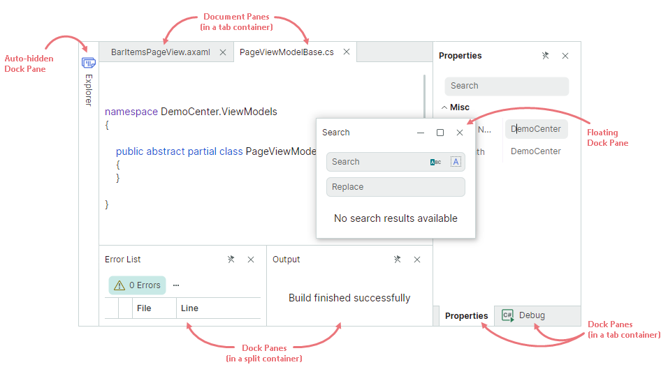
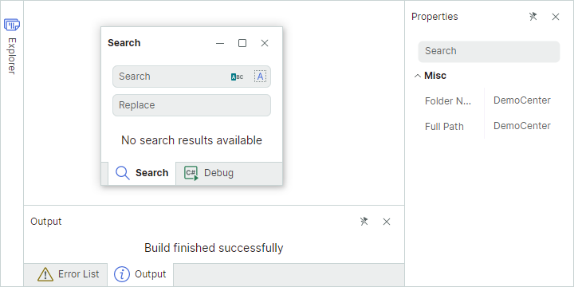
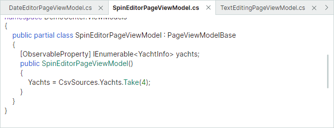
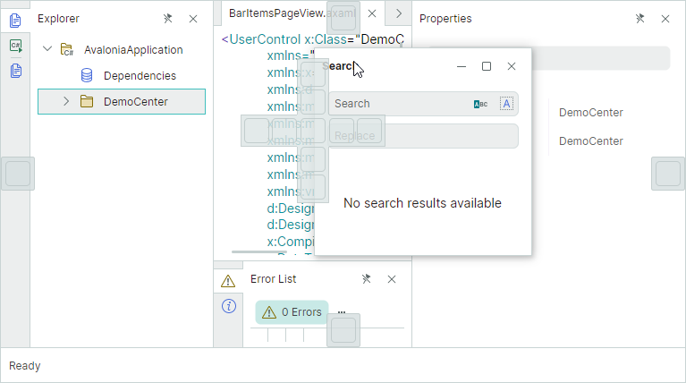
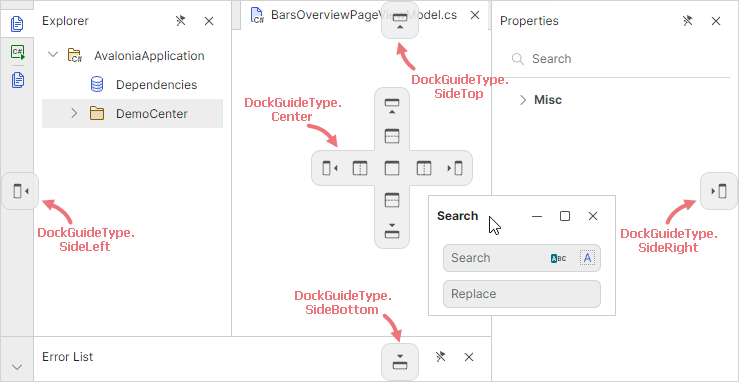
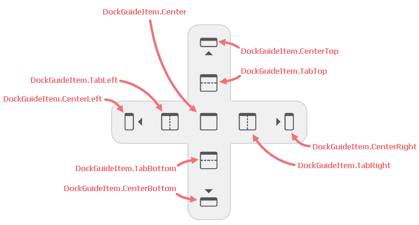
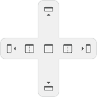
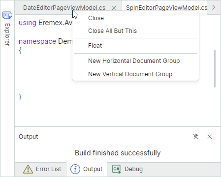
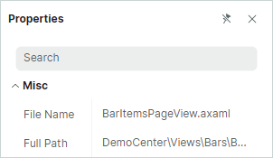

# Dock 管理器和 Dock 项目 {#dock-manager-and-dock-items}

[`DockManager`](../../API/Eremex.AvaloniaUI.Controls.Docking/DockManager.md) 组件允许您创建受 Visual Studio 启发的对接 UI。停靠窗格和 Document 窗格是停靠 UI 的基本元素。停靠窗格用于实现工具面板。Document 窗格专为显示窗口的主要内容而定制。您可以将多个 Document 窗格组合在一个特殊容器中，以实现选项卡式 MDI（多文档界面）。




Docking 库支持用户在代码中对停靠项目（面板和文档）进行运行时操作。用户可以使用拖放操作和上下文菜单重新排列布局或停靠项目，并使它们浮动。相邻项目之间的拆分器允许运行时调整大小操作。面板标题中的”固定”按钮保留了自动隐藏功能，使用户可以折叠和恢复面板。

借助 Docking 库，您可以使用 MVVM 设计模式通过停靠窗格和 Document 窗格填充对接界面，并为窗格提供内容。


## 开始使用 Docking UI {#get-started-with-docking-ui}

以下主题演示如何从头开始创建示例对接接口：

- [Docking 入门指南](get-started-with-docking.md) 
- [如何在代码后台创建复杂的 Docking 布局](examples/how-to-create-a-complex-docking-layout-in-code-behind.md)


## 停靠窗格 {#dock-panes}

停靠窗格（[`DockPane`](../../API/Eremex.AvaloniaUI.Controls.Docking/DockPane.md) 对象）允许您创建可停靠和浮动工具面板。面板可以并排显示或作为选项卡显示。他们还支持自动隐藏功能。



要在 XAML 或代码隐藏中创建 Docking UI，需要将 Dock 窗格组合到容器（组）中。例如，您可以组合 [`DockGroup`](../../API/Eremex.AvaloniaUI.Controls.Docking/DockGroup.md) 容器中的项目，以水平或垂直方式将它们相邻显示。如果您将面板组合在 [`TabbedGroup`](../../API/Eremex.AvaloniaUI.Controls.Docking/TabbedGroup.md) 容器中，它们将显示为选项卡。容器还可以包含其他容器作为子容器。

请参阅以下主题以了解更多信息：[Dock 面板与容器](dock-panes-and-containers.md)


## Document 窗格 {#document-panes}

使用 Document 窗格（[`DocumentPane`](../../API/Eremex.AvaloniaUI.Controls.Docking/DocumentPane.md) 对象）来显示窗口的主要内容。如果您创建多个 Document 窗格，则可以将它们合并到一个 [`DocumentGroup`](../../API/Eremex.AvaloniaUI.Controls.Docking/DocumentGroup.md) 容器中。 [`DocumentGroup`](../../API/Eremex.AvaloniaUI.Controls.Docking/DocumentGroup.md) 是一个特殊容器，它将 Document 窗格显示为选项卡（类似于用于将停靠窗格显示为选项卡的 [`TabbedGroup`](../../API/Eremex.AvaloniaUI.Controls.Docking/TabbedGroup.md) 容器）。



Document 窗格可以设为浮动。与 Dock 窗格不同，Document 窗格不支持自动隐藏功能。

您可以创建两个或多个 [`DocumentGroup`](../../API/Eremex.AvaloniaUI.Controls.Docking/DocumentGroup.md) 容器，每个容器显示其自己的一组 Document 窗格。

<animated gif>

请参阅以下主题以了解更多信息：[Document 面板](document-panes.md)

## 停靠引导 {#dock-guides}

当用户将停靠窗格或 Document 窗格拖动到另一个面板或容器上时，DockManager 会显示停靠引导。停靠引导是箭头形式的可视化叠加层，用于在停靠操作期间为用户提供辅助。将面板或容器放到特定引导上会将该项停靠在相应的位置。



如果用户将该项放在停靠引导之外，则该项会变为浮动。

### 自定义停靠引导 {#customize-dock-guides}

通过 [`CustomizeDockGuide`](../../API/Eremex.AvaloniaUI.Controls.Docking/DockManager/CustomizeDockGuide.md) 事件，您可以隐藏特定的停靠引导以及 `Center` 引导中的各个项。隐藏某个引导元素后，用户将无法执行相应的停靠操作。

使用事件参数提供的以下方法隐藏引导元素：

- [`HideGuide(DockGuideType guide)`](../../API/Eremex.AvaloniaUI.Controls.Docking/CustomizeDockGuideEventArgs/HideGuide.md) — 隐藏由 `DockGuideType` 枚举指定的停靠引导。

    下图显示了可用的停靠引导类型：

    

    - `SideLeft`、`SideRight`、`SideTop` 和 `SideBottom` — 放到这些引导上的面板将停靠在根容器的相应边缘。
    - `Center` — 此引导由 9 个内部项组成，每个项都可以使用 [`HideItem`](../../API/Eremex.AvaloniaUI.Controls.Docking/CustomizeDockGuideEventArgs/HideItem.md) 方法隐藏。


- [`HideItem(DockGuideItem item)`](../../API/Eremex.AvaloniaUI.Controls.Docking/CustomizeDockGuideEventArgs/HideItem.md) — 隐藏 `Center` 停靠引导中的某一项。

    下图显示了 `Center` 停靠引导中的可用项：

    

    - `Center` — 放入的面板与目标面板合并到同一个选项卡容器中。
    - `CenterLeft`、`CenterRight`、`CenterTop` 和 `CenterBottom` — 放入的面板放置在目标面板的相应边缘，形成拆分容器。
    - `TabLeft`、`TabRight`、`TabTop` 和 `TabBottom` — 放入的面板被包裹在新的选项卡容器中，该容器放置在目标面板的相应边缘。

#### 示例 - 隐藏停靠引导 {#example-hide-dock-guides}

以下代码处理 [`CustomizeDockGuide`](../../API/Eremex.AvaloniaUI.Controls.Docking/DockManager/CustomizeDockGuide.md) 事件，以隐藏 `Center` 引导中的 `TabTop` 和 `TabBottom` 项。



```csharp
private void DockManager1_CustomizeDockGuide(object sender, Eremex.AvaloniaUI.Controls.Docking.CustomizeDockGuideEventArgs e)
{
    DockGuideItem[] guideItems = new DockGuideItem[] { DockGuideItem.TabTop, DockGuideItem.TabBottom  };
    foreach (var item in guideItems)
    {
        e.HideItem(item);
    }
}
```

## 上下文菜单 {#context-menus}

Docking 库为 Dock 窗格和 Document 窗格提供内置上下文菜单。这些菜单包含在窗格上执行常见停靠操作的命令。



处理 [`DockManager.DockItemContextMenuOpening`](../../API/Eremex.AvaloniaUI.Controls.Docking/DockManager/DockItemContextMenuOpening.md) 事件以自定义上下文菜单，或阻止显示它们。

<!-- TODO
example for the [`DockManager.DockItemContextMenuOpening`](../../API/Eremex.AvaloniaUI.Controls.Docking/DockManager/DockItemContextMenuOpening.md) event 
 -->

## 阻止对 Dock 项目的某些操作 {#prevent-certain-operations-on-dock-items}

Dock 窗格和 Document 窗格在其标题中显示预定义按钮，用于在窗格上执行常见操作。



DockManager 提供选项和事件，用于控制停靠窗格上的操作。有关更多详细信息，请参阅以下部分：[Dock 面板与容器 - 停靠面板的运行时选项](dock-panes-and-containers.md#runtime-options-for-dock-panels)

## 保存和恢复窗格布局 {#save-and-restore-the-layout-of-panes}

您可以将当前的停靠布局保存到流中，然后在需要时恢复。此功能允许您在用户关闭应用程序时保存布局，并在下次应用程序运行时重新加载保存的布局。有关详细信息，请参阅以下主题：[保存和恢复面板布局](save-and-restore-layout.md)

## 另请参阅 {#see-also}

- [如何在代码后台创建复杂的 Docking 布局](examples/how-to-create-a-complex-docking-layout-in-code-behind.md)

<br>
<br>

<sup>*</sup> 本页面使用机器翻译技术翻译。
