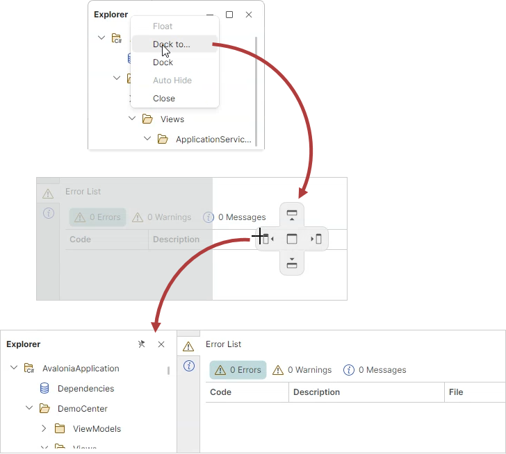

# Wayland 限制 {#wayland-limitations}

Linux 上的原生 Wayland 会话使单个应用程序窗口无法获知或设置自己的屏幕位置。因此，Docking 库具有以下限制：

- 您可以拖动浮动面板来移动它。但在拖动过程中不会显示停靠参考线。浮动面板无法通过拖放进行停靠。

- 要停靠面板，请在其上下文菜单中选择 **Dock To**。该命令会显示停靠参考线。然后，单击参考线将面板停靠到相应位置。

- 您无法通过拖动使已停靠的面板变为浮动。请改为右键单击面板标题，然后从上下文菜单中选择 **Float** 命令。
