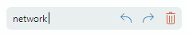
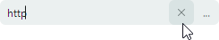
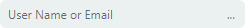

# ButtonEditor {#buttoneditor}

[`ButtonEditor`](../../API/Eremex.AvaloniaUI.Controls.Editors/ButtonEditor.md) 是一种文本编辑器，可以显示多个内置的普通按钮和切换按钮。



该控件的主要功能包括：

- 普通按钮和切换按钮。
- 在按钮中显示文本和图像。
- 按钮的左右对齐方式。
- 工具提示。
- 预定义的“x”按钮，用于清除编辑器的值。
- 水印。

## 内置按钮 {#built-in-buttons}

要添加内置按钮，请将一个 [`ButtonSettings`](../../API/Eremex.AvaloniaUI.Controls.Editors/ButtonSettings.md) 对象添加到 [`ButtonEditor.Buttons`](../../API/Eremex.AvaloniaUI.Controls.Editors/ButtonEditor/Buttons.md) 集合中。[`ButtonSettings`](../../API/Eremex.AvaloniaUI.Controls.Editors/ButtonSettings.md) 对象包含按钮的显示和行为选项。

### 主要属性和事件 {#main-properties-and-events}

- [`ButtonKind`](../../API/Eremex.AvaloniaUI.Controls.Editors/ButtonKind.md) — 指定按钮是普通按钮还是切换按钮。
- [`Content`](../../API/Eremex.AvaloniaUI.Controls.Editors/ButtonSettings/Content.md) — 按钮的文本或自定义数据。使用 [`ContentTemplate`](../../API/Eremex.AvaloniaUI.Controls.Editors/ButtonSettings/ContentTemplate.md) 属性指定用于呈现自定义数据的模板。
- [`Glyph`](../../API/Eremex.AvaloniaUI.Controls.Editors/ButtonSettings/Glyph.md) — 按钮的图像。
- [`GlyphSize`](../../API/Eremex.AvaloniaUI.Controls.Editors/ButtonSettings/GlyphSize.md) — 按钮图像的大小。
- [`IsLeft`](../../API/Eremex.AvaloniaUI.Controls.Editors/ButtonSettings/IsLeft.md) — 指定按钮是对齐到编辑框的左边缘还是右边缘（默认）。
- [`Click`](../../API/Eremex.AvaloniaUI.Controls.Editors/ButtonSettings/Click.md) — 允许你响应按钮点击的事件。
- [`Command`](../../API/Eremex.AvaloniaUI.Controls.Editors/ButtonSettings/Command.md) — 指定点击按钮时触发的命令。
- [`CommandParameter`](../../API/Eremex.AvaloniaUI.Controls.Editors/ButtonSettings/CommandParameter.md) — 指定命令的参数。
- [`IsChecked`](../../API/Eremex.AvaloniaUI.Controls.Editors/ButtonSettings/IsChecked.md) — 获取或设置切换按钮是否处于选中状态。


### 示例 - 如何添加普通按钮和切换按钮 {#example-how-to-add-regular-and-toggle-buttons}

以下示例定义了一个带有两个按钮的 [`ButtonEditor`](../../API/Eremex.AvaloniaUI.Controls.Editors/ButtonEditor.md) 控件：

- 一个与 _ResetValue_ 命令关联的普通按钮，用于将编辑器的值设置为“0”。
- 一个切换父编辑器 [`IsTextEditable`](../../API/Eremex.AvaloniaUI.Controls.Editors/ButtonEditor/IsTextEditable.md) 设置的复选按钮。当该按钮被选中时，文本编辑将被禁用。

假设项目的“_Images_”文件夹中包含“_dot.svg_”“_locked.svg_”和“_unlocked.svg_”图像。普通按钮显示“_dot.svg_”图像。复选按钮根据选中状态显示“_locked.svg_”或“_unlocked.svg_”图像。

``` xml
xmlns:mxe="https://schemas.eremexcontrols.net/avalonia/editors"
xmlns:local="clr-namespace:EditorsSample"

<Window.DataContext>
    <local:MainViewModel/>
</Window.DataContext>

<mxe:ButtonEditor Name="btnEditor1" 
                  EditorValue="{Binding Quantity, Mode=TwoWay}"
                  IsTextEditable="True">
    <mxe:ButtonEditor.Buttons>
        <mxe:ButtonSettings ButtonKind="Simple"
                            Glyph="{SvgImage 'avares://EditorsSample/Images/dot.svg'}"
                            Command="{Binding ResetValueCommand}"
                            CommandParameter="{Binding #btnEditor1}"
                            ToolTip.Tip = "Reset value"
                            >
        </mxe:ButtonSettings>
        <mxe:ButtonSettings ButtonKind="Toggle"
                            Glyph="{Binding $self.IsChecked, 
                             Converter={local:LockedStateToSvgNameConverter}}"
                            IsChecked="{Binding !$parent.IsTextEditable}"
                            ToolTip.Tip = "Toggle text editing mode"
                >
        </mxe:ButtonSettings>
    </mxe:ButtonEditor.Buttons>
</mxe:ButtonEditor>
```

```csharp
using Eremex.AvaloniaUI.Controls.Utils;

namespace EditorsSample;

[ObservableObject]
public partial class MainViewModel
{
    [ObservableProperty]
    decimal quantity = 0;

    // Sets the editor's value to '0'.
    [RelayCommand]
    void ResetValue(TextEditor editor)
    {
        // You can access the current editor from the command parameter, 
        // and change its value.
        editor.EditorValue = 0;
    }
}

public class LockedStateToSvgNameConverter : MarkupExtension, IValueConverter
{
    public object? Convert(object? value, Type targetType, object? parameter, CultureInfo culture)
    {
        if (value == null)
            return null;
        bool isLocked = (bool)value;
        string lockedState = isLocked ? "locked" : "unlocked";
        if (isLocked)
            lockedState = "locked";
        return ImageLoader.LoadSvgImage(Assembly.GetExecutingAssembly(), $"Images/{lockedState}.svg");
    }

    public object? ConvertBack(object? value, Type targetType, object? parameter, CultureInfo culture)
    {
        throw new NotImplementedException();
    }

    public override object ProvideValue(IServiceProvider serviceProvider)
    {
        return this;
    }
}
```

<!--TODO ## Provide Custom Template to Render Buttons

### Example - How to display an Image and Text in a Button

 -->

## 清除值（“x”）按钮 {#clear-value-x-button}

将 [`ButtonEditor.NullValueButtonPosition`](../../API/Eremex.AvaloniaUI.Controls.Editors/ButtonEditor/NullValueButtonPosition.md) 属性设置为 [`ComponentPlacement.EditorBox`](../../API/Eremex.AvaloniaUI.Controls.Editors/ComponentPlacement.md)，以启用内置的“x”按钮，允许用户将当前值设置为 null。



## 水印 {#watermark}

与所有 [`TextEditor`](../../API/Eremex.AvaloniaUI.Controls.Editors/TextEditor.md) 的派生类一样，[`ButtonEditor`](../../API/Eremex.AvaloniaUI.Controls.Editors/ButtonEditor.md) 控件支持水印（当编辑器的值为空或为 null 时显示的灰色提示文字）。



使用继承的 [`TextEditor.Watermark`](../../API/Eremex.AvaloniaUI.Controls.Editors/TextEditor/Watermark.md) 属性来指定水印。

``` xml
xmlns:mxe="https://schemas.eremexcontrols.net/avalonia/editors"

<mxe:ButtonEditor Name="buttonEditor1" Watermark="User Name or Email" Margin="5">
    ...
</mxe:ButtonEditor>
```


<br>
<br>

<sup>*</sup> 本页面使用机器翻译技术翻译。
