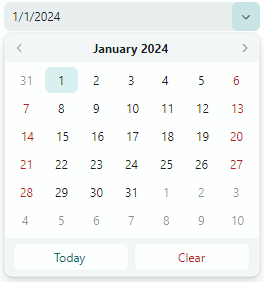
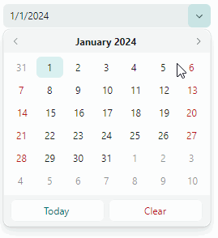
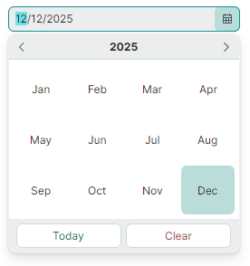

# DateEditor {#dateeditor}

[`DateEditor`](../../API/Eremex.AvaloniaUI.Controls.Editors/DateEditor.md) 控件包含一个下拉日历，允许用户选择日期。该编辑器支持在编辑框中以多种格式显示日期值。



下拉日历包含用于浏览月份和年份的导航标题。“今天”和“清除”按钮分别帮助用户快速选择今天的日期和清除当前值。

该控件的主要功能包括：

- 使用鼠标在下拉日历中选择日期。
- 使用导航栏浏览月份和年份。
- 三种日历视图：月视图、年视图和年份范围视图。
- 内置的“今天”和“清除”按钮。
- 限制可用的日期范围。
- 编辑框中所选日期值的多种显示格式。


## 选择日期 {#select-a-date}

用户可以通过打开下拉窗口，并在出现的日历中选取日期来选择日期。

下拉日历的导航标题允许用户浏览月份和年份：



在代码中，你可以使用 [`DateEditor.DateTime`](../../API/Eremex.AvaloniaUI.Controls.Editors/DateEditor/DateTime.md) 或 [`DateEditor.EditorValue`](../../API/Eremex.AvaloniaUI.Controls.Editors/BaseEditor/EditorValue.md) 属性指定日期或读取当前选定的日期。这两个属性是同步的，区别在于值类型：[`DateTime`](../../API/Eremex.AvaloniaUI.Controls.Editors/DateEditor/DateTime.md) 属性是可为 null 的 `System.DateTime` 类型，而 [`EditorValue`](../../API/Eremex.AvaloniaUI.Controls.Editors/BaseEditor/EditorValue.md) 属性和所有 Eremex 编辑器一样是 `object` 类型。

## 自定义下拉日历 {#customize-the-dropdown-calendar}

以下属性允许你设置 [`DateEditor`](../../API/Eremex.AvaloniaUI.Controls.Editors/DateEditor.md) 的日历：

- [`ShowToday`](../../API/Eremex.AvaloniaUI.Controls.Editors/DateEditor/ShowToday.md) — 获取或设置是否在日历中高亮显示今天的日期。
- [`NullValueButtonPosition`](../../API/Eremex.AvaloniaUI.Controls.Editors/ButtonEditor/NullValueButtonPosition.md) — 获取或设置（_“x”_）（清除值）按钮是否可见。
- [`MinValue`](../../API/Eremex.AvaloniaUI.Controls.Editors/DateEditor/MinValue.md) — 指定允许的最小日期。[`MinValue`](../../API/Eremex.AvaloniaUI.Controls.Editors/DateEditor/MinValue.md) 和 [`MaxValue`](../../API/Eremex.AvaloniaUI.Controls.Editors/DateEditor/MaxValue.md) 属性允许你指定日历中显示的值范围。
- [`MaxValue`](../../API/Eremex.AvaloniaUI.Controls.Editors/DateEditor/MaxValue.md) — 指定允许的最大日期。

<!--TODO
[`ShowToday`](../../API/Eremex.AvaloniaUI.Controls.Editors/DateEditor/ShowToday.md) — `HighlightTodayDate`?
[`NullValueButtonPosition`](../../API/Eremex.AvaloniaUI.Controls.Editors/ButtonEditor/NullValueButtonPosition.md) — `ShowClearButton`? 
-->

你还可以处理 [`PopupOpened`](../../API/Eremex.AvaloniaUI.Controls.Editors/PopupEditor/PopupOpened.md) 事件，对下拉日历进行额外的自定义。在 [`PopupOpened`](../../API/Eremex.AvaloniaUI.Controls.Editors/PopupEditor/PopupOpened.md) 事件处理程序中，可以使用 [`DateEditor.PopupContent`](../../API/Eremex.AvaloniaUI.Controls.Editors/PopupEditor/PopupContent.md) 属性访问日历对象。将该属性转换为 [`CalendarControl`](../../API/Eremex.AvaloniaUI.Controls.Editors/CalendarControl.md) 类对象，即可修改其属性。请参见以下示例：[示例 - 打开日历时启用年份视图](#example-enable-the-year-view-when-the-calendar-is-opened)


### 示例 - 如何创建 DateEditor {#example-how-to-create-a-dateeditor}

以下示例定义了一个 DateEditor，设置了初始值，并指定了允许的日期范围。

``` xml
xmlns:mxe="https://schemas.eremexcontrols.net/avalonia/editors"

<Window.DataContext>
    <local:MainViewModel/>
</Window.DataContext>

<mxe:DateEditor 
    DateTime="{Binding SelectedDate, Mode=TwoWay}" 
    MinValue="{Binding MinimumDate}" 
    MaxValue="{Binding MaximumDate}" />
```
``` csharp
using CommunityToolkit.Mvvm.ComponentModel;
using System.Collections.ObjectModel;

[ObservableObject]
public partial class MainViewModel
{
    [ObservableProperty]
    DateTime selectedDate = DateTime.Now;
    [ObservableProperty]
    DateTime minimumDate = DateTime.Now.AddDays(-15);
    [ObservableProperty] 
    DateTime maximumDate = DateTime.Now.AddDays(15);
}
```

## 指定值的显示格式 {#specify-the-values-display-format}

使用 [`DisplayFormatString`](../../API/Eremex.AvaloniaUI.Controls.Editors/BaseEditor/DisplayFormatString.md) 属性设置编辑框中显示的日期/时间值的显示格式。

## 防止只读编辑器弹出下拉窗口 {#prevent-popups-in-read-only-editors}

在只读模式下，任何弹出式编辑器的默认行为都是允许用户打开编辑器的下拉窗口。但用户无法通过编辑框或下拉窗口修改值。要为只读编辑器禁用弹出窗口，请将 [`ShowPopupIfReadOnly`](../../API/Eremex.AvaloniaUI.Controls.Editors/PopupEditor/ShowPopupIfReadOnly.md) 属性设置为 `false`。

## 阻止弹出窗口打开和关闭 {#prevent-popups-from-opening-and-closing}

你可以处理以下继承事件来取消弹出窗口的打开和关闭操作：

- [`PopupEditor.PopupOpening`](../../API/Eremex.AvaloniaUI.Controls.Editors/PopupEditor/PopupOpening.md) — 在弹出窗口即将创建时触发。
- [`PopupEditor.PopupClosing`](../../API/Eremex.AvaloniaUI.Controls.Editors/PopupEditor/PopupClosing.md) — 在弹出窗口即将关闭时触发。

这些事件提供 `e.Cancel` 参数。将其设置为 `true` 即可取消当前操作。

## 在弹出窗口出现时对其进行自定义 {#customize-the-popup-when-it-appears}

处理以下继承事件，以修改弹出窗口或其嵌套控件：

- [`PopupEditor.PopupOpened`](../../API/Eremex.AvaloniaUI.Controls.Editors/PopupEditor/PopupOpened.md) — 在弹出窗口创建完成之后、显示之前立即触发。这是一个通知事件，不允许你取消弹出窗口的打开操作。处理 [`PopupOpened`](../../API/Eremex.AvaloniaUI.Controls.Editors/PopupEditor/PopupOpened.md) 事件即可自定义弹出窗口或其子控件。

在处理 [`PopupEditor.PopupOpened`](../../API/Eremex.AvaloniaUI.Controls.Editors/PopupEditor/PopupOpened.md) 事件时，可使用编辑器的 [`PopupContent`](../../API/Eremex.AvaloniaUI.Controls.Editors/PopupEditor/PopupContent.md) 属性安全地访问编辑器弹出窗口内部的控件。[`PopupOpened`](../../API/Eremex.AvaloniaUI.Controls.Editors/PopupEditor/PopupOpened.md) 事件确保在你访问该弹出窗口控件时它已经存在。对于 DateEditor 控件而言，[`PopupContent`](../../API/Eremex.AvaloniaUI.Controls.Editors/PopupEditor/PopupContent.md) 属性返回一个 [`CalendarControl`](../../API/Eremex.AvaloniaUI.Controls.Editors/CalendarControl.md) 类的实例。

### 示例 - 打开日历时启用年份视图 {#example-enable-the-year-view-when-the-calendar-is-opened}

本示例展示了如何在打开时将 DateEditor 的下拉日历设置为年份视图。



[`DateEditor`](../../API/Eremex.AvaloniaUI.Controls.Editors/DateEditor.md) 类没有提供公共属性来更改其日历的当前视图。但内嵌的日历（[`CalendarControl`](../../API/Eremex.AvaloniaUI.Controls.Editors/CalendarControl.md) 对象）公开了一个名为 `DisplayMode` 的公共属性。该属性指定日历的视图模式（`Month`、`Year` 或 `Decade`）。

本示例通过处理 [`PopupOpened`](../../API/Eremex.AvaloniaUI.Controls.Editors/PopupEditor/PopupOpened.md) 事件，在内嵌日历创建时对其进行访问。处理程序将 [`DateEditor.PopupContent`](../../API/Eremex.AvaloniaUI.Controls.Editors/PopupEditor/PopupContent.md) 属性转换为 [`CalendarControl`](../../API/Eremex.AvaloniaUI.Controls.Editors/CalendarControl.md) 对象，然后将 `CalendarControl.DisplayMode` 属性设置为 `Year`。

``` cs
using Eremex.AvaloniaUI.Controls.Editors;

dateEditor1.PopupOpened += DateEditor_PopupOpened;

private void DateEditor_PopupOpened(object sender, Avalonia.Interactivity.RoutedEventArgs e)
{
    DateEditor editor = sender as DateEditor;
    (editor.PopupContent as CalendarControl).DisplayMode = CalendarMode.Year;
}
```

## 响应弹出窗口的关闭 {#respond-to-popup-closing}

使用以下继承事件，在弹出窗口关闭后执行相应操作：

- [`PopupEditor.PopupClosed`](../../API/Eremex.AvaloniaUI.Controls.Editors/PopupEditor/PopupClosed.md) — 在弹出窗口关闭后立即触发。这是一个通知事件，不允许你取消弹出窗口的关闭操作。


<br>
<br>

<sup>*</sup> 本页面使用机器翻译技术翻译。
