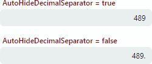
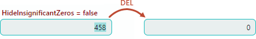
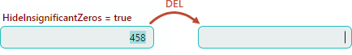

# 数字掩码 {#numeric-masks}

`Numeric` 掩码类型允许用户按照指定的输入掩码在编辑器中输入数值（整数、实数、货币、百分比等）。输入掩码还可用于在显示模式下（文本编辑未激活时）格式化数值。[`SpinEditor`](../../../API/Eremex.AvaloniaUI.Controls.Editors/SpinEditor.md) 控件默认启用 `Numeric` 掩码类型。要为其他文本编辑器启用此掩码类型，请将编辑器的 [`TextEditor.MaskType`](../../../API/Eremex.AvaloniaUI.Controls.Editors/TextEditor/MaskType.md) 属性设置为 `Numeric`。

使用编辑器的 [`Mask`](../../../API/Eremex.AvaloniaUI.Controls.Editors/TextEditor/Mask.md) 属性指定输入掩码。输入掩码是一个字符串，它定义了输入或格式化数值所依据的模式。

当前区域性会影响大多数数字掩码。例如，区域性定义了货币符号和小数分隔符。您可以使用 [`TextEditor.MaskCulture`](../../../API/Eremex.AvaloniaUI.Controls.Editors/TextEditor/MaskCulture.md) 属性为掩码强制指定特定的区域性。

Eremex 编辑器支持标准数字掩码和自定义数字掩码。

## 标准掩码 {#standard-masks}

Eremex 编辑器支持的标准数字掩码与 .NET 中用于格式化值的最常用[标准数字格式](https://learn.microsoft.com/zh-cn/dotnet/standard/base-types/standard-numeric-format-strings)相对应。

### 示例 {#example}

以下代码将 `p1` 掩码应用于 [`SpinEditor`](../../../API/Eremex.AvaloniaUI.Controls.Editors/SpinEditor.md)。掩码 `p` 将编辑器的值格式化为百分比。后缀 `1`（精度说明符）定义小数点右侧的位数。

``` xml
xmlns:mxe="https://schemas.eremexcontrols.net/avalonia/editors"

<mxe:SpinEditor x:Name="SpinEditor" Width="200" Value="0.3" Mask="p1" Increment="0.005"/>
```


### 标准掩码说明符 {#standard-mask-specifiers}

标准数字掩码由一个标准掩码说明符和一个可选的精度说明符（整数值）组成。精度说明符影响结果字符串中的位数。

下表列出了可用的标准掩码说明符。

| 掩码说明符 | 说明 | 示例 |
|---|---|---|
| `C` 或 `c` | 货币。<br><br>精度说明符决定小数点右侧的小数位数。 | 12.54("c",ru-RU)&rarr;"12,54 ₽" <br><br> 71.85("c0",zh-CN)&rarr;"￥72" |
| `D` 或 `d` | 十进制（整数）数字。<br><br>精度说明符决定最少位数。 | 789("D")&rarr;"789" <br><br> -965("D5")&rarr;"-00965"|
| `F` 或 `f` <br><br>`G` 或 `g` | 定点数。<br><br>精度说明符决定小数位数。默认精度由 `CultureInfo.NumberFormatInfo.NumberDecimalDigits` 定义。 | 1234.5678("F",ru-RU)&rarr;"1234,57" <br><br> 1234.56("F4",hi-IN)&rarr;"-1234.5600" |
| `N` 或 `n` | 带组分隔符的实数。<br><br>精度说明符决定小数位数。默认精度由 `CultureInfo.NumberFormatInfo.NumberDecimalDigits` 定义。 | 1234.5678("N",ru-RU)&rarr;"1 234,57" <br><br> -1234.56("N3",en-US)&rarr;"-1,234.560" |
| `P` | 数字按原样显示，并按照系统模式附加百分号。<br><br>系统模式由 `CultureInfo.NumberFormatInfo.PercentNegativePattern` 和 `CultureInfo.NumberFormatInfo.PercentPositivePattern` 属性指定。<br><br>精度说明符决定小数位数。默认精度由 `CultureInfo.NumberFormatInfo.PercentDecimalDigits` 定义。 | 12("P",zh-CN)&rarr;"12.00%" <br><br> -15.6("P0",ru-RU)&rarr;"-16 %" |
| `p` | 显示基础数值时，先将其乘以 100，再按照系统模式附加百分号显示。在编辑器中输入数字时，反向转换会将该数字除以 100，并存储到编辑值中。<br><br>系统模式由 `CultureInfo.NumberFormatInfo.PercentNegativePattern` 和 `CultureInfo.NumberFormatInfo.PercentPositivePattern` 属性指定。<br><br>精度说明符决定小数位数（默认精度由 `CultureInfo.NumberFormatInfo.PercentDecimalDigits` 定义）。 | 12("p",en-US)&rarr;"1,200.00%" <br><br> -0.2567("P0",ru-RU)&rarr;"-26 %"|


## 自定义掩码 {#custom-masks}

如果标准掩码无法满足您的特定需求，可以创建自定义掩码。自定义掩码由一个或多个自定义掩码说明符组成。

### 示例 {#example_1}

以下代码将 `#,##0.##` 自定义掩码应用于 [`SpinEditor`](../../../API/Eremex.AvaloniaUI.Controls.Editors/SpinEditor.md)。该掩码允许用户输入 -9999.99 到 9999.99 范围内的实数。编辑器的 [`Minimum`](../../../API/Eremex.AvaloniaUI.Controls.Editors/SpinEditor/Minimum.md) 和 [`Maximum`](../../../API/Eremex.AvaloniaUI.Controls.Editors/SpinEditor/Maximum.md) 属性将范围限制为 [0;5000]。

`,` 掩码说明符用于在每三位数字之间插入本地化的分隔符。


``` xml
xmlns:mxe="https://schemas.eremexcontrols.net/avalonia/editors"

<mxe:SpinEditor x:Name="SpinEditor" Value="1234.5" Mask="#,##0.##" Minimum="0" Maximum="5000" Increment="0.5"/>
```

### 自定义掩码说明符 {#custom-mask-specifiers}

下表列出了支持的自定义掩码说明符。

| 掩码说明符 | 说明 | 示例 |
|---|---|---|
| `0` | 数字 (0-9) 的零占位符。当该位置没有数字时，此占位符显示“0”。 | -12.345("0000")&rarr;"-0012"<br><br>78.97("000.0", ru-RU)&rarr;"079,0" |
| `#` | 数字占位符。当该位置没有数字时，此占位符不显示任何内容。 | 12.34("####")&rarr;"12"<br><br>-0.123("####.##",ru-RU)&rarr;"-,12" |
| `.` | 小数点。指定小数点在结果字符串中的位置。<br><br>`CultureInfo.NumberFormatInfo.NumberDecimalSeparator` 属性决定当前区域性中用作小数分隔符的字符。 | 0.9876("0.00",zh-CN)&rarr;0.99<br><br>0.01("####0.#")&rarr;"0" |
| `,` | 组分隔符。可以将组分隔符放在掩码中的任意位置，用本地化的组分隔符字符分隔小数点左侧的数字组。<br><br> `CultureInfo.NumberFormatInfo.NumberGroupSeparator` 属性指定默认的组分隔符字符。`CultureInfo.NumberFormatInfo.NumberGroupSizes` 属性指定每组的默认位数。<br><br> 如果掩码包含“%”字符（见下文），则分别由 `CultureInfo.NumberFormatInfo.PercentGroupSeparator` 和 `CultureInfo.NumberFormatInfo.PercentGroupSizes` 属性指定组分隔符和组长度。<br><br>如果掩码包含“$”字符（见下文），则改用 `CultureInfo.NumberFormatInfo.CurrencyGroupSeparator` 和 `CultureInfo.NumberFormatInfo.CurrencyGroupSizes` 属性。| 12345678.91("#,########.#",en-US)&rarr;"12,345,678.9" |
| `%` | 百分比。显示基础数值时，先将其乘以 100，再附加百分号显示。在编辑器中输入数字时，反向转换会将该数字除以 100，并存储到编辑值中。<br><br> `%` 说明符定义本地化百分号（`CultureInfo.NumberFormat.PercentSymbol`）在结果字符串中的位置。| 0.31415("% ##0.00",en-US)&rarr;"% 31.41"<br><br>0.5567("##.0 %",ru-RU)&rarr;"55,7 %" |
| `%%` | 百分号字符。按原样显示值，并在结果字符串的指定位置添加本地化百分号（`CultureInfo.NumberFormat.PercentSymbol`）。 |0.31415("%% ##0.00",en-US)&rarr;"% 0.31"<br><br>0.1256("#0.00 %%",ru-RU)&rarr;"0,13 %" |
| `\` | 转义字符。转义字符后面的字符会被解释为文本字面量，而不是掩码说明符。使用 "&bsol;&bsol;" 可插入反斜杠字面量。 | 123456("&bsol;#########&bsol;#")&rarr;"#123456#" |
| `;` | 分隔正数掩码和负数掩码的节分隔符。<br><br>`;` 字符之前的部分指定正数的掩码，`;` 字符之后的部分指定负数的掩码。如果负数部分为空，用户将无法输入负值。 | 10.25("#0.##;(#0.##)", en-US)&rarr;"10.25"<br><br> -10.25("#0.##;(#0.##)", en-US)&rarr;"(10.25)" |
| `$` | 货币符号。在指定位置插入货币符号（`CultureInfo.NumberFormatInfo.CurrencySymbol`）。 | 35("###0 $",zh-CN)&rarr;"35 ￥" |
| 所有其他字符 | 这些字符按原样以只读方式显示，不会存储在编辑器的编辑值中。 | 36.6("#0.## °",hi-IN)&rarr;"36.6 °" |

## 数字掩码设置 {#numeric-mask-settings}

可以通过附加设置自定义数字掩码的行为。这些设置由 [`Eremex.AvaloniaUI.Controls.Editors.NumericMaskOptions`](../../../API/Eremex.AvaloniaUI.Controls.Editors/NumericMaskOptions.md) 类公开的附加属性提供。

### 自动隐藏小数分隔符 {#automatically-hide-decimal-separator}

`NumericMaskOptions.AutoHideDecimalSeparator` 属性指定当前数字没有小数部分时，是隐藏还是显示小数分隔符。



### 示例 {#example_2}

以下示例禁止隐藏小数分隔符。

``` xml
xmlns:mxe="https://schemas.eremexcontrols.net/avalonia/editors"

<mxe:TextEditor Name="textEditor1" MaskType="Numeric" Mask="####0.#" mxe:NumericMaskOptions.AutoHideDecimalSeparator="False"/>
```

以下代码在代码隐藏中设置 `AutoHideDecimalSeparator` 属性：

``` csharp
textEditor1.MaskType = Eremex.AvaloniaUI.Controls.Editors.MaskType.Numeric;
textEditor1.Mask = "##0.##";
textEditor1.SetValue(NumericMaskOptions.AutoHideDecimalSeparatorProperty, false);
```

### 零值显示为“0”或不显示 {#show-0-or-nothing-for-zero-values}

'#' 掩码说明符定义一个占位符，当该位置没有数字时不显示任何内容。当掩码仅由 '#' 数字占位符组成且编辑器的值为 '0' 时，编辑器既可以显示字符串“0”（默认模式），也可以不显示任何内容。

`NumericMaskOptions.HideInsignificantZeros` 属性用于在掩码由 '#' 字符组成时选择 '0' 值的显示方式。

- `HideInsignificantZeros` 设置为 `false`（默认值）— 当编辑值为 '0' 时，编辑器显示“0”。

    

- `HideInsignificantZeros` 设置为 `true` — 当编辑值为 '0' 时，编辑器不显示任何内容。

    

### 示例 {#example_3}

以下示例将 `HideInsignificantZeros` 属性设置为 `true`，以便在编辑值为 '0' 时不显示任何内容。

``` xml
xmlns:mxe="https://schemas.eremexcontrols.net/avalonia/editors"

<mxe:TextEditor Name="textEditor1" MaskType="Numeric" Mask="#####.##" mxe:NumericMaskOptions.HideInsignificantZeros="True"/>
```

以下代码在代码隐藏中设置 `HideInsignificantZeros` 属性：

``` csharp
textEditor1.MaskType = Eremex.AvaloniaUI.Controls.Editors.MaskType.Numeric;
textEditor1.Mask = "#####.##";
textEditor1.SetValue(NumericMaskOptions.HideInsignificantZeros, true);
```


<br>
<br>

<sup>*</sup> 本页面使用机器翻译技术翻译。
