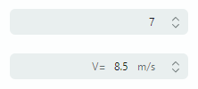

# SpinEditor {#spineditor}

[`SpinEditor`](../../API/Eremex.AvaloniaUI.Controls.Editors/SpinEditor.md) 是一个数值编辑器，带有内置微调按钮，用于按特定值（增量）增加和减少数字。用户可以通过单击这些按钮或按键盘上的向上和向下箭头来增加和减少数字。



控件的主要特点包括：

- 内置微调按钮允许用户增加和减少值。
- 限制可用值范围。
- 自定义增量值。
- 在编辑框中显示自定义值前缀和后缀。

## 获取和设置编辑器的值 {#get-and-set-the-editors-value}

使用 [`SpinEditor.Value`](../../API/Eremex.AvaloniaUI.Controls.Editors/SpinEditor/Value.md) 属性返回并指定编辑器的数值。您还可以将 [`EditorValue`](../../API/Eremex.AvaloniaUI.Controls.Editors/BaseEditor/EditorValue.md) 属性用于相同目的。这些属性是同步的。它们的不同之处在于值类型：[`Value`](../../API/Eremex.AvaloniaUI.Controls.Editors/SpinEditor/Value.md) 属性是十进制类型，而 [`EditorValue`](../../API/Eremex.AvaloniaUI.Controls.Editors/BaseEditor/EditorValue.md) 属性是 `object` 类型，与所有 Eremex 编辑器一样。

另请参阅：[增加和减少代码中的值](#increase-and-decrease-a-value-in-code)。

## 设置 {#set-up}

下面主要设置help you、[`SpinEditor`](../../API/Eremex.AvaloniaUI.Controls.Editors/SpinEditor.md)、控件的属性：

- [`SpinEditor.Minimum`](../../API/Eremex.AvaloniaUI.Controls.Editors/SpinEditor/Minimum.md) — 编辑器的最小值。
- [`SpinEditor.Maximum`](../../API/Eremex.AvaloniaUI.Controls.Editors/SpinEditor/Maximum.md) — 编辑器的最大值。
- [`SpinEditor.Increment`](../../API/Eremex.AvaloniaUI.Controls.Editors/SpinEditor/Increment.md) — 当用户单击微调按钮或按向上和向下箭头键时编辑器的值增加或减少的值。
- [`SpinEditor.ShowEditorButtons`](../../API/Eremex.AvaloniaUI.Controls.Editors/BaseEditor/ShowEditorButtons.md) — 获取或设置是否显示内置微调按钮。
- [`SpinEditor.AllowRoundOutOfRangeValue`](../../API/Eremex.AvaloniaUI.Controls.Editors/SpinEditor/AllowRoundOutOfRangeValue.md) — 获取或设置是否将用户输入的超出范围的值自动舍入为 [`SpinEditor.Minimum`](../../API/Eremex.AvaloniaUI.Controls.Editors/SpinEditor/Minimum.md) 或 [`SpinEditor.Maximum`](../../API/Eremex.AvaloniaUI.Controls.Editors/SpinEditor/Maximum.md)。

    !!! Note

        使用 [`AllowRoundOutOfRangeValue`](../../API/Eremex.AvaloniaUI.Controls.Editors/SpinEditor/AllowRoundOutOfRangeValue.md) 时，可能还需要将编辑器的 [`ValidateOnInput`](../../API/Eremex.AvaloniaUI.Controls.Editors/TextEditor/ValidateOnInput.md) 属性设置为 `false`。此设置会跳过每次按键时的数据验证。按 ENTER 或将焦点移出 [`SpinEditor`](../../API/Eremex.AvaloniaUI.Controls.Editors/SpinEditor.md) 控件时，将验证输入的值。

### 示例 - 如何创建 SpinEditor {#example-how-to-create-a-spineditor}

以下示例初始化 SpinEditor 控件。

``` xml
xmlns:mxe="https://schemas.eremexcontrols.net/avalonia/editors"

<mxe:SpinEditor x:Name="SpinEditor" Width="200" 
    Value="7"
    Maximum="15"
    Minimum="1"
    Increment="1"
    />
```


## 显示值前缀和后缀 {#display-value-prefix-and-suffix}

使用 [`SpinEditor.Prefix`](../../API/Eremex.AvaloniaUI.Controls.Editors/SpinEditor/Prefix.md) 和 [`SpinEditor.Suffix`](../../API/Eremex.AvaloniaUI.Controls.Editors/SpinEditor/Suffix.md) 属性指定在数值之前和之后显示的文本。用户无法编辑此文本。

### 示例 - 如何为 SpinEditor 的值指定前缀和后缀 {#example-how-to-specify-a-prefix-and-suffix-for-a-spineditors-value}

以下示例将 [`SpinEditor.Prefix`](../../API/Eremex.AvaloniaUI.Controls.Editors/SpinEditor/Prefix.md) 和 [`SpinEditor.Suffix`](../../API/Eremex.AvaloniaUI.Controls.Editors/SpinEditor/Suffix.md) 属性用于显示文本之前和之后的编辑器值。

``` xml
xmlns:mxe="https://schemas.eremexcontrols.net/avalonia/editors"

<mxe:SpinEditor x:Name="SpinEditor1" Width="200" 
    Value="8.5"
    Maximum="35"
    Minimum="2"
    Increment="0.5"
    Prefix="V=" Suffix="m/s"
    />
```

## 增加和减少代码中的值 {#increase-and-decrease-a-value-in-code}

[`SpinEditor.IncreaseCommand`](../../API/Eremex.AvaloniaUI.Controls.Editors/SpinEditor/IncreaseCommand.md) 和 [`SpinEditor.DecreaseCommand`](../../API/Eremex.AvaloniaUI.Controls.Editors/SpinEditor/DecreaseCommand.md) 命令通过 increment 值 ([`SpinEditor.Increment`](../../API/Eremex.AvaloniaUI.Controls.Editors/SpinEditor/Increment.md)) 增加和减少编辑器的值。

<!--TODO
Check:
The [`SpinEditor.IncreaseCommand`](../../API/Eremex.AvaloniaUI.Controls.Editors/SpinEditor/IncreaseCommand.md) and [`SpinEditor.DecreaseCommand`](../../API/Eremex.AvaloniaUI.Controls.Editors/SpinEditor/DecreaseCommand.md) commands increase and decrease the editor's value by the increment value ([`SpinEditor.Increment`](../../API/Eremex.AvaloniaUI.Controls.Editors/SpinEditor/Increment.md)).
-->

您还可以使用 [`SpinEditor.Value`](../../API/Eremex.AvaloniaUI.Controls.Editors/SpinEditor/Value.md) 属性直接更改编辑器的值。

<br>
<br>

<sup>*</sup> 本页面使用机器翻译技术翻译。
