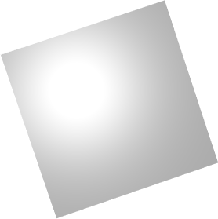
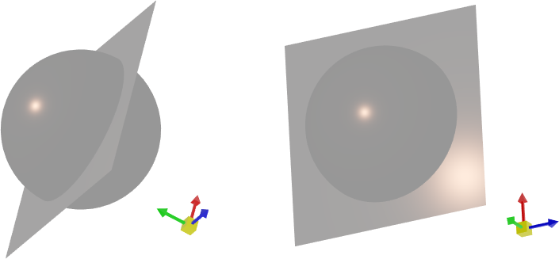
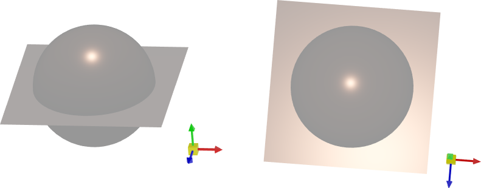
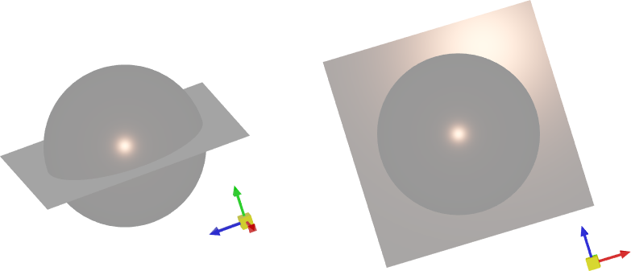
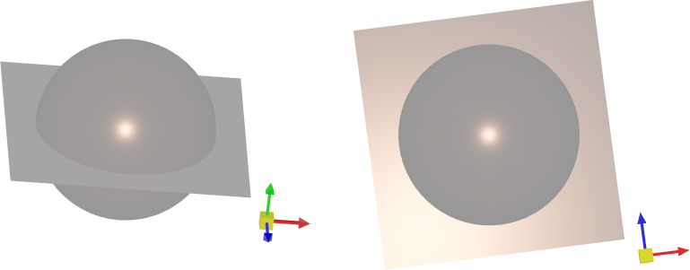

# 光 {#light}

在Graphics3DControl中，灯光用于照亮3D模型。您可以使用默认灯光，或为 3D 场景创建自定义光源。


## 默认灯光 {#default-light}

[`Graphics3DControl`](../../API/Eremex.AvaloniaUI.Controls3D/Graphics3DControl.md) 提供开箱即用的默认灯光。默认灯光表示链接到相机的白点光源。它的方向始终与相机的方向同步。

下面的图像演示了从金属平面反射的默认光。



任何灯光的实际视觉效果都是由应用于3D模型的[materials](graphics3dcontrol-overview.md#materials)决定的。


#### 相关选项 {#related-options}

- [`Graphics3DControl.AllowDefaultLight`](../../API/Eremex.AvaloniaUI.Controls3D/Graphics3DControl/AllowDefaultLight.md)（默认值为 `true`）— 将此属性设置为 `false` 可强制禁用默认灯光。

创建自定义灯光时，默认灯光会自动禁用。


## 定制灯 {#custom-lights}


要将自定义灯光添加到 3D 场景，请创建光源并将其添加到 [`Graphics3DControl.Lights`](../../API/Eremex.AvaloniaUI.Controls3D/Graphics3DControl/Lights.md) 集合中。您还可以使用 [`Graphics3DControl.LightsSource`](../../API/Eremex.AvaloniaUI.Controls3D/Graphics3DControl/LightsSource.md) 和 [`Graphics3DControl.LightTemplate`](../../API/Eremex.AvaloniaUI.Controls3D/Graphics3DControl/LightTemplate.md) 属性根据 MVVM 设计模式添加自定义灯光。


[`Graphics3DControl`](../../API/Eremex.AvaloniaUI.Controls3D/Graphics3DControl.md)支持以下光源类型：

- 点光源 ([`PointLight`](../../API/Eremex.AvaloniaUI.Controls3D/PointLight.md))
- 定向光 ([`DirectionalLight`](../../API/Eremex.AvaloniaUI.Controls3D/DirectionalLight.md))
- 相机相关点光源（[`CameraPointLight`](../../API/Eremex.AvaloniaUI.Controls3D/CameraPointLight.md)）
- 相机相关定向光（[`CameraDirectionalLight`](../../API/Eremex.AvaloniaUI.Controls3D/CameraDirectionalLight.md)）

所有这些光源都有一个祖先，即 [`Light`](../../API/Eremex.AvaloniaUI.Controls3D/Light.md) 抽象类。

### 点光源 {#point-light}

向各个方向辐射（就像灯泡一样）。

#### 班级 {#class}

[`PointLight`](../../API/Eremex.AvaloniaUI.Controls3D/PointLight.md)

#### 设置 {#settings}
    
- [`Color`](../../API/Eremex.AvaloniaUI.Controls3D/Light/Color.md) — 光的颜色。
- [`Position`](../../API/Eremex.AvaloniaUI.Controls3D/PointLight/Position.md) — 光发射器的位置。
- [`Radius`](../../API/Eremex.AvaloniaUI.Controls3D/PointLightBase/Radius.md) — 光发射器的半径。

#### 例子 {#example}

以下示例创建珊瑚色的点光源。下面的图像演示了从金属平面和球体反射的光。



``` xml
<mx3d:Graphics3DControl.Lights>
    <mx3d:PointLight Color="{Binding MyLightColor}" Position="{Binding MyLightPosition}" Radius="10"/>
</mx3d:Graphics3DControl.Lights>
```
``` cs
PointLight myLight = new PointLight();
myLight.Color = Avalonia.Media.Colors.Coral;
myLight.Position = new Vector3(0, 50, 0);
myLight.Radius = 10;
g3DControl.Lights.Add(myLight);
```

### 定向光 {#directional-light}

向指定方向发射平行光线，模拟远处的照明（如阳光）。


#### 班级 {#class_1}

[`DirectionalLight`](../../API/Eremex.AvaloniaUI.Controls3D/DirectionalLight.md)

#### 设置 {#settings_1}

- [`Color`](../../API/Eremex.AvaloniaUI.Controls3D/Light/Color.md) — 光的颜色。
- [`Direction`](../../API/Eremex.AvaloniaUI.Controls3D/DirectionalLight/Direction.md) — 指定光线方向的矢量。

#### 例子 {#example_1}


以下示例添加指向负 Y 轴方向的定向光源。下面的图像演示了从金属平面和球体反射的光。




``` xml
<mx3d:Graphics3DControl.Lights>
    <mx3d:DirectionalLight Color="{Binding MyLightColor}" Direction="{Binding MyLightDirection}"/>
</mx3d:Graphics3DControl.Lights>
```
``` cs
using Eremex.AvaloniaUI.Controls3D;

DirectionalLight myLight = new DirectionalLight();
myLight.Direction = new System.Numerics.Vector3(0, -1, 0);
myLight.Color = Avalonia.Media.Colors.Coral;
g3DControl.Lights.Add(myLight);
```


### 相机相关的点光源 {#camera-related-point-light}

从相机发出的点光。该光的位置和方向与相机同步。

#### 班级 {#class_2}

[`CameraPointLight`](../../API/Eremex.AvaloniaUI.Controls3D/CameraPointLight.md)

#### 设置 {#settings_2}

- [`Color`](../../API/Eremex.AvaloniaUI.Controls3D/Light/Color.md) — 光的颜色。
- [`Radius`](../../API/Eremex.AvaloniaUI.Controls3D/PointLightBase/Radius.md) — 光发射器的半径。

#### 例子 {#example_2}

以下示例创建与相机链接的点光源。下面的图像演示了从金属平面和球体反射的光。



``` xml
<mx3d:Graphics3DControl.Lights>
    <mx3d:CameraPointLight Color="{Binding MyLightColor}" Radius="10"/>
</mx3d:Graphics3DControl.Lights>
```
``` cs
using Eremex.AvaloniaUI.Controls3D;

CameraPointLight myLight = new CameraPointLight();
myLight.Radius = 10;
myLight.Color = Avalonia.Media.Colors.Coral;
g3DControl.Lights.Add(myLight);
```


### 相机相关定向光 {#camera-related-directional-light}

沿相机方向发射平行光线，模拟远处的照明（如阳光）。

#### 班级 {#class_3}

[`CameraDirectionalLight`](../../API/Eremex.AvaloniaUI.Controls3D/CameraDirectionalLight.md)

#### 设置 {#settings_3}

- [`Color`](../../API/Eremex.AvaloniaUI.Controls3D/Light/Color.md) — 光的颜色。


#### 例子 {#example_3}

以下示例创建与相机链接的定向光。下面的图像演示了从金属平面和球体反射的光。



``` xml
<mx3d:Graphics3DControl.Lights>
    <mx3d:CameraDirectionalLight Color="{Binding MyLightColor}"/>
</mx3d:Graphics3DControl.Lights>
```
``` cs
using Eremex.AvaloniaUI.Controls3D;

CameraDirectionalLight myLight = new CameraDirectionalLight();
myLight.Color = Avalonia.Media.Colors.Coral;
g3DControl.Lights.Add(myLight);
```


<!-- TODO

### 使用 MVVM 方法添加灯光

- [`Graphics3DControl.LightsSource`](../../API/Eremex.AvaloniaUI.Controls3D/Graphics3DControl/LightsSource.md) — 支持 MVVM 设计模式。 [`LightsSource`](../../API/Eremex.AvaloniaUI.Controls3D/Graphics3DControl/LightsSource.md) 属性是业务对象的集合 -->

<br>
<br>

<sup>*</sup> 本页面使用机器翻译技术翻译。
