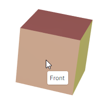
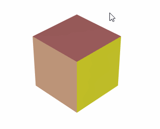
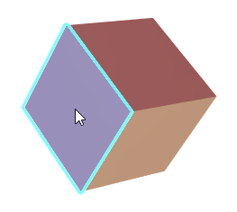
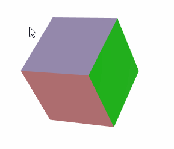
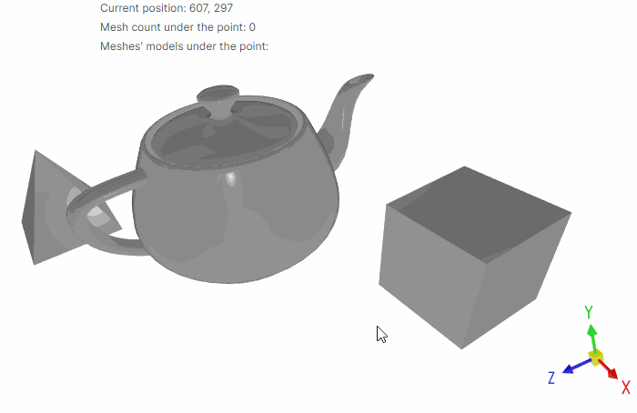

# 用户与 3D 模型的交互 {#user-interactions-with-3d-models}

[`Graphics3DControl`](../../API/Eremex.AvaloniaUI.Controls3D/Graphics3DControl.md) 使用户能够与 3D 模型进行交互。用户可以使用鼠标和键盘旋转、缩放和平移（移动）模型。此外，您可以允许用户通过单击鼠标来选择模型的元素，或者在将鼠标悬停在元素上时突出显示元素。 
[`Graphics3DControl`](../../API/Eremex.AvaloniaUI.Controls3D/Graphics3DControl.md) 还支持模型及其元素（网格）的工具提示。

## 旋转模型 {#rotate-the-model}

#### 键盘快捷键 {#keyboard-shortcuts}

- 向左旋转 — Shift+向左箭头
- 向右旋转 — Shift+右箭头
- 向上旋转 — Shift+向上箭头
- 向下旋转 — Shift+向下箭头


#### 鼠标操作 {#mouse-operations}

- 旋转 — 使用鼠标左键拖动模型。

### 旋转选项 {#rotate-options}

- [`Graphics3DControl.RotateStep`](../../API/Eremex.AvaloniaUI.Controls3D/Graphics3DControl/RotateStep.md) — 允许您设置控件的旋转速度。 [`RotateStep`](../../API/Eremex.AvaloniaUI.Controls3D/Graphics3DControl/RotateStep.md) 属性以内部单位指定。默认值为 20。值越高，旋转速度越大。

- [`Graphics3DControl.RotationMode`](../../API/Eremex.AvaloniaUI.Controls3D/Graphics3DControl/RotationMode.md) — 获取或设置当用户按住鼠标左键拖动以旋转场景时相机环绕的轴心。可用的旋转模式包括：

    - [`RotationMode.AroundCameraTarget`](../../API/Eremex.AvaloniaUI.Controls3D/RotationMode.md)（默认）— 相机围绕其目标（[`Camera.Target`](../../API/Eremex.AvaloniaUI.Controls3D/Camera/Target.md)）旋转。

        相机的默认目标是坐标系原点 _(0, 0, 0)_。当您使用 [`Camera.MoveLeft`](../../API/Eremex.AvaloniaUI.Controls3D/Camera/MoveLeft.md)/[`Camera.MoveUp`](../../API/Eremex.AvaloniaUI.Controls3D/Camera/MoveUp.md) 方法以及[键盘快捷键和鼠标手势](#move-the-model)平移（移动）模型时，目标点会自动改变。


    - [`RotationMode.AroundMouseHit`](../../API/Eremex.AvaloniaUI.Controls3D/RotationMode.md) — 相机围绕旋转开始时鼠标指针下方的场景点旋转。

        此模式允许用户单击任意对象或表面，并围绕该特定位置旋转视图，而不是围绕相机的当前目标旋转。

    


<!-- TODO
Check the property in the demo. 
 -->

## 缩放模型 {#zoom-the-model}

#### 键盘快捷键 {#keyboard-shortcuts_1}

- 放大 — CTRL+加号键
- 缩小 — CTRL+减号键

#### 鼠标操作 {#mouse-operations_1}

- 缩放 — 使用鼠标滚轮放大和缩小。

### 缩放选项 {#zoom-options}

- [`Graphics3DControl.ZoomRate`](../../API/Eremex.AvaloniaUI.Controls3D/Graphics3DControl/ZoomRate.md) — 控制使用键盘和鼠标滚轮执行缩放操作的速度。默认值为 0.1。值越高，变焦速度越高。

## 移动模型 {#move-the-model}

#### 键盘快捷键 {#keyboard-shortcuts_2}

- 向左移动 — CTRL+向左箭头
- 向右移动 — CTRL+右箭头
- 向上移动 — CTRL+向上箭头
- 向下移动 — CTRL+向下箭头

#### 鼠标操作 {#mouse-operations_2}

- 移动 - 使用鼠标右键拖动模型。

### 移动选项 {#move-options}

- [`Graphics3DControl.KeyboardMoveStep`](../../API/Eremex.AvaloniaUI.Controls3D/Graphics3DControl/KeyboardMoveStep.md) 属性 — 允许您指定在单次键盘移动操作期间模型移动的距离。

<!-- TODO
which units ?
 -->

## 在代码中旋转、缩放和移动模型 {#rotate-zoom-and-move-models-in-code}

要在代码中从特定位置和角度查看模型，您需要调整相机的位置和方向。请参阅以下主题了解更多信息：

- [Camera](camera.md)


## 覆盖键盘快捷键 {#override-keyboard-shortcuts}

[`Graphics3DKeyBindings`](../../API/Eremex.AvaloniaUI.Controls3D/Graphics3DKeyBindings.md) 类的 [`Graphics3DControl.NavigationBindings`](../../API/Eremex.AvaloniaUI.Controls3D/Graphics3DControl/NavigationBindings.md) 属性允许您覆盖默认键盘快捷键。 [`Graphics3DKeyBindings`](../../API/Eremex.AvaloniaUI.Controls3D/Graphics3DKeyBindings.md) 类包含定义缩放、旋转和平移操作快捷方式的属性。最初，这些属性被设置为上面列出的默认快捷方式。您可以使用这些属性为操作分配自定义快捷方式。

以下代码将 CTRL+1 和 CTRL+2 快捷键分配给“放大”和“缩小”操作。

``` cs
g3DControl.NavigationBindings = new Graphics3DKeyBindings();
Graphics3DKeyBinding zoomInShortcut = new Graphics3DKeyBinding(Avalonia.Input.KeyModifiers.Control, Avalonia.Input.Key.D1);
Graphics3DKeyBinding zoomOutShortcut = new Graphics3DKeyBinding(Avalonia.Input.KeyModifiers.Control, Avalonia.Input.Key.D2);
g3DControl.NavigationBindings.ZoomIn = zoomInShortcut;
g3DControl.NavigationBindings.ZoomOut = zoomOutShortcut;
```

## 显示提示 {#show-hints}

当用户将鼠标悬停在模型或单个网格上时，[`Graphics3DControl`](../../API/Eremex.AvaloniaUI.Controls3D/Graphics3DControl.md) 可以显示提示。



使用以下属性将提示分配给模型、网格或同时分配给模型和网格：

- [`GeometryModel3D.Hint`](../../API/Eremex.AvaloniaUI.Controls3D/SelectableElement/Hint.md) — 模型提示。
- [`MeshGeometry3D.Hint`](../../API/Eremex.AvaloniaUI.Controls3D/SelectableElement/Hint.md) — 网格的提示。

以下示例为模型及其网格设置提示。网格的提示表明了它们的名称。

``` xml
<mx3d:GeometryModel3D x:Name="Cube" MeshesSource="{Binding Meshes}" Hint="Cube">
    <mx3d:GeometryModel3D.MeshTemplate>
        <DataTemplate x:DataType="vm:MeshViewModel">
            <mx3d:MeshGeometry3D 
                Name="{Binding Name}" 
                Hint="{Binding Name}"
                ...
            />
        </DataTemplate>
    </mx3d:GeometryModel3D.MeshTemplate>
</mx3d:GeometryModel3D>
```
``` cs
public partial class MeshViewModel : ObservableObject
{
    [ObservableProperty] string name;
    [ObservableProperty] Vertex3D[] vertices;
    //...
}
```

当为模型和网格设置提示时，这些提示将合并为单个提示，并由“,”分隔符分隔。



将 [`Graphics3DControl.ShowHints`](../../API/Eremex.AvaloniaUI.Controls3D/Graphics3DControl/ShowHints.md) 属性设置为 `false` 以禁用提示。该属性的默认值为 `true`。

## 突出显示元素 {#highlight-elements}

[`Graphics3DControl`](../../API/Eremex.AvaloniaUI.Controls3D/Graphics3DControl.md)支持模型和网格突出显示。借助此功能，当用户将鼠标悬停在模型/网格上时，该控件会在模型/网格周围绘制高亮边框。



使用 [`Graphics3DControl.HighlightMode`](../../API/Eremex.AvaloniaUI.Controls3D/Graphics3DControl/HighlightMode.md) 属性启用突出显示功能并指定突出显示模式。可以使用以下选项：

- `Mesh` — 启用单个网格的突出显示。
- `Model` — 启用单个模型的突出显示。
- `None`（默认）— 突出显示功能已禁用。

**相关API**

- [`Graphics3DControl.HighlightedElement`](../../API/Eremex.AvaloniaUI.Controls3D/Graphics3DControl/HighlightedElement.md) — 获取或设置当前突出显示的元素。
- [`Graphics3DControl.HighlightColor`](../../API/Eremex.AvaloniaUI.Controls3D/Graphics3DControl/HighlightColor.md) — 获取或设置用于在突出显示元素周围绘制突出显示边框的颜色。


## 选择元素 {#select-elements}

您可以启用选择功能，以允许用户通过单击鼠标来选择元素（模型或网格）。当用户单击元素时，元素周围会绘制选择边框。



使用 [`Graphics3DControl.SelectionMode`](../../API/Eremex.AvaloniaUI.Controls3D/Graphics3DControl/SelectionMode.md) 属性激活选择功能并定义选择模式。可用的选项包括：

- `Mesh` — 单击鼠标即可选择单个网格。
- `Model` — 单击鼠标即可选择单个模型。
- `None`（默认）— 选择功能已禁用。


**相关API**

- [`Graphics3DControl.SelectedElement`](../../API/Eremex.AvaloniaUI.Controls3D/Graphics3DControl/SelectedElement.md) — 获取或设置当前选定的元素。
- [`Graphics3DControl.SelectionColor`](../../API/Eremex.AvaloniaUI.Controls3D/Graphics3DControl/SelectionColor.md) — 获取或设置用于在选定元素周围绘制边框的颜色。


### 覆盖选择并作出响应 {#override-and-respond-to-selection}

当新元素即将被选中时，控件会触发 [`Graphics3DControl.SelectionChanging`](../../API/Eremex.AvaloniaUI.Controls3D/Graphics3DControl/SelectionChanging.md) 事件。该事件允许您覆盖默认选择。

默认情况下，控件会选择单击点下最近的模型和网格。您可以处理 [`Graphics3DControl.SelectionChanging`](../../API/Eremex.AvaloniaUI.Controls3D/Graphics3DControl/SelectionChanging.md) 事件来更改此行为：

- 要选择其他元素，请将其赋给 `e.NewValue` 事件参数。
- 要清除选择，请将 `e.NewValue` 事件参数设置为 `null`。

要选择其他元素，请使用 `e.HitTestResults` 事件参数，它包含在单击点通过射线检测找到的所有命中结果，按从近到远排序。对于该点，[`Graphics3DControl.CalcHitInfo`](../../API/Eremex.AvaloniaUI.Controls3D/Graphics3DControl/CalcHitInfo.md) 方法返回相同的结果。有关详细信息，请参阅[命中测试](#hit-testing)。

使用 `e.OldValue` 事件参数可获取当前选中的元素。

## 命中测试 {#hit-testing}

命中测试可让您确定场景中位于给定点下方的是哪些模型和网格。[`Graphics3DControl`](../../API/Eremex.AvaloniaUI.Controls3D/Graphics3DControl.md) 提供两种用于命中测试的方法：

- [`HitTest(Point)`](../../API/Eremex.AvaloniaUI.Controls3D/Graphics3DControl/HitTest.md) — 返回指定点下最近的网格；如果该点位于空白区域，则返回 `null`。
- [`CalcHitInfo(Point)`](../../API/Eremex.AvaloniaUI.Controls3D/Graphics3DControl/CalcHitInfo.md) — 返回指定点下（所有模型中）的网格列表，按从近到远排序。如果该点位于空白区域，该方法返回空列表。

命中测试通过射线检测实现。控件从相机穿过给定的二维点（以控件相对坐标指定）投射一条射线，然后检测该射线与 3D 场景几何体的相交情况，以确定相交的对象。

### 示例 - 命中测试 {#example-hit-testing}

以下代码处理 Graphics3DControl 的 `PointerMoved` 事件，以显示：

- 当前光标位置
- 光标下的网格数量
- 这些网格所属模型的 [`GeometryModel3D.Hint`](../../API/Eremex.AvaloniaUI.Controls3D/SelectableElement/Hint.md) 属性

当光标下存在多个模型时，输出中会包含所有这些模型的网格。



``` cs
private void G3DControl_PointerMoved(object sender, Avalonia.Input.PointerEventArgs e)
{
    Point position = e.GetPosition(graphics3DControl1);
    label1.Content = "Current position: " + position;
    IList<RaycastHitTestResult> meshesHitInfo = graphics3DControl1.CalcHitInfo(position);
    label2.Content = "Mesh count under the point: " + meshesHitInfo.Count;
    label3.Content = "Meshes' models under the point: " + string.Join(", ", meshesHitInfo.Select(r => r.Model.Hint ?? "<null>"));
}
```


## 另请参阅 {#see-also}

- [Camera](camera.md)

<br>
<br>

<sup>*</sup> 本页面使用机器翻译技术翻译。
