# ListView 控件概述 {#listview-control-overview}

`ListViewControl` 是一种高级控件，用于以单列或多列形式显示项列表。该控件支持多种项排列布局，以及项的排序、分组、筛选和选择。
可以使用 ListView 模拟 Microsoft Windows 资源管理器右侧窗格的用户界面。

ListView 支持使用 MVVM 设计模式呈现项。控件从所绑定的项源中检索项，并使用指定的项模板呈现它们。您需要定义一个模板，以所需的方式绘制项。例如，模板可以让 ListView 将项绘制为图标、带文本的图标或纯文本。

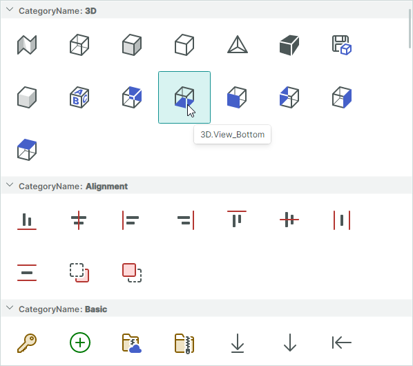

 

## 入门 {#get-started}

- [ListView 控件入门](get-started-with-listview.md)

## 为 ListView 提供项 {#supply-items-to-listview}

使用 `ListViewControl.ItemsSource` 属性将控件绑定到对象集合，这些对象将呈现为 ListView 项。

### 项模板 {#item-template}

要以特定方式呈现项，请使用 `ListViewControl.ItemTemplate` 属性指定项模板。没有此模板，ListView 不会呈现其项。

**ItemTemplate 的 DataContext**：`ListViewControl.ItemsSource` 集合中的项对象。

### 示例 {#example}

以下示例使用 _SvgIconsBrowserViewModel.Categories_ 集合中的项填充 ListView，并定义呈现这些项的模板。此示例的完整代码请参阅 _SVG Icons Browser_ 模块。

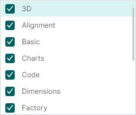

下面代码中的 _SvgIconCategoryViewModel_ 类封装了所绑定项集合中的项。
ListView 项模板由一个复选框和其后的文本字段组成。复选框和文本框分别绑定到 _SvgIconCategoryViewModel.IsChecked_ 和 _SvgIconCategoryViewModel.DisplayName_ 属性。


``` xml
<mxlv:ListViewControl ItemLayoutMode="Stack" ItemHeight="28" ItemsSource="{Binding Categories}" >
    <mxlv:ListViewControl.ItemTemplate>
        <DataTemplate DataType="vm:SvgIconCategoryViewModel">
            <Grid ColumnDefinitions="Auto, *">
                <CheckBox IsChecked="{Binding IsChecked}" Margin="0,0,4,0" VerticalAlignment="Center"/>
                <TextBlock Grid.Column="1" Text="{Binding DisplayName}" VerticalAlignment="Center"/>
            </Grid>
        </DataTemplate>
    </mxlv:ListViewControl.ItemTemplate>
</mxlv:ListViewControl>
```
``` cs
public partial class SvgIconsBrowserViewModel : PageViewModelBase
{
    [ObservableProperty] private List<SvgIconCategoryViewModel> categories;
    //...
}

public partial class SvgIconCategoryViewModel : ObservableObject, IComparable<SvgIconCategoryViewModel>, IComparable
{
    [ObservableProperty] private bool isChecked;
    [ObservableProperty] private string name;
    [ObservableProperty] private string displayName;
    [ObservableProperty] private bool isExpanded;
    //...
}
```

## 项的排列 {#item-arrangement}

ListView 控件支持两种项排列模式：`Wrap`（默认）和 `Stack`。使用 `ListViewControl.ItemLayoutMode` 属性选择所需的布局。

### _Wrap_ 布局 {#wrap-layout}

将 `ListViewControl.ItemLayoutMode` 属性设置为 `ListViewItemLayoutMode.Wrap`，可先横向再纵向排列项。项会在控件右边缘自动换行，形成多行。


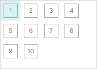

所有项的大小相同。默认项大小根据指定的模板（`ListViewControl.ItemTemplate`）由第一项的数据计算得出。
可以使用 `ListViewControl.ItemWidth` 和 `ListViewControl.ItemHeight` 属性为 ListView 指定自定义项大小。

### _Stack_ 布局 {#stack-layout}

将 `ListViewControl.ItemLayoutMode` 属性设置为 `ListViewItemLayoutMode.Stack`，可将项排列成垂直列表。项会被拉伸以适应 ListView 的宽度。

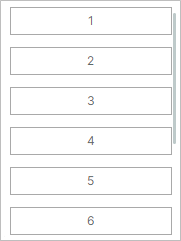

在 `Stack` 布局模式下，可以使用 `ListViewControl.ItemHeight` 属性指定自定义项高度。

## 对项进行排序 {#sort-items}

可以按一个或多个项属性对 ListView 项进行升序或降序排序。要对项进行排序，请将 `ListViewSortInfo` 对象添加到 `ListViewControl.SortInfo` 集合中。此集合还用于定义项的[分组](#group-items)。

`ListViewSortInfo` 对象包含以下用于自定义排序设置的属性：

- `ListViewSortInfo.FieldName` — 指定用于对 ListView 项进行排序的项属性。
- `ListViewSortInfo.SortDirection` — 指定 ListView 项的排序顺序。默认排序顺序为升序。

### 示例 - 对项进行排序 {#example-sort-items}

以下示例按 _ShipCountry_ 和 _Date_ 属性对项进行排序。控件首先按 _ShipCountry_ 属性对项进行升序排序，将其整理为运输国家相同的子集。然后，控件在每个子集内按 _Date_ 属性对项进行降序排序。

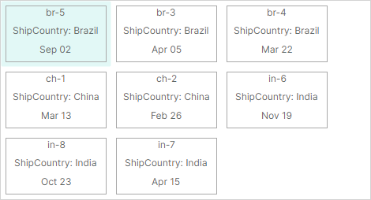

``` xml
<mxlv:ListViewControl Name="listViewControl1" ItemsSource="{Binding Items}" >
    <mxlv:ListViewControl.SortInfo>
        <mxlv:ListViewSortInfo FieldName="ShipCountry" SortDirection="Ascending" />
        <mxlv:ListViewSortInfo FieldName="Date" SortDirection="Descending"/>
    </mxlv:ListViewControl.SortInfo>
</mxlv:ListViewControl>
```

``` cs
public partial class MainWindowViewModel : ViewModelBase
{
    [ObservableProperty] 
    private List<ItemViewModel> items;
    //...
}

public partial class ItemViewModel : ObservableObject
{
    [ObservableProperty] private int invoiceId;
    [ObservableProperty] private string shipCountry;
    [ObservableProperty] private DateTime date;
    //...
}
```


## 对项进行分组 {#group-items}

分组可将值相同的项合并到同一个可展开的组中。

例如，如果项对象包含 _ShipCountry_ 属性，则可以按此属性分组，得到以下结果：

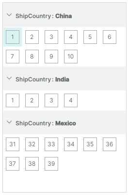

每组项之前都有一个分组行。分组行显示分组属性的名称和值。用户可以单击分组行的折叠/展开按钮来隐藏/显示组的内容。

请注意，按某个属性分组时，分组行会自动按该分组属性排序。在代码中应用分组时，可以选择分组行按升序还是降序排列。

要按一个或多个项属性分组，请执行以下操作：

- 在 `ListViewControl.SortInfo` 集合的开头添加 `ListViewSortInfo` 对象。
将 `ListViewSortInfo.FieldName` 设置为用于对项进行分组的项属性。还可以使用 `ListViewSortInfo.SortDirection` 选择分组行的排列顺序（升序或降序）。

- 将 `ListViewControl.GroupCount` 属性设置为分组级别（分组属性）的数量。
`ListViewControl.GroupCount` 指定从 `ListViewControl.SortInfo` 集合开头算起，有多少个 `ListViewSortInfo` 对象用于对数据进行分组。如果按单个项属性分组，请将 `ListViewControl.GroupCount` 设置为 _1_；要按两个属性分组，请将 `ListViewControl.GroupCount` 设置为 2，依此类推。

`ListViewControl.SortInfo` 集合中的元素数可以多于 `ListViewControl.GroupCount`。前 `GroupCount` 个元素用于对 ListView 项进行分组，其余元素用于对 ListView 项进行排序。

### 示例 - 对项进行分组 {#example-group-items}

假设项对象包含 _ShipCountry_ 属性。要按此属性分组，需要将引用 _ShipCountry_ 属性的 `ListViewSortInfo` 对象放在 `ListViewControl.SortInfo` 集合的开头，并将 `ListViewControl.GroupCount` 属性设置为 `1`。

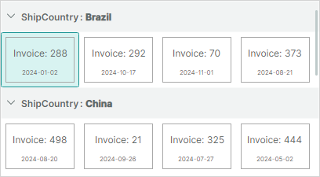

``` xml
<mxlv:ListViewControl Name="lv" ItemsSource="{Binding Items}" ItemHeight="40" ItemWidth="40" 
                      ItemLayoutMode="Wrap"                        
                      GroupCount="1">
    <mxlv:ListViewControl.SortInfo>
        <mxlv:ListViewSortInfo FieldName="ShipCountry" SortDirection="Ascending" />
    </mxlv:ListViewControl.SortInfo>
</mxlv:ListViewControl>
```

``` cs
public partial class MainWindowViewModel : ViewModelBase
{
    [ObservableProperty] 
    private List<ItemViewModel> items;
}

public partial class ItemViewModel : ObservableObject
{
    [ObservableProperty] private int invoiceId;
    [ObservableProperty] private string shipCountry;
    [ObservableProperty] private DateTime date;
    [ObservableProperty] private IImage flag;
    //...
}
```


### 自定义分组行模板 {#custom-group-row-template}

如果默认的分组行模板不能满足需要，可以使用 `ListViewControl.GroupTemplate` 属性指定用于绘制分组行的自定义 DataTemplate。

**GroupTemplate 的 DataContext**：`Eremex.AvaloniaUI.Controls.ListView.Data.ListViewGroupData` 对象

模板的 DataContext 中存储的 `ListViewGroupData` 对象公开以下属性，可帮助您获取分组行的信息并设置分组行模板：

- `ListViewGroupData.FieldName` — 分组属性的名称。
- `ListViewGroupData.GroupValue` — 分组属性的值。
- `ListViewGroupData.GroupValueDisplayText` — 分组属性值的文本表示形式。可以通过处理 `ListViewControl.CustomGroupValueDisplayText` 事件为分组值提供自定义显示文本。
- `ListViewGroupData.IsExpanded` — 指定组是展开还是折叠。
- `ListViewGroupData.Level` — 组的分组级别。对于根级别的分组行，`ListViewGroupData.Level` 属性返回 `0`；对于第二级的分组行，`ListViewGroupData.Level` 属性返回 `1`，依此类推。

自定义模板可能需要不同的分组行高度。可以使用 `ListViewControl.GroupHeight` 属性设置自定义分组行高度。

#### 示例 - 自定义分组行模板 {#example-custom-group-row-template}

以下示例使用 `ListViewControl.GroupTemplate` 属性定义自定义分组行模板。该模板由一个显示分组值的文本块和一个显示与分组行关联的 SVG 图像的图像控件组成。

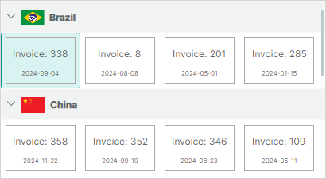

该示例假定项目的 _Assets_ 文件夹中包含 _brazil-flag.svg_ 和 _china-flag.svg_ 图像。所有图像的 _Build Action_ 属性都应设置为 _AvaloniaResource_。为了从文件中读取图像，下面的代码使用了 `Eremex.AvaloniaUI.Controls.Utils.ImageLoader` 帮助器类。


``` xml
xmlns:mxlv="https://schemas.eremexcontrols.net/avalonia/listview"
xmlns:mxlvd="using:Eremex.AvaloniaUI.Controls.ListView.Data"
xmlns:vm="using:ListView_example.ViewModels"

<mxlv:ListViewControl Name="listViewControl1" ItemsSource="{Binding Items}" 
                      ItemHeight="70" ItemWidth="100"
                      GroupCount="1"
                      GroupHeight="40">
    <mxlv:ListViewControl.SortInfo>
        <mxlv:ListViewSortInfo FieldName="ShipCountry" SortDirection="Ascending" />
    </mxlv:ListViewControl.SortInfo>
    <mxlv:ListViewControl.GroupTemplate>
        <DataTemplate DataType="mxlvd:ListViewGroupData">
            <StackPanel Orientation="Horizontal" >
                <Image Height="20" 
                  Source="{Binding GroupValue, Converter={vm:CountryNameToFlagConverter}}}" 
                  Margin="0,0,5,0" VerticalAlignment="Center"/>
                <TextBlock Text="{Binding GroupValueDisplayText}" VerticalAlignment="Center"/>
            </StackPanel>
        </DataTemplate>
    </mxlv:ListViewControl.GroupTemplate>
```

``` cs
using Eremex.AvaloniaUI.Controls.Utils;

namespace ListView_example.ViewModels;

public class CountryNameToFlagConverter : MarkupExtension, IValueConverter
{
    public object? Convert(object? value, Type targetType, object? parameter, CultureInfo culture)
    {
        if (value == null)
            return null;
        string countryName = ((string)value).ToLower();
        return ImageLoader.LoadSvgImage(Assembly.GetExecutingAssembly(), $"Assets/{countryName}-flag.svg");
    }

    public object? ConvertBack(object? value, Type targetType, object? parameter, CultureInfo culture)
    {
        throw new NotImplementedException();
    }

    public override object ProvideValue(IServiceProvider serviceProvider)
    {
        return this;
    }
}
```


### 自定义分组值文本 {#custom-group-value-text}

默认情况下，分组行显示分组值的文本表示形式。可以处理 `ListViewControl.CustomGroupValueDisplayText` 事件来覆盖分组值的显示文本。此事件会针对每个分组行重复触发。

### 识别分组行 {#identify-group-rows}

ListView 项和分组行可以通过**索引**进行识别。分组行的索引为负数，而项的索引为非负数。除索引外，还可以通过分组值识别分组行。

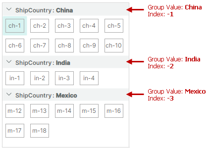

有关详细信息，请参阅以下部分：[识别和获取项与分组行](#identify-and-get-items-and-group-rows)。


### 分组相关 API {#grouping-related-api}

- `ListViewControl.GroupHeight` — 指定分组行高度。
- `ListViewControl.GroupLevelIndent` — 指定嵌套分组行（第二级及更低级别）之前的缩进。
- `ListViewControl.AutoExpandAllGroups` — 可用于禁止在控件加载时自动展开分组行。
- `ListViewControl.CollapseAllGroups` — 折叠所有分组行。
- `ListViewControl.CollapseGroup` — 折叠特定分组行。
- `ListViewControl.ExpandAllGroups` — 展开所有分组行。
- `ListViewControl.ExpandGroup` — 展开特定分组行。
- `ListViewControl.IsGroupExpanded` — 返回特定组是否已展开。

另请参阅：[遍历分组行及其子项的方法](#methods-to-traverse-through-group-rows-and-their-children)。


<!-- TODO
string GroupClass/ItemClass -->

## 筛选项 {#filter-items}

处理 `ListViewControl.FilterItem` 事件可动态控制特定 ListView 项的可见性。此事件会针对 `ListViewControl.ItemsSource` 集合中的每个项重复触发。要隐藏特定项，请将 `e.Visible` 事件参数设置为 `false`。

如果应用程序中的项筛选规则会动态变化，可能需要强制重新执行项筛选机制，从而重新触发 `ListViewControl.FilterItem` 事件。为此，请调用 `ListViewControl.RefreshData` 方法。

### 示例 {#example_1}

以下示例取自 _SVG Icons Browser_ 模块，它根据特定条件隐藏项。

``` xml
<mxlv:ListViewControl x:Name="IconsListControl" 
    FilterItem="ListViewControl_OnFilterItem">
```

``` cs
private void ListViewControl_OnFilterItem(object sender, ListViewFilterEventArgs e)
{
    ((SvgIconsBrowserViewModel)DataContext)?.OnCustomFilter(e);
}

public partial class SvgIconsBrowserViewModel : PageViewModelBase
{
    public void OnCustomFilter(ListViewFilterEventArgs e)
    {
        SvgIconViewModel vm = (SvgIconViewModel)e.Item;
        e.Visible = vm.Category.IsChecked && (string.IsNullOrEmpty(SearchText) || vm.Name.Contains(SearchText, StringComparison.OrdinalIgnoreCase));
    }
}
```

## 识别和获取项与分组行 {#identify-and-get-items-and-group-rows}

ListView 为 ListView 项和分组行分配**索引**，以便对其进行识别。


- 索引反映项和分组行的顺序。
- 项使用从零开始的非负索引编号。最上面的项的索引为 **0**，第二项的索引为 **1**，依此类推。
- 分组行使用负索引编号。最上面的分组行的索引为 **-1**，第二个分组行的索引为 **-2**，依此类推。
- 索引用于识别可见项和隐藏项（位于已折叠组内的项）。
- 当项的顺序发生变化时（例如对数据进行排序或分组时），项会根据其新位置获得新的索引。
- 因数据筛选而隐藏的项不会被分配索引。

项未分组时，索引与可见索引相同：

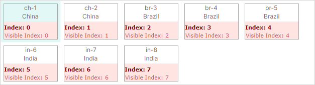

项分组后，索引与可见索引不同：

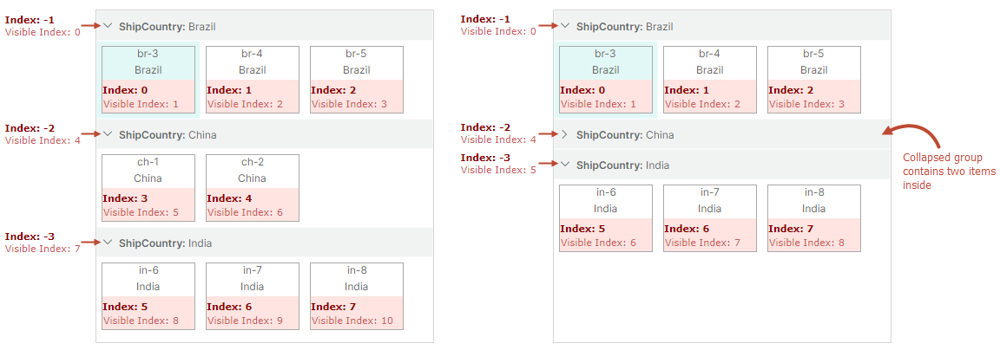

### 特殊索引 {#special-indexes}

ListView 保留以下预定义索引来标识无效项：

- `ListViewControl.InvalidItemIndex` 常量 — 标识 ListView 控件中不存在的项。用于获取项索引的 ListView 方法可能会返回此值。

例如，根级别的项没有父级。如果尝试使用 `ListViewControl.GetParentItemIndex` 方法获取根项的父级，此方法将返回 `ListViewControl.InvalidItemIndex` 常量。

### 源项和源项索引 {#source-items-and-source-item-indexes}

每个 ListView 项都对应于所绑定项源（`ListViewControl.ItemsSource`）中的特定业务对象。项在项源中的位置称为**源项索引**。

可以使用以下方法获取基础源项和源项索引。

- `ListViewControl.GetSourceItemIndexByItemIndex`
- `ListViewControl.GetSourceItemIndexByVisibleItemIndex`

<!-- TODO
не хватает методов
- `GetSourceItemByRowIndex`
- `GetSourceItemByVisibleRowIndex` 
issue=MX-253
 -->

要执行相反的索引转换，请参阅以下方法：

- `ListViewControl.GetItemIndexBySourceItemIndex`
- `ListViewControl.GetVisibleItemIndexBySourceItemIndex`


源项索引从零开始。对项进行排序、分组或筛选时，其源项索引不会改变。

分组行在项源中没有对应的项，因此无法通过源项和源项索引来访问分组行。


### 相关 API {#related-api}

ListView 提供了用于按索引检索项，以及在项索引、可见项索引和源项索引之间进行转换的 API 成员。下表对此进行了总结：

- `ListViewControl.FocusedItemIndex` — 指定获得焦点的项/分组行的索引。此属性可用于将焦点移动到特定项或分组行。
- `ListViewControl.GetItemIndexBySourceItemIndex` — 根据源项索引返回项的索引。
- `ListViewControl.GetItemIndexByVisibleItemIndex` — 根据项的可见索引返回项的索引。
- `ListViewControl.GetSourceItemIndexByItemIndex` — 返回具有指定索引的项的源项索引。
- `ListViewControl.GetSourceItemIndexByVisibleItemIndex` — 返回具有指定可见索引的项的源项索引。
- `ListViewControl.GetVisibleItemIndexByItemIndex` — 根据项的索引返回项的可见索引。
- `ListViewControl.GetVisibleItemIndexBySourceItemIndex` — 根据源项索引返回项的可见索引。

#### 遍历分组行及其子项的方法 {#methods-to-traverse-through-group-rows-and-their-children}


- `ListViewControl.GetGroupChildItemIndex(int childIndex)` — 返回特定根分组行的索引。`childIndex` 参数指定目标根分组行在其同级中从零开始的顺序号，取值范围为 `0` 到 `GetGroupChildrenCount() - 1`。
- `ListViewControl.GetGroupChildItemIndex(int itemIndex, int childIndex)` — 返回子项或嵌套分组行的索引。`itemIndex` 参数指定父分组行的索引，`childIndex` 参数指定目标子项或分组行在其同级中从零开始的顺序号，取值范围为 `0` 到 `GetGroupChildrenCount(itemIndex) - 1`。
- `ListViewControl.GetGroupChildrenCount()` — 此不带参数的重载返回根级别的分组行数。
- `ListViewControl.GetGroupChildrenCount(int itemIndex)` — 返回特定分组行的直接子项数。父分组行由其索引标识。

- `ListViewControl.GetGroupIndex` — 根据分组行的字段名和分组值返回分组行的索引。
- `ListViewControl.GetGroupValue` — 根据分组行的索引返回其值。
- `ListViewControl.GetParentItemIndex` — 返回嵌套项或嵌套分组行的父分组行的索引。

!!! note "注意"

    如果项未分组，上述方法不起作用。

## 项焦点 {#item-focus}

当用户使用键盘或鼠标单击导航到特定项或分组行时，ListView 会将焦点移动到该项/分组行。

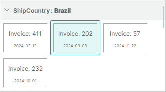

可以使用以下属性在代码中获取/设置获得焦点的项/分组行：

- `ListViewControl.FocusedItem` — 获取或设置 `ListViewControl.ItemsSource` 集合中与 ListView 获得焦点的项相对应的业务对象。要将焦点移动到特定项，可以将 `ItemsSource` 集合中的对象分配给 `FocusedItem` 属性。

    !!! note "注意"
    
        如果获得焦点的是分组行，`FocusedItem` 属性返回 `null`。不能使用此属性使分组行获得焦点。

- `ListViewControl.FocusedItemIndex` — 获取或设置获得焦点的项/分组行的[索引](#identify-and-get-items-and-group-rows)。可以使用 `FocusedItemIndex` 属性将焦点移动到项或分组行。

以下代码使 _ShipCountry_ 字段为“India”的分组行获得焦点。

``` cs
int groupRowindex = listViewControl1.GetGroupIndex("ShipCountry", "India");
if(groupRowindex != ListViewControl.InvalidItemIndex)
    listViewControl1.FocusedItemIndex = groupRowindex;
```


### 示例 - 响应项获得焦点 {#example-respond-to-focusing-an-item}

以下示例将 `ListViewControl.FocusedItem` 属性绑定到 _MainWindowViewModel.FocusedItem_ 属性。可以在 _MainWindowViewModel.FocusedItem_ 属性的 setter 中响应获得焦点的项的更改。

``` xml
xmlns:mxlv="https://schemas.eremexcontrols.net/avalonia/listview"

<mxlv:ListViewControl Name="listViewControl1" ItemsSource="{Binding Items}" 
    FocusedItem="{Binding FocusedItem, Mode=TwoWay}">
</mxlv:ListViewControl>
```

``` cs
public partial class MainWindowViewModel : ViewModelBase
{
    ItemViewModel focusedItem;
    ItemViewModel FocusedItem {
        get {
            return focusedItem;
        }
        set
        {
            if (value != focusedItem)
            {
                focusedItem = value;
                // Perform actions when the focused item changes.
            }
        }
    }
}

public partial class ItemViewModel : ObservableObject
{
    //...
}
```


## 多项选择 {#multiple-item-selection}

ListView 允许选择多个项和分组行。要启用此选择模式，请将 `ListViewControl.SelectionMode` 属性设置为 `Multiple`。所选项和分组行的背景会高亮显示。

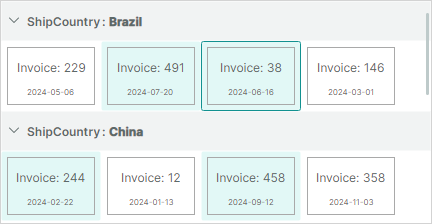

- 单击某项会选择该项，并取消选择之前选择的项。
- 按住 CTRL 单击某项会切换该项的选择状态。
- 按住 SHIFT 单击某项会选择一个项范围（从之前获得焦点的项到所单击的项）。

<!-- TODO
I cannot select items using the keyboard.
 -->


用户选择某项时，该项也会获得焦点（`ListViewControl.FocusedItem` 和 `ListViewControl.FocusedItemIndex` 属性会更新）。
随后按住 CTRL 单击该项会取消选择该项，但焦点保持不变。


使用以下 API 成员获取所选的项和分组行：

- `ListViewControl.SelectedItems` — `ListViewControl.ItemsSource` 源中与所选 ListView 项相对应的业务对象集合。`SelectedItems` 集合不包含所选的分组行，因为分组行不对应 `ListViewControl.ItemsSource` 源中的任何业务对象。

- `ListViewControl.GetSelectedIndices` — 此方法返回当前所选项和分组行的[索引](#identify-and-get-items-and-group-rows)数组。项的索引为非负数，分组行的索引为负数。有关详细信息，请参阅以下部分：[识别和获取项与分组行](#identify-and-get-items-and-group-rows)。


以下属性和方法可用于在代码中选择项和分组行：

- `ListViewControl.SelectedItems` — 可以将 `ListViewControl.ItemsSource` 源中的业务对象集合分配给 `SelectedItems` 属性，以选择相应的 ListView 项。
- `ListViewControl.SelectAll` — 选择所有项和分组行（如果有）。
- `ListViewControl.SetSelected` — 选择或取消选择特定项或分组行。
- `ListViewControl.ToggleSelected` — 切换项或分组行的选择状态。


要响应选择的更改，可以处理 `ListViewControl.SelectionChanged` 事件。

<!-- TODO
GetSelectedIndices

selected group rows are not included in the selection
 -->


### 相关 API {#related-api_1}

- `ListViewControl.ClearSelection` — 清除选择。
- `ListViewControl.GetIsSelected` — 返回某项是否已选择。


<br>
<br>

<sup>*</sup> 本页面使用机器翻译技术翻译。
