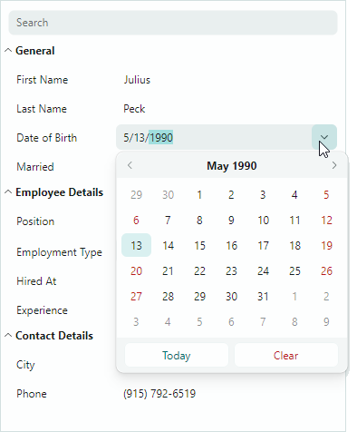

# 数据编辑 {#data-editing}

## 默认就地 Eremex 编辑器 {#default-in-place-eremex-editors}

如果没有显式指定行的就地编辑器，则 PropertyGrid 控件使用就地 Eremex 编辑器来显示和编辑常见数据类型的行值。



以下列表显示了具有常见数据类型的 Eremex 编辑器关联的：

- 布尔值 — [`CheckEditor`](../../API/Eremex.AvaloniaUI.Controls.Editors/CheckEditor.md)
- 双值 — [`SpinEditor`](../../API/Eremex.AvaloniaUI.Controls.Editors/SpinEditor.md)
- 枚举值 — [`ComboBoxEditor`](../../API/Eremex.AvaloniaUI.Controls.Editors/ComboBoxEditor.md)
- 具有 `TypeConverter` 属性且 `TypeConverter.GetStandardValuesSupported` 方法返回 `true` — [`ComboBoxEditor`](../../API/Eremex.AvaloniaUI.Controls.Editors/ComboBoxEditor.md) 的属性
- 其他值 — [`TextEditor`](../../API/Eremex.AvaloniaUI.Controls.Editors/TextEditor.md)

当就地 Eremex 编辑器激活时，您可以动态访问和修改这些编辑器的实例。有关更多详细信息，请参阅 [访问活动就地 Eremex 编辑器](#access-the-active-in-place-eremex-editor) 部分。

## 分配就地 Eremex 编辑器 {#assign-in-place-eremex-editors}

如果需要覆盖默认 editor assignment，或者在 XAML 或代码隐藏中自定义行编辑器，则可以将就地 Eremex 编辑器显式分配给行。

为此目的，请使用 [`PropertyGridRow.EditorProperties`](../../API/Eremex.AvaloniaUI.Controls.PropertyGrid/PropertyGridRow/EditorProperties.md) 属性，如下所示：

1. 创建并自定义辅助程序 `...EditorProperties` 类的实例，该类存储特定于所需就地编辑器的设置。这些辅助类都是 [`BaseEditorProperties`](../../API/Eremex.AvaloniaUI.Controls.Editors/BaseEditorProperties.md) 的后代： 
    - [`ButtonEditorProperties`](../../API/Eremex.AvaloniaUI.Controls.Editors/ButtonEditorProperties.md) — 包含特定于 [`ButtonEditor`](../../API/Eremex.AvaloniaUI.Controls.Editors/ButtonEditor.md) 控件的设置。
    - [`CheckEditorProperties`](../../API/Eremex.AvaloniaUI.Controls.Editors/CheckEditorProperties.md) — 包含特定于 [`CheckEditor`](../../API/Eremex.AvaloniaUI.Controls.Editors/CheckEditor.md) 控件的设置。
    - `ColorEditorProperties` — 包含特定于 [`ColorEditor`](../../API/Eremex.AvaloniaUI.Controls.Editors/ColorEditor.md) 控件的设置。
    - [`ComboBoxEditorProperties`](../../API/Eremex.AvaloniaUI.Controls.Editors/ComboBoxEditorProperties.md) — 包含特定于 [`ComboBoxEditor`](../../API/Eremex.AvaloniaUI.Controls.Editors/ComboBoxEditor.md) 控件的设置。
    - [`HyperlinkEditorProperties`](../../API/Eremex.AvaloniaUI.Controls.Editors/HyperlinkEditorProperties.md) — 包含特定于 [`HyperlinkEditor`](../../API/Eremex.AvaloniaUI.Controls.Editors/HyperlinkEditor.md) 控件的设置。
    - [`PopupColorEditorProperties`](../../API/Eremex.AvaloniaUI.Controls.Editors/PopupColorEditorProperties.md) — 包含特定于 [`PopupColorEditor`](../../API/Eremex.AvaloniaUI.Controls.Editors/PopupColorEditor.md) 控件的设置。
    - [`PopupEditorProperties`](../../API/Eremex.AvaloniaUI.Controls.Editors/PopupEditorProperties.md) — 包含特定于 [`PopupEditor`](../../API/Eremex.AvaloniaUI.Controls.Editors/PopupEditor.md) 控件的设置。
    - [`SegmentedEditorProperties`](../../API/Eremex.AvaloniaUI.Controls.Editors/SegmentedEditorProperties.md) — 包含特定于 [`SegmentedEditor`](../../API/Eremex.AvaloniaUI.Controls.Editors/SegmentedEditor.md) 控件的设置。
    - [`SpinEditorProperties`](../../API/Eremex.AvaloniaUI.Controls.Editors/SpinEditorProperties.md) — 包含特定于 [`SpinEditor`](../../API/Eremex.AvaloniaUI.Controls.Editors/SpinEditor.md) 控件的设置。
    - [`TextEditorProperties`](../../API/Eremex.AvaloniaUI.Controls.Editors/TextEditorProperties.md) — 包含特定于 [`TextEditor`](../../API/Eremex.AvaloniaUI.Controls.Editors/TextEditor.md) 控件的设置。
    
2. 将[`PropertyGridRow.EditorProperties`](../../API/Eremex.AvaloniaUI.Controls.PropertyGrid/PropertyGridRow/EditorProperties.md) 属性设置为创建的`...EditorProperties` 实例。

``` xml
xmlns:mxpg="https://schemas.eremexcontrols.net/avalonia/propertygrid"
xmlns:mxe="https://schemas.eremexcontrols.net/avalonia/editors"

<mxpg:PropertyGridRow FieldName="OrderNo">
    <mxpg:PropertyGridRow.EditorProperties >
        <mxe:ButtonEditorProperties TextWrapping="Wrap" />
    </mxpg:PropertyGridRow.EditorProperties>
</mxpg:PropertyGridRow>
```

[`PropertyGridRow.CellTemplate`](../../API/Eremex.AvaloniaUI.Controls.PropertyGrid/PropertyGridRow/CellTemplate.md) 属性是将 Eremex 编辑器分配给行的另一种方法。确保 Eremex 编辑器的 `x:Name` 属性设置为 **“PART_Editor”**。在这种情况下，PropertyGrid 自动将编辑器的 [`EditorValue`](../../API/Eremex.AvaloniaUI.Controls.Editors/BaseEditor/EditorValue.md) 属性绑定到行的绑定字段。此外，PropertyGrid 开始维护就地编辑器的外观设置（活动和非活动状态下的边框可见性和前景色）。

``` xml
xmlns:mxpg="https://schemas.eremexcontrols.net/avalonia/propertygrid"
xmlns:mxe="https://schemas.eremexcontrols.net/avalonia/editors"
...
<mxpg:PropertyGridRow FieldName="Caption">
    <mxpg:PropertyGridRow.CellTemplate>
        <DataTemplate>
            <mxe:ButtonEditor x:Name="PART_Editor">
                <mxe:ButtonEditor.Buttons>
                    <mxe:ButtonSettings Content="..."/>
                </mxe:ButtonEditor.Buttons>
            </mxe:ButtonEditor>
        </DataTemplate>
    </mxpg:PropertyGridRow.CellTemplate>
</mxpg:PropertyGridRow>
```


## 自定义编辑器 {#custom-editors}
PropertyGrid 允许您为行单元指定自定义编辑器。您可以将编辑器直接分配给特定行，或者根据行的基础对象的数据类型动态地将编辑器分配给行。
有关详细信息，请参阅以下主题：[自定义编辑器](custom-editors.md)。

<!--TODO ## Get and Set Cell values

-->

## 访问活动就地 Eremex 编辑器 {#access-the-active-in-place-eremex-editor}

- [`ActiveEditor`](../../API/Eremex.AvaloniaUI.Controls.PropertyGrid/PropertyGridControl/ActiveEditor.md) 属性 — 返回活动的就地编辑器。
  
为了提高控件的性能，PropertyGrid 在显示模式下渲染单元格值时（文本编辑未激活时）使用就地 Eremex 编辑器的轻量级版本。当在单元格中编辑 operation starts 文本时，就地编辑器从轻量级版本切换到全功能版本。在这种情况下，您可以使用 [`ActiveEditor`](../../API/Eremex.AvaloniaUI.Controls.PropertyGrid/PropertyGridControl/ActiveEditor.md) 属性来访问 Eremex 编辑器实例。当行单元格失去焦点时，编辑器切换回其轻量级版本，并且 [`ActiveEditor`](../../API/Eremex.AvaloniaUI.Controls.PropertyGrid/PropertyGridControl/ActiveEditor.md) 属性返回 `null`。

- [`ShowingEditor`](../../API/Eremex.AvaloniaUI.Controls.PropertyGrid/PropertyGridControl/ShowingEditor.md) 事件 — 允许您在行单元格中开始编辑操作时接收通知。您可以安全地访问 [`ShowingEditor`](../../API/Eremex.AvaloniaUI.Controls.PropertyGrid/PropertyGridControl/ShowingEditor.md) 事件处理程序中的 [`ActiveEditor`](../../API/Eremex.AvaloniaUI.Controls.PropertyGrid/PropertyGridControl/ActiveEditor.md) 属性。

## 显示单元格编辑器 {#show-a-cell-editor}

- [`ShowEditor`](../../API/Eremex.AvaloniaUI.Controls.PropertyGrid/PropertyGridControl/ShowEditor.md) 方法 — 激活焦点行中的单元格编辑器。
- [`ShowingEditor`](../../API/Eremex.AvaloniaUI.Controls.PropertyGrid/PropertyGridControl/ShowingEditor.md) 事件 — 允许您防止用户在特定情况下激活单元格编辑器。处理 [`ShowingEditor`](../../API/Eremex.AvaloniaUI.Controls.PropertyGrid/PropertyGridControl/ShowingEditor.md) 事件时，将 `Cancel` 事件参数设置为 `true` 以禁用编辑器激活。

## 关闭活动就地编辑器 {#close-the-active-in-place-editor}

- [`CloseEditor`](../../API/Eremex.AvaloniaUI.Controls.PropertyGrid/PropertyGridControl/CloseEditor.md) 方法 — 保存在单元格编辑器中所做的更改并关闭编辑器。
- [`HideEditor`](../../API/Eremex.AvaloniaUI.Controls.PropertyGrid/PropertyGridControl/HideEditor.md) 方法 — 关闭单元格编辑器而不保存任何更改。

- [`HiddenEditor`](../../API/Eremex.AvaloniaUI.Controls.PropertyGrid/PropertyGridControl/HiddenEditor.md) 事件 — 在活动单元格编辑器关闭后触发。


## 保存在就地编辑器中所做的更改 {#save-the-changes-made-in-an-in-place-editor}

- [`CloseEditor`](../../API/Eremex.AvaloniaUI.Controls.PropertyGrid/PropertyGridControl/CloseEditor.md) 方法 — 保存在单元格编辑器中所做的更改并关闭编辑器。
- [`PostEditor`](../../API/Eremex.AvaloniaUI.Controls.PropertyGrid/PropertyGridControl/PostEditor.md) 方法 — 保存在活动单元格编辑器中所做的更改，而不关闭编辑器。

<br>
<br>

<sup>*</sup> 本页面使用机器翻译技术翻译。
