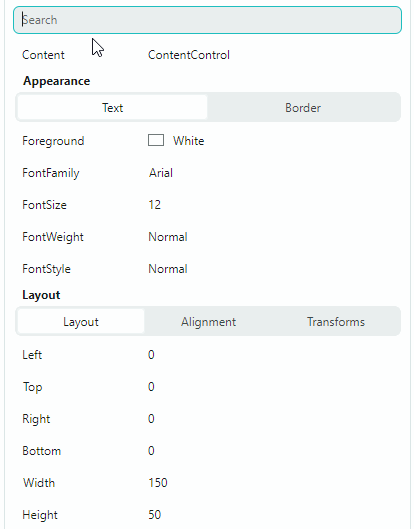

# 数据搜索 {#data-search}

## 搜索面板 {#search-panel}

控件的内置搜索面板允许用户搜索所绑定对象的属性。

当用户在搜索框中输入文本时，PropertyGrid 控件会筛选行，仅显示与搜索文本匹配的行。

使用 [`ShowSearchPanel`](../../API/Eremex.AvaloniaUI.Controls.PropertyGrid/PropertyGridControl/ShowSearchPanel.md) 属性控制搜索框的可见性。

 
 

* 本页面使用机器翻译技术翻译。
