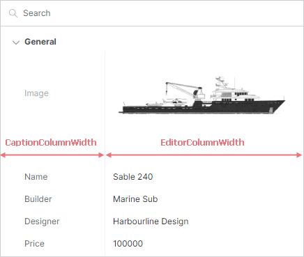
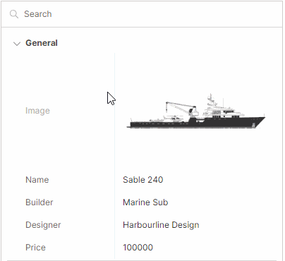

# 行标题和单元格布局选项 {#row-header-and-cell-layout-options}

[`PropertyGridControl`](../../API/Eremex.AvaloniaUI.Controls.PropertyGrid/PropertyGridControl.md) 提供了多个属性，用于控制标题（题注）列和编辑器（单元格）列的宽度，以及指定行标题的对齐方式。您可以固定这些列的宽度，并允许用户在运行时调整其大小。

## 设置列宽 {#set-column-widths}

使用以下属性设置 PropertyGrid 列的宽度：

- [`CaptionColumnWidth`](../../API/Eremex.AvaloniaUI.Controls.PropertyGrid/PropertyGridControl/CaptionColumnWidth.md) — 获取或设置标题（题注）列的宽度。默认为 `GridLength.Star` 值。
- [`EditorColumnWidth`](../../API/Eremex.AvaloniaUI.Controls.PropertyGrid/PropertyGridControl/EditorColumnWidth.md) — 获取或设置编辑器（单元格）列的宽度。默认为 `GridLength.Star` 值。

    


[`CaptionColumnWidth`](../../API/Eremex.AvaloniaUI.Controls.PropertyGrid/PropertyGridControl/CaptionColumnWidth.md) 和 [`EditorColumnWidth`](../../API/Eremex.AvaloniaUI.Controls.PropertyGrid/PropertyGridControl/EditorColumnWidth.md) 属性接受 `GridLength` 值，因此您可以指定绝对像素宽度、星号（按比例）宽度或自动宽度。

这些属性的默认值为 `GridLength.Star`，表示可用的水平空间按比例在标题列和编辑器列之间分配。


如果两列都使用绝对（像素）宽度，请确保它们的总和不超过控件的宽度。否则，列内容将被裁剪。

```csharp
propertyGridControl.Width = 300;
propertyGridControl.CaptionColumnWidth = new GridLength(100);
propertyGridControl.EditorColumnWidth = new GridLength(200);
```


## 允许用户调整列宽 {#allow-users-to-resize-columns}

PropertyGrid 允许用户在运行时使用内置的调整器调整标题列和编辑器列的大小。



使用 [`AllowResizing`](../../API/Eremex.AvaloniaUI.Controls.PropertyGrid/PropertyGridControl/AllowResizing.md) 属性控制是否启用调整器。该属性的默认值为 `true`。


## 对齐标题文本 {#align-caption-text}

使用 [`CaptionHorizontalAlignment`](../../API/Eremex.AvaloniaUI.Controls.PropertyGrid/PropertyGridControl/CaptionHorizontalAlignment.md) 属性指定标题列内文本的水平对齐方式。支持以下文本对齐模式：`Left`、`Center` 和 `Right`。

```csharp
propertyGridControl.CaptionHorizontalAlignment = HorizontalAlignment.Center;
```


<br>
<br>

<sup>*</sup> 本页面使用机器翻译技术翻译。
