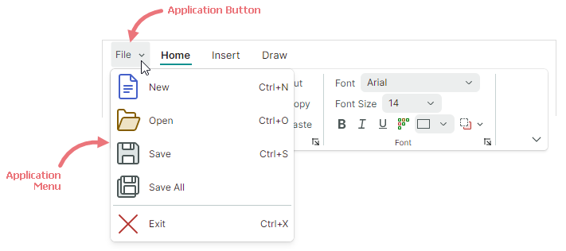
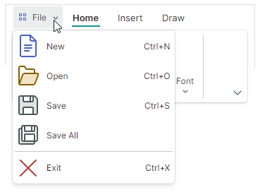
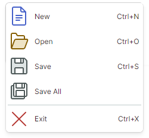
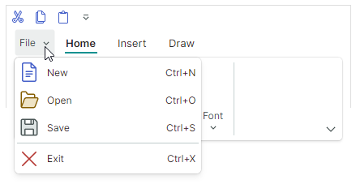

# Application Button 和主菜单 {#application-button-and-main-menu}

Ribbon 控件有一个内置应用程序按钮。单击 Application Button 通常会调用关联的下拉应用程序菜单。单击此按钮时，您还可以执行自定义操作。



## Application Button 内容 {#application-button-content}

Application Button 可以显示图像和内容（文本）。

- [`RibbonControl.ApplicationButtonContent`](../../API/Eremex.AvaloniaUI.Controls.Ribbon/RibbonControl/ApplicationButtonContent.md) — 指定 Application Button 的标题。
- [`RibbonControl.ApplicationButtonContentTemplate`](../../API/Eremex.AvaloniaUI.Controls.Ribbon/RibbonControl/ApplicationButtonContentTemplate.md) — 用于以自定义方式呈现 Application Button 标题的数据模板。
- [`RibbonControl.ApplicationButtonGlyph`](../../API/Eremex.AvaloniaUI.Controls.Ribbon/RibbonControl/ApplicationButtonGlyph.md) — 指定在标题之前显示的图像。

以下代码将自定义标题和图像分配给 Application Button：



``` xml
xmlns:icons="https://schemas.eremexcontrols.net/avalonia/icons"

<mxr:RibbonControl Name="ribbon1" 
  ApplicationButtonContent="File" 
  ApplicationButtonGlyph="{x:Static icons:Basic.Small_Images}" 
  ApplicationButtonKeyTip="F" >
```

## Application Button 可见性 {#application-button-visibility}

Application Button 位于左边缘，功能区页眉之前。

当不需要 Application Button 和菜单时，可以使用 [`RibbonControl.IsApplicationButtonVisible`](../../API/Eremex.AvaloniaUI.Controls.Ribbon/RibbonControl/IsApplicationButtonVisible.md) 属性隐藏应用程序按钮。

## 点击Application Button {#click-the-application-button}

单击 Application Button 会调用 [应用菜单](#application-menu)（如果已指定）。

您还可以使用以下 API 成员处理 Application Button 单击：

- [`RibbonControl.ApplicationButtonCommand`](../../API/Eremex.AvaloniaUI.Controls.Ribbon/RibbonControl/ApplicationButtonCommand.md) — 右键单击应用程序按钮时触发的命令。使用 [`RibbonControl.ApplicationButtonCommandParameter`](../../API/Eremex.AvaloniaUI.Controls.Ribbon/RibbonControl/ApplicationButtonCommandParameter.md) 属性指定命令的参数。
- [`RibbonControl.ApplicationButtonClick`](../../API/Eremex.AvaloniaUI.Controls.Ribbon/RibbonControl/ApplicationButtonClick.md) — 右键单击 Application Button 时引发的事件。
- [`RibbonControl.ApplicationButtonPress`](../../API/Eremex.AvaloniaUI.Controls.Ribbon/RibbonControl/ApplicationButtonPress.md) — 在应用程序按钮上按下任意鼠标按钮时引发的事件。


## 应用菜单 {#application-menu}

使用 [`RibbonControl.ApplicationButtonDropDownControl`](../../API/Eremex.AvaloniaUI.Controls.Ribbon/RibbonControl/ApplicationButtonDropDownControl.md) 属性指定单击 Application Button 时调用的弹出菜单/dropdown 控件。您可以将 [`ApplicationButtonDropDownControl`](../../API/Eremex.AvaloniaUI.Controls.Ribbon/RibbonControl/ApplicationButtonDropDownControl.md) 属性设置为以下对象：

- [`PopupMenu`](../../API/Eremex.AvaloniaUI.Controls.Bars/PopupMenu.md) — 可以显示各种项目（按钮、检查按钮、子菜单等）的弹出菜单。请参阅 [弹出菜单和上下文菜单](../toolbars-and-menus/popup-and-context-menus.md) 了解更多信息。
  


- [`PopupContainer`](../../API/Eremex.AvaloniaUI.Controls.Bars/PopupContainer.md) — 可以显示自定义内容的弹出窗口控件。


以下示例将 [`PopupMenu`](../../API/Eremex.AvaloniaUI.Controls.Bars/PopupMenu.md) 组件指定为 Ribbon 控件的应用程序菜单。



``` xml
<mxr:RibbonControl Name="ribbon1" ApplicationButtonContent="File">
    <mxr:RibbonControl.ApplicationButtonDropDownControl>
        <mxb:PopupMenu MinWidth="250" ContentRightIndent="30">
            <mxb:ToolbarButtonItem Header="New" Glyph="{x:Static icons:Basic.Doc}" 
              GlyphSize="24,24" HotKey="Ctrl+N"/>
            <mxb:ToolbarButtonItem Header="Open" Glyph="{x:Static icons:Basic.Folder_Open}" 
              GlyphSize="24,24" HotKey="Ctrl+O"/>
            <mxb:ToolbarButtonItem Header="Save" Glyph="{x:Static icons:Basic.Save}" 
              GlyphSize="24,24"  HotKey="Ctrl+S"/>
            <mxb:ToolbarButtonItem Header="Exit" Glyph="{x:Static icons:Basic.Cancel}" 
              ShowSeparator="True" GlyphSize="24,24"  HotKey="Ctrl+X"/>
        </mxb:PopupMenu>
    </mxr:RibbonControl.ApplicationButtonDropDownControl>
    <!-- ... -->
</mxr:RibbonControl>
```

<br>
<br>

<sup>*</sup> 本页面使用机器翻译技术翻译。
