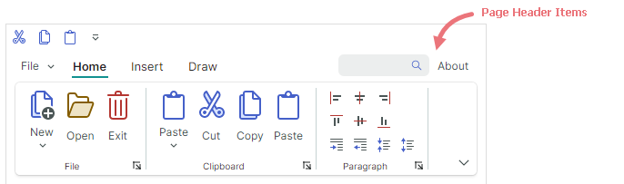

# 页面标题项 {#page-header-items}

页面标题项是与页面标题显示在同一行中的 [Ribbon 项](ribbon-items.md)。这些项固定在 Ribbon 控件的右边缘。



使用 [`RibbonControl.PageHeaderItems`](../../API/Eremex.AvaloniaUI.Controls.Ribbon/RibbonControl/PageHeaderItems.md) 集合来添加、访问和修改页面标题项。

``` xml
<mxr:RibbonControl.PageHeaderItems>
    <mxb:ToolbarEditorItem EditorWidth="100">
        <mxb:ToolbarEditorItem.EditorProperties>
            <mxe:ButtonEditorProperties>
                <mxe:ButtonEditorProperties.Buttons>
                    <mxe:ButtonSettings Glyph="{x:Static icons:Basic.Search}" GlyphSize="12, 12"/>
                </mxe:ButtonEditorProperties.Buttons>
            </mxe:ButtonEditorProperties>
        </mxb:ToolbarEditorItem.EditorProperties>
    </mxb:ToolbarEditorItem>
    <mxb:ToolbarButtonItem Name="btnAbout" Header="About" Click="BtnAbout_Click" />
</mxr:RibbonControl.PageHeaderItems>
```

您还可以使用 [`RibbonControl.PageHeaderItemsSource`](../../API/Eremex.AvaloniaUI.Controls.Ribbon/RibbonControl/PageHeaderItemsSource.md) 属性，根据 View Model 中存储的业务对象集合创建页面标题项。相应的数据模板应定义 [Ribbon 项](ribbon-items.md)。


<br>
<br>

<sup>*</sup> 本页面使用机器翻译技术翻译。
