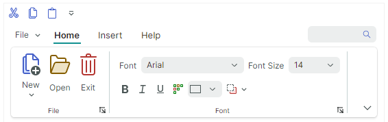
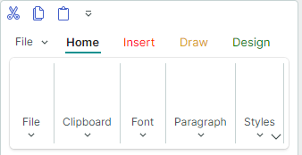

# 页数 {#pages}

Ribbon 页面用于在 Ribbon 控件的命令栏中创建选项卡。以下图像显示了具有三个页面（_Home_、_Insert_ 和 _Help_）的 Ribbon 控件：



您可以首先隐藏各个页面，然后使它们在特定时间可见并处于活动状态。请参阅以下部分了解更多信息：[页面可见性](#page-visibility)。

## 定义和访问 Ribbon 页面 {#define-and-access-ribbon-pages}

Ribbon 页面由 [`RibbonPage`](../../API/Eremex.AvaloniaUI.Controls.Ribbon/RibbonPage.md) 类对象封装。在代码隐藏中，您可以使用 [`RibbonControl.Pages`](../../API/Eremex.AvaloniaUI.Controls.Ribbon/RibbonControl/Pages.md) 集合创建、访问和修改功能区页面。要在 XAML 中定义功能区页面，请在 **&lt;RibbonControl&gt;** 开始标记和结束标记之间添加 [`RibbonPage`](../../API/Eremex.AvaloniaUI.Controls.Ribbon/RibbonPage.md) 对象。

``` xml
<mxb:ToolbarManager IsWindowManager="True">
    <mxr:RibbonControl>
      <mxr:RibbonPage Header="Home" KeyTip="H"> 
        <!-- ... -->
      </mxr:RibbonPage>
      <mxr:RibbonPage Header="Insert" KeyTip="I">
        <!-- ... -->
      </mxr:RibbonPage>
      <mxr:RibbonPage Header="Help" KeyTip="P">
        <!-- ... -->
      </mxr:RibbonPage>
    </mxr:RibbonControl>
</mxb:ToolbarManager>
```

<!-- TODO
Example of adding, hiding, positioning pages via [`RibbonControl.Pages`](../../API/Eremex.AvaloniaUI.Controls.Ribbon/RibbonControl/Pages.md).
 -->


您还可以使用 [`RibbonControl.PagesSource`](../../API/Eremex.AvaloniaUI.Controls.Ribbon/RibbonControl/PagesSource.md) 属性从视图模型中的业务对象集合创建功能区页面。相应的数据模板应定义 [`RibbonPage`](../../API/Eremex.AvaloniaUI.Controls.Ribbon/RibbonPage.md) 对象并从基础业务对象初始化其设置。

<!-- TODO
PagesSource example 
 -->

## 页面标题和内容 {#page-header-and-content}

创建页面时，使用 [`RibbonPage.Header`](../../API/Eremex.AvaloniaUI.Controls.Ribbon/RibbonPage/Header.md) 属性指定页面标题的文本。

<!-- TODO
There is a Glyph property in RibbonPage.  Doesn't work???
 -->

功能区页面的内容为 [ribbon page groups](page-groups.md)。使用 [`RibbonPage.Groups`](../../API/Eremex.AvaloniaUI.Controls.Ribbon/RibbonPage/Groups.md) 集合创建和访问功能区页面组。在 XAML 中，您可以在 **&lt;RibbonPage&gt;** 开始标记和结束标记之间定义页面组。

``` xml
 <mxr:RibbonPage Header="Home" KeyTip="H">
    <mxr:RibbonPageGroup Header="File" IsHeaderButtonVisible="True">
        <mxb:ToolbarButtonItem Header="New" KeyTip="N" Glyph="{x:Static icons:Basic.Docs_Add}"
                               mxr:RibbonControl.DisplayMode="Large"/>
        <mxb:ToolbarButtonItem Header="Open" KeyTip="O"
                               Glyph="{x:Static icons:Basic.Folder_Open}" />
        <mxb:ToolbarButtonItem Header="Exit" KeyTip="E"
                               Glyph="{x:Static icons:Basic.Remove}" />
    </mxr:RibbonPageGroup>
    <mxr:RibbonPageGroup Header="Font" IsHeaderButtonVisible="True">
        <mxb:ToolbarCheckItemGroup ShowSeparator="True">
            <mxb:ToolbarCheckItem Header="Bold" KeyTip="B" Glyph="{x:Static icons:Basic.Font_Bold}" />
            <mxb:ToolbarCheckItem Header="Italic" KeyTip="I" Glyph="{x:Static icons:Basic.Font_Italic}" />
            <mxb:ToolbarCheckItem Header="Underline" KeyTip="U" Glyph="{x:Static icons:Basic.Font_Underline}"  />
        </mxb:ToolbarCheckItemGroup>
       <!-- ... -->
    </mxr:RibbonPageGroup>
</mxr:RibbonPage>
```


您还可以使用 [`RibbonPage.GroupsSource`](../../API/Eremex.AvaloniaUI.Controls.Ribbon/RibbonPage/GroupsSource.md) 属性从视图模型中的业务对象集合创建页组。相应的数据模板应定义 [`RibbonPageGroup`](../../API/Eremex.AvaloniaUI.Controls.Ribbon/RibbonPageGroup.md) 对象并从业务对象初始化其设置。

## 选定的页面 {#selected-page}

当选择页面时，页面的内容会显示给用户。用户可以通过单击页眉来选择页面。在代码中，您可以选择具有以下属性之一的页面：

- [`RibbonControl.SelectedPage`](../../API/Eremex.AvaloniaUI.Controls.Ribbon/RibbonControl/SelectedPage.md)
- [`RibbonPage.IsSelected`](../../API/Eremex.AvaloniaUI.Controls.Ribbon/RibbonPage/IsSelected.md)

## 页面可见性 {#page-visibility}

使用 `RibbonPage.IsVisible` 属性隐藏和显示页面。页面的位置由其在 [`RibbonControl.Pages`](../../API/Eremex.AvaloniaUI.Controls.Ribbon/RibbonControl/Pages.md) 集合中的位置指定。

以下代码显示并激活最初隐藏的 _Table_ 页面。

``` xml
<mxr:RibbonControl Name="ribbon">
    <mxr:RibbonPage Header="Table" Name="pageTable" IsVisible="False"> 
        <!-- ... -->
    </mxr:RibbonPage>
<mxr:RibbonControl>
```
``` cs
// Display and select the Table page.
pageTable.IsVisible = true;
pageTable.IsSelected = true;
```

## 页面着色 {#page-colorization}

在 Ribbon 控件中，您可以使用自定义前景色突出显示任何页面。为此目的，请使用 `RibbonPage.Foreground` 属性。

``` xml
<mxr:RibbonPage Header="Insert"  KeyTip="I" Foreground="Red"/>
<mxr:RibbonPage Header="Draw" KeyTip="D" Foreground="Goldenrod"/>
<mxr:RibbonPage Header="Design" KeyTip="S" Foreground="Green" />
```




当您需要实现上下文页面（那些在特定时间临时可见并突出显示的页面）时，页面着色非常有用。您应手动控件这些页面的可见性、位置和选定状态。请参阅 [选定的页面](#selected-page) 和 [页面可见性](#page-visibility) 了解更多信息。

<br>
<br>

<sup>*</sup> 本页面使用机器翻译技术翻译。
