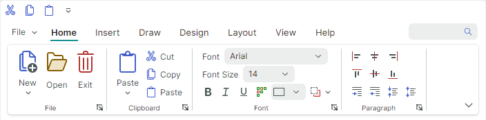
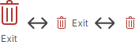
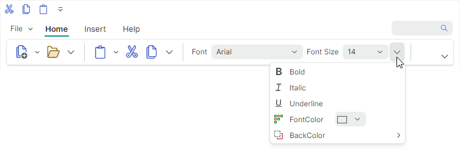
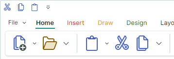
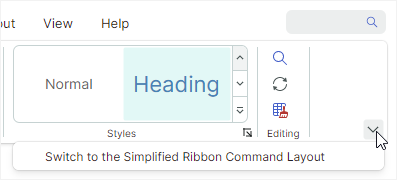

# Ribbon 命令布局 {#ribbon-command-layouts}

功能区命令布局确定 Ribbon 栏中命令的排列。 Ribbon 控件支持两种布局：经典和简化。

## 经典命令布局 {#classic-command-layout}



- Ribbon 栏足够高，可以显示三行带有小图标的命令。
- 页面组标题可见
- 当 Ribbon 调整大小时，组不能部分折叠
- 支持内联库
- 小图标默认大小为`16x16`。您可以使用 [`RibbonControl.SmallGlyphSize`](../../API/Eremex.AvaloniaUI.Controls.Ribbon/RibbonControl/SmallGlyphSize.md) 属性来更改小图标的大小。大图标的大小是小图标的两倍。
- 当 Ribbon 调整大小时，[经典命令布局中的自适应字形大小](ribbon-items.md#adaptive-glyph-size-in-the-classic-command-layout) 会调整图标的大小 - 从大到小，将文本调整到小字形，然后向后调整。



## 简化的命令布局 {#simplified-command-layout}



- 按钮排列成一排
- 页面组标题被隐藏
- 调整 Ribbon 大小时，组可能会部分折叠。折叠按钮可从组的下拉菜单访问。
- 图库显示在下拉菜单中
- 简化命令布局中图标的默认大小为 `22x22`。使用 [`RibbonControl.GlyphSizeInSimplifiedLayout`](../../API/Eremex.AvaloniaUI.Controls.Ribbon/RibbonControl/GlyphSizeInSimplifiedLayout.md) 属性指定自定义图标大小。

    ``` xml
    <mxr:RibbonControl GlyphSizeInSimplifiedLayout="32">
    ```



## 选择命令布局 {#select-a-command-layout}

用户可以通过单击 Ribbon 右下角的命令布局选择按钮在经典视图和简化视图在运行时之间切换。



将 [`RibbonControl.IsCommandLayoutSelectionButtonVisible`](../../API/Eremex.AvaloniaUI.Controls.Ribbon/RibbonControl/IsCommandLayoutSelectionButtonVisible.md) 选项设置为 `false` 以隐藏此按钮。

[`RibbonControl.CommandLayout`](../../API/Eremex.AvaloniaUI.Controls.Ribbon/RibbonControl/CommandLayout.md) 属性允许您在代码中指定命令布局。

``` xml
<mxr:RibbonControl Name="ribbon" CommandLayout="Simplified">
    <!-- ... -->
</mxr:RibbonControl>
```

<br>
<br>

<sup>*</sup> 本页面使用机器翻译技术翻译。
