# Ribbon 项 {#ribbon-items}

可以向 Ribbon 控件及其菜单添加各种项：按钮、复选按钮、文本标签、子菜单、就地编辑器等。

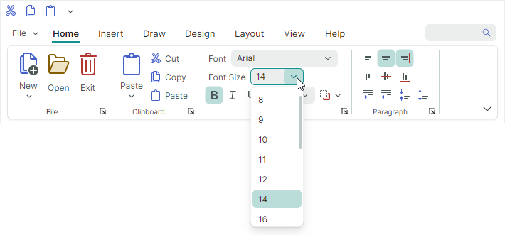

除了这些经典项之外，Ribbon 控件还支持库（Gallery）。库用于显示图形丰富的元素，这些元素按行和列排列。有关详细信息，请参阅[库](galleries.md)。

所有项（包括库）都可以添加到[传统工具栏和上下文菜单](../toolbars-and-menus/index.md)中。

## 添加 Ribbon 项 {#add-ribbon-items}

可以在不同的 Ribbon 元素中显示各种项：[Ribbon 页面组](page-groups.md)、[快速访问工具栏](quick-access-toolbar.md)、[页面标题区域](page-header-items.md)、[主（应用程序）菜单](application-button-and-main-menu.md)和子菜单。

要在 XAML 中向 Ribbon 页面组添加项，请在 **&lt;RibbonPageGroup&gt;** 开始标记和结束标记之间定义这些项。在代码隐藏中，可以使用 [`RibbonPageGroup.Items`](../../API/Eremex.AvaloniaUI.Controls.Ribbon/RibbonPageGroup/Items.md) 集合添加、访问和修改项。其他 Ribbon 元素也以相同方式填充项。

以下示例向 [`RibbonPageGroup`](../../API/Eremex.AvaloniaUI.Controls.Ribbon/RibbonPageGroup.md) 对象添加三个按钮（[`ToolbarButtonItem`](../../API/Eremex.AvaloniaUI.Controls.Bars/ToolbarButtonItem.md) 对象）。

``` xml
<mxb:ToolbarManager IsWindowManager="True">
    <mxr:RibbonControl ApplicationButtonContent="File" ApplicationButtonKeyTip="F">
        <mxr:RibbonPage Header="Home" KeyTip="H">
            <mxr:RibbonPageGroup Header="Editing" IsHeaderButtonVisible="False">
                <mxb:ToolbarButtonItem Header="Find" KeyTip="FN" 
                  Glyph="{x:Static icons:Basic.Search}" 
                  Command="FindButtonClick" />
                <mxb:ToolbarButtonItem Header="Replace" KeyTip="RP" 
                  Glyph="{x:Static icons:Basic.Update}" 
                  Command="ReplaceButtonClick"/>
                <mxb:ToolbarButtonItem Header="Clear" KeyTip="CL" 
                  Glyph="{x:Static icons:Basic.Table_Clear}" 
                  Command="ClearButtonClick"/>
            </mxr:RibbonPageGroup>
        </mxr:RibbonPage>
    </mxr:RibbonControl>
</mxb:ToolbarManager>
```

## Ribbon 项类型 {#ribbon-item-types}

可以添加到 Ribbon 控件和传统工具栏中的所有项都是 [`ToolbarItem`](../../API/Eremex.AvaloniaUI.Controls.Bars/ToolbarItem.md) 类的派生类。以下各部分介绍可用的 Ribbon 项及其设置。


### 常规按钮（ToolbarButtonItem） {#regular-buttons-toolbarbuttonitem}

[`ToolbarButtonItem`](../../API/Eremex.AvaloniaUI.Controls.Bars/ToolbarButtonItem.md) 对象可用于实现常规按钮和[带下拉功能的按钮](#buttons-with-dropdown-functionality-toolbarbuttonitem)。

常规按钮在单击时执行操作。

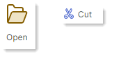


#### 单击按钮 {#click-the-button}

要为按钮实现操作，可以指定命令或处理按钮的事件：

- [`ToolbarItem.Command`](../../API/Eremex.AvaloniaUI.Controls.Bars/ToolbarItem/Command.md) — 单击按钮时执行的命令。

    ``` xml
    <mxb:ToolbarButtonItem Header="Open" KeyTip="O" 
    Command="{Binding OpenFileCommand}" 
    Glyph="{x:Static icons:Basic.Folder_Open}" />
    ```
    ``` cs
    [RelayCommand]
    public void OpenFile()
    {
        //...
    }
    ```
    
- [`CommandParameter`](../../API/Eremex.AvaloniaUI.Controls.Bars/ToolbarItem/CommandParameter.md) — 传递给指定命令的命令参数。

- [`ToolbarItem.Click`](../../API/Eremex.AvaloniaUI.Controls.Bars/ToolbarItem/Click.md) — 左键单击项时（按下并释放鼠标左键后）触发。
- [`ToolbarItem.Press`](../../API/Eremex.AvaloniaUI.Controls.Bars/ToolbarItem/Press.md) — 在项上按下任意鼠标按键时触发。

#### 按钮标题和字形 {#button-caption-and-glyph}

- [`Header`](../../API/Eremex.AvaloniaUI.Controls.Bars/ToolbarItem/Header.md) — 项的显示文本。
- [`Glyph`](../../API/Eremex.AvaloniaUI.Controls.Bars/ToolbarItem/Glyph.md) — 项的图像。另请参阅：[字形大小](#glyph-size)。
- [`GlyphTemplate`](../../API/Eremex.AvaloniaUI.Controls.Bars/ToolbarItem/GlyphTemplate.md) — 用于呈现项图像的自定义数据模板。

#### 字形大小 {#glyph-size}

在简化和经典[命令布局](ribbon-command-layouts.md)中，[Ribbon 页面组](page-groups.md)中命令字形的大小不同。以下部分提供了更多详细信息：

- [简化命令布局中的字形大小](#glyph-size-in-the-simplified-command-layout)
- [经典命令布局中的字形大小](#glyph-size-in-the-classic-command-layout)
- [经典命令布局中的自适应字形大小](#adaptive-glyph-size-in-the-classic-command-layout)


!!! tip "提示"

    要自定义弹出菜单和上下文菜单中项字形的大小，请使用项的 [`GlyphSize`](../../API/Eremex.AvaloniaUI.Controls.Bars/ToolbarItem/GlyphSize.md) 属性。
    
    ``` xml
    <mxb:PopupMenu MinWidth="250" ContentRightIndent="30">
        <mxb:ToolbarButtonItem Header="New" Glyph="{x:Static icons:Basic.Doc}" GlyphSize="32,32" HotKey="Ctrl+N"/>
    </mxb:PopupMenu>
    ```


#### 简化命令布局中的字形大小 {#glyph-size-in-the-simplified-command-layout}

在[简化命令布局](ribbon-command-layouts.md)中，页面组中的所有命令都使用同一种图标大小。

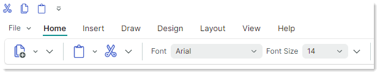

默认图标大小为 `22x22`。可以使用 [`RibbonControl.GlyphSizeInSimplifiedLayout`](../../API/Eremex.AvaloniaUI.Controls.Ribbon/RibbonControl/GlyphSizeInSimplifiedLayout.md) 属性指定自定义图标大小。

#### 经典命令布局中的字形大小 {#glyph-size-in-the-classic-command-layout}

在[经典命令布局](ribbon-command-layouts.md)中，页面组中的命令可以显示大字形和小字形。

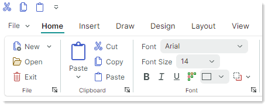

小图标的默认大小为 `16x16`。可以使用 [`RibbonControl.SmallGlyphSize`](../../API/Eremex.AvaloniaUI.Controls.Ribbon/RibbonControl/SmallGlyphSize.md) 属性更改小图标的大小。大图标的尺寸是小图标的两倍。

`RibbonControl.DisplayMode` 附加属性可用于为 Ribbon 页面组中的命令指定显示尺寸（大、小以及小图标加文本）。有关详细信息，请参阅[经典命令布局中的自适应字形大小](#adaptive-glyph-size-in-the-classic-command-layout)。

#### 经典命令布局中的自适应字形大小 {#adaptive-glyph-size-in-the-classic-command-layout}

调整 Ribbon 控件大小时，Ribbon 控件的[自适应布局功能](page-groups.md#adaptive-layout)会调整 [Ribbon 页面组](page-groups.md)中项的布局。使用经典命令布局时，此功能还会在调整 Ribbon 大小时调整项的显示尺寸。

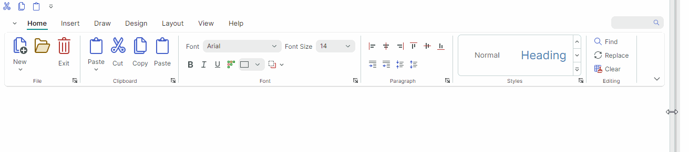

`RibbonControl.DisplayMode` 附加属性可用于指定[经典命令布局](ribbon-command-layouts.md)下 Ribbon 页面组中 Ribbon 项支持的显示模式。
可以强制项仅使用大图像、小图像、带文本的小图像，或这些显示模式的组合。

预定义的字形显示模式由 [`RibbonItemDisplayMode`](../../API/Eremex.AvaloniaUI.Controls.Ribbon/RibbonItemDisplayMode.md) 枚举定义：

  - `Large` — 项显示大字形和文本。
  
    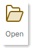 

  - `Small` — 项显示小字形和文本。

    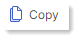

  - `SmallGlyph` — 项显示小字形。

    

  - `Auto` — 项支持 `Large`、`Small` 和 `SmallGlyph` 显示模式。Ribbon 控件会根据项的父[组](page-groups.md)中的可用空间，自动为项选择其中一种显示模式。

以下代码段将 Ribbon 项的 `RibbonControl.DisplayMode` 附加属性设置为 `Large`，强制该项仅使用大图像。

``` xml
<mxr:RibbonPage Header="Home" KeyTip="H">
    <mxr:RibbonPageGroup Header="File" IsHeaderButtonVisible="True">
        <mxb:ToolbarButtonItem Header="Open" KeyTip="O" mxr:RibbonControl.DisplayMode="Large"
                            Glyph="{x:Static icons:Basic.Folder_Open}" />
    </mxr:RibbonPageGroup>
</mxr:RibbonPage>
```

[`RibbonItemDisplayMode`](../../API/Eremex.AvaloniaUI.Controls.Ribbon/RibbonItemDisplayMode.md) 枚举带有 `[Flags]` 特性，因此在设置 `RibbonControl.DisplayMode` 附加属性时，可以使用 `Large`、`Small` 和 `SmallGlyph` 标志的任意组合。

以下代码使 Ribbon 项仅使用 `Small` 和 `SmallGlyph` 显示模式：

``` xml
<mxb:ToolbarButtonItem Header="Help" KeyTip="LP" Glyph="{x:Static icons:Basic.Info}"
                       mxr:RibbonControl.DisplayMode="Small, SmallGlyph" />
```

#### 常用项显示设置 {#common-item-display-settings}

- [`ShowSeparator`](../../API/Eremex.AvaloniaUI.Controls.Bars/ToolbarItem/ShowSeparator.md) — 获取或设置是否在项之前显示分隔线。也可以使用 [`ToolbarSeparatorItem`](../../API/Eremex.AvaloniaUI.Controls.Bars/ToolbarSeparatorItem.md) 项插入分隔线。

<!-- TODO
 Check:
  - [`GlyphAlignment`](../../API/Eremex.AvaloniaUI.Controls.Bars/ToolbarItem/GlyphAlignment.md) — The glyph alignment relative to the item's header. 
-->

    
### 带下拉功能的按钮（ToolbarButtonItem） {#buttons-with-dropdown-functionality-toolbarbuttonitem}

[`ToolbarButtonItem`](../../API/Eremex.AvaloniaUI.Controls.Bars/ToolbarButtonItem.md) 项可用于创建带有关联下拉控件或菜单的按钮。

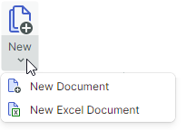

使用 [`ToolbarButtonItem.DropDownControl`](../../API/Eremex.AvaloniaUI.Controls.Bars/ToolbarButtonItem/DropDownControl.md) 属性指定下拉控件/菜单。当用户单击按钮或内置的下拉箭头按钮时（取决于 [`DropDownArrowVisibility`](../../API/Eremex.AvaloniaUI.Controls.Bars/DropDownArrowVisibility.md) 设置，见下文），会打开此下拉控件。
  

  
``` xml
<mxb:ToolbarButtonItem Name="btnNew" Header="New" KeyTip="N" 
    Glyph="{x:Static icons:Basic.Docs_Add}"
    mxr:RibbonControl.DisplayMode="Large"
    DropDownArrowVisibility="ShowSplitArrow">
    <mxb:ToolbarButtonItem.DropDownControl>
        <mxb:PopupMenu>
            <mxb:ToolbarButtonItem Header="New Document" KeyTip="ND" 
                Glyph="{x:Static icons:Basic.Doc_Add}" />
            <mxb:ToolbarButtonItem Header="New Excel Document" KeyTip="NX"
                                    Glyph="{x:Static icons:Basic.Doc_Excel}" />
        </mxb:PopupMenu>
    </mxb:ToolbarButtonItem.DropDownControl>
</mxb:ToolbarButtonItem>
```
  
#### 下拉控件和下拉箭头按钮 {#dropdown-control-and-down-arrow-button}

- [`DropDownControl`](../../API/Eremex.AvaloniaUI.Controls.Bars/ToolbarButtonItem/DropDownControl.md) — 获取或设置与项关联的下拉控件（[`Eremex.AvaloniaUI.Controls.Bars.IPopup`](../../API/Eremex.AvaloniaUI.Controls.Bars/IPopup.md) 对象）。当用户单击该项或内置的下拉箭头按钮时（请参阅 [`DropDownArrowVisibility`](../../API/Eremex.AvaloniaUI.Controls.Bars/DropDownArrowVisibility.md)），会弹出该控件。以下对象实现了 [`Eremex.AvaloniaUI.Controls.Bars.IPopup`](../../API/Eremex.AvaloniaUI.Controls.Bars/IPopup.md) 接口，因此可以作为下拉控件显示：

    - [`Eremex.AvaloniaUI.Controls.Bars.PopupMenu`](../../API/Eremex.AvaloniaUI.Controls.Bars/PopupMenu.md) — [弹出菜单](../toolbars-and-menus/popup-and-context-menus.md)。可以向菜单添加所有类型的工具栏项来填充其内容。
    - [`Eremex.AvaloniaUI.Controls.Bars.PopupContainer`](../../API/Eremex.AvaloniaUI.Controls.Bars/PopupContainer.md) — 控件容器。使用 [`PopupContainer`](../../API/Eremex.AvaloniaUI.Controls.Bars/PopupContainer.md) 可在下拉部分中显示自定义控件。
    
- [`DropDownArrowVisibility`](../../API/Eremex.AvaloniaUI.Controls.Bars/DropDownArrowVisibility.md) — 获取或设置项是否显示用于打开关联下拉控件的下拉箭头。

    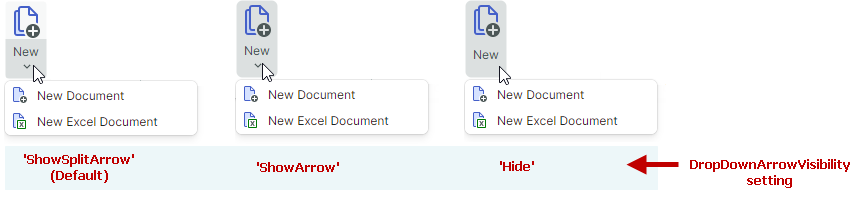

    - `ShowSplitArrow` 或 `Default` — 下拉箭头可见，作为嵌入项中的单独按钮。单击下拉箭头会打开关联的下拉控件，并引发 [`DropDownPress`](../../API/Eremex.AvaloniaUI.Controls.Bars/ToolbarButtonItem/DropDownPress.md) 事件。单击项本身会执行其命令（[`Command`](../../API/Eremex.AvaloniaUI.Controls.Bars/ToolbarItem/Command.md)）并引发事件（[`Click`](../../API/Eremex.AvaloniaUI.Controls.Bars/ToolbarItem/Click.md) 和 [`Press`](../../API/Eremex.AvaloniaUI.Controls.Bars/ToolbarItem/Press.md)）。

    - `ShowArrow` — 下拉箭头可见。项和箭头作为一个按钮工作，单击它们会显示关联的下拉控件。

    - `Hide` — 下拉箭头隐藏。单击项会打开下拉控件。

<!-- - [`DropDownArrowAlignment`](../../API/Eremex.AvaloniaUI.Controls.Bars/DropDownArrowAlignment.md) — Gets or sets the position of the dropdown arrow. -->

#### 打开下拉控件 {#invoke-the-dropdown-control}

- [`DropDownOpenMode`](../../API/Eremex.AvaloniaUI.Controls.Bars/DropDownOpenMode.md) — 获取或设置当用户触碰项/下拉箭头时是否以及何时打开下拉控件。支持的选项包括：
    - [`Press`](../../API/Eremex.AvaloniaUI.Controls.Bars/ToolbarItem/Press.md) 或 `Default` — 在鼠标按下事件时显示下拉部分。
    - [`Click`](../../API/Eremex.AvaloniaUI.Controls.Bars/ToolbarItem/Click.md) — 在项上按下并释放鼠标后显示下拉部分。
    - `Never` — 不显示下拉部分。
- [`DropDownPress`](../../API/Eremex.AvaloniaUI.Controls.Bars/ToolbarButtonItem/DropDownPress.md) — 按下下拉箭头时触发的事件。
  


### 复选按钮（ToolbarCheckItem） {#check-buttons-toolbarcheckitem}


[`ToolbarCheckItem`](../../API/Eremex.AvaloniaUI.Controls.Bars/ToolbarCheckItem.md) 项可用于创建复选按钮。复选按钮支持两种状态：正常和按下。


``` xml
xmlns:mxb="https://schemas.eremexcontrols.net/avalonia/bars"

<mxb:ToolbarCheckItem Header="Bold" 
 IsChecked="{Binding #textBox.FontWeight, 
  Converter={helpers:BoolToFontWeightConverter}, Mode=TwoWay}" 
 Glyph="{SvgImage 'avares://DemoCenter/Images/FontBold.svg'}" />
```

#### 选中按钮 {#check-the-button}

- [`IsChecked`](../../API/Eremex.AvaloniaUI.Controls.Bars/ToolbarCheckItem/IsChecked.md) — 获取或设置按钮的选中状态。
- [`CheckedChanged`](../../API/Eremex.AvaloniaUI.Controls.Bars/ToolbarCheckItem/CheckedChanged.md) — 选中状态更改时触发的事件。


#### 标题、字形和显示设置 {#caption-glyph-and-display-settings}

- [`Header`](../../API/Eremex.AvaloniaUI.Controls.Bars/ToolbarItem/Header.md) — 项的显示文本。
- [`Glyph`](../../API/Eremex.AvaloniaUI.Controls.Bars/ToolbarItem/Glyph.md) — 项的图像。复选按钮同时支持大图像和小图像。要了解更多信息，请参阅以下部分：

  - [字形大小](#glyph-size)
  - [经典命令布局中的自适应字形大小](#adaptive-glyph-size-in-the-classic-command-layout)

- [`GlyphTemplate`](../../API/Eremex.AvaloniaUI.Controls.Bars/ToolbarItem/GlyphTemplate.md) — 用于呈现项图像的自定义数据模板。

- [`CheckBoxStyle`](../../API/Eremex.AvaloniaUI.Controls.Bars/CheckBoxStyle.md) — 获取或设置 [`ToolbarCheckItem`](../../API/Eremex.AvaloniaUI.Controls.Bars/ToolbarCheckItem.md) 对象的显示模式。可用选项包括：

  - [`CheckBoxStyle.CheckButton`](../../API/Eremex.AvaloniaUI.Controls.Bars/CheckBoxStyle.md) — 项呈现为复选按钮。当 [`IsChecked`](../../API/Eremex.AvaloniaUI.Controls.Bars/ToolbarCheckItem/IsChecked.md) 为 `true` 时，按钮显示为按下状态。

    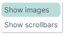

  - [`CheckBoxStyle.CheckBox`](../../API/Eremex.AvaloniaUI.Controls.Bars/CheckBoxStyle.md) — 项在其文本和字形之前显示一个复选框。当 [`IsChecked`](../../API/Eremex.AvaloniaUI.Controls.Bars/ToolbarCheckItem/IsChecked.md) 为 `true` 时，复选框中显示选中标记。

    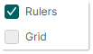
    
  - [`CheckBoxStyle.RadioButton`](../../API/Eremex.AvaloniaUI.Controls.Bars/CheckBoxStyle.md) — 项在其文本和字形之前显示一个单选按钮。当 [`IsChecked`](../../API/Eremex.AvaloniaUI.Controls.Bars/ToolbarCheckItem/IsChecked.md) 为 `true` 时，单选按钮显示为实心圆。

    可以将 RadioButton 样式应用于组合在复选组（[`ToolbarCheckItemGroup`](#non-breaking-groups-of-check-items-toolbarcheckitemgroup)）中的 [`ToolbarCheckItem`](../../API/Eremex.AvaloniaUI.Controls.Bars/ToolbarCheckItem.md) 对象。在这种情况下，该组显示为典型的单选按钮组。

    ``` xml
    <mxb:ToolbarCheckItemGroup CheckType="Radio">
        <mxb:ToolbarCheckItem Header="E-mail" CheckBoxStyle="RadioButton" />
        <mxb:ToolbarCheckItem Header="Phone" CheckBoxStyle="RadioButton" />
    </mxb:ToolbarCheckItemGroup>
    ```
    
    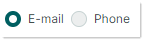
    
- [`CheckBoxAlignment`](../../API/Eremex.AvaloniaUI.Controls.Bars/CheckBoxAlignment.md) — 获取或设置复选框（或单选按钮）显示在项的字形和文本之前还是之后。当 [`CheckBoxStyle`](../../API/Eremex.AvaloniaUI.Controls.Bars/CheckBoxStyle.md) 属性设置为 [`CheckBoxStyle.CheckBox`](../../API/Eremex.AvaloniaUI.Controls.Bars/CheckBoxStyle.md) 或 [`CheckBoxStyle.RadioButton`](../../API/Eremex.AvaloniaUI.Controls.Bars/CheckBoxStyle.md) 时，此选项有效。

    ```xml
    <mxb:ToolbarCheckItem Header="Status bar" CheckBoxAlignment="After"
                        CheckBoxStyle="CheckBox"
                        Hint="Show and hide the status bar"/>
    <mxb:ToolbarSeparatorItem/>
    ```
    
    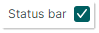
    


可以按照与常规按钮相同的方式自定义复选按钮的常规显示设置。

- [常用项显示设置](#common-item-display-settings)

### 子菜单（ToolbarMenuItem） {#sub-menus-toolbarmenuitem}

使用 [`ToolbarMenuItem`](../../API/Eremex.AvaloniaUI.Controls.Bars/ToolbarMenuItem.md) 创建单击时显示子菜单的项。

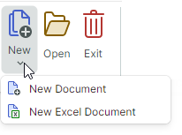

#### 子菜单的内容 {#sub-menus-content}

要指定子菜单的内容，请在 XAML 中的 **&lt;ToolbarMenuItem&gt;** 开始标记和结束标记之间定义项，或在代码隐藏中将项添加到 [`ToolbarMenuItem.Items`](../../API/Eremex.AvaloniaUI.Controls.Bars/ToolbarMenuItem/Items.md) 集合中。

``` xml
xmlns:mxb="https://schemas.eremexcontrols.net/avalonia/bars"

<mxb:ToolbarMenuItem Header="File" Category="File">
    <mxb:ToolbarButtonItem Header="New" 
     Glyph="{SvgImage 'avares://DemoCenter/Images/Group=Context Menu, Icon=NewDraftAction.svg'}" 
     Category="File" Command="{Binding NewFileCommand}"/>
    <mxb:ToolbarButtonItem Header="Open" 
     Glyph="{SvgImage 'avares://DemoCenter/Images/Group=Basic, Icon=Folder Open.svg'}" 
     Category="File" Command="{Binding OpenFileCommand}"/>
    <mxb:ToolbarButtonItem Header="Save" 
     Glyph="{SvgImage 'avares://DemoCenter/Images/Group=Basic, Icon=Save.svg'}" 
     Category="File" Command="{Binding SaveFileCommand}"/>
    <mxb:ToolbarButtonItem Header="Print" 
     Glyph="{SvgImage 'avares://DemoCenter/Images/Group=Basic, Icon=Print.svg'}" 
     ShowSeparator="True"  Category="File" Command="{Binding PrintFileCommand}"/>
</mxb:ToolbarMenuItem>
```

还可以使用 [`ToolbarMenuItem.ItemsSource`](../../API/Eremex.AvaloniaUI.Controls.Bars/ToolbarMenuItem/ItemsSource.md) 属性，根据 View Model 中的业务对象集合向子菜单填充项。相应的数据模板应定义 Ribbon 项，并根据基础业务对象初始化其设置。


#### 打开子菜单 {#invoke-the-sub-menu}

打开子菜单时，会引发以下事件：

- `Opening` — 在菜单即将显示时触发。此事件可用于取消显示菜单。
- `Opened` — 在菜单显示后触发。
- `Closing` — 在菜单即将关闭时触发。此事件可用于取消关闭菜单。
- `Closed` — 在菜单关闭后触发。

以下属性可用于取消显示子菜单，以及指定在鼠标单击还是按下事件时显示子菜单。

- [`DropDownOpenMode`](../../API/Eremex.AvaloniaUI.Controls.Bars/DropDownOpenMode.md) — 获取或设置当用户触碰项时是否以及如何打开子菜单。支持的选项包括：
    - [`Press`](../../API/Eremex.AvaloniaUI.Controls.Bars/ToolbarItem/Press.md) 或 `Default` — 在鼠标按下事件时显示菜单。
    - [`Click`](../../API/Eremex.AvaloniaUI.Controls.Bars/ToolbarItem/Click.md) — 在项上按下并释放鼠标后显示菜单。
    - `Never` — 不显示菜单。


#### 标题、字形和显示设置 {#caption-glyph-and-display-settings_1}

- [`Header`](../../API/Eremex.AvaloniaUI.Controls.Bars/ToolbarItem/Header.md) — 子菜单的标题文本。
- [`Glyph`](../../API/Eremex.AvaloniaUI.Controls.Bars/ToolbarItem/Glyph.md) — 子菜单的图像。子菜单标题同时支持大图像和小图像。要了解如何在 Ribbon 控件中指定项字形的大小，请参阅以下部分：

  - [字形大小](#glyph-size)
  - [经典命令布局中的自适应字形大小](#adaptive-glyph-size-in-the-classic-command-layout)

- [`GlyphTemplate`](../../API/Eremex.AvaloniaUI.Controls.Bars/ToolbarItem/GlyphTemplate.md) — 用于呈现项图像的自定义数据模板。

可以按照与常规按钮相同的方式自定义子菜单的常规显示设置。

- [常用项显示设置](#common-item-display-settings)


### 就地编辑器（ToolbarEditorItem） {#in-place-editors-toolbareditoritem}

使用 [`ToolbarEditorItem`](../../API/Eremex.AvaloniaUI.Controls.Bars/ToolbarEditorItem.md) 对象在 Ribbon 控件中嵌入就地编辑器。

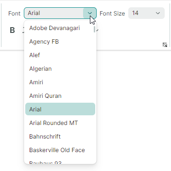

[`ToolbarEditorItem`](../../API/Eremex.AvaloniaUI.Controls.Bars/ToolbarEditorItem.md) 对象支持以下指定就地编辑器的方式：

- [指定编辑器类型](#specify-an-editor-type)。这是指定 Eremex 就地编辑器的推荐方式。

- [在数据模板中指定编辑器](#specify-an-editor-in-a-data-template)


#### 指定编辑器类型 {#specify-an-editor-type}

使用这种方式可以嵌入 Eremex 编辑器。

要指定编辑器类型，请将 [`ToolbarEditorItem.EditorProperties`](../../API/Eremex.AvaloniaUI.Controls.Bars/ToolbarEditorItem/EditorProperties.md) 属性设置为以下对象之一：

- [`ButtonEditorProperties`](../../API/Eremex.AvaloniaUI.Controls.Editors/ButtonEditorProperties.md) — 对应 [`ButtonEditor`](../../API/Eremex.AvaloniaUI.Controls.Editors/ButtonEditor.md) 就地编辑器。
- [`CheckEditorProperties`](../../API/Eremex.AvaloniaUI.Controls.Editors/CheckEditorProperties.md) — 对应 [`CheckEditor`](../../API/Eremex.AvaloniaUI.Controls.Editors/CheckEditor.md) 就地编辑器。
- `ColorEditorProperties` — 对应 [`ColorEditor`](../../API/Eremex.AvaloniaUI.Controls.Editors/ColorEditor.md) 就地编辑器。
- [`ComboBoxEditorProperties`](../../API/Eremex.AvaloniaUI.Controls.Editors/ComboBoxEditorProperties.md) — 对应 [`ComboBoxEditor`](../../API/Eremex.AvaloniaUI.Controls.Editors/ComboBoxEditor.md) 就地编辑器。
- [`HyperlinkEditorProperties`](../../API/Eremex.AvaloniaUI.Controls.Editors/HyperlinkEditorProperties.md) — 对应 [`HyperlinkEditor`](../../API/Eremex.AvaloniaUI.Controls.Editors/HyperlinkEditor.md) 就地编辑器。
- [`PopupColorEditorProperties`](../../API/Eremex.AvaloniaUI.Controls.Editors/PopupColorEditorProperties.md) — 对应 [`PopupColorEditor`](../../API/Eremex.AvaloniaUI.Controls.Editors/PopupColorEditor.md) 就地编辑器。
- [`PopupEditorProperties`](../../API/Eremex.AvaloniaUI.Controls.Editors/PopupEditorProperties.md) — 对应 [`PopupEditor`](../../API/Eremex.AvaloniaUI.Controls.Editors/PopupEditor.md) 就地编辑器。
- [`SegmentedEditorProperties`](../../API/Eremex.AvaloniaUI.Controls.Editors/SegmentedEditorProperties.md) — 对应 [`SegmentedEditor`](../../API/Eremex.AvaloniaUI.Controls.Editors/SegmentedEditor.md) 就地编辑器。
- [`SpinEditorProperties`](../../API/Eremex.AvaloniaUI.Controls.Editors/SpinEditorProperties.md) — 对应 [`SpinEditor`](../../API/Eremex.AvaloniaUI.Controls.Editors/SpinEditor.md) 就地编辑器。
- [`TextEditorProperties`](../../API/Eremex.AvaloniaUI.Controls.Editors/TextEditorProperties.md) — 对应 [`TextEditor`](../../API/Eremex.AvaloniaUI.Controls.Editors/TextEditor.md) 就地编辑器。
- [`MemoEditorProperties`](../../API/Eremex.AvaloniaUI.Controls.Editors/MemoEditorProperties.md) — 对应 [`MemoEditor`](../../API/Eremex.AvaloniaUI.Controls.Editors/MemoEditor.md) 就地编辑器。

这些对象是 [`BaseEditorProperties`](../../API/Eremex.AvaloniaUI.Controls.Editors/BaseEditorProperties.md) 的派生类，包含用于自定义相应就地编辑器的设置。

以下示例定义了 _Font_ 项（[`ToolbarEditorItem`](../../API/Eremex.AvaloniaUI.Controls.Bars/ToolbarEditorItem.md) 对象），该项使用组合框就地编辑器显示字体列表。[`ToolbarEditorItem.EditorProperties`](../../API/Eremex.AvaloniaUI.Controls.Bars/ToolbarEditorItem/EditorProperties.md) 属性设置为 [`ComboBoxEditorProperties`](../../API/Eremex.AvaloniaUI.Controls.Editors/ComboBoxEditorProperties.md) 对象，对应 [`ComboBoxEditor`](../../API/Eremex.AvaloniaUI.Controls.Editors/ComboBoxEditor.md) 编辑器。完整代码请参阅 _WordPad Example_ 演示。

``` xml
<mxb:ToolbarEditorItem Header="Font" EditorWidth="150" 
 EditorValue="{Binding #textBox.FontFamily, Converter={helpers:FontNameToFontFamilyConverter}}">
    <mxb:ToolbarEditorItem.EditorProperties>
        <mxe:ComboBoxEditorProperties 
         ItemsSource="{Binding $parent[view:ToolbarAndMenuPageView].Fonts}"
         IsTextEditable="False" PopupMaxHeight="300"/>
    </mxb:ToolbarEditorItem.EditorProperties>
</mxb:ToolbarEditorItem>      
```

#### 在数据模板中指定编辑器 {#specify-an-editor-in-a-data-template}

使用 [`ToolbarEditorItem.EditorTemplate`](../../API/Eremex.AvaloniaUI.Controls.Bars/ToolbarEditorItem/EditorTemplate.md) 属性在数据模板中指定编辑器。在这种情况下，需要手动为编辑器设置值（例如使用数据绑定）。

``` xml
<mxb:ToolbarEditorItem Width="150">
    <mxb:ToolbarEditorItem.EditorTemplate>
        <DataTemplate>
            <mxe:TextEditor EditorValue="{Binding Count}" Width="80"/>
        </DataTemplate>
    </mxb:ToolbarEditorItem.EditorTemplate>
</mxb:ToolbarEditorItem>
```

#### 更改和返回编辑器的值 {#change-and-return-the-editors-value}

- [`ToolbarEditorItem.EditorValue`](../../API/Eremex.AvaloniaUI.Controls.Bars/ToolbarEditorItem/EditorValue.md) — 获取或设置就地编辑器的值。将此属性用于数据绑定。

- [`ToolbarEditorItem.EditorValueChanged`](../../API/Eremex.AvaloniaUI.Controls.Bars/ToolbarEditorItem/EditorValueChanged.md) — 编辑器的值更改后触发的事件。

使用 [`ToolbarEditorItem.EditorProperties`](../../API/Eremex.AvaloniaUI.Controls.Bars/ToolbarEditorItem/EditorProperties.md) 属性指定编辑器时，这些成员有效。

#### 编辑器的宽度 {#editors-width}

<!-- TODO 
Not supported in Ribbon

 - [`ToolbarEditorItem.SizeMode`](../../API/Eremex.AvaloniaUI.Controls.Bars/ToolbarEditorItem/SizeMode.md) — Gets or sets the item's size mode. This property allows you to stretch the bar item, so it occupues all the available empty space within the bar. -->
- [`ToolbarEditorItem.EditorWidth`](../../API/Eremex.AvaloniaUI.Controls.Bars/ToolbarEditorItem/EditorWidth.md) — 获取或设置就地编辑器的宽度。使用 [`ToolbarEditorItem.EditorProperties`](../../API/Eremex.AvaloniaUI.Controls.Bars/ToolbarEditorItem/EditorProperties.md) 属性指定编辑器时，此属性有效。如果在数据模板中指定编辑器，可以使用 `ToolbarEditorItem.Width` 属性设置编辑器宽度，或为编辑器本身设置宽度。
<!-- TODO
Doesn't work:

- [`ToolbarEditorItem.EditorHeight`](../../API/Eremex.AvaloniaUI.Controls.Bars/ToolbarEditorItem/EditorHeight.md) — Gets or sets the in-place editor's height. 
- [`ToolbarEditorItem.EditorAlignment`](../../API/Eremex.AvaloniaUI.Controls.Bars/ToolbarEditorItem/EditorAlignment.md) — Gets or sets the editor's alignment relative to the item's header.
-->

<!--TODO - `ToolbarEditorItem.Editor` -  

-->

#### 标题和字形 {#caption-and-glyph}

- [`Header`](../../API/Eremex.AvaloniaUI.Controls.Bars/ToolbarItem/Header.md) — 项的显示文本。

- [`Glyph`](../../API/Eremex.AvaloniaUI.Controls.Bars/ToolbarItem/Glyph.md) — 项的图像。[`ToolbarEditorItem`](../../API/Eremex.AvaloniaUI.Controls.Bars/ToolbarEditorItem.md) 对象仅支持小图像。在经典命令布局中，小图像的大小由 [`RibbonControl.SmallGlyphSize`](../../API/Eremex.AvaloniaUI.Controls.Ribbon/RibbonControl/SmallGlyphSize.md) 属性指定；在简化命令布局中，由 [`RibbonControl.GlyphSizeInSimplifiedLayout`](../../API/Eremex.AvaloniaUI.Controls.Ribbon/RibbonControl/GlyphSizeInSimplifiedLayout.md) 属性指定。
- [`GlyphTemplate`](../../API/Eremex.AvaloniaUI.Controls.Bars/ToolbarItem/GlyphTemplate.md) — 用于呈现项图像的自定义数据模板。

可以按照与常规按钮相同的方式自定义 [`ToolbarEditorItem`](../../API/Eremex.AvaloniaUI.Controls.Bars/ToolbarEditorItem.md) 对象的常规显示设置。

- [常用项显示设置](#common-item-display-settings)


### 文本标签（ToolbarTextItem） {#text-labels-toolbartextitem}


使用 [`ToolbarTextItem`](../../API/Eremex.AvaloniaUI.Controls.Bars/ToolbarTextItem.md) 对象显示用户无法编辑的文本标签。

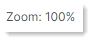

``` xml
<mxb:ToolbarTextItem 
 Header="{Binding #scaleDecorator.Scale, StringFormat={}Zoom: {0:P0}}" 
 ShowBorder="False" 
 />
```

#### 标题和字形 {#caption-and-glyph_1}

- [`Header`](../../API/Eremex.AvaloniaUI.Controls.Bars/ToolbarItem/Header.md) — 项的显示文本。
- [`Glyph`](../../API/Eremex.AvaloniaUI.Controls.Bars/ToolbarItem/Glyph.md) — 项的图像。文本标签同时支持大图像和小图像。要了解如何在 Ribbon 控件中指定项字形的大小，请参阅以下部分：

  - [字形大小](#glyph-size)
  - [经典命令布局中的自适应字形大小](#adaptive-glyph-size-in-the-classic-command-layout)


#### 文本标签的显示设置 {#text-labels-display-settings}

- [`ToolbarTextItem.ShowBorder`](../../API/Eremex.AvaloniaUI.Controls.Bars/ToolbarTextItem/ShowBorder.md) — 获取或设置项的边框是否可见。

  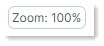

  可以使用 [`ToolbarTextItem.BorderTemplate`](../../API/Eremex.AvaloniaUI.Controls.Bars/ToolbarTextItem/BorderTemplate.md) 属性指定用于绘制边框的自定义模板。
- [`ToolbarTextItem.BorderTemplate`](../../API/Eremex.AvaloniaUI.Controls.Bars/ToolbarTextItem/BorderTemplate.md) — 获取或设置用于绘制项边框的自定义模板。启用 [`ToolbarTextItem.ShowBorder`](../../API/Eremex.AvaloniaUI.Controls.Bars/ToolbarTextItem/ShowBorder.md) 选项时，此模板有效。


另请参阅：

- [常用项显示设置](#common-item-display-settings)


### 不可拆分的项组（ToolbarItemGroup） {#non-breaking-groups-of-items-toolbaritemgroup}

使用 [`ToolbarItemGroup`](../../API/Eremex.AvaloniaUI.Controls.Bars/ToolbarItemGroup.md) 创建不可拆分的工具栏项容器（组）。此容器中的项始终在一行中一起显示，并在调整 Ribbon 大小时作为一个整体处理。

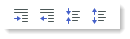

在[经典命令布局](ribbon-command-layouts.md)中，[`ToolbarItemGroup`](../../API/Eremex.AvaloniaUI.Controls.Bars/ToolbarItemGroup.md) 中的项仅支持小图像。

#### 组的内容 {#groups-content}

要指定容器的内容，请在 XAML 中的 **&lt;ToolbarItemGroup&gt;** 开始标记和结束标记之间定义项，或在代码隐藏中将项添加到 [`ToolbarItemGroup.Items`](../../API/Eremex.AvaloniaUI.Controls.Bars/ToolbarItemGroup/Items.md) 集合中。

``` xml
<mxb:ToolbarItemGroup>
    <mxb:ToolbarButtonItem Header="Increase" KeyTip="CR" Glyph="{x:Static icons:Basic.Level_Increase}" />
    <mxb:ToolbarButtonItem Header="Decrease" KeyTip="DC" Glyph="{x:Static icons:Basic.Level_Reduce}" />
    <mxb:ToolbarButtonItem Header="Collapse" KeyTip="CL" Glyph="{x:Static icons:Basic.List_Collapse}" />
    <mxb:ToolbarButtonItem Header="Expand" KeyTip="EX" Glyph="{x:Static icons:Basic.List_Expand}" />
</mxb:ToolbarItemGroup>
```

还可以使用 [`ToolbarItemGroup.ItemsSource`](../../API/Eremex.AvaloniaUI.Controls.Bars/ToolbarItemGroup/ItemsSource.md) 属性，根据 View Model 中存储的业务对象集合向容器填充项。相应的数据模板应定义 Ribbon 项，并根据基础业务对象初始化其设置。

另请参阅：

- [自定义页面组中项的布局](page-groups.md#customize-item-layout-in-page-groups)
- [将不可拆分的容器排列成两行或三行](page-groups.md#arrange-non-breaking-containers-in-two-or-three-rows)

### 不可拆分的复选项组（ToolbarCheckItemGroup） {#non-breaking-groups-of-check-items-toolbarcheckitemgroup}

使用 [`ToolbarCheckItemGroup`](../../API/Eremex.AvaloniaUI.Controls.Bars/ToolbarCheckItemGroup.md) 创建不可拆分的复选项（[`ToolbarCheckItem` 对象](#check-buttons-toolbarcheckitem)）容器（组）。与 [`ToolbarItemGroup`](../../API/Eremex.AvaloniaUI.Controls.Bars/ToolbarItemGroup.md) 对象一样，当其父级调整大小时，[`ToolbarCheckItemGroup`](../../API/Eremex.AvaloniaUI.Controls.Bars/ToolbarCheckItemGroup.md) 对象作为一个整体处理（容器的内容不会被部分隐藏；项始终显示在一行中，不支持换行）。


[`ToolbarCheckItemGroup`](../../API/Eremex.AvaloniaUI.Controls.Bars/ToolbarCheckItemGroup.md) 容器可以控制其子项 [`ToolbarCheckItem`](../../API/Eremex.AvaloniaUI.Controls.Bars/ToolbarCheckItem.md) 的选中状态。可以使用 [`ToolbarCheckItemGroup`](../../API/Eremex.AvaloniaUI.Controls.Bars/ToolbarCheckItemGroup.md) 容器创建以下类型的组：

- 互斥项组（单选组）。
- 允许同时选中多个项的组。

在[经典命令布局](ribbon-command-layouts.md)中，[`ToolbarCheckItemGroup`](../../API/Eremex.AvaloniaUI.Controls.Bars/ToolbarCheckItemGroup.md) 中的项仅支持小图像。

#### 组的内容 {#groups-content_1}

要指定容器的内容，请在 XAML 中的 **&lt;ToolbarCheckItemGroup&gt;** 开始标记和结束标记之间定义 [`ToolbarCheckItem`](../../API/Eremex.AvaloniaUI.Controls.Bars/ToolbarCheckItem.md) 项，或在代码隐藏中将项添加到 [`ToolbarCheckItemGroup.Items`](../../API/Eremex.AvaloniaUI.Controls.Bars/ToolbarItemGroup/Items.md) 集合中。

``` xml
<mxb:ToolbarCheckItemGroup>
    <mxb:ToolbarCheckItem Header="Bold" KeyTip="B" Glyph="{x:Static icons:Basic.Font_Bold}" />
    <mxb:ToolbarCheckItem Header="Italic" KeyTip="I" Glyph="{x:Static icons:Basic.Font_Italic}" />
    <mxb:ToolbarCheckItem Header="Underline" KeyTip="U" Glyph="{x:Static icons:Basic.Font_Underline}" />
</mxb:ToolbarCheckItemGroup>
```

还可以使用 [`ToolbarCheckItemGroup.ItemsSource`](../../API/Eremex.AvaloniaUI.Controls.Bars/ToolbarItemGroup/ItemsSource.md) 属性，根据 View Model 中存储的业务对象集合向容器填充项。相应的数据模板应定义 Ribbon 项，并根据基础业务对象初始化其设置。


#### 选中组中的项 {#check-the-groups-items}

- [`ToolbarCheckItemGroup.CheckType`](../../API/Eremex.AvaloniaUI.Controls.Bars/ToolbarCheckItemGroup/CheckType.md) — 获取或设置组中一次可以选中一个还是多个项。支持以下选项：

    - `Default` 或 `Multiple` — 可以同时选中多个项。
    - `Radio` — 互斥项组。用户只能通过选中另一个项来取消选中某项。
    - `Single` — 互斥项组。用户可以取消选中组中的所有项。

- [`ToolbarCheckItem.IsChecked`](../../API/Eremex.AvaloniaUI.Controls.Bars/ToolbarCheckItem/IsChecked.md) — 获取或设置按钮的选中状态。


另请参阅：

- [自定义页面组中项的布局](page-groups.md#customize-item-layout-in-page-groups)
- [将不可拆分的容器排列成两行或三行](page-groups.md#arrange-non-breaking-containers-in-two-or-three-rows)

### 分隔线（ToolbarSeparatorItem） {#separators-toolbarseparatoritem}

[`ToolbarSeparatorItem`](../../API/Eremex.AvaloniaUI.Controls.Bars/ToolbarSeparatorItem.md) 对象可用于插入分隔线。

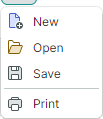

``` xml
<mxb:ToolbarMenuItem Header="File" Category="File">
    <mxb:ToolbarButtonItem Header="New" 
     Glyph="{SvgImage 'avares://DemoCenter/Images/Group=Context Menu, Icon=NewDraftAction.svg'}" 
     Category="File"/>
    <mxb:ToolbarButtonItem Header="Open" 
     Glyph="{SvgImage 'avares://DemoCenter/Images/Group=Basic, Icon=Folder Open.svg'}" 
     Category="File"/>
    <mxb:ToolbarButtonItem Header="Save" 
     Glyph="{SvgImage 'avares://DemoCenter/Images/Group=Basic, Icon=Save.svg'}" 
     Category="File"/>
    <mxb:ToolbarSeparatorItem/>
    <mxb:ToolbarButtonItem Header="Print" 
     Glyph="{SvgImage 'avares://DemoCenter/Images/Group=Basic, Icon=Print.svg'}" 
     Category="File"/>
</mxb:ToolbarMenuItem>
```

### 库 {#galleries}

要创建库，请使用 [`RibbonGalleryItem`](../../API/Eremex.AvaloniaUI.Controls.Ribbon/RibbonGalleryItem.md) 项。下图显示了一个内嵌在 Ribbon 中的库。

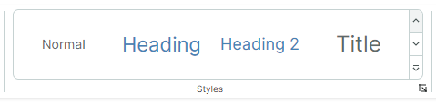

将 [`RibbonGalleryItem`](../../API/Eremex.AvaloniaUI.Controls.Ribbon/RibbonGalleryItem.md) 对象添加到传统工具栏或弹出菜单时，库显示为子菜单。

有关详细信息，请参阅以下主题：[库](galleries.md)

## 快捷键 {#hot-keys}

可以使用 [`ToolbarItem.HotKey`](../../API/Eremex.AvaloniaUI.Controls.Bars/ToolbarItem/HotKey.md) 属性为项分配快捷键。

``` xml
<mxb:ToolbarButtonItem 
    Header="Open" Command="{Binding OpenCommand}" HotKey="Ctrl+O"
    Glyph="{x:Static icons:Basic.Folder_Open}"/>
```

只要焦点位于快捷键作用范围内，按下快捷键就会执行项的命令。默认的快捷键作用范围是 [`ToolbarManager`](../../API/Eremex.AvaloniaUI.Controls.Bars/ToolbarManager.md) 组件边界内的界面区域。当输入焦点位于快捷键作用范围之外时，[`ToolbarManager`](../../API/Eremex.AvaloniaUI.Controls.Bars/ToolbarManager.md) 无法拦截快捷键。

[`ToolbarManager.IsWindowManager`](../../API/Eremex.AvaloniaUI.Controls.Bars/ToolbarManager/IsWindowManager.md) 属性可用于将快捷键作用范围扩展到整个窗口。将此属性设置为 `true` 时，[`ToolbarManager`](../../API/Eremex.AvaloniaUI.Controls.Bars/ToolbarManager.md) 组件会在窗口中注册项的快捷键，即使焦点位于其客户区之外，也能够拦截和处理快捷键。

## 工具提示 {#tooltips}

使用 [`ToolbarItem.Hint`](../../API/Eremex.AvaloniaUI.Controls.Bars/ToolbarItem/Hint.md) 属性为 Ribbon 项指定工具提示：

``` xml
<mxb:ToolbarButtonItem Header="Increase" HotKey="CTRL+J" 
  Glyph="{x:Static icons:Basic.Level_Increase}" 
  Hint="Increase the indent"/>
```

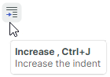

## 另请参阅 {#see-also}

- [按键提示](key-tips.md)
- [自定义页面组中项的布局](page-groups.md#customize-item-layout-in-page-groups)


<br>
<br>

<sup>*</sup> 本页面使用机器翻译技术翻译。
