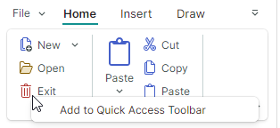
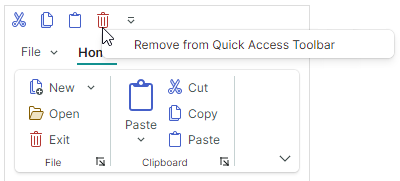

# Ribbon 序列化和反序列化 {#ribbon-serialization-and-deserialization}

最终用户可以使用上下文菜单向 [快速访问工具栏](quick-access-toolbar.md) 添加命令并在运行时从中删除命令。





快速访问工具栏中的布局命令可以保存到流中，并在以后（例如，应用程序下次运行时）从中加载。为此，请使用以下布局序列化和反序列化方法：

- [`RibbonControl.SaveLayout`](../../API/Eremex.AvaloniaUI.Controls.Ribbon/RibbonControl/SaveLayout.md) — 将快速访问工具栏中的功能区项目布局保存到流中。
- [`RibbonControl.RestoreLayout`](../../API/Eremex.AvaloniaUI.Controls.Ribbon/RibbonControl/RestoreLayout.md) — 从流中读取之前保存的布局并将其应用到快速访问工具栏。

!!!笔记

所有功能区项目必须具有唯一的名称，您可以使用 `Name` 属性（或者使用 `SerializationName` 属性）指定该名称。唯一的名称可确保色带项目的正确识别和序列化。

``` xml
<mxb:ToolbarButtonItem Name="btnNew" .../>
```

以下示例显示如何将功能区项目的布局保存到文件或从文件恢复。

``` cs
string fileName = "ribbon_layout.xml";
private void BtnSave_Click(object sender, Avalonia.Interactivity.RoutedEventArgs e)
{
    using (var stream = new FileStream(fileName, FileMode.Create, FileAccess.Write))
    {
        ribbon.SaveLayout(stream);
    }
}

private void BtnLoad_Click(object sender, Avalonia.Interactivity.RoutedEventArgs e)
{
    if (!File.Exists(fileName)) return;
    using (FileStream fileStream = File.OpenRead(fileName))
    {
        ribbon.RestoreLayout(fileStream);
    }
}
```

<br>
<br>

<sup>*</sup> 本页面使用机器翻译技术翻译。
