# 视觉主题 {#themes}

在 Avalonia UI 中，视觉主题定义了控件的外观设置、资源和模板。Eremex Controls 库包含以下视觉主题，用于渲染库中提供的控件：

<table >
  <thead>
    <tr>
      <th style="visibility: visible;">视觉&nbsp;主题</th>
      <th style="visibility: visible;">说明</th>
      <th style="visibility: visible;">程序包</th>
    </tr>
  </thead>
  <tbody>
    <tr>
      <td><code>DeltaDesign</code></td>
      <td>包含 Eremex 控件（<a href="../../API/Eremex.AvaloniaUI.Controls3D/Graphics3DControl.md"><code>Graphics3DControl</code></a> 除外）以及一组标准 Avalonia UI 控件的视觉设置。</td>
      <td><code>Eremex.Avalonia.Themes.DeltaDesign</code> 程序包</td>
    </tr>
    <tr>
      <td><code>Controls3D</code></td>
      <td>包含 <a href="../../API/Eremex.AvaloniaUI.Controls3D/Graphics3DControl.md"><code>Graphics3DControl</code></a> 的视觉设置。</td>
      <td><code>Eremex.Avalonia.Controls3D</code> 程序包</td>
    </tr>
  </tbody>
</table>


您必须[添加并注册](register-an-eremex-paint-theme.md)适当的主题，Eremex 控件才能正确渲染。如果没有相应的主题，控件将显示为空白。

## 浅色和深色主题变体 {#light-and-dark-theme-variants}

Eremex 视觉主题支持浅色和深色两种主题变体：

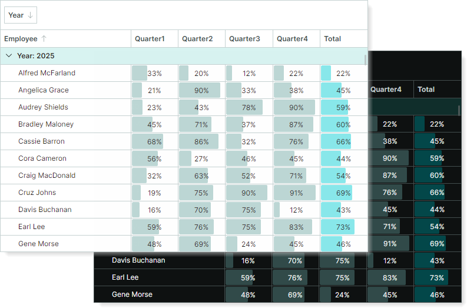

要指定所需的主题变体，请设置 `Application.RequestedThemeVariant` 属性（例如在 _App.axaml_ 文件中）。

``` xml
<Application
    RequestedThemeVariant="Default" ... >
    <!-- "Default" - The application's theme is defined by the system setting.
         "Light" - Enables the Light theme.
         "Dark" - Enables the Dark theme.
    -->
</Application>
```

## DeltaDesign 主题的调色板 {#color-palettes-for-deltadesign-theme}

`DeltaDesign` 主题提供多种调色板，可用于微调应用程序中 Eremex 控件的外观。调色板在基础主题之上应用一组颜色，以调整控件样式和强调色。

应用调色板会动态更新关键界面元素的颜色值，包括：

- 窗口、面板和容器的背景
- 编辑器在各种状态（正常、悬停和聚焦）下的背景
- 数据感知控件中行和单元格的背景
- 选中高亮、悬停跟踪元素和聚焦控件的强调色

可用的调色板由 `Eremex.AvaloniaUI.Themes.DeltaDesign.Palette` 枚举提供，包括：

<style>

th {
    visibility: collapse;
}
td, th, tr {
   border: none!important;
   vertical-align: top;
}
</style>


| <div style="width:400px"></div> | <div style="width:400px"></div> |
|---|---|
| **Nova** (默认)<br>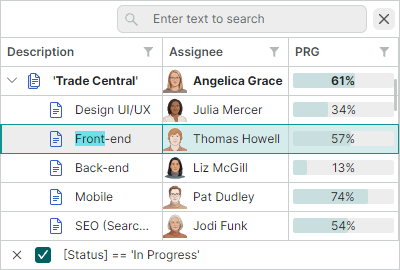 | **NovaDeep**<br>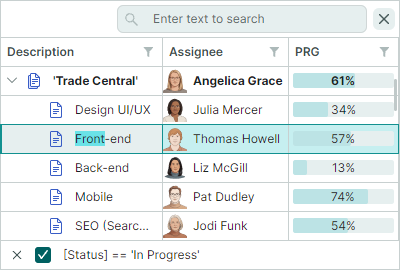 |
| **Helios**<br>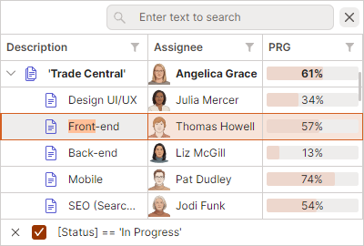 | **HeliosDeep**<br>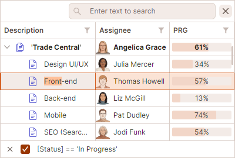 |
| **Terra**<br>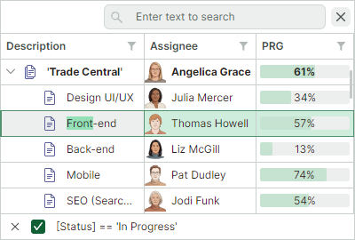 | **TerraDeep**<br>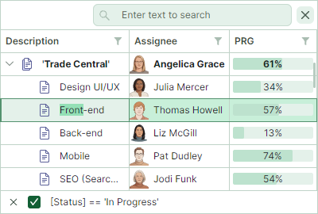 |
| **Vega**<br>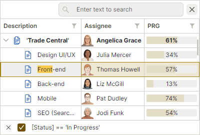 | **VegaDeep**<br>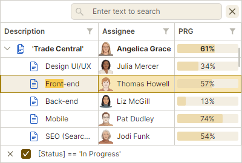 |
| **Atlas**<br>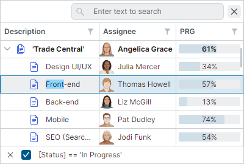 | **AtlasDeep**<br>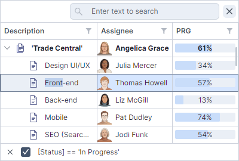 |


浅色和深色主题变体均支持调色板。

| <div style="width:400px"></div> | <div style="width:400px"></div> |
|---|---|
| **Helios** (浅色)<br>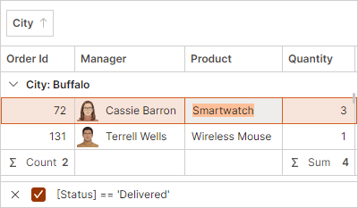 | **Helios** (深色)<br>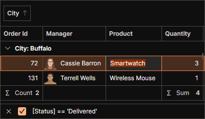 |


### 应用调色板 {#apply-a-palette}

要更改调色板，请将 `DeltaDesignTheme.Palette` 属性设置为 `Eremex.AvaloniaUI.Themes.DeltaDesign.Palette` 枚举中的相应值。

以下示例在 _App.axaml_ 文件中[注册](register-an-eremex-paint-theme.md) `DeltaDesign` 主题时设置调色板：

``` xml
<Application xmlns="https://github.com/avaloniaui"
             xmlns:x="http://schemas.microsoft.com/winfx/2006/xaml"
             xmlns:local="using:DemoCenter"
             x:Class="DemoCenter.App"
             xmlns:theme="clr-namespace:Eremex.AvaloniaUI.Themes.DeltaDesign;assembly=Eremex.Avalonia.Themes.DeltaDesign"
             RequestedThemeVariant="Light">
    <Application.Styles>
        <theme:DeltaDesignTheme Palette="AtlasDeep"/>
        ...
    </Application.Styles>
</Application>
```

要在运行时更改调色板，请在应用程序样式中找到已注册的 `DeltaDesign` 主题，并更新其 `DeltaDesignTheme.Palette` 属性：

```csharp
using Eremex.AvaloniaUI.Themes.DeltaDesign;

var deltaDesignTheme = Application.Current?.Styles.OfType<DeltaDesignTheme>().FirstOrDefault();
deltaDesignTheme.Palette = Palette.HeliosDeep;
```

#### 在应用程序界面中创建调色板选择器 {#create-a-palette-selector-in-the-applications-ui}

您可以使用 [IAppearanceService](../app-services/appearanceservice.md) 对象管理 `DeltaDesign` 主题选项，包括调色板、界面密度和主题变体。[`IAppearanceService`](../../API/Eremex.AvaloniaUI.Controls.ApplicationServices/IAppearanceService.md) 允许您在代码中更改主题选项。它还便于在界面中创建选择器控件（例如功能区库、组合框或菜单），让用户在运行时切换主题选项。

下图演示了用作可用调色板选择器的组合框。


有关详细信息，请参阅以下主题：[示例 - 在 View 中创建调色板选择器](../app-services/appearanceservice.md#example-create-a-palette-selector-in-a-view)

## 设置标准 Avalonia 控件的样式 {#styling-standard-avalonia-controls}

`DeltaDesign` 视觉主题还包含常用标准 Avalonia 控件的样式。如果您使用的标准 Avalonia 控件不受 `DeltaDesign` 主题支持，则还必须注册 `Fluent` 主题。有关说明，请参阅以下主题：

- [为标准 Avalonia 控件注册 'FluentTheme' 主题](register-an-eremex-paint-theme.md#register-the-fluenttheme-theme-for-standard-avalonia-controls)。

## 主题自定义 {#theme-customization}

要修改 Eremex 控件的外观，您应该自定义相应的主题设置。
以下主题说明了如何为单个控件或项目中的所有 Eremex 控件修改样式：

- [修改控件主题](modify-control-themes.md)


## 另请参阅 {#see-also}

- [选择浅色或深色主题变体](register-an-eremex-paint-theme.md#choose-the-light-or-dark-theme-variant)


<br>
<br>

<sup>*</sup> 本页面使用机器翻译技术翻译。
