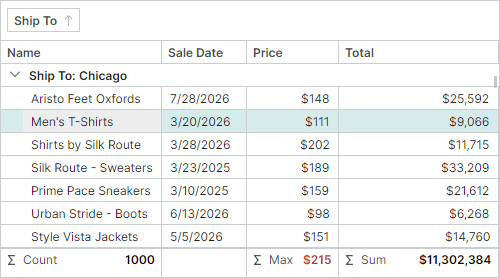
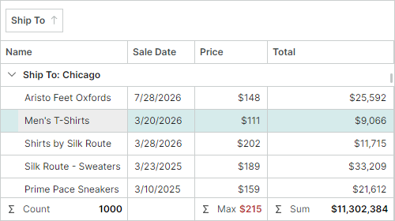
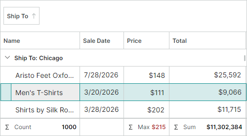

# 界面密度 {#ui-density}

应用程序有时需要最大限度地利用屏幕空间，或者相反，需要更宽松的布局。为满足这些需求，`DeltaDesign` 主题允许您更改界面密度，从而调整元素内边距和字体大小。提供三种预定义模式：

- `Compact`

    

- `Standard`（默认）

    

- `Spacious`

    


## 更改界面密度 {#modify-the-ui-density}

要更改界面密度，请将 `DeltaDesignTheme.Density` 属性设置为 `Eremex.AvaloniaUI.Themes.DeltaDesign.Density` 枚举中的相应值。

以下示例在 _App.axaml_ 文件中[注册](register-an-eremex-paint-theme.md) `DeltaDesign` 主题时设置界面密度：

```xml
<Application xmlns="https://github.com/avaloniaui"
             xmlns:x="http://schemas.microsoft.com/winfx/2006/xaml"
             xmlns:theme="clr-namespace:Eremex.AvaloniaUI.Themes.DeltaDesign;assembly=Eremex.Avalonia.Themes.DeltaDesign"
             x:Class="MyApp.App">
    <Application.Styles>
        <theme:DeltaDesignTheme Palette="AtlasDeep"
                        Density="Compact"/>
    </Application.Styles>
</Application>
```

要在运行时更改界面密度，请在应用程序样式中找到已注册的 `DeltaDesign` 主题，并更新其 `DeltaDesignTheme.Density` 属性：

```csharp
var deltaDesignTheme = Application.Current?.Styles.OfType<DeltaDesignTheme>().FirstOrDefault();
deltaDesignTheme.Density = Density.Compact;
```

## 在应用程序界面中创建密度选择器 {#create-a-density-selector-in-the-applications-ui}

您可以使用 [IAppearanceService](../app-services/appearanceservice.md) 对象管理 `DeltaDesign` 主题选项，包括调色板、界面密度和主题变体。[`IAppearanceService`](../../API/Eremex.AvaloniaUI.Controls.ApplicationServices/IAppearanceService.md) 允许您在代码中更改主题选项。它还便于在界面中创建选择器控件（例如功能区库、组合框或菜单），让用户在运行时切换主题选项。

下图演示了用作界面密度选择器的组合框。


有关详细信息，请参阅以下主题：[示例 - 创建密度选择器](../app-services/appearanceservice.md#example-create-a-density-selector)
