# 工具栏项 {#toolbar-items}

工具栏项用于在工具栏和菜单中显示按钮、检查按钮、文本标签、子菜单和就地编辑器。您可以向每个工具栏/菜单添加任意数量的项，并使用子菜单创建多个层级。

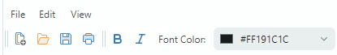

## 向工具栏和上下文菜单添加工具栏项 {#add-toolbar-items-to-a-bar-and-context-menu}

使用 [`Toolbar.Items`](../../API/Eremex.AvaloniaUI.Controls.Bars/Toolbar/Items.md) 和 [`PopupMenu.Items`](../../API/Eremex.AvaloniaUI.Controls.Bars/PopupMenu/Items.md) 集合，为工具栏和菜单填充项。在 XAML 中，您可以直接在起始和结束的 `<Toolbar>`/`<PopupMenu>` 标记之间定义项。

以下示例在工具栏中显示三个项。

``` xml
xmlns:mxb="https://schemas.eremexcontrols.net/avalonia/bars"

<mxb:Toolbar x:Name="EditToolbar" ToolbarName="Edit" ShowCustomizationButton="False">
    <mxb:ToolbarButtonItem Header="Cut" Command="{Binding #textBox.Cut}" 
     IsEnabled="{Binding #textBox.CanCut}" 
     Glyph="{SvgImage 'avares://DemoCenter/Images/Group=Context Menu, Icon=Cut.svg'}" 
     Category="Edit"/>
    <mxb:ToolbarButtonItem Header="Copy" Command="{Binding #textBox.Copy}" 
     IsEnabled="{Binding #textBox.CanCopy}" 
     Glyph="{SvgImage 'avares://DemoCenter/Images/Group=Context Menu, Icon=Copy.svg'}" 
     Category="Edit"/>
    <mxb:ToolbarButtonItem Header="Paste" Command="{Binding #textBox.Paste}" 
     IsEnabled="{Binding #textBox.CanPaste}" 
     Glyph="{SvgImage 'avares://DemoCenter/Images/Group=Context Menu, Icon=Paste.svg'}" 
     Category="Edit"/>
</mxb:Toolbar>
```
## 工具栏项类型 {#toolbar-item-types}

工具栏库支持多种工具栏项类型。它们都是 [`ToolbarItem`](../../API/Eremex.AvaloniaUI.Controls.Bars/ToolbarItem.md) 类的派生类，该类包含所有工具栏项通用的设置。

### 通用工具栏项设置 {#common-toolbar-item-settings}

- [`Alignment`](../../API/Eremex.AvaloniaUI.Controls.Bars/Alignment.md) — 项在工具栏中的对齐方式。
- [`Category`](../../API/Eremex.AvaloniaUI.Controls.Bars/ToolbarItem/Category.md) — 项所属的类别。类别用于在"自定义"窗口中将项组织为逻辑分组。有关详细信息，请参阅以下部分：[工具栏项类别](#toolbar-item-categories)。
- [`Command`](../../API/Eremex.AvaloniaUI.Controls.Bars/ToolbarItem/Command.md) — 单击按钮时执行的命令。
- [`CommandParameter`](../../API/Eremex.AvaloniaUI.Controls.Bars/ToolbarItem/CommandParameter.md) — 传递给指定命令的命令参数。
- [`DisplayMode`](../../API/Eremex.AvaloniaUI.Controls.Bars/ToolbarItem/DisplayMode.md) — 获取或设置是仅显示图形符号、标题，还是两者都显示。
- [`Glyph`](../../API/Eremex.AvaloniaUI.Controls.Bars/ToolbarItem/Glyph.md) — 项的图像。
- [`GlyphAlignment`](../../API/Eremex.AvaloniaUI.Controls.Bars/ToolbarItem/GlyphAlignment.md) — 图形符号相对于项标题的对齐方式。
- [`GlyphSize`](../../API/Eremex.AvaloniaUI.Controls.Bars/ToolbarItem/GlyphSize.md) — 图形符号的显示尺寸。
- [`Header`](../../API/Eremex.AvaloniaUI.Controls.Bars/ToolbarItem/Header.md) — 项的显示文本。
- [`ShowSeparator`](../../API/Eremex.AvaloniaUI.Controls.Bars/ToolbarItem/ShowSeparator.md) — 获取或设置是否在该项之前显示分隔符。您也可以使用 [`ToolbarSeparatorItem`](../../API/Eremex.AvaloniaUI.Controls.Bars/ToolbarSeparatorItem.md) 工具栏项来插入分隔符。

**事件**

- [`Click`](../../API/Eremex.AvaloniaUI.Controls.Bars/ToolbarItem/Click.md) — 在项上单击左键时触发（在按下并释放鼠标左键之后）。
- [`Press`](../../API/Eremex.AvaloniaUI.Controls.Bars/ToolbarItem/Press.md) — 在该项上按下任意鼠标按钮时触发。

### 常规按钮和下拉按钮（ToolbarButtonItem） {#regular-and-dropdown-buttons-toolbarbuttonitem}

使用 [`ToolbarButtonItem`](../../API/Eremex.AvaloniaUI.Controls.Bars/ToolbarButtonItem.md) 创建常规按钮。单击常规按钮会调用由 [`Command`](../../API/Eremex.AvaloniaUI.Controls.Bars/ToolbarItem/Command.md) 属性指定的命令，并触发相关事件（[`Click`](../../API/Eremex.AvaloniaUI.Controls.Bars/ToolbarItem/Click.md) 和 [`Press`](../../API/Eremex.AvaloniaUI.Controls.Bars/ToolbarItem/Press.md)）。

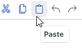

``` xml
xmlns:mxb="https://schemas.eremexcontrols.net/avalonia/bars"

<mxb:ToolbarButtonItem Header="Open" 
 Glyph="{SvgImage 'avares://bars_sample/Images/Toolbars/FileOpen.svg'}" 
 Category="File" Command="{Binding OpenFileCommand}"/>
```

您可以将下拉控件或菜单与 [`ToolbarButtonItem`](../../API/Eremex.AvaloniaUI.Controls.Bars/ToolbarButtonItem.md) 对象关联起来。在这种情况下，[`ToolbarButtonItem`](../../API/Eremex.AvaloniaUI.Controls.Bars/ToolbarButtonItem.md) 可以充当下拉按钮：单击该项本身或内置的向下箭头即可调用指定的下拉控件/菜单。

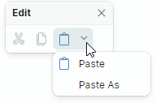

``` xml
xmlns:mxb="https://schemas.eremexcontrols.net/avalonia/bars"

<mxb:ToolbarButtonItem Header="Paste"
                       Command="{Binding #textBox.Paste}"
                       IsEnabled="{Binding #textBox.CanPaste}"
                       Glyph="{SvgImage 'avares://bars_sample/Images/Toolbars/EditPaste.svg'}"
                       Category="Edit"
                       DropDownArrowVisibility="ShowArrow" DropDownArrowAlignment="Default"
                       >
    <mxb:ToolbarButtonItem.DropDownControl>
        <mxb:PopupMenu>
            <mxb:ToolbarButtonItem Header="Paste" Command="{Binding #textBox.Paste}" 
             IsEnabled="{Binding #textBox.CanPaste}"/>
            <mxb:ToolbarButtonItem Header="Paste As" Command="{Binding PasteAsCommand}" 
             IsEnabled="{Binding #textBox.CanPaste}"/>
        </mxb:PopupMenu>
    </mxb:ToolbarButtonItem.DropDownControl>
</mxb:ToolbarButtonItem>
```

#### 按钮的主要设置 {#buttons-main-settings}

- [`DropDownControl`](../../API/Eremex.AvaloniaUI.Controls.Bars/ToolbarButtonItem/DropDownControl.md) — 获取或设置与该项关联的下拉控件（一个 [`Eremex.AvaloniaUI.Controls.Bars.IPopup`](../../API/Eremex.AvaloniaUI.Controls.Bars/IPopup.md) 对象）。当用户单击该项或内置的向下箭头按钮时（参见 [`DropDownArrowVisibility`](../../API/Eremex.AvaloniaUI.Controls.Bars/DropDownArrowVisibility.md)），该控件会弹出显示。以下对象实现了 [`Eremex.AvaloniaUI.Controls.Bars.IPopup`](../../API/Eremex.AvaloniaUI.Controls.Bars/IPopup.md) 接口，因此可以作为下拉控件显示：

    - [`Eremex.AvaloniaUI.Controls.Bars.PopupMenu`](../../API/Eremex.AvaloniaUI.Controls.Bars/PopupMenu.md) — 一个[弹出菜单](../toolbars-and-menus/popup-and-context-menus.md)。您可以将所有类型的工具栏项添加到该菜单中，以填充其内容。
    - [`Eremex.AvaloniaUI.Controls.Bars.PopupContainer`](../../API/Eremex.AvaloniaUI.Controls.Bars/PopupContainer.md) — 控件容器。使用 [`PopupContainer`](../../API/Eremex.AvaloniaUI.Controls.Bars/PopupContainer.md) 可以在下拉内容中显示自定义控件。
    
- [`DropDownArrowVisibility`](../../API/Eremex.AvaloniaUI.Controls.Bars/DropDownArrowVisibility.md) — 获取或设置该项是否显示用于调用关联下拉控件的下拉箭头。

    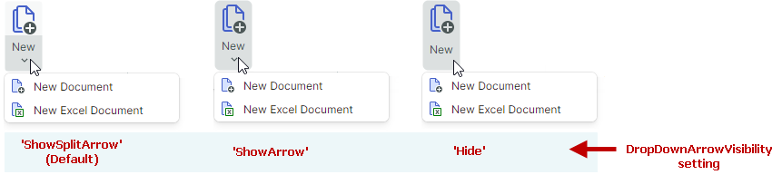

    - `ShowArrow` — 下拉箭头可见。该项和箭头充当单个按钮。单击它们会显示关联的下拉控件。

    - `ShowSplitArrow` 或 `Default` — 下拉箭头可见。它充当嵌入该项中的独立按钮。单击该项本身会调用其命令（[`Command`](../../API/Eremex.AvaloniaUI.Controls.Bars/ToolbarItem/Command.md)）并触发相关事件（[`Click`](../../API/Eremex.AvaloniaUI.Controls.Bars/ToolbarItem/Click.md) 和 [`Press`](../../API/Eremex.AvaloniaUI.Controls.Bars/ToolbarItem/Press.md)）。

    - `Hide` — 下拉箭头处于隐藏状态。单击该项会调用下拉控件。

- [`DropDownArrowAlignment`](../../API/Eremex.AvaloniaUI.Controls.Bars/DropDownArrowAlignment.md) — 获取或设置下拉箭头的位置。
- [`DropDownOpenMode`](../../API/Eremex.AvaloniaUI.Controls.Bars/DropDownOpenMode.md) — 获取或设置当用户触碰该项/下拉箭头时是否以及何时调用下拉控件。支持的选项包括：
    - [`Press`](../../API/Eremex.AvaloniaUI.Controls.Bars/ToolbarItem/Press.md) 或 `Default` — 在鼠标按下事件时显示下拉内容。
    - [`Click`](../../API/Eremex.AvaloniaUI.Controls.Bars/ToolbarItem/Click.md) — 在该项上按下并释放鼠标后显示下拉内容。
    - `Never` — 不显示下拉内容。
- [`DropDownPress`](../../API/Eremex.AvaloniaUI.Controls.Bars/ToolbarButtonItem/DropDownPress.md) — 按下下拉箭头时触发的事件。

另请参阅：[通用工具栏项设置](#common-toolbar-item-settings)。

### 检查按钮（ToolbarCheckItem） {#check-buttons-toolbarcheckitem}

[`ToolbarCheckItem`](../../API/Eremex.AvaloniaUI.Controls.Bars/ToolbarCheckItem.md) 封装了一个检查按钮，支持正常和按下两种状态。


``` xml
xmlns:mxb="https://schemas.eremexcontrols.net/avalonia/bars"

<mxb:ToolbarCheckItem Header="Bold" 
 IsChecked="{Binding #textBox.FontWeight, 
  Converter={helpers:BoolToFontWeightConverter}, Mode=TwoWay}" 
 Glyph="{SvgImage 'avares://DemoCenter/Images/FontBold.svg'}" Category="Font"/>
```

#### 检查按钮的主要设置和事件 {#check-buttons-main-settings-and-events}

- [`IsChecked`](../../API/Eremex.AvaloniaUI.Controls.Bars/ToolbarCheckItem/IsChecked.md) — 获取或设置按钮的检查状态。
- [`CheckedChanged`](../../API/Eremex.AvaloniaUI.Controls.Bars/ToolbarCheckItem/CheckedChanged.md) — 检查状态更改时触发的事件。

- [`CheckBoxStyle`](../../API/Eremex.AvaloniaUI.Controls.Bars/CheckBoxStyle.md) — 获取或设置 [`ToolbarCheckItem`](../../API/Eremex.AvaloniaUI.Controls.Bars/ToolbarCheckItem.md) 对象的显示模式。可用选项包括：

  - [`CheckBoxStyle.CheckButton`](../../API/Eremex.AvaloniaUI.Controls.Bars/CheckBoxStyle.md) — 该项呈现为检查按钮。当 [`IsChecked`](../../API/Eremex.AvaloniaUI.Controls.Bars/ToolbarCheckItem/IsChecked.md) 为 `true` 时，按钮显示为按下状态。

    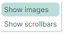

  - [`CheckBoxStyle.CheckBox`](../../API/Eremex.AvaloniaUI.Controls.Bars/CheckBoxStyle.md) — 该项在其文本和图形符号之前显示一个复选框。当 [`IsChecked`](../../API/Eremex.AvaloniaUI.Controls.Bars/ToolbarCheckItem/IsChecked.md) 为 `true` 时，复选框会显示一个勾选标记。

    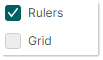
    
  - [`CheckBoxStyle.RadioButton`](../../API/Eremex.AvaloniaUI.Controls.Bars/CheckBoxStyle.md) — 该项在其文本和图形符号之前显示一个单选按钮。当 [`IsChecked`](../../API/Eremex.AvaloniaUI.Controls.Bars/ToolbarCheckItem/IsChecked.md) 为 `true` 时，单选按钮呈现为一个填充的圆圈。

    您可以将 RadioButton 样式应用于组合在检查组（[`ToolbarCheckItemGroup`](../../API/Eremex.AvaloniaUI.Controls.Bars/ToolbarCheckItemGroup.md)）中的 [`ToolbarCheckItem`](../../API/Eremex.AvaloniaUI.Controls.Bars/ToolbarCheckItem.md) 对象。在这种情况下，该组会呈现为典型的单选按钮组。

    ``` xml
    <mxb:ToolbarCheckItemGroup CheckType="Radio">
        <mxb:ToolbarCheckItem Header="E-mail" CheckBoxStyle="RadioButton" />
        <mxb:ToolbarCheckItem Header="Phone" CheckBoxStyle="RadioButton" />
    </mxb:ToolbarCheckItemGroup>
    ```
    
    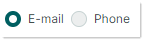

- [`CheckBoxAlignment`](../../API/Eremex.AvaloniaUI.Controls.Bars/CheckBoxAlignment.md) — 获取或设置复选框（或单选按钮）显示在该项的图形符号和文本之前还是之后。当 [`CheckBoxStyle`](../../API/Eremex.AvaloniaUI.Controls.Bars/CheckBoxStyle.md) 属性设置为 [`CheckBoxStyle.CheckBox`](../../API/Eremex.AvaloniaUI.Controls.Bars/CheckBoxStyle.md) 或 [`CheckBoxStyle.RadioButton`](../../API/Eremex.AvaloniaUI.Controls.Bars/CheckBoxStyle.md) 时，此选项才会生效。

    ```xml
    <mxb:ToolbarCheckItem Header="Status bar" CheckBoxAlignment="After"
                        CheckBoxStyle="CheckBox"
                        Hint="Show and hide the status bar"/>
    <mxb:ToolbarSeparatorItem/>
    ```
    
    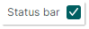

另请参阅：[通用工具栏项设置](#common-toolbar-item-settings)。

### 子菜单（ToolbarMenuItem） {#sub-menus-toolbarmenuitem}

[`ToolbarMenuItem`](../../API/Eremex.AvaloniaUI.Controls.Bars/ToolbarMenuItem.md) 是一个单击后显示子菜单的项。

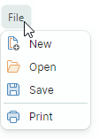

要指定子菜单的内容，请在 XAML 中的起始和结束 `<ToolbarMenuItem>` 标记之间定义项，或在代码隐藏文件中将项添加到 [`ToolbarMenuItem.Items`](../../API/Eremex.AvaloniaUI.Controls.Bars/ToolbarMenuItem/Items.md) 集合中。

``` xml
xmlns:mxb="https://schemas.eremexcontrols.net/avalonia/bars"

<mxb:ToolbarMenuItem Header="File" Category="File">
    <mxb:ToolbarButtonItem Header="New" 
     Glyph="{SvgImage 'avares://DemoCenter/Images/Group=Context Menu, Icon=NewDraftAction.svg'}" 
     Category="File" Command="{Binding NewFileCommand}"/>
    <mxb:ToolbarButtonItem Header="Open" 
     Glyph="{SvgImage 'avares://DemoCenter/Images/Group=Basic, Icon=Folder Open.svg'}" 
     Category="File" Command="{Binding OpenFileCommand}"/>
    <mxb:ToolbarButtonItem Header="Save" 
     Glyph="{SvgImage 'avares://DemoCenter/Images/Group=Basic, Icon=Save.svg'}" 
     Category="File" Command="{Binding SaveFileCommand}"/>
    <mxb:ToolbarButtonItem Header="Print" 
     Glyph="{SvgImage 'avares://DemoCenter/Images/Group=Basic, Icon=Print.svg'}" 
     ShowSeparator="True"  Category="File" Command="{Binding PrintFileCommand}"/>
</mxb:ToolbarMenuItem>
```

#### 子菜单的主要设置和事件 {#sub-menus-main-settings-and-events}

- [`DropDownOpenMode`](../../API/Eremex.AvaloniaUI.Controls.Bars/DropDownOpenMode.md) — 获取或设置当用户触碰该项时是否以及如何调用子菜单。支持的选项包括：
    - [`Press`](../../API/Eremex.AvaloniaUI.Controls.Bars/ToolbarItem/Press.md) 或 `Default` — 在鼠标按下事件时显示菜单。
    - [`Click`](../../API/Eremex.AvaloniaUI.Controls.Bars/ToolbarItem/Click.md) — 在该项上按下并释放鼠标后显示菜单。
    - `Never` — 不显示菜单。
- `Items` — 子菜单中显示的项的集合。
- `ItemsSource` — 视图模型中业务对象的集合，用于创建子菜单的项。相应的数据模板应定义工具栏项，并根据底层业务对象初始化它们的设置。

**事件**

- `Opening` — 当菜单即将显示时触发。该事件允许您取消菜单的显示。
- `Opened` — 菜单显示后触发。
- `Closing` — 当菜单即将关闭时触发。该事件允许您取消菜单的关闭。
- `Closed` — 菜单关闭后触发。

另请参阅：[通用工具栏项设置](#common-toolbar-item-settings)。

### 就地编辑器（ToolbarEditorItem） {#in-place-editors-toolbareditoritem}

[`ToolbarEditorItem`](../../API/Eremex.AvaloniaUI.Controls.Bars/ToolbarEditorItem.md) 允许您显示一个就地编辑器。

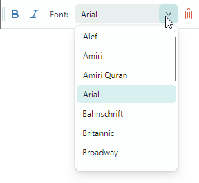

要指定就地编辑器的类型和设置，请使用 [`ToolbarEditorItem.EditorProperties`](../../API/Eremex.AvaloniaUI.Controls.Bars/ToolbarEditorItem/EditorProperties.md) 属性。您可以将 [`ToolbarEditorItem.EditorProperties`](../../API/Eremex.AvaloniaUI.Controls.Bars/ToolbarEditorItem/EditorProperties.md) 设置为以下对象之一：

- [`ButtonEditorProperties`](../../API/Eremex.AvaloniaUI.Controls.Editors/ButtonEditorProperties.md) — 对应于 [`ButtonEditor`](../../API/Eremex.AvaloniaUI.Controls.Editors/ButtonEditor.md) 就地编辑器。
- [`CheckEditorProperties`](../../API/Eremex.AvaloniaUI.Controls.Editors/CheckEditorProperties.md) — 对应于 [`CheckEditor`](../../API/Eremex.AvaloniaUI.Controls.Editors/CheckEditor.md) 就地编辑器。
- `ColorEditorProperties` — 对应于 [`ColorEditor`](../../API/Eremex.AvaloniaUI.Controls.Editors/ColorEditor.md) 就地编辑器。
- [`ComboBoxEditorProperties`](../../API/Eremex.AvaloniaUI.Controls.Editors/ComboBoxEditorProperties.md) — 对应于 [`ComboBoxEditor`](../../API/Eremex.AvaloniaUI.Controls.Editors/ComboBoxEditor.md) 就地编辑器。
- [`HyperlinkEditorProperties`](../../API/Eremex.AvaloniaUI.Controls.Editors/HyperlinkEditorProperties.md) — 对应于 [`HyperlinkEditor`](../../API/Eremex.AvaloniaUI.Controls.Editors/HyperlinkEditor.md) 就地编辑器。
- [`PopupColorEditorProperties`](../../API/Eremex.AvaloniaUI.Controls.Editors/PopupColorEditorProperties.md) — 对应于 [`PopupColorEditor`](../../API/Eremex.AvaloniaUI.Controls.Editors/PopupColorEditor.md) 就地编辑器。
- [`PopupEditorProperties`](../../API/Eremex.AvaloniaUI.Controls.Editors/PopupEditorProperties.md) — 对应于 [`PopupEditor`](../../API/Eremex.AvaloniaUI.Controls.Editors/PopupEditor.md) 就地编辑器。
- [`SegmentedEditorProperties`](../../API/Eremex.AvaloniaUI.Controls.Editors/SegmentedEditorProperties.md) — 对应于 [`SegmentedEditor`](../../API/Eremex.AvaloniaUI.Controls.Editors/SegmentedEditor.md) 就地编辑器。
- [`SpinEditorProperties`](../../API/Eremex.AvaloniaUI.Controls.Editors/SpinEditorProperties.md) — 对应于 [`SpinEditor`](../../API/Eremex.AvaloniaUI.Controls.Editors/SpinEditor.md) 就地编辑器。
- [`TextEditorProperties`](../../API/Eremex.AvaloniaUI.Controls.Editors/TextEditorProperties.md) — 对应于 [`TextEditor`](../../API/Eremex.AvaloniaUI.Controls.Editors/TextEditor.md) 就地编辑器。
- [`MemoEditorProperties`](../../API/Eremex.AvaloniaUI.Controls.Editors/MemoEditorProperties.md) — 对应于 [`MemoEditor`](../../API/Eremex.AvaloniaUI.Controls.Editors/MemoEditor.md) 就地编辑器。

在以下示例中，_Font_ [`ToolbarEditorItem`](../../API/Eremex.AvaloniaUI.Controls.Bars/ToolbarEditorItem.md) 对象使用一个组合框就地编辑器显示字体列表。[`ToolbarEditorItem.EditorProperties`](../../API/Eremex.AvaloniaUI.Controls.Bars/ToolbarEditorItem/EditorProperties.md) 属性被设置为 [`ComboBoxEditorProperties`](../../API/Eremex.AvaloniaUI.Controls.Editors/ComboBoxEditorProperties.md)，对应于 [`ComboBoxEditor`](../../API/Eremex.AvaloniaUI.Controls.Editors/ComboBoxEditor.md) 控件。

``` xml
<mxb:ToolbarEditorItem Header="Font:" EditorWidth="150" Category="Font" 
 EditorValue="{Binding #textBox.FontFamily, Converter={helpers:FontNameToFontFamilyConverter}}">
    <mxb:ToolbarEditorItem.EditorProperties>
        <mxe:ComboBoxEditorProperties 
         ItemsSource="{Binding $parent[view:ToolbarAndMenuPageView].Fonts}"
         IsTextEditable="False" PopupMaxHeight="300"/>
    </mxb:ToolbarEditorItem.EditorProperties>
</mxb:ToolbarEditorItem>      
```

#### 就地编辑器的主要设置和事件 {#in-place-editors-main-settings-and-events}

- [`ToolbarEditorItem.EditorProperties`](../../API/Eremex.AvaloniaUI.Controls.Bars/ToolbarEditorItem/EditorProperties.md) — 获取或设置指定就地编辑器类型和设置的对象。
- [`ToolbarEditorItem.EditorValue`](../../API/Eremex.AvaloniaUI.Controls.Bars/ToolbarEditorItem/EditorValue.md) — 获取或设置就地编辑器的值。请将此属性用于数据绑定。
- [`ToolbarEditorItem.SizeMode`](../../API/Eremex.AvaloniaUI.Controls.Bars/ToolbarEditorItem/SizeMode.md) — 获取或设置该项的大小模式。此属性允许您拉伸该工具栏项，使其占据工具栏中所有可用的空白空间。
- [`ToolbarEditorItem.EditorWidth`](../../API/Eremex.AvaloniaUI.Controls.Bars/ToolbarEditorItem/EditorWidth.md) — 获取或设置就地编辑器的宽度。
- [`ToolbarEditorItem.EditorHeight`](../../API/Eremex.AvaloniaUI.Controls.Bars/ToolbarEditorItem/EditorHeight.md) — 获取或设置就地编辑器的高度。
- [`ToolbarEditorItem.EditorAlignment`](../../API/Eremex.AvaloniaUI.Controls.Bars/ToolbarEditorItem/EditorAlignment.md) — 获取或设置编辑器相对于该项标题的对齐方式。

- [`ToolbarEditorItem.EditorValueChanged`](../../API/Eremex.AvaloniaUI.Controls.Bars/ToolbarEditorItem/EditorValueChanged.md) — 编辑器的值更改后触发的事件。

<!--TODO - `ToolbarEditorItem.Editor` -  

-->

另请参阅：[通用工具栏项设置](#common-toolbar-item-settings)。


### 文本标签（ToolbarTextItem） {#text-labels-toolbartextitem}

[`ToolbarTextItem`](../../API/Eremex.AvaloniaUI.Controls.Bars/ToolbarTextItem.md) 显示由 [`ToolbarTextItem.Header`](../../API/Eremex.AvaloniaUI.Controls.Bars/ToolbarItem/Header.md) 属性指定的文本标签。使用此项可以呈现用户无法编辑的文本。

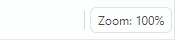

``` xml
<mxb:ToolbarTextItem 
 Header="{Binding #scaleDecorator.Scale, StringFormat={}Zoom: {0:P0}}" 
 ShowBorder="True" Alignment="Far" ShowSeparator="True" Category="Info" 
 CustomizationName="Zoom Info"/>
```

#### 文本标签的主要设置和事件 {#text-labels-main-settings-and-events}

- [`ToolbarTextItem.SizeMode`](../../API/Eremex.AvaloniaUI.Controls.Bars/ToolbarTextItem/SizeMode.md) — 获取或设置该项的大小模式。此属性允许您拉伸该项，使其占据工具栏中所有可用的空白空间。
- [`ToolbarTextItem.ShowBorder`](../../API/Eremex.AvaloniaUI.Controls.Bars/ToolbarTextItem/ShowBorder.md) — 获取或设置该项的边框是否可见。您可以使用 [`ToolbarTextItem.BorderTemplate`](../../API/Eremex.AvaloniaUI.Controls.Bars/ToolbarTextItem/BorderTemplate.md) 属性指定用于绘制边框的自定义模板。
- [`ToolbarTextItem.BorderTemplate`](../../API/Eremex.AvaloniaUI.Controls.Bars/ToolbarTextItem/BorderTemplate.md) — 获取或设置用于绘制该项边框的自定义模板。仅当 [`ToolbarTextItem.ShowBorder`](../../API/Eremex.AvaloniaUI.Controls.Bars/ToolbarTextItem/ShowBorder.md) 选项启用时，此模板才会生效。

另请参阅：[通用工具栏项设置](#common-toolbar-item-settings)。

### 不间断项组（ToolbarItemGroup） {#non-breaking-groups-of-items-toolbaritemgroup}

使用 [`ToolbarItemGroup`](../../API/Eremex.AvaloniaUI.Controls.Bars/ToolbarItemGroup.md) 创建一个不间断的工具栏项组。不间断组是一个项容器，在其父容器调整大小时会作为一个整体行动（组的内容不能被部分隐藏；项始终显示在同一行中，且不支持换行）。


要指定组的内容，请在起始和结束 `<ToolbarItemGroup>` 标记之间定义项，或在代码隐藏文件中将项添加到 [`ToolbarItemGroup.Items`](../../API/Eremex.AvaloniaUI.Controls.Bars/ToolbarItemGroup/Items.md) 集合中。

``` xml
<mxb:ToolbarItemGroup CustomizationName="Clipboard" >
    <mxb:ToolbarButtonItem Header="Cut" Command="{Binding #textBox.Cut}" 
     IsEnabled="{Binding #textBox.CanCut}" 
     Glyph="{SvgImage 'avares://DemoCenter/Images/Group=Context Menu, Icon=Cut.svg'}" 
     Category="Edit"/>
    <mxb:ToolbarButtonItem Header="Copy" Command="{Binding #textBox.Copy}" 
     IsEnabled="{Binding #textBox.CanCopy}" 
     Glyph="{SvgImage 'avares://DemoCenter/Images/Group=Context Menu, Icon=Copy.svg'}" 
     Category="Edit"/>
    <mxb:ToolbarButtonItem Header="Paste" Command="{Binding #textBox.Paste}" 
     IsEnabled="{Binding #textBox.CanPaste}" 
     Glyph="{SvgImage 'avares://DemoCenter/Images/Group=Context Menu, Icon=Paste.svg'}" 
     Category="Edit"/>
</mxb:ToolbarItemGroup>
```

#### 组的主要设置和事件 {#groups-main-settings-and-events}

- [`ToolbarItemGroup.Items`](../../API/Eremex.AvaloniaUI.Controls.Bars/ToolbarItemGroup/Items.md) — 允许您访问该组的子项。

### 不间断检查项组（ToolbarCheckItemGroup） {#non-breaking-groups-of-check-items-toolbarcheckitemgroup}

使用 [`ToolbarCheckItemGroup`](../../API/Eremex.AvaloniaUI.Controls.Bars/ToolbarCheckItemGroup.md) 创建一个不间断的检查项组。不间断组是一个项容器，在其父容器调整大小时会作为一个整体行动（组的内容不能被部分隐藏；项始终显示在同一行中，且不支持换行）。


[`ToolbarCheckItemGroup`](../../API/Eremex.AvaloniaUI.Controls.Bars/ToolbarCheckItemGroup.md) 容器可以控制其子项（[`ToolbarCheckItem` 对象](#check-buttons-toolbarcheckitem)）的检查状态。您可以使用 [`ToolbarCheckItemGroup`](../../API/Eremex.AvaloniaUI.Controls.Bars/ToolbarCheckItemGroup.md) 创建以下类型的组：

- 一组互斥的项（单选组）。
- 一个允许同时检查多个项的组。


要指定组的内容，请在 XAML 中的起始和结束 `<ToolbarCheckItemGroup>` 标记之间添加 [`ToolbarCheckItem`](../../API/Eremex.AvaloniaUI.Controls.Bars/ToolbarCheckItem.md) 项，或在代码隐藏文件中将项添加到 [`ToolbarCheckItemGroup.Items`](../../API/Eremex.AvaloniaUI.Controls.Bars/ToolbarItemGroup/Items.md) 集合中。

``` xml
<mxb:ToolbarCheckItemGroup CustomizationName="Check group" CheckType="Radio" >
    <mxb:ToolbarCheckItem Header="1" IsChecked="{Binding Option1}"  
     Category="Settings"/>
    <mxb:ToolbarCheckItem Header="2" IsChecked="{Binding Option2}" 
     Category="Settings"/>
    <mxb:ToolbarCheckItem Header="3" IsChecked="{Binding Option3}" 
     Category="Settings"/>
</mxb:ToolbarCheckItemGroup>
```

[`ToolbarCheckItemGroup`](../../API/Eremex.AvaloniaUI.Controls.Bars/ToolbarCheckItemGroup.md) 对象可以接受所有受支持的工具栏项类型作为子项。但该组只会处理嵌套的 [`ToolbarCheckItem`](../../API/Eremex.AvaloniaUI.Controls.Bars/ToolbarCheckItem.md) 对象的检查状态。

#### 检查组的主要设置和事件 {#check-groups-main-settings-and-events}

- [`ToolbarCheckItemGroup.CheckType`](../../API/Eremex.AvaloniaUI.Controls.Bars/ToolbarCheckItemGroup/CheckType.md) — 获取或设置组中一次可以检查一个还是多个项。支持以下选项：

    - `Default` 或 `Multiple` — 可以同时检查多个项。
    - `Radio` — 一组互斥的项。用户只能通过检查另一个项来取消检查当前项。
    - `Single` — 一组互斥的项。用户可以取消检查组内的所有项。

- [`ToolbarCheckItemGroup.Items`](../../API/Eremex.AvaloniaUI.Controls.Bars/ToolbarItemGroup/Items.md) — 允许您访问该组的子项。

另请参阅：[通用工具栏项设置](#common-toolbar-item-settings)。

### 分隔符（ToolbarSeparatorItem） {#separators-toolbarseparatoritem}

[`ToolbarSeparatorItem`](../../API/Eremex.AvaloniaUI.Controls.Bars/ToolbarSeparatorItem.md) 用于绘制一个分隔符。


``` xml
<mxb:ToolbarMenuItem Header="File" Category="File">
    <mxb:ToolbarButtonItem Header="New" 
     Glyph="{SvgImage 'avares://DemoCenter/Images/Group=Context Menu, Icon=NewDraftAction.svg'}" 
     Category="File"/>
    <mxb:ToolbarButtonItem Header="Open" 
     Glyph="{SvgImage 'avares://DemoCenter/Images/Group=Basic, Icon=Folder Open.svg'}" 
     Category="File"/>
    <mxb:ToolbarButtonItem Header="Save" 
     Glyph="{SvgImage 'avares://DemoCenter/Images/Group=Basic, Icon=Save.svg'}" 
     Category="File"/>
    <mxb:ToolbarSeparatorItem/>
    <mxb:ToolbarButtonItem Header="Print" 
     Glyph="{SvgImage 'avares://DemoCenter/Images/Group=Basic, Icon=Print.svg'}" 
     Category="File"/>
</mxb:ToolbarMenuItem>
```


## 工具栏项类别 {#toolbar-item-categories}

您可以将工具栏项分类，以便在"自定义"窗口中对项进行分组。用户可以在"自定义"窗口中选择一个类别，以访问相关的项。

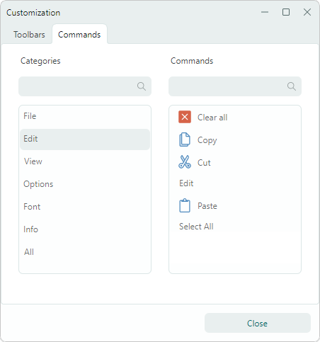

使用 [`ToolbarItem.Category`](../../API/Eremex.AvaloniaUI.Controls.Bars/ToolbarItem/Category.md) 属性将某个项分配到一个类别。此属性指定类别的名称。要将一组项分配到同一类别，请将它们的 [`ToolbarItem.Category`](../../API/Eremex.AvaloniaUI.Controls.Bars/ToolbarItem/Category.md) 属性设置为相同的类别名称。

``` xml
<mxb:ToolbarMenuItem Header="Edit" Category="Edit">
    <mxb:ToolbarButtonItem Header="Cut" 
     Glyph="{SvgImage 'avares://DemoCenter/Images/Group=Context Menu, Icon=Cut.svg'}" 
     Category="Edit"/>
    <mxb:ToolbarButtonItem Header="Copy" 
     Glyph="{SvgImage 'avares://DemoCenter/Images/Group=Context Menu, Icon=Copy.svg'}" 
     Category="Edit"/>
    <mxb:ToolbarButtonItem Header="Paste" 
     Glyph="{SvgImage 'avares://DemoCenter/Images/Group=Context Menu, Icon=Paste.svg'}" 
     Category="Edit"/>
    <mxb:ToolbarButtonItem Header="Select All" 
     Command="{Binding #textBox.SelectAll}" Category="Edit" ShowSeparator="True"/>
    <mxb:ToolbarButtonItem Header="Clear all" 
     Command="{Binding #textBox.Clear}" 
     Glyph="{SvgImage 'avares://DemoCenter/Images/Group=Basic, Icon=Clear.svg'}" 
     Category="Edit"/>
</mxb:ToolbarMenuItem>       
```

## 热键 {#hotkeys}

您可以使用 [`ToolbarItem.HotKey`](../../API/Eremex.AvaloniaUI.Controls.Bars/ToolbarItem/HotKey.md) 属性为项分配热键。

``` xml
<mxb:ToolbarButtonItem 
    Header="Clear" Command="{Binding #textBox.Clear}" HotKey="Ctrl+Q"
    Glyph="{SvgImage 'avares://bars_sample/Images/Toolbars/EditDelete.svg'}"/>
```

只要焦点位于热键作用范围内，按下热键就会激活该项的命令。默认的热键作用范围是 [`ToolbarManager`](../../API/Eremex.AvaloniaUI.Controls.Bars/ToolbarManager.md) 组件边界内的 UI 区域。当输入焦点超出热键作用范围时，[`ToolbarManager`](../../API/Eremex.AvaloniaUI.Controls.Bars/ToolbarManager.md) 将无法拦截热键。

[`ToolbarManager.IsWindowManager`](../../API/Eremex.AvaloniaUI.Controls.Bars/ToolbarManager/IsWindowManager.md) 属性允许您将热键作用范围扩展到整个窗口。将此属性设置为 `true` 后，[`ToolbarManager`](../../API/Eremex.AvaloniaUI.Controls.Bars/ToolbarManager.md) 组件会在窗口中注册项的热键。即使焦点位于其客户区域之外，它也能够拦截并处理热键。

### 显示热键 {#displaying-hotkeys}

分配给工具栏项的热键会在以下情况下显示：

- 当项位于子菜单或弹出菜单中时。
- 在项的工具提示中。

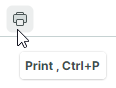

您可以使用 [`ToolbarItem.HotKeyDisplayString`](../../API/Eremex.AvaloniaUI.Controls.Bars/ToolbarItem/HotKeyDisplayString.md) 属性指定热键的显示文本。即使该项未分配热键，此文本也会显示。当目标热键已被另一个对象注册用于执行特定操作，而您希望表明同一热键与某个工具栏项相关联时，这一属性会很有用。

例如，TextBox 注册了 _Ctrl+Z_ 快捷键用于执行撤销操作。如果某个工具栏项对该 TextBox 执行相同的撤销操作，请不要为该项分配 _Ctrl+Z_ 热键。相反，请将该项的 [`ToolbarItem.HotKeyDisplayString`](../../API/Eremex.AvaloniaUI.Controls.Bars/ToolbarItem/HotKeyDisplayString.md) 设置为 "_Ctrl+Z_"，以便在工具提示和子菜单/弹出菜单中向用户显示该快捷键。

``` xml
<mxb:ToolbarButtonItem Header="Undo" HotKeyDisplayString="Ctrl+Z" 
    Command="{Binding $parent[TextBox].Undo}" 
    IsEnabled="{Binding $parent[TextBox].CanUndo}" 
    Glyph="{SvgImage 'avares://bars_sample/Images/Toolbars/EditUndo.svg'}"/>
```

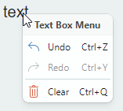


<br>
<br>

<sup>*</sup> 本页面使用机器翻译技术翻译。
