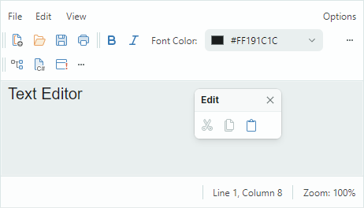
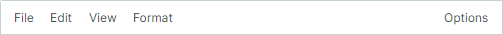
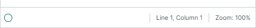
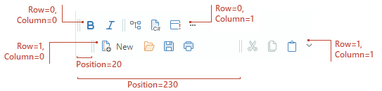
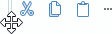
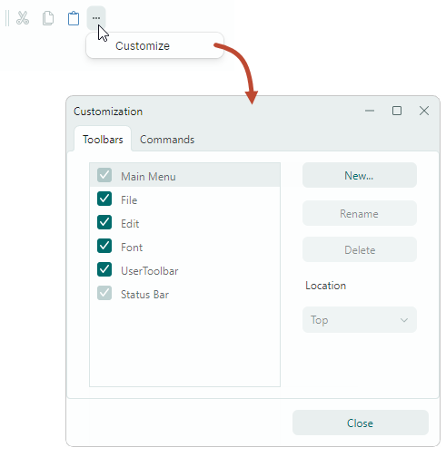
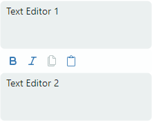
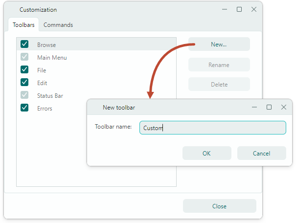

# 工具栏 {#toolbars}

[`ToolbarManager`](../../API/Eremex.AvaloniaUI.Controls.Bars/ToolbarManager.md) 组件可以管理应用程序中的传统工具栏、[弹出菜单和上下文菜单](popup-and-context-menus.md)以及 [Ribbon 界面](../ribbon/index.md)。可以将传统工具栏停靠到窗口/UserControl 的边缘，也可以创建浮动工具栏。Eremex 工具栏库还允许将工具栏放置在窗口/UserControl 内的任意位置。



使用 [`ToolbarManager`](../../API/Eremex.AvaloniaUI.Controls.Bars/ToolbarManager.md) 组件实现传统工具栏时，需要创建用于停靠这些工具栏的工具栏容器。工具栏容器是用于显示已停靠工具栏的可视容器。工具栏容器是 [`ToolbarManager`](../../API/Eremex.AvaloniaUI.Controls.Bars/ToolbarManager.md) 组件的子元素。

## 创建工具栏 {#create-toolbars}

[`Toolbar`](../../API/Eremex.AvaloniaUI.Controls.Bars/Toolbar.md) 控件实现工具栏。使用它可以向应用程序添加常规工具栏、主菜单和状态栏。

按照以下步骤创建工具栏：

- 创建 [`ToolbarManager`](../../API/Eremex.AvaloniaUI.Controls.Bars/ToolbarManager.md) 组件。
- 创建工具栏容器。
- 创建工具栏。
- 向工具栏添加项。

### 创建 ToolbarManager {#create-toolbarmanager}

要创建工具栏，首先需要定义 [`ToolbarManager`](../../API/Eremex.AvaloniaUI.Controls.Bars/ToolbarManager.md) 组件（`Avalonia.Controls.Border` 类的派生类）。要为其创建工具栏界面的客户端控件需要放在 [`ToolbarManager`](../../API/Eremex.AvaloniaUI.Controls.Bars/ToolbarManager.md) 组件内部。[`ToolbarManager`](../../API/Eremex.AvaloniaUI.Controls.Bars/ToolbarManager.md) 对象确定工具栏和弹出菜单的作用区域。

``` xml
xmlns:mxb="https://schemas.eremexcontrols.net/avalonia/bars"

<mxb:ToolbarManager IsWindowManager="True">
    <Grid RowDefinitions="Auto, *, Auto" ColumnDefinitions="Auto, *, Auto">

        <TextBox x:Name="textBox" Text="Text Editor" AcceptsReturn="True" 
         CornerRadius="0" FontFamily="Arial" FontSize="20" 
         helpers:TextBoxHelper.IsEnabled="True"/>

    </Grid>
</mxb:ToolbarManager>        
```

!!! tip "提示"

    可以为工具栏项分配快捷键。要使 [`ToolbarManager`](../../API/Eremex.AvaloniaUI.Controls.Bars/ToolbarManager.md) 对象在键盘焦点位于 [`ToolbarManager`](../../API/Eremex.AvaloniaUI.Controls.Bars/ToolbarManager.md) 客户区之外时也能处理这些快捷键，请启用 [`ToolbarManager.IsWindowManager`](../../API/Eremex.AvaloniaUI.Controls.Bars/ToolbarManager/IsWindowManager.md) 选项。有关工具栏项快捷键作用范围的信息，请参阅以下主题：[快捷键](#hotkey-scope)。

### 创建工具栏容器 {#create-toolbar-containers}

向 [`ToolbarManager`](../../API/Eremex.AvaloniaUI.Controls.Bars/ToolbarManager.md) 组件添加工具栏容器（[`ToolbarContainerControl`](../../API/Eremex.AvaloniaUI.Controls.Bars/ToolbarContainerControl.md)），使工具栏可以停靠在窗口/UserControl 中的特定位置。工具栏容器指定可以停靠和拖动工具栏的区域。

以下示例在 Grid 控件的四个边缘创建工具栏容器，以便稍后将工具栏停靠在这些位置。

``` xml
xmlns:mxb="https://schemas.eremexcontrols.net/avalonia/bars"

<mxb:ToolbarManager IsWindowManager="True">
    <Grid RowDefinitions="Auto, *, Auto" ColumnDefinitions="Auto, *, Auto">
        <mxb:ToolbarContainerControl Grid.ColumnSpan="3" DockType="Top">
        </mxb:ToolbarContainerControl>

        <mxb:ToolbarContainerControl DockType="Left" Grid.Row="1"/>

        <TextBox x:Name="textBox" Text="Text Editor" AcceptsReturn="True" 
         CornerRadius="0" FontFamily="Arial" FontSize="20" 
         helpers:TextBoxHelper.IsEnabled="True"/>

        <mxb:ToolbarContainerControl DockType="Right" Grid.Row="1" Grid.Column="2"/>

        <mxb:ToolbarContainerControl Grid.Row="2" Grid.ColumnSpan="3" DockType="Bottom">
        </mxb:ToolbarContainerControl>
    </Grid>
</mxb:ToolbarManager>        
```
为所创建的容器初始化 [`ToolbarContainerControl.DockType`](../../API/Eremex.AvaloniaUI.Controls.Bars/ToolbarContainerControl/DockType.md) 属性，以指定其停靠方式。容器的停靠类型决定其中工具栏的默认对齐方式，以及应用于工具栏容器的外观设置。可用的停靠类型包括：

- `Left`、`Right`、`Top`、`Bottom` — 工具栏容器停靠到父控件的相应一侧。具有这些停靠类型的容器会绘制边框线，以便与客户区的其余部分分隔开。例如，停靠在顶部的工具栏容器会在底部绘制一条边框线。
- `Standalone` — 此模式应用于[独立工具栏容器](#standalone-toolbars)。独立工具栏容器专门用于在窗口/UserControl 中的自定义位置显示工具栏。独立工具栏容器没有边框。

可以定义一个空的 [`ToolbarContainerControl`](../../API/Eremex.AvaloniaUI.Controls.Bars/ToolbarContainerControl.md)，以便稍后（由用户或在代码中）向此容器添加工具栏。

### 添加工具栏 {#add-toolbars}
向工具栏容器添加 [`Toolbar`](../../API/Eremex.AvaloniaUI.Controls.Bars/Toolbar.md) 控件，即可将工具栏停靠到相应的位置。

``` xml
xmlns:mxb="https://schemas.eremexcontrols.net/avalonia/bars"

<mxb:ToolbarContainerControl Grid.ColumnSpan="3" DockType="Top">
    <mxb:Toolbar x:Name="MainMenu" ToolbarName="Main Menu" DisplayMode="MainMenu">
    </mxb:Toolbar>

    <mxb:Toolbar x:Name="EditToolbar" ToolbarName="Edit" ShowCustomizationButton="False">
    </mxb:Toolbar>
</mxb:ToolbarContainerControl>        

<mxb:ToolbarContainerControl Grid.Row="2" Grid.ColumnSpan="3" DockType="Bottom">
    <mxb:Toolbar DisplayMode="StatusBar" ToolbarName="Status Bar" x:Name="StatusBar">
    </mxb:Toolbar>
</mxb:ToolbarContainerControl>
```


有关更多信息，请参阅以下部分：

- [浮动工具栏](#floating-toolbars)
- [独立工具栏](#standalone-toolbars)

### 添加工具栏项 {#add-toolbar-items}

工具栏可以显示以下各种类型的工具栏项：

- [`ToolbarButtonItem`](../../API/Eremex.AvaloniaUI.Controls.Bars/ToolbarButtonItem.md) — 可用作常规按钮或下拉按钮（如果为其关联了下拉控件/菜单）的项。
- [`ToolbarCheckItem`](../../API/Eremex.AvaloniaUI.Controls.Bars/ToolbarCheckItem.md) — 复选按钮。
- [`ToolbarMenuItem`](../../API/Eremex.AvaloniaUI.Controls.Bars/ToolbarMenuItem.md) — 显示子菜单的项。
- [`ToolbarEditorItem`](../../API/Eremex.AvaloniaUI.Controls.Bars/ToolbarEditorItem.md) — 显示就地编辑器的项。
- [`ToolbarTextItem`](../../API/Eremex.AvaloniaUI.Controls.Bars/ToolbarTextItem.md) — 文本标签。
- [`ToolbarItemGroup`](../../API/Eremex.AvaloniaUI.Controls.Bars/ToolbarItemGroup.md) — 工具栏项组。
- [`ToolbarCheckItemGroup`](../../API/Eremex.AvaloniaUI.Controls.Bars/ToolbarCheckItemGroup.md) — 复选按钮组。可用于创建一组互斥的复选项，或支持同时选择多个项的组。
- [`ToolbarSeparatorItem`](../../API/Eremex.AvaloniaUI.Controls.Bars/ToolbarSeparatorItem.md) — 在相邻项之间绘制分隔线。

要向工具栏添加项，请在 XAML 中将其定义为 [`Toolbar`](../../API/Eremex.AvaloniaUI.Controls.Bars/Toolbar.md) 控件的子元素，或在代码隐藏中将其添加到 [`Toolbar.Items`](../../API/Eremex.AvaloniaUI.Controls.Bars/Toolbar/Items.md) 集合中。

``` xml
xmlns:mxb="https://schemas.eremexcontrols.net/avalonia/bars"

<mxb:Toolbar x:Name="EditToolbar" ToolbarName="Edit" ShowCustomizationButton="False">
    <mxb:ToolbarButtonItem Header="Cut" Command="{Binding #textBox.Cut}" 
     IsEnabled="{Binding #textBox.CanCut}" 
     Glyph="{SvgImage 'avares://DemoCenter/Images/Group=Context Menu, Icon=Cut.svg'}" 
     Category="Edit"/>
    <mxb:ToolbarButtonItem Header="Copy" Command="{Binding #textBox.Copy}" 
     IsEnabled="{Binding #textBox.CanCopy}" 
     Glyph="{SvgImage 'avares://DemoCenter/Images/Group=Context Menu, Icon=Copy.svg'}" 
     Category="Edit"/>
    <mxb:ToolbarButtonItem Header="Paste" Command="{Binding #textBox.Paste}" 
     IsEnabled="{Binding #textBox.CanPaste}" 
     Glyph="{SvgImage 'avares://DemoCenter/Images/Group=Context Menu, Icon=Paste.svg'}" 
     Category="Edit"/>
</mxb:Toolbar>
```

有关详细信息，请参阅[工具栏项](toolbar-items.md)主题。

## 选择工具栏类型 - 常规工具栏、主菜单或状态栏 {#choose-toolbar-type-regular-bar-main-menu-or-status-bar}

通过 [`Toolbar.DisplayMode`](../../API/Eremex.AvaloniaUI.Controls.Bars/Toolbar/DisplayMode.md) 属性可以指定工具栏类型。

### 常规工具栏 {#regular-toolbars}

如果未指定 [`Toolbar.DisplayMode`](../../API/Eremex.AvaloniaUI.Controls.Bars/Toolbar/DisplayMode.md) 属性，或将其设置为 [`ToolbarDisplayMode.Default`](../../API/Eremex.AvaloniaUI.Controls.Bars/ToolbarDisplayMode.md)，则 [`Toolbar`](../../API/Eremex.AvaloniaUI.Controls.Bars/Toolbar.md) 对象呈现为常规工具栏。


常规工具栏带有拖动手柄，可通过拖放重新排列工具栏。

### 主菜单 {#main-menu}

将 [`Toolbar.DisplayMode`](../../API/Eremex.AvaloniaUI.Controls.Bars/Toolbar/DisplayMode.md) 设置为 [`ToolbarDisplayMode.MainMenu`](../../API/Eremex.AvaloniaUI.Controls.Bars/ToolbarDisplayMode.md)，可将工具栏显示为主菜单。



主菜单的特点包括：

- 用户无法在运行时隐藏主菜单。
- 用户按 ALT 键时，主菜单获得焦点。
- 主菜单会在水平方向上拉伸以适应容器的宽度。
- 主菜单不支持多行排列项、浮动模式和拖放操作。

### 状态栏 {#status-bar}

将 [`Toolbar.DisplayMode`](../../API/Eremex.AvaloniaUI.Controls.Bars/Toolbar/DisplayMode.md) 设置为 [`ToolbarDisplayMode.StatusBar`](../../API/Eremex.AvaloniaUI.Controls.Bars/ToolbarDisplayMode.md)，可将工具栏呈现为应用程序的状态栏。



状态栏的特点包括：

- 用户无法在运行时隐藏状态栏。
- 状态栏会在水平方向上拉伸以适应容器的宽度。
- 状态栏不支持多行排列项、浮动模式和拖放操作。

以下示例创建一个包含两个项的状态栏。该状态栏放在显示于父 Grid 控件底部的工具栏容器中。

``` xml
xmlns:mxb="https://schemas.eremexcontrols.net/avalonia/bars"

<mxb:ToolbarContainerControl Grid.Row="2" Grid.ColumnSpan="3" DockType="Bottom">
    <mxb:Toolbar DisplayMode="StatusBar" ToolbarName="Status Bar" x:Name="StatusBar" 
     ShowCustomizationButton="False">
        <mxb:ToolbarTextItem Alignment="Far" ShowSeparator="True" ShowBorder="False" 
         Category="Info" CustomizationName="Position Info">
            <mxb:ToolbarTextItem.Header>
                <MultiBinding Converter="{helpers:LineAndColumnToTextConverter}">
                    <Binding ElementName="textBox" Path="(helpers:TextBoxHelper.Line)"/>
                    <Binding ElementName="textBox" Path="(helpers:TextBoxHelper.Column)"/>
                </MultiBinding>
            </mxb:ToolbarTextItem.Header>
        </mxb:ToolbarTextItem>
        <mxb:ToolbarTextItem 
         Header="{Binding #scaleDecorator.Scale, StringFormat={}Zoom: {0:P0}}" 
         ShowBorder="False" Alignment="Far" ShowSeparator="True" Category="Info" 
         CustomizationName="Zoom Info"/>
    </mxb:Toolbar>
</mxb:ToolbarContainerControl>
```

## 工具栏的布局和位置 {#layout-and-position-of-toolbars}

当工具栏位于工具栏容器中时，会根据容器的停靠类型（[`ToolbarContainerControl.DockType`](../../API/Eremex.AvaloniaUI.Controls.Bars/ToolbarContainerControl/DockType.md) 设置）对齐：

- 如果 [`ToolbarContainerControl.DockType`](../../API/Eremex.AvaloniaUI.Controls.Bars/ToolbarContainerControl/DockType.md) 属性设置为 `Top`、`Bottom` 或 `Standalone`，工具栏水平排列。
- 如果 [`ToolbarContainerControl.DockType`](../../API/Eremex.AvaloniaUI.Controls.Bars/ToolbarContainerControl/DockType.md) 属性设置为 `Left` 或 `Right`，工具栏垂直排列。

[`Toolbar`](../../API/Eremex.AvaloniaUI.Controls.Bars/Toolbar.md) 对象有自己的停靠类型设置，由 [`Toolbar.DockType`](../../API/Eremex.AvaloniaUI.Controls.Bars/Toolbar/DockType.md) 属性指定。可以在代码隐藏中使用 [`Toolbar.DockType`](../../API/Eremex.AvaloniaUI.Controls.Bars/Toolbar/DockType.md) 属性将工具栏移动到特定的工具栏容器。将 [`Toolbar.DockType`](../../API/Eremex.AvaloniaUI.Controls.Bars/Toolbar/DockType.md) 属性设置为 `Left`、`Right`、`Top` 或 `Bottom` 时，工具栏会移动到 [`ToolbarContainerControl.DockType`](../../API/Eremex.AvaloniaUI.Controls.Bars/ToolbarContainerControl/DockType.md) 选项设置为相应值的工具栏容器中。

工具栏可以在其父工具栏容器中排列成多行。可以使用以下属性将工具栏显示在特定行中，并在该行内移动工具栏：

- [`Toolbar.Row`](../../API/Eremex.AvaloniaUI.Controls.Bars/Toolbar/Row.md) — 获取或设置显示工具栏的行的索引（从零开始）。行索引从 `0` 开始。该属性仅对常规工具栏有效。无法更改主菜单的行索引，也无法将常规工具栏放在主菜单之前。
- [`Toolbar.Column`](../../API/Eremex.AvaloniaUI.Controls.Bars/Toolbar/Column.md) — 获取或设置工具栏在行中的顺序（从零开始）。
- [`Toolbar.Position`](../../API/Eremex.AvaloniaUI.Controls.Bars/Toolbar/Position.md) — 获取或设置工具栏在行内的最小偏移量。



## 工具栏中项的布局 {#layout-of-items-in-toolbars}

### 自适应布局 {#adaptive-layout}

当父容器的大小发生变化时，工具栏会自动隐藏和恢复其项。
禁用 [`Toolbar.AllowShrinkToolbar`](../../API/Eremex.AvaloniaUI.Controls.Bars/Toolbar/AllowShrinkToolbar.md) 选项，可防止特定工具栏在容器尺寸缩小时被折叠。

### 工具栏拉伸 {#toolbar-stretching}

工具栏可以拉伸以适应容器的宽度。将 [`Toolbar.StretchToolbar`](../../API/Eremex.AvaloniaUI.Controls.Bars/Toolbar/StretchToolbar.md) 选项设置为 `true` 可启用工具栏拉伸。在此模式下，同一行中不能显示其他工具栏。

主菜单和状态栏始终占据整行。[`Toolbar.StretchToolbar`](../../API/Eremex.AvaloniaUI.Controls.Bars/Toolbar/StretchToolbar.md) 选项对这些工具栏无效。

### 多行排列项 {#multi-line-item-arrangement}

当父容器的宽度不足以在一行中显示所有项时，工具栏可以将其项显示为多行。将 [`Toolbar.WrapItems`](../../API/Eremex.AvaloniaUI.Controls.Bars/Toolbar/WrapItems.md) 属性设置为 `true` 可启用多行布局。


## 浮动工具栏 {#floating-toolbars}

要在 XAML 中创建浮动工具栏，请将 [`Toolbar`](../../API/Eremex.AvaloniaUI.Controls.Bars/Toolbar.md) 对象添加到 [`ToolbarManager.Toolbars`](../../API/Eremex.AvaloniaUI.Controls.Bars/ToolbarManager/Toolbars.md) 集合中，并将 [`Toolbar.DockType`](../../API/Eremex.AvaloniaUI.Controls.Bars/Toolbar/DockType.md) 属性设置为 `Floating`。使用 [`Toolbar.FloatingPosition`](../../API/Eremex.AvaloniaUI.Controls.Bars/Toolbar/FloatingPosition.md) 属性设置浮动工具栏的位置。

``` xml
xmlns:mxb="https://schemas.eremexcontrols.net/avalonia/bars"

<mxb:ToolbarManager.Toolbars>
    <mxb:Toolbar x:Name="bar1" DockType="Floating" FloatingPosition="200,200" 
                        ToolbarName="Toolbar 1"  >
        <mxb:ToolbarButtonItem Header="Script" 
         Glyph="{SvgImage 'avares://DemoCenter/Images/Group=Script, Icon=CSharpFile.svg'}" 
         Category="UserCommands"/>
        <mxb:ToolbarButtonItem Header="Settings" 
         Glyph="{SvgImage 'avares://DemoCenter/Images/Group=Basic, Icon=List of Bugs.svg'}" 
         Category="UserCommands"/>
    </mxb:Toolbar>
</mxb:ToolbarManager.Toolbars>
```

以下代码段演示如何在代码隐藏中使工具栏浮动。

``` csharp
toolBar1.DockType = Eremex.AvaloniaUI.Controls.Bars.MxToolbarDockType.Floating;
toolBar1.FloatingPosition = new PixelPoint(200, 200);
```

## 运行时自定义工具栏 {#runtime-toolbar-customization}

### 重新排列工具栏 {#rearrange-toolbars}

如果启用了 [`Toolbar.AllowDragToolbar`](../../API/Eremex.AvaloniaUI.Controls.Bars/Toolbar/AllowDragToolbar.md) 选项，工具栏会显示拖动手柄。用户可以按住此手柄将工具栏拖动到其他位置，或使工具栏浮动。



### 使用快速自定义重新排列项 {#rearrange-items-using-quick-customization}

用户无需激活自定义模式即可重新排列工具栏项：按住 ALT 键，然后将项拖放到所需位置。如果按住 CTRL+ALT 组合键而不是 ALT 键，则会复制被拖动的项。

### 自定义模式和自定义窗口 {#customization-mode-and-customization-window}

工具栏支持自定义模式，用户可以在该模式下执行以下操作：

- 访问可见和隐藏的工具栏，并显示或隐藏它们。
- 访问所有项，并通过拖放操作管理它们在工具栏中的可见性和位置。
- 创建和删除用户工具栏。

要激活工具栏自定义模式，用户可以单击工具栏的自定义按钮（'...'），然后选择“Customize”命令。激活自定义模式后会显示自定义窗口：



!!! tip "提示"

    启用 [`Toolbar.ShowCustomizationButton`](../../API/Eremex.AvaloniaUI.Controls.Bars/Toolbar/ShowCustomizationButton.md) 选项可在工具栏中显示自定义按钮（'...'）。

    调用 [`ToolbarManager.ShowCustomizationWindow`](../../API/Eremex.AvaloniaUI.Controls.Bars/ToolbarManager/ShowCustomizationWindow.md) 方法，可在代码中激活自定义模式并显示自定义窗口。

在自定义模式下，用户可以使用拖放操作隐藏、显示和移动工具栏项：

- 将项从工具栏/子菜单拖到自定义窗口的“Commands”选项卡上，即可隐藏这些项。
- 将项从自定义窗口的“Commands”选项卡拖到工具栏/子菜单中，即可显示这些项。
- 在工具栏和子菜单之间拖动项，即可重新排列它们。

用户还可以通过自定义窗口隐藏/显示工具栏，以及创建自定义工具栏。有关详细信息，请参阅以下部分：[用户工具栏](#user-toolbars)。


## 工具栏自定义选项 {#toolbar-customization-options}

工具栏提供以下选项，用于自定义其视图和行为设置：

- [`Toolbar.ToolbarName`](../../API/Eremex.AvaloniaUI.Controls.Bars/Toolbar/ToolbarName.md) — 获取或设置工具栏标题。工具栏标题显示在自定义窗口中以及工具栏浮动时。
- [`Toolbar.AllowDragToolbar`](../../API/Eremex.AvaloniaUI.Controls.Bars/Toolbar/AllowDragToolbar.md) — 获取或设置工具栏是否显示拖动手柄。用户可以通过该手柄将工具栏拖动到另一个停靠位置或使其浮动。
- [`Toolbar.ShowCustomizationButton`](../../API/Eremex.AvaloniaUI.Controls.Bars/Toolbar/ShowCustomizationButton.md) — 获取或设置工具栏是否显示自定义（'...'）按钮。单击此按钮会打开一个菜单，用户可以从中打开自定义窗口。


## 独立工具栏 {#standalone-toolbars}

可以在窗口/UserControl 中的任意位置显示工具栏。为此，请在该位置创建 [`ToolbarContainerControl`](../../API/Eremex.AvaloniaUI.Controls.Bars/ToolbarContainerControl.md)，并向此容器添加工具栏。

将 [`ToolbarContainerControl.DockType`](../../API/Eremex.AvaloniaUI.Controls.Bars/ToolbarContainerControl/DockType.md) 属性设置为 `Standalone`。此停靠类型会应用独立工具栏容器特有的外观设置。例如，在 Eremex 的 Light 和 Dark 主题中，独立容器没有边框。

独立工具栏容器中工具栏的默认方向为水平。可以使用 [`ToolbarContainerControl.Orientation`](../../API/Eremex.AvaloniaUI.Controls.Bars/ToolbarContainerControl/Orientation.md) 属性使独立工具栏垂直排列。

以下示例在两个文本框之间显示一个独立工具栏。该工具栏包含对第二个文本框执行操作的命令。



``` xml
xmlns:mxb="https://schemas.eremexcontrols.net/avalonia/bars"

<StackPanel Grid.Row="1" Grid.Column="1">
    <TextBox x:Name="textBox" Text="Text Editor 1" AcceptsReturn="True" 
    FontSize="14" Height="70"/>
                
    <mxb:ToolbarContainerControl DockType="Standalone" Orientation="Horizontal"  >
        <mxb:Toolbar x:Name="EditToolbar2" ToolbarName="Edit (textBox2)" 
         AllowDragToolbar="False" ShowCustomizationButton="False" >
            <mxb:ToolbarCheckItemGroup>
                <mxb:ToolbarCheckItem Header="Bold" 
                 IsChecked="{Binding #textBox2.FontWeight, 
                  Converter={local:BoolToFontWeightConverter}, Mode=TwoWay}" 
                 Glyph="{SvgImage 'avares://bars_sample/Images/Toolbars/FontBold.svg'}" Category="Font"/>
                <mxb:ToolbarCheckItem Header="Italic" 
                 IsChecked="{Binding #textBox2.FontStyle, 
                  Converter={local:BoolToFontStyleConverter}, Mode=TwoWay}" 
                 Glyph="{SvgImage 'avares://bars_sample/Images/Toolbars/FontItalic.svg'}" Category="Font"/>
            </mxb:ToolbarCheckItemGroup>
            <mxb:ToolbarButtonItem Header="Copy" Command="{Binding #textBox2.Copy}" 
             IsEnabled="{Binding #textBox2.CanCopy}" 
             Glyph="{SvgImage 'avares://bars_sample/Images/Toolbars/EditCopy.svg'}" Category="Edit"/>
            <mxb:ToolbarButtonItem Header="Paste"
                                    Command="{Binding #textBox2.Paste}"
                                    IsEnabled="{Binding #textBox2.CanPaste}"
                                    Glyph="{SvgImage 'avares://bars_sample/Images/Toolbars/EditPaste.svg'}"
                                    Category="Edit"
                                />
        </mxb:Toolbar>
    </mxb:ToolbarContainerControl>
    <TextBox x:Name="textBox2" Text="Text Editor 2" AcceptsReturn="True" FontSize="14" Height="70"/>
</StackPanel>
```

## 用户工具栏 {#user-toolbars}

用户可以在运行时通过自定义窗口创建工具栏。这些工具栏称为“用户工具栏”，其 [`Toolbar.UserToolbar`](../../API/Eremex.AvaloniaUI.Controls.Bars/Toolbar/UserToolbar.md) 选项设置为 `true`。



与其他工具栏不同，用户工具栏可以在自定义窗口中重命名和删除。

必要时，可以手动将 [`Toolbar.UserToolbar`](../../API/Eremex.AvaloniaUI.Controls.Bars/Toolbar/UserToolbar.md) 属性设置为 `true`，在代码中创建用户工具栏。用户同样可以在自定义窗口中重命名和删除此工具栏。

创建用户工具栏后，用户可以通过拖放操作向其中添加命令。

## 快捷键作用范围 {#hotkey-scope}

[`ToolbarItem.HotKey`](../../API/Eremex.AvaloniaUI.Controls.Bars/ToolbarItem/HotKey.md) 属性可用于为项分配快捷键。如果焦点位于快捷键作用范围内，[`ToolbarManager`](../../API/Eremex.AvaloniaUI.Controls.Bars/ToolbarManager.md) 组件可以拦截快捷键。

默认的快捷键作用范围是 [`ToolbarManager`](../../API/Eremex.AvaloniaUI.Controls.Bars/ToolbarManager.md) 的客户区。将 [`ToolbarManager.IsWindowManager`](../../API/Eremex.AvaloniaUI.Controls.Bars/ToolbarManager/IsWindowManager.md) 属性设置为 `true`，可将快捷键作用范围扩展到整个窗口。在这种情况下，[`ToolbarManager`](../../API/Eremex.AvaloniaUI.Controls.Bars/ToolbarManager.md) 组件会在窗口中注册项的快捷键，即使焦点位于其客户区之外，也能够拦截和处理快捷键。

有关详细信息，请参阅以下主题：[工具栏项快捷键](toolbar-items.md#hotkeys)。


<br>
<br>

<sup>*</sup> 本页面使用机器翻译技术翻译。
