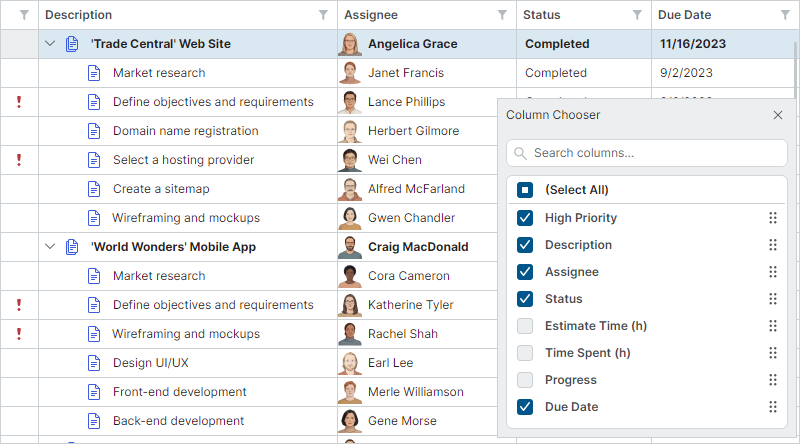
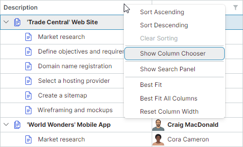
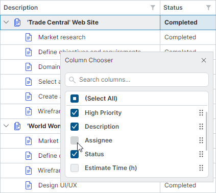
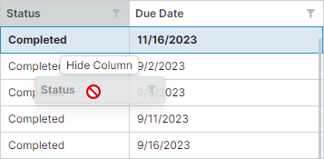
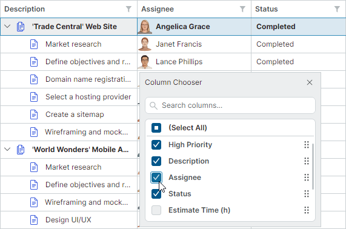
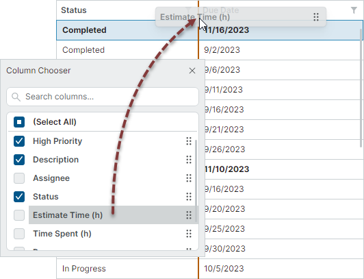
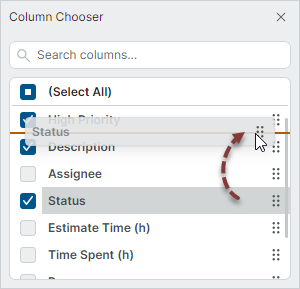
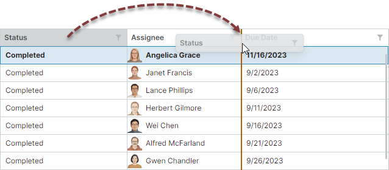

# 列选择器 {#column-chooser}

列选择器（Column Chooser）是一个窗口，用于访问 TreeList 的所有列（包括隐藏列和当前可见列）。

列选择器的功能包括：

- 使用内置复选框隐藏或显示列。
- 直接在列选择器中拖动列标题以调整列顺序。
- 按名称内置搜索列。

## 显示和隐藏列选择器 {#show-and-hide-the-column-chooser}

用户可以在列标题面板中单击鼠标右键并选择 **Show Column Chooser** 来打开列选择器。

要隐藏列选择器，请单击窗口的 **Close** (x) 按钮，或在 TreeList 的列标题面板中单击鼠标右键并选择 **Hide Column Chooser**。

**相关 API：**

- [`DataControlBase.ShowColumnChooser`](../../API/Eremex.AvaloniaUI.Controls.DataControl/DataControlBase/ShowColumnChooser.md) 方法 — 显示列选择器。
- [`DataControlBase.HideColumnChooser`](../../API/Eremex.AvaloniaUI.Controls.DataControl/DataControlBase/HideColumnChooser.md) 方法 — 隐藏列选择器。
- [`DataControlBase.IsColumnChooserVisible`](../../API/Eremex.AvaloniaUI.Controls.DataControl/DataControlBase/IsColumnChooserVisible.md) 属性 — 获取或设置列选择器是否可见。

## 隐藏列 {#hide-a-column}

用户可以通过以下方式之一隐藏列：

- 在列选择器中，取消选中该列的复选框。

    

- 在 TreeList 中，将列标题拖出标题面板，并在出现 **Hide Column** 工具提示时松开。

    

**相关 API：**

- [`ColumnBase.VisibleIndex`](../../API/Eremex.AvaloniaUI.Controls.DataControl/ColumnBase/VisibleIndex.md) — 获取或设置列的可视位置。要隐藏列，请将此属性设置为 `-1`。
- [`ColumnBase.IsVisible`](../../API/Eremex.AvaloniaUI.Controls.DataControl/ColumnBase/IsVisible.md) — 获取或设置列的可见状态。要隐藏列，请将此属性设置为 `false`。

## 显示列 {#show-a-column}

用户可以通过以下方式之一显示隐藏的列：

- 在列选择器中选中该列的复选框。

    

- 将列标题从列选择器拖到 TreeList 的列标题面板上。

    

**相关 API：**

- [`ColumnBase.VisibleIndex`](../../API/Eremex.AvaloniaUI.Controls.DataControl/ColumnBase/VisibleIndex.md) — 获取或设置列的可视位置。要显示列，请将此属性设置为非负值。
- [`ColumnBase.IsVisible`](../../API/Eremex.AvaloniaUI.Controls.DataControl/ColumnBase/IsVisible.md) — 获取或设置列的可见状态。要显示列，请将此属性设置为 `true`。

## 调整列顺序 {#reorder-columns}

用户可以通过以下方式之一调整列顺序：

- 在列选择器中单击列标题并将其拖到所需位置。列选择器中列标题的顺序与 TreeList 中列的顺序保持同步。

    

- 在控件的列标题面板中拖动列标题。

    

**相关 API：**

- [`ColumnBase.VisibleIndex`](../../API/Eremex.AvaloniaUI.Controls.DataControl/ColumnBase/VisibleIndex.md) — 获取或设置列的可视位置。

## 在列选择器中隐藏列 {#hide-columns-from-the-column-chooser}

- [`ColumnBase.ShowInColumnChooser`](../../API/Eremex.AvaloniaUI.Controls.DataControl/ColumnBase/ShowInColumnChooser.md) — 允许您阻止特定列显示在列选择器中。

## 为列选择器设置自定义列标题 {#set-a-custom-column-header-for-the-column-chooser}

[`ColumnBase.ColumnChooserHeader`](../../API/Eremex.AvaloniaUI.Controls.DataControl/ColumnBase/ColumnChooserHeader.md) — 获取或设置在列选择器中显示的列标题的自定义内容。
