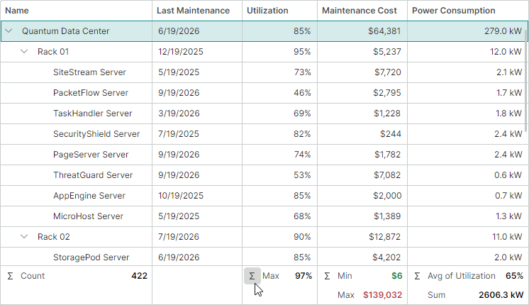
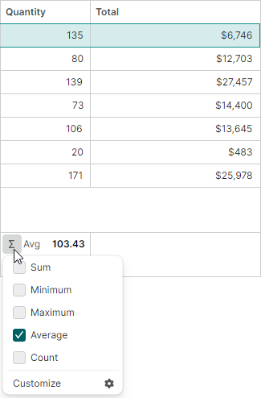
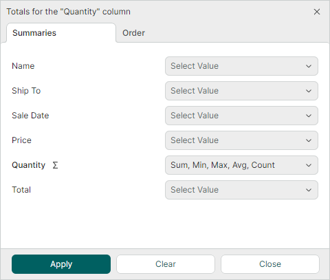
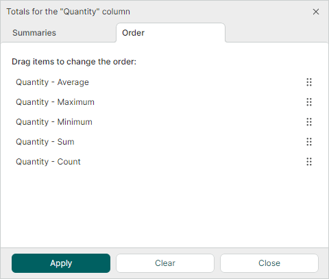
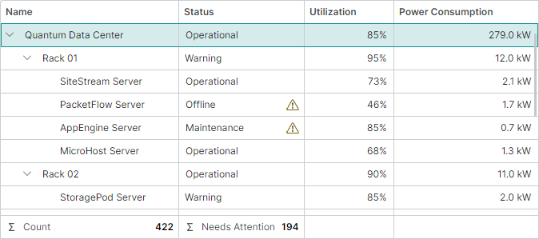
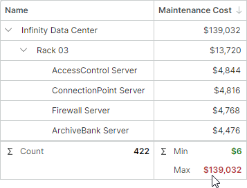

# 汇总 {#summaries}

TreeList 控件允许针对列计算总计汇总。总计汇总是针对所有行计算的聚合函数。控件必须能够同时访问所有行，才能正确计算总计汇总。

!!! note "注意"

    将 [`AllowDynamicDataLoading`](../../API/Eremex.AvaloniaUI.Controls.TreeList/TreeListControlBase/AllowDynamicDataLoading.md) 属性设置为 `false` 可禁用[动态数据加载](data-binding/binding-to-hierarchical-data.md#dynamic-data-load)，使 TreeList 控件能够同时访问所有行。




汇总计算的主要功能包括：

- 内置汇总函数：Sum、Min、Max、Count 和 Average。
- 运行时管理 — 用户可以单击页脚单元格中的 Σ 按钮添加汇总，或打开 Summary Editor 对话框执行高级汇总操作。
- 每列多个汇总 — 每一列可以显示针对该列值计算的多个汇总。
- 跨列汇总 — 可以针对一列计算汇总，并在另一列中显示。
- 自定义汇总 — 可以处理 [`CustomSummary`](../../API/Eremex.AvaloniaUI.Controls.TreeList/TreeListControl/CustomSummary.md) 事件，按您自己的逻辑计算自定义聚合函数。
- 在 XLSX 和 PDF 导出中包含汇总。


## 启用总计汇总 {#enable-total-summaries}

总计汇总显示在控件的页脚中。

将 [`ShowTotalSummaries`](../../API/Eremex.AvaloniaUI.Controls.TreeList/TreeListControl/ShowTotalSummaries.md) 属性设置为 `true`，即可显示汇总页脚并启用总计汇总计算。汇总页脚位于 [`TreeListControl`](../../API/Eremex.AvaloniaUI.Controls.TreeList/TreeListControl.md) 底部、所有行之下。该页脚默认处于隐藏状态。

```xml
<mxtl:TreeListControl x:Name="treeList" ShowTotalSummaries="True" AllowDynamicDataLoading="False">...</mxtl:TreeListControl>
```

汇总页脚包含所有列的汇总单元格。如果启用了[用户汇总自定义](#user-summary-customizations)（默认启用），汇总单元格会包含 `Σ` 按钮，用于显示汇总菜单和汇总编辑器。


**相关 API**

- [`ShowTotalSummaries`](../../API/Eremex.AvaloniaUI.Controls.TreeList/TreeListControl/ShowTotalSummaries.md) — 获取或设置是否显示总计汇总页脚并启用总计汇总计算。
- [`TotalSummaryPanelMinHeight`](../../API/Eremex.AvaloniaUI.Controls.TreeList/TreeListControl/TotalSummaryPanelMinHeight.md) — 获取或设置总计汇总页脚的最小高度。

## 定义总计汇总 {#define-total-summaries}

使用 [`TotalSummaries`](../../API/Eremex.AvaloniaUI.Controls.TreeList/TreeListControl/TotalSummaries.md) 集合定义总计汇总。该集合中的项是 [`SummaryItem`](../../API/Eremex.AvaloniaUI.Controls.DataControl/SummaryItem.md) 类的实例。每个 [`SummaryItem`](../../API/Eremex.AvaloniaUI.Controls.DataControl/SummaryItem.md) 对象指定要汇总的字段、汇总类型、显示结果的列以及其他设置。

```xml
xmlns:mxdc="clr-namespace:Eremex.AvaloniaUI.Controls.DataControl;assembly=Eremex.Avalonia.Controls"

<mxtl:TreeListControl x:Name="treeList" ShowTotalSummaries="True" AllowDynamicDataLoading="False">
    <mxtl:TreeListControl.TotalSummaries>
        <mxdc:SummaryItem FieldName="Name" SummaryType="Count" />
        <mxdc:SummaryItem FieldName="Utilization" SummaryType="Average" ShowInColumn="PowerConsumption" />
        <mxdc:SummaryItem FieldName="Utilization" SummaryType="Max" />
        <mxdc:SummaryItem FieldName="MaintenanceCost" SummaryType="Min" />
        <mxdc:SummaryItem FieldName="MaintenanceCost" SummaryType="Max" />
        <mxdc:SummaryItem FieldName="PowerConsumption" SummaryType="Sum" />
    </mxtl:TreeListControl.TotalSummaries>
</mxtl:TreeListControl>
```

**相关 API**

- [`TotalSummaries`](../../API/Eremex.AvaloniaUI.Controls.TreeList/TreeListControl/TotalSummaries.md) — 提供对汇总项（[`SummaryItem`](../../API/Eremex.AvaloniaUI.Controls.DataControl/SummaryItem.md) 对象）集合的访问，这些汇总项定义总计汇总。
- [`SummaryItem.FieldName`](../../API/Eremex.AvaloniaUI.Controls.DataControl/SummaryItem/FieldName.md) — 获取或设置其值用于计算汇总的数据字段的名称。
- [`SummaryItem.Name`](../../API/Eremex.AvaloniaUI.Controls.DataControl/SummaryItem/Name.md) — 获取或设置汇总项的名称，用于标识该汇总项。可以按名称从 [`TotalSummaries`](../../API/Eremex.AvaloniaUI.Controls.TreeList/TreeListControl/TotalSummaries.md) 集合中检索汇总项。
- [`SummaryItem.Tag`](../../API/Eremex.AvaloniaUI.Controls.DataControl/SummaryItem/Tag.md) — 获取或设置与此 `SummaryItem` 关联的自定义数据。
- [`SummaryItem.ShowInColumn`](../../API/Eremex.AvaloniaUI.Controls.DataControl/SummaryItem/ShowInColumn.md) — 获取或设置显示汇总值的列的字段名称。如果未设置此属性，汇总将显示在绑定到 `FieldName` 的列中。
- [`SummaryItem.SummaryType`](../../API/Eremex.AvaloniaUI.Controls.DataControl/SummaryItem/SummaryType.md) — 获取或设置聚合函数的类型（`Sum`、`Min`、`Max`、`Count` 或 `Average`）。
- [`SummaryItem.Label`](../../API/Eremex.AvaloniaUI.Controls.DataControl/SummaryItem/Label.md) — 获取或设置自定义标签，用于替代默认汇总标签显示。默认汇总标签显示汇总函数的名称。如果汇总显示在另一列中（请参阅 [`ShowInColumn`](../../API/Eremex.AvaloniaUI.Controls.DataControl/SummaryItem/ShowInColumn.md)），汇总标签还会显示绑定到 [`SummaryItem.FieldName`](../../API/Eremex.AvaloniaUI.Controls.DataControl/SummaryItem/FieldName.md) 的列的标题。

    


## 用户汇总自定义 {#user-summary-customizations}

默认情况下，用户可以在运行时编辑汇总。在此模式下，汇总单元格会显示 `Σ` 按钮，用于打开汇总菜单：



用户可以使用此菜单：

- 通过切换汇总函数旁边的复选框来添加或删除汇总。

    

- 选择 `Customize` 打开 `Summary Editor` 对话框。

    

    在此对话框的 `Summaries` 选项卡中，用户可以创建跨列汇总（针对一列计算但显示在另一列中的汇总）。

    在 `Order` 选项卡中，用户可以更改现有汇总的显示顺序。

    


**相关 API**

- [`AllowEditingTotalSummaries`](../../API/Eremex.AvaloniaUI.Controls.TreeList/TreeListControl/AllowEditingTotalSummaries.md) — 获取或设置用户是否可以编辑总计汇总。

    此属性只影响用户修改汇总的能力，不影响在代码中执行的汇总计算。

## 自定义汇总 {#custom-summaries}

自定义汇总允许您使用自己的逻辑计算聚合值。

要添加自定义汇总，请执行以下操作：

- 创建一个 [`SummaryItem`](../../API/Eremex.AvaloniaUI.Controls.DataControl/SummaryItem.md) 对象，并将其 [`SummaryItem.SummaryType`](../../API/Eremex.AvaloniaUI.Controls.DataControl/SummaryItem/SummaryType.md) 属性设置为 `Custom`。

- 将此 [`SummaryItem`](../../API/Eremex.AvaloniaUI.Controls.DataControl/SummaryItem.md) 添加到 [`TotalSummaries`](../../API/Eremex.AvaloniaUI.Controls.TreeList/TreeListControl/TotalSummaries.md) 集合中。

- 处理 [`CustomSummary`](../../API/Eremex.AvaloniaUI.Controls.TreeList/TreeListControl/CustomSummary.md) 事件，为此 [`SummaryItem`](../../API/Eremex.AvaloniaUI.Controls.DataControl/SummaryItem.md) 手动计算值。

    将 `e.SummaryValue` 事件参数设置为您的自定义结果。

    在处理 [`CustomSummary`](../../API/Eremex.AvaloniaUI.Controls.TreeList/TreeListControl/CustomSummary.md) 事件时，使用 `e.Nodes` 集合遍历目标节点（行）。


### 示例 - 计算自定义总计汇总 {#example-calculate-a-custom-total-summary}

以下示例创建一个自定义总计汇总（名为“Needs Attention”），用于计算需要关注的资产数量。这些资产的状态为 _Maintenance_、_Degraded_、_Offline_ 或 _Decommissioned_。




```xml
<!-- XAML -->
<mxtl:TreeListControl x:Name="treeList" CustomSummary="OnCustomSummary">
    <mxtl:TreeListControl.TotalSummaries>
        <mxdc:SummaryItem FieldName="Status" SummaryType="Custom" Label="Needs Attention"/>
        <mxdc:SummaryItem FieldName="Name" SummaryType="Count" />
    </mxtl:TreeListControl.TotalSummaries>
</mxtl:TreeListControl>
```

```csharp
// Code-behind
void OnCustomSummary(object sender, TreeListCustomSummaryEventArgs e)
{
    int assetsRequiringAttention = 0;
    foreach (var node in e.Nodes)
    {
        var status = (AssetStatus)treeList.GetCellValue(node, e.SummaryItem.FieldName);
        if (status is AssetStatus.Maintenance or AssetStatus.Degraded or AssetStatus.Offline or AssetStatus.Decommissioned)
            assetsRequiringAttention++;
    }
    e.SummaryValue = assetsRequiringAttention;
}
```

**相关 API**

- [`CustomSummary`](../../API/Eremex.AvaloniaUI.Controls.TreeList/TreeListControl/CustomSummary.md) — 在计算汇总值时发生。使用 [`SummaryValue`](../../API/Eremex.AvaloniaUI.Controls.TreeList/TreeListCustomSummaryEventArgs/SummaryValue.md) 事件参数提供自定义汇总值。


## 获取汇总值 {#get-summary-values}

您可以使用以下 API 在代码中检索已计算的汇总值：

- [`TreeListControl.GetTotalSummaryValue`](../../API/Eremex.AvaloniaUI.Controls.TreeList/TreeListControl/GetTotalSummaryValue.md) — 返回总计汇总的计算值。


```csharp
object? totalValue = treeList.GetTotalSummaryValue(summaryItem);
```


## 设置汇总项样式 {#style-summary-items}

TreeList 控件允许您自定义汇总项的外观。为此，请为用于绘制 TreeList 汇总项的专用可视控件设置样式。

### 目标可视控件类 {#target-visual-control-class}

`Eremex.AvaloniaUI.Controls.DataControl.Visuals.FooterCellItemControl`

每个 `FooterCellItemControl` 都以一个 `FooterCellItem` 对象作为其 DataContext。

### DataContext {#datacontext}

`Eremex.AvaloniaUI.Controls.DataControl.Visuals.FooterCellItem`

下面列出了 `FooterCellItem` 类的定义供您参考。创建自定义样式设置器和转换器时，可以绑定到汇总的属性（`FooterCellItem.FieldName`、`FooterCellItem.SummaryType`、`FooterCellItem.Value`、`FooterCellItem.Label` 和 `FooterCellItem.DisplayValue`）。请参阅[示例](#example-style-summary-items)。

```csharp
/// <summary>Represents a summary value displayed in a footer cell.</summary>
public partial class FooterCellItem : ViewModelBase
{
	/// <summary>Gets or sets the summary item's label.</summary>
	[ObservableProperty] string label = string.Empty;

	/// <summary>Gets or sets the formatted summary value displayed in the footer cell.</summary>
	[ObservableProperty] string displayValue = string.Empty;

	/// <summary>Gets or sets the type of the aggregate function the summary calculates.</summary>
	public SummaryItemType SummaryType { get; set; } = SummaryItemType.None;

	/// <summary>Gets or sets the summary value.</summary>
	public object Value { get; set; }

	/// <summary>Gets or sets the name of the data field whose values the summary calculates.</summary>
	public string FieldName { get; set; }
}
```

### 用于呈现汇总项的默认模板 {#default-template-to-render-summary-items}

以下代码显示了用于呈现汇总项的默认模板。您可以在 [`DeltaDesign` 视觉主题源代码](../themes/modify-control-themes.md#default-theme)中找到此模板。根据该模板中的信息创建样式选择器，以定位汇总项的特定元素。例如，名为 _Label_ 的 `TextBlock` 显示汇总项的标签，而名为 _DisplayValue_ 的 `TextBlock` 显示汇总值：

``` xml
<!-- DeltaDesign paint theme -->
xmlns:mxdcv="clr-namespace:Eremex.AvaloniaUI.Controls.DataControl.Visuals;assembly=Eremex.Avalonia.Controls"

<ControlTheme x:Key="{x:Type mxdcv:FooterCellItemControl}" TargetType="mxdcv:FooterCellItemControl">
    <Setter Property="Background" Value="Transparent" />
    <Setter Property="Padding" Value="{DynamicResource DataControlFooterPadding}" />
    
    <Setter Property="Template">
        <ControlTemplate TargetType="mxdcv:FooterCellItemControl">
            <DockPanel Margin="{TemplateBinding Padding}" Background="{TemplateBinding Background}">
                <TextBlock x:Name="Label"
                           Text="{Binding Label}"
                           DockPanel.Dock="Left"
                           TextTrimming="CharacterEllipsis"
                           HorizontalAlignment="Left"
                           mxc:TextBlockHelper.ShowTooltipWhenTrimming="True" />
                <TextBlock Text=" "/>
                <TextBlock x:Name="DisplayValue"
                           Text="{Binding DisplayValue}"
                           DockPanel.Dock="Right"
                           FontWeight="SemiBold"
                           TextTrimming="CharacterEllipsis"
                           HorizontalAlignment="Right"
                           mxc:TextBlockHelper.ShowTooltipWhenTrimming="True" />
            </DockPanel>
        </ControlTemplate>
    </Setter>
</ControlTheme>
```

### 示例 - 设置汇总项样式 {#example-style-summary-items}

以下代码修改 TreeList 控件中 _MaintenanceCost_ 列两个汇总值的颜色。`Min` 汇总值显示为绿色，`Max` 汇总值显示为红色。



所创建的样式以 `FooterCellItemControl` 模板中的 _DisplayValue_ 文本块为目标，并使用自定义多值转换器根据汇总的属性（`FooterCellItem.FieldName` 和 `FooterCellItem.SummaryType`）选择前景色。

```xml
xmlns:mxtl="https://schemas.eremexcontrols.net/avalonia/treelist"

xmlns:mxdcv="clr-namespace:Eremex.AvaloniaUI.Controls.DataControl.Visuals;assembly=Eremex.Avalonia.Controls"

<mxtl:TreeListControl.Styles>
    <Style Selector="mxdcv|FooterCellItemControl /template/ TextBlock#DisplayValue" x:DataType="mxdcv:FooterCellItem">
        <Setter Property="Foreground">
            <Setter.Value>
            <MultiBinding Converter="{views:TreeListSummaryTypeToForegroundConverter}">
                <Binding Path="FieldName" />
                <Binding Path="SummaryType" />
                <DynamicResourceExtension ResourceKey="Icons/Outline/Green"/>
                <DynamicResourceExtension ResourceKey="Icons/Outline/Red"/>
            </MultiBinding>
            </Setter.Value>
        </Setter>
        </Style>                
</mxtl:TreeListControl.Styles>
```

```csharp
public class TreeListSummaryTypeToForegroundConverter : MarkupExtension, IMultiValueConverter
{
    public object Convert(IList<object> values, Type targetType, object parameter, CultureInfo culture)
    {
        if (values.Count != 4)
            return null;

        if (values[0] is string fieldName && fieldName == "MaintenanceCost" && values[1] is SummaryItemType sumType)
        {
            if (sumType == SummaryItemType.Min)
                return values[2];
            else if (sumType == SummaryItemType.Max)
                return values[3];
        }

        return null;
    }

    public override object ProvideValue(IServiceProvider serviceProvider)
    {
        return this;
    }
}
```

完整代码请参阅[演示应用程序](../../index.md#demo-application)。

<br>
<br>

<sup>*</sup> 本页面使用机器翻译技术翻译。
