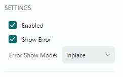
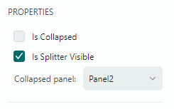

# GroupBox {#groupbox}

[`GroupBox`](../../API/Eremex.AvaloniaUI.Controls.Editors/GroupBox.md) 是一个面板，具有标题和底部的线，从视觉上将 [`GroupBox`](../../API/Eremex.AvaloniaUI.Controls.Editors/GroupBox.md) 与其他控件分开。



[`GroupBox`](../../API/Eremex.AvaloniaUI.Controls.Editors/GroupBox.md) 是 `Avalonia.Controls.Primitives.HeaderedContentControl` 的后代。

## 指定标题 {#specify-a-header}

使用 `Header` 属性设置 [`GroupBox`](../../API/Eremex.AvaloniaUI.Controls.Editors/GroupBox.md) 的标头。 `HeaderTemplate` 属性允许您设置模板以自定义方式呈现控件的标头。

### 相关API {#related-api}

- [`ShowHeader`](../../API/Eremex.AvaloniaUI.Controls.Editors/GroupBox/ShowHeader.md) — 获取或设置标题是否可见。
- [`HeaderHorizontalAlignment`](../../API/Eremex.AvaloniaUI.Controls.Editors/GroupBox/HeaderHorizontalAlignment.md) — 指定标题的水平对齐方式。
- [`HeaderVerticalAlignment`](../../API/Eremex.AvaloniaUI.Controls.Editors/GroupBox/HeaderVerticalAlignment.md) — 指定标题的垂直对齐方式。

## 定义内容 {#define-the-content}

您可以在 XAML 中的开始和结束 `<GroupBox>` 标记之间指定 [`GroupBox`](../../API/Eremex.AvaloniaUI.Controls.Editors/GroupBox.md) 的内容。在代码中，使用继承的 `Content` 属性来实现此目的。您可以设置 `ContentTemplate` 属性来指定用于呈现控件内容的模板。

## 例子 {#example}

以下示例定义了一个显示带有控件的 StackPanel 的 [`GroupBox`](../../API/Eremex.AvaloniaUI.Controls.Editors/GroupBox.md)。



``` xml
xmlns:mxe="https://schemas.eremexcontrols.net/avalonia/editors"

<mxe:GroupBox Header="PROPERTIES">
    <StackPanel>
        <mxe:CheckEditor x:Name="IsCollapsedSelector" 
         Content="Is Collapsed" Classes="LayoutItem"/>
        <mxe:CheckEditor x:Name="IsSplitterVisibleSelector" 
         Content="Is Splitter Visible" IsChecked="True" 
         Classes="LayoutItem"/>
        <DockPanel>
            <Label Content="Collapsed panel:" Classes="LayoutItem"/>
            <mxe:ComboBoxEditor EditorValue="{Binding CollapsedPanel, Mode=TwoWay}" 
            ItemsSource="{mxc:EnumItemsSource EnumType=mxe:SplitContainerControlCollapsePanel}"/>
        </DockPanel>
    </StackPanel>
</mxe:GroupBox>
```

<br>
<br>

<sup>*</sup> 本页面使用机器翻译技术翻译。
