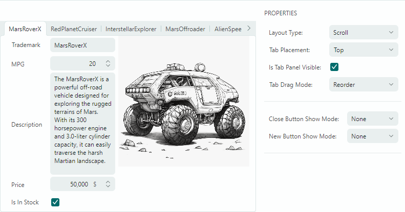

# 实用控件 {#utility-controls}

Eremex Controls 库附带多种实用控件，可帮助您创建功能完善、美观的用户界面。

- [MxTabControl](tabcontrol.md) — 可将面板组合成选项卡式界面的控件。
    - 选项卡数量不受限制。
    - 可从项源填充选项卡及其内容。
    - 可通过拖放重新排列选项卡。
    - 选项卡布局模式：拉伸、滚动和多行。
    - “关闭选项卡”按钮。
    - “新建选项卡”按钮。
    - 选项卡标题区域中的自定义控件。

- [MxSplitButton](splitbutton.md) — 将两个按钮组合在一个控件中。主按钮执行控件的主操作，辅助按钮则打开与 `MxSplitButton` 关联的下拉控件/菜单。
    - 可以使用事件或命令指定主操作。
    - MxSplitButton 的下拉内容可以是弹出菜单，也可以是自定义弹出控件。
    
- [SplitContainerControl](splitcontainercontrol.md) — 用拆分条分隔两个面板。
    - 用户可以拖动拆分条来调整面板大小。
    - 面板可垂直或水平排列。
    - 可以折叠/展开其中一个面板。
    - 可以隐藏拆分条。

- [`ColorEditor`](../../API/Eremex.AvaloniaUI.Controls.Editors/ColorEditor.md) — 允许用户选择颜色的独立控件。
    - ColorEditor 是 PopupColorEditor 控件的组成部分，也可以作为独立控件使用。
    - 三种调色板：默认（Default）、标准（Standard）和自定义（Custom）。
    - 默认调色板可以在代码中初始化。
    - 标准调色板显示预定义的标准颜色。
    - 自定义调色板允许用户使用内置的颜色选取器添加和修改颜色。
    - 可以使用 RGB 和 HSB 格式指定颜色。

<!--TODO Describe ColorEditor
 -->

- [CalendarControl](calendarcontrol.md) — 允许用户选择日期的独立控件。
    - CalendarControl 是 DateEditor 控件的组成部分，也可以作为独立控件使用。
    - 可以使用鼠标和键盘在日历中选择日期。
    - 通过导航栏可以浏览月份和年份。
    - 三种日历视图：月视图、年视图和年份范围视图。
    - 可以限制可选的日期范围。

- [GroupBox](groupbox.md) — 带标题的面板。
    - 可以在控件标题中显示自定义文本。
    - 控件会在客户区下方显示一条线。

- `CircleProgressIndicator` — 以旋转圆圈的形式显示操作进度。

<!-- TODO
Describe CircleProgressIndicator
 -->

 
 

* 本页面使用机器翻译技术翻译。
