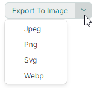
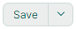
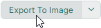
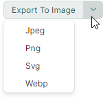
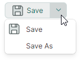

# SplitButton {#splitbutton}

`MxSplitButton` 将两个按钮组合在一个控件中。主按钮执行主操作，该操作可以通过命令或事件实现。辅助按钮会打开关联的下拉控件（菜单），您可以在其中显示自定义内容或命令。

下图展示了一个将 PopupMenu 用作下拉控件的 SplitButton。



创建此按钮的代码如下所示。完整示例请参阅 [DemoCenter 应用程序](../../index.md#demo-application)。

``` xml
xmlns:mx="https://schemas.eremexcontrols.net/avalonia"
xmlns:mxb="https://schemas.eremexcontrols.net/avalonia/bars"

<mx:MxSplitButton Name="splitButton1"
                  Content="Export To Image" Margin="0,8,0,0" 
                  Command="{Binding ExportImageCommand}" 
                  CommandParameter="{x:Static exports:MxImageFormat.Jpeg}" 
                  HorizontalAlignment="Left" Grid.Row="6"
                  >
    <mx:MxSplitButton.DropDownControl>
        <mxb:PopupMenu>
            <mxb:ToolbarButtonItem Header="Jpeg" Command="{Binding ExportImageCommand}" CommandParameter="{x:Static exports:MxImageFormat.Jpeg}"/>
            <mxb:ToolbarButtonItem Header="Png" Command="{Binding ExportImageCommand}" CommandParameter="{x:Static exports:MxImageFormat.Png}"/>
            <mxb:ToolbarButtonItem Header="Svg" Command="{Binding ExportImageCommand}" CommandParameter="{x:Static exports:MxImageFormat.Svg}"/>
            <mxb:ToolbarButtonItem Header="Webp" Command="{Binding ExportImageCommand}" CommandParameter="{x:Static exports:MxImageFormat.Webp}"/>
        </mxb:PopupMenu>
    </mx:MxSplitButton.DropDownControl>
</mx:MxSplitButton>
```

## 内容 {#content}

使用 `Content` 属性为主按钮指定可视内容。

``` xml
<mx:MxSplitButton Content="Save"/>
```



通过 `Content` 属性，您可以在文本旁边显示图像，或以自定义方式调整主按钮的外观。以下示例同时显示图像和文本：

``` xml
xmlns:mx="https://schemas.eremexcontrols.net/avalonia"
xmlns:mxi="https://schemas.eremexcontrols.net/avalonia/icons"

<mx:MxSplitButton Height="27" VerticalContentAlignment="Center" Command="{Binding SaveCommand}">
    <mx:MxSplitButton.Content>
        <StackPanel Orientation="Horizontal" Spacing="5" >
            <Image Source="{x:Static mxi:Basic.Save}" Height="20"/>
            <TextBlock Text="Save" />
        </StackPanel>
    </mx:MxSplitButton.Content>
</mx:MxSplitButton>
```


## 指定主操作 {#specify-the-main-action}

主按钮会触发 `MxSplitButton` 的主操作。



您可以使用以下 API 成员实现此操作：

- `MxSplitButton.Click` 事件 — 单击主按钮时引发的事件。
- `MxSplitButton.Command` 命令 — 单击主按钮时执行的命令。可以使用 `MxSplitButton.CommandParameter` 属性向命令传递参数。

``` xml
<mx:MxSplitButton Content="Save" Command="{Binding SaveCommand}">
```

``` cs
using CommunityToolkit.Mvvm.Input;

public partial class MainWindowViewModel : ViewModelBase
{
    [RelayCommand]
    void Save()
    {
        //...
    }
}
```


## 指定下拉控件 {#specify-the-dropdown-control}

辅助按钮会打开由 `MxSplitButton.DropDownControl` 属性指定的下拉控件/菜单。



可以将 `DropDownControl` 属性设置为以下对象：

- [`Eremex.AvaloniaUI.Controls.Bars.PopupMenu`](../../API/Eremex.AvaloniaUI.Controls.Bars/PopupMenu.md) — 可以承载各种项（按钮、复选按钮、子菜单等）的弹出菜单。有关详细信息，请参阅以下主题：[弹出菜单和上下文菜单](../toolbars-and-menus/popup-and-context-menus.md)。
  
- [`Eremex.AvaloniaUI.Controls.Bars.PopupContainer`](../../API/Eremex.AvaloniaUI.Controls.Bars/PopupContainer.md) — 可以显示自定义内容的弹出控件。

以下示例定义了一个包含两个命令的 [`PopupMenu`](../../API/Eremex.AvaloniaUI.Controls.Bars/PopupMenu.md)，并将其用作 SplitButton 的下拉控件：

``` xml
xmlns:mx="https://schemas.eremexcontrols.net/avalonia"
xmlns:mxi="https://schemas.eremexcontrols.net/avalonia/icons"
xmlns:mxb="https://schemas.eremexcontrols.net/avalonia/bars"

<mx:MxSplitButton Height="27" VerticalContentAlignment="Center" Command="{Binding SaveCommand}">
    <mx:MxSplitButton.Content>
        ...
    </mx:MxSplitButton.Content>

    <mx:MxSplitButton.DropDownControl>
        <mxb:PopupMenu>
            <mxb:ToolbarButtonItem Header="Save" 
                    Glyph="{x:Static mxi:Basic.Save}"
                    GlyphSize="20,20"
                    Command="{Binding SaveCommand}"/>
            <mxb:ToolbarButtonItem Header="Save As" Command="{Binding SaveAsCommand}"/>
        </mxb:PopupMenu>
    </mx:MxSplitButton.DropDownControl>
</mx:MxSplitButton>
```

``` cs
using CommunityToolkit.Mvvm.Input;

public partial class MainWindowViewModel : ViewModelBase
{
    [RelayCommand]
    void Save()
    {
        //...
    }
    [RelayCommand]
    void SaveAs()
    {
        //...
    }
}
```




### 相关 API {#related-api}

- `MxSplitButton.IsPopupOpen` — 获取或设置下拉控件/菜单当前是否处于打开状态。可以使用此属性在代码中打开或关闭下拉控件。


<br>
<br>

<sup>*</sup> 本页面使用机器翻译技术翻译。
