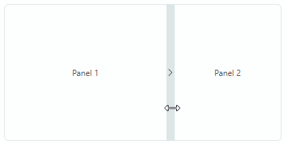
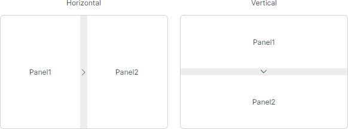
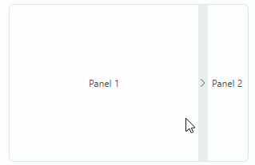

# SplitContainerControl {#splitcontainercontrol}

[`SplitContainerControl`](../../API/Eremex.AvaloniaUI.Controls.Editors/SplitContainerControl.md) 是复合控件，显示由可移动分流器分隔的两个面板。用户可以拖动拆分器来更改面板的大小。他们还可以单击拆分器来折叠选定的面板，然后再次单击拆分器来恢复面板。



控件的主要特点包括：

- 用户可以拖放拆分器来调整面板大小。
- 在代码中设置面板的大小。
- 面板的垂直或水平布置。
- 能够折叠/展开其中一个面板。
- 用于隐藏分离器的选项。

## 指定面板内容 {#specify-content-for-the-panels}

使用 [`SplitContainerControl.Panel1`](../../API/Eremex.AvaloniaUI.Controls.Editors/SplitContainerControl/Panel1.md) 和 [`SplitContainerControl.Panel2`](../../API/Eremex.AvaloniaUI.Controls.Editors/SplitContainerControl/Panel2.md) 属性将内容放置到控件的面板上。支持两种使用场景：

- 使用控件初始化这些属性以显示在面板中。 
- 使用自定义对象初始化这些属性。在这种情况下，使用 [`SplitContainerControl.Panel1Template`](../../API/Eremex.AvaloniaUI.Controls.Editors/SplitContainerControl/Panel1Template.md) 和 [`SplitContainerControl.Panel2Template`](../../API/Eremex.AvaloniaUI.Controls.Editors/SplitContainerControl/Panel2Template.md) 属性来指定将呈现自定义对象的 DataTemplates。

``` xml
<mxe:SplitContainerControl Name="splitContainer"
                            Grid.Row="1"
                            BorderThickness="1" BorderBrush="Gray">
    <mxe:SplitContainerControl.Panel1>
        <Label Content="Panel1" HorizontalAlignment="Center" VerticalAlignment="Center"/>
    </mxe:SplitContainerControl.Panel1>
    <mxe:SplitContainerControl.Panel2>
        <Label Content="Panel2" HorizontalAlignment="Center" VerticalAlignment="Center"/>
    </mxe:SplitContainerControl.Panel2>
</mxe:SplitContainerControl>
```

## 设置面板大小和方向 {#set-panel-size-and-direction}

使用 [`SplitContainerControl.Orientation`](../../API/Eremex.AvaloniaUI.Controls.Editors/SplitContainerControl/Orientation.md) 属性来设置 choose between 的水平（默认）和垂直面板排列。



要设置容器面板的大小，请使用 [`SplitContainerControl.Panel1Length`](../../API/Eremex.AvaloniaUI.Controls.Editors/SplitContainerControl/Panel1Length.md) 或 [`SplitContainerControl.Panel2Length`](../../API/Eremex.AvaloniaUI.Controls.Editors/SplitContainerControl/Panel2Length.md) 属性。

- 在水平方向上，这些属性设置面板的宽度。
- 在垂直方向上，它们设置面板的高度。

[`Panel1MinLength`](../../API/Eremex.AvaloniaUI.Controls.Editors/SplitContainerControl/Panel1MinLength.md)、[`Panel1MaxLength`](../../API/Eremex.AvaloniaUI.Controls.Editors/SplitContainerControl/Panel1MaxLength.md)、[`Panel2MinLength`](../../API/Eremex.AvaloniaUI.Controls.Editors/SplitContainerControl/Panel2MinLength.md) 和 [`Panel2MaxLength`](../../API/Eremex.AvaloniaUI.Controls.Editors/SplitContainerControl/Panel2MaxLength.md) 属性允许您设置面板大小调整约束。  用户无法将面板大小调整到超出这些限制。

## 折叠和恢复面板 {#collapse-and-restore-a-panel}

拆分器中显示的箭头图标表示当用户单击拆分器时面板将折叠。在折叠状态下，分离器的箭头图标会反转其方向。用户可以再次单击拆分器来恢复面板。



[`SplitContainerControl.CollapsePanel`](../../API/Eremex.AvaloniaUI.Controls.Editors/SplitContainerControl/CollapsePanel.md) 属性允许您指定可折叠面板。该属性的默认值为_Panel2_。

要在代码中折叠和恢复面板，请使用 [`IsCollapsed`](../../API/Eremex.AvaloniaUI.Controls.Editors/SplitContainerControl/IsCollapsed.md) 属性。

## 禁用面板折叠 {#disable-panel-collapsing}

将 [`SplitContainerControl.CollapsePanel`](../../API/Eremex.AvaloniaUI.Controls.Editors/SplitContainerControl/CollapsePanel.md) 属性设置为 `None` 以禁用面板折叠功能。在此模式下，拆分器不显示箭头图标。

## 隐藏分离器 {#hide-the-splitter}

使用 [`SplitContainerControl.IsSplitterVisible`](../../API/Eremex.AvaloniaUI.Controls.Editors/SplitContainerControl/IsSplitterVisible.md) 属性至 `false` 可在特定情况下隐藏拆分器。这防止用户在面板上执行调整大小和折叠/恢复操作。

<br>
<br>

<sup>*</sup> 本页面使用机器翻译技术翻译。
