# TabControl {#tabcontrol}

[`MxTabControl`](../../API/Eremex.AvaloniaUI.Controls/MxTabControl.md) 控件可将面板组织成选项卡式界面。用户单击相应的选项卡即可激活特定面板。

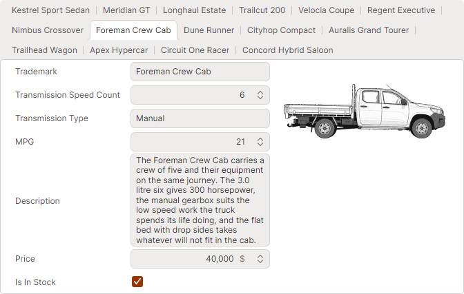

[`MxTabControl`](../../API/Eremex.AvaloniaUI.Controls/MxTabControl.md) 派生自标准的 `Avalonia.Controls.TabControl` 控件。它继承了 `TabControl` 的基本功能，并通过以下附加功能对其进行了扩展：

- 选项卡数量不受限制。
- 可从项源填充选项卡及其内容。
- 可通过拖放重新排列选项卡。
- 选项卡布局模式：拉伸（Stretch）、滚动（Scroll）和多行（Multi-line）。
- 灵活的选项卡宽度设置，包括按内容、按最宽内容或固定宽度。
- 选项卡拉伸以填满控件。
- 可配置的图标可见性，以及空间不足时自动折叠文本。
- “关闭选项卡”按钮。
- “新建选项卡”按钮。
- 选项卡标题区域中的自定义控件。

## 创建选项卡 {#create-tabs}

[`MxTabControl`](../../API/Eremex.AvaloniaUI.Controls/MxTabControl.md) 从基类 `Avalonia.Controls.TabControl` 继承了创建选项卡的功能。这些控件支持两种添加选项卡的方式：

- 手动添加选项卡项
- 从项源填充选项卡及其内容。

### 手动添加选项卡项 {#add-tab-items-manually}

[`MxTabControl`](../../API/Eremex.AvaloniaUI.Controls/MxTabControl.md) 控件中的选项卡项由 [`MxTabItem`](../../API/Eremex.AvaloniaUI.Controls/MxTabItem.md) 对象封装。这些对象提供用于设置选项卡标题内容、选项卡标题图标、选中状态等的设置。以下列表介绍了 [`MxTabItem`](../../API/Eremex.AvaloniaUI.Controls/MxTabItem.md) 的主要公共成员（包括继承的成员）：

- `Header` — 获取或设置选项卡标题内容。
- `HeaderTemplate` — 获取或设置用于呈现 `Header` 的数据模板。
- [`Glyph`](../../API/Eremex.AvaloniaUI.Controls/MxTabItem/Glyph.md) — 获取或设置选项卡标题中显示的图标。
- [`GlyphSize`](../../API/Eremex.AvaloniaUI.Controls/MxTabItem/GlyphSize.md) — 获取或设置选项卡标题图标的显示大小。
- `IsSelected` — 获取或设置选项卡的选中状态。
- [`CloseCommand`](../../API/Eremex.AvaloniaUI.Controls/MxTabItem/CloseCommand.md) — 获取或设置单击此选项卡的关闭按钮时执行的命令。
- [`CloseCommandParameter`](../../API/Eremex.AvaloniaUI.Controls/MxTabItem/CloseCommandParameter.md) — 获取或设置传递给 [`CloseCommand`](../../API/Eremex.AvaloniaUI.Controls/MxTabItem/CloseCommand.md) 的参数。

#### 示例 {#example}

以下示例创建两个包含预定义内容（编辑器和标签）的选项卡。

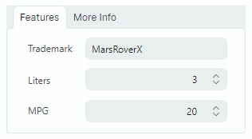

``` xml
xmlns:mx="https://schemas.eremexcontrols.net/avalonia"
xmlns:mxe="https://schemas.eremexcontrols.net/avalonia/editors"

<mx:MxTabControl Margin="5" Height="160" Name="tabControl1" Width="300">
    <mx:MxTabItem Header="Features">
        <Grid RowDefinitions="Auto Auto Auto" ColumnDefinitions="Auto *" Margin="5">
            <Label Classes="LayoutItem" Grid.Column="0" Grid.Row="0" Content="Trademark"/>
            <mxe:TextEditor EditorValue="{Binding SelectedCar.Trademark}" Margin="5" 
             Height="20" Grid.Row="0" Grid.Column="1"/>
            <Label Classes="LayoutItem" Grid.Column="0" Grid.Row="1" Content="Liters"/>
            <mxe:SpinEditor EditorValue="{Binding SelectedCar.Liter}" Margin="5" 
             Height="20" Grid.Row="1" Grid.Column="1"/>
            <Label Classes="LayoutItem" Grid.Column="0" Grid.Row="2" Content="MPG"/>
            <mxe:SpinEditor EditorValue="{Binding SelectedCar.MPG}" Margin="5" 
             Height="20" Grid.Row="2" Grid.Column="1"/>
        </Grid>
    </mx:MxTabItem>
    <mx:MxTabItem Header="More Info" >
        <mxe:TextEditor Margin="5" EditorValue="{Binding SelectedCar.Description}" 
         TextWrapping="Wrap" VerticalAlignment="Stretch"/>
    </mx:MxTabItem>
</mx:MxTabControl>
```

### 从项源填充选项卡 {#populate-tabs-from-an-items-source}

[`MxTabControl`](../../API/Eremex.AvaloniaUI.Controls/MxTabControl.md) 的祖先类之一是 `Avalonia.Controls.ItemsControl` 类，因此可以使用项源中的项填充 TabControl。为此，请使用以下主要属性：

- `ItemsSource` — 指定包含要呈现为选项卡的项的源。
- `ItemTemplate` — 指定用于呈现选项卡标题的 DataTemplate。
- `ContentTemplate` — 指定用于呈现选项卡内容的 DataTemplate。

#### 示例 {#example_1}

以下示例将 [`MxTabControl`](../../API/Eremex.AvaloniaUI.Controls/MxTabControl.md) 控件绑定到项源，并指定用于呈现选项卡标题和内容的 DataTemplate。

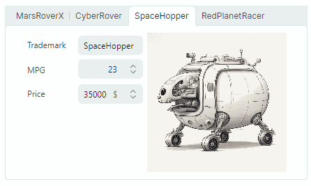

``` xml
xmlns:mx="https://schemas.eremexcontrols.net/avalonia"
xmlns:mxe="https://schemas.eremexcontrols.net/avalonia/editors"

<mx:MxTabControl ItemsSource="{Binding Cars}" SelectedItem="{Binding SelectedCar}">
    <mx:MxTabControl.ItemTemplate>
        <DataTemplate DataType="demoData:CarInfo">
            <TextBlock Text="{Binding Trademark}"></TextBlock>
        </DataTemplate>
    </mx:MxTabControl.ItemTemplate>

    <mx:MxTabControl.ContentTemplate>
        <DataTemplate DataType="demoData:CarInfo">
            <StackPanel Orientation="Horizontal" Margin="10">
                <Grid RowDefinitions="Auto Auto Auto" ColumnDefinitions="Auto *">
                    <Label Classes="LayoutItem" Grid.Column="0" Grid.Row="0" Content="Trademark"/>
                    <mxe:TextEditor Classes="LayoutItem"  Grid.Column="1" Grid.Row="0" 
                     EditorValue="{Binding Trademark}"/>

                    <Label Classes="LayoutItem" Grid.Column="0" Grid.Row="1" Content="MPG"/>
                    <mxe:SpinEditor Classes="LayoutItem" Grid.Column="1" Grid.Row="1" 
                     EditorValue="{Binding  MPG}" Minimum="0"/>

                    <Label Classes="LayoutItem" Grid.Column="0" Grid.Row="2" Content="Price"/>
                    <mxe:SpinEditor Classes="LayoutItem" Grid.Column="1" Grid.Row="2" 
                     EditorValue="{Binding  Price}" Suffix="{Binding Currency}" Minimum="0"/>
                </Grid>
                <Image Grid.Column="1" Width="200" Source="{Binding Image}" VerticalAlignment="Top"/>
            </StackPanel>
        </DataTemplate>
    </mx:MxTabControl.ContentTemplate>
</mx:MxTabControl>
```

#### 使用项源时指定选项卡标题图标 {#specify-tab-header-icons-when-using-an-items-source}

要在选项卡标题中显示图标，请为选项卡指定 [`MxTabItem.Glyph`](../../API/Eremex.AvaloniaUI.Controls/MxTabItem/Glyph.md) 属性。
从项源填充选项卡时，无法直接初始化 [`MxTabItem.Glyph`](../../API/Eremex.AvaloniaUI.Controls/MxTabItem/Glyph.md) 属性。请改为在 `MxTabControl.Styles` 集合中创建 `Style` 来设置该属性。该样式必须以 [`MxTabItem`](../../API/Eremex.AvaloniaUI.Controls/MxTabItem.md) 类为目标。如需限制选项卡标题图标的显示大小，请在 `Style` 中设置 [`MxTabItem.GlyphSize`](../../API/Eremex.AvaloniaUI.Controls/MxTabItem/GlyphSize.md) 属性。

##### 示例 - 指定选项卡标题图标 {#example-assign-tab-header-icons}

以下示例在从项源填充选项卡时为选项卡指定图标。

在此示例中，选项卡控件绑定到 _Cars_ 源，该源存储 _CarInfo_ 对象的集合。因此，每个选项卡的数据上下文都是 _CarInfo_ 对象。

要设置选项卡标题图标，需创建一个以 [`MxTabItem`](../../API/Eremex.AvaloniaUI.Controls/MxTabItem.md) 为目标的 `Style`。该样式将 [`MxTabItem.Glyph`](../../API/Eremex.AvaloniaUI.Controls/MxTabItem/Glyph.md) 属性绑定到 _CarInfo.SmallImage_ 属性。

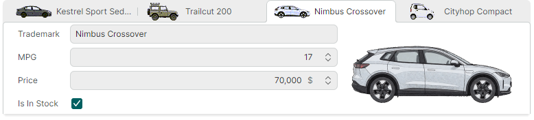

``` xml
<mx:MxTabControl ItemsSource="{Binding Cars}" >
    <mx:MxTabControl.Styles>
        <Style Selector="mx|MxTabItem" x:DataType="demoData:CarInfo">
            <Setter Property="Glyph" Value="{Binding SmallImage}"/>
            <Setter Property="GlyphSize" Value="57 32"/>
        </Style>
    </mx:MxTabControl.Styles>
</mx:MxTabControl>
```


## 选择选项卡 {#select-a-tab}

使用以下属性选择选项卡和获取所选选项卡：

- `SelectedIndex` — 指定所选选项卡在所有选项卡中从零开始的索引。可以使用 `MxTabControl.Items` 属性访问选项卡集合。
- `SelectedItem` — 指定所选选项卡的项。如果使用 [`MxTabItem`](../../API/Eremex.AvaloniaUI.Controls/MxTabItem.md) 对象手动向 TabControl 添加选项卡，则 `SelectedItem` 属性指定所选的 [`MxTabItem`](../../API/Eremex.AvaloniaUI.Controls/MxTabItem.md) 对象。如果 TabControl 从项源填充，则 `SelectedItem` 属性指定所绑定项源中与所选选项卡对应的数据对象。

`SelectedValue` 属性指定所选选项卡的值。此属性返回以下值：

- `null`：如果使用 [`MxTabItem`](../../API/Eremex.AvaloniaUI.Controls/MxTabItem.md) 对象手动向 TabControl 添加选项卡。
- 选项卡的基础数据对象：如果 TabControl 从项源填充。

以下属性用于返回所选选项卡的内容：

- `SelectedContent` — 指定所选选项卡的内容。
- `SelectedContentTemplate` — 指定所选选项卡的内容模板。

## 选项卡排列和大小 {#tab-arrangement-and-size}

默认情况下，选项卡标题沿 TabControl 的上边缘显示。可以使用 `TabStripPlacement` 属性指定选项卡标题的位置。

TabControl 支持三种选项卡标题布局模式。使用 [`MxTabControl.TabStripLayoutType`](../../API/Eremex.AvaloniaUI.Controls/MxTabControl/TabStripLayoutType.md) 属性指定选项卡标题的排列方式：

- `Scroll` — 选项卡标题的宽度足以显示其内容。如果空间不足以完整显示所有选项卡标题，选项卡标题区域中会出现滚动按钮。

    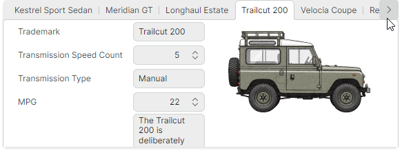

- `MultiLine` — 如果空间不足以在一行中显示所有选项卡标题，则将其排列成多行。

    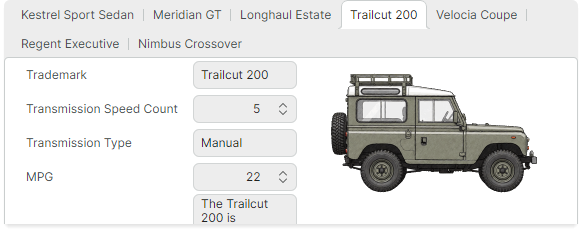

- `Stretch` — 所有选项卡标题排列在一行中，不进行滚动。如果标题的总宽度超过控件的宽度，选项卡会缩小以适应可用宽度。

    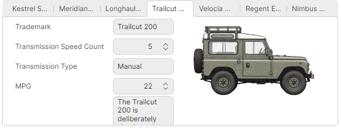


### 选项卡拉伸 {#tab-stretching}

如果选项卡的总宽度小于控件的宽度，选项卡不会扩展以填满可用空间。要将选项卡拉伸到控件的宽度，请将 [`StretchTabsToFill`](../../API/Eremex.AvaloniaUI.Controls/MxTabControl/StretchTabsToFill.md) 属性设置为 `true`。

**[`StretchTabsToFill`](../../API/Eremex.AvaloniaUI.Controls/MxTabControl/StretchTabsToFill.md) 为 `false`：**

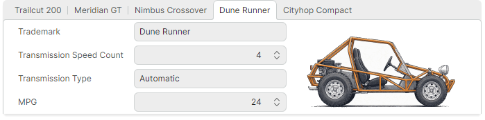

**[`StretchTabsToFill`](../../API/Eremex.AvaloniaUI.Controls/MxTabControl/StretchTabsToFill.md) 为 `true`：**

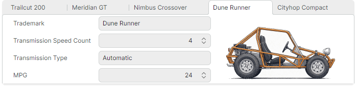


### 选项卡大小 {#tab-size}

[`TabSizeMode`](../../API/Eremex.AvaloniaUI.Controls/TabSizeMode.md) 属性用于指定选项卡宽度的计算方式。提供以下模式：

- `Default` — 选项卡的默认宽度取决于 [`TabStripLayoutType`](../../API/Eremex.AvaloniaUI.Controls/TabStripLayoutType.md) 选项：
    - 当 [`TabStripLayoutType`](../../API/Eremex.AvaloniaUI.Controls/TabStripLayoutType.md) 设置为 `Stretch` 时，选项卡宽度由 [`TabSize`](../../API/Eremex.AvaloniaUI.Controls/MxTabControl/TabSize.md) 属性指定。
    - 在其他布局类型中，选项卡的大小根据其内容调整，等同于 [`TabSizeMode.Content`](../../API/Eremex.AvaloniaUI.Controls/TabSizeMode.md) 模式。
- `Explicit` — 选项卡的宽度由 [`TabSize`](../../API/Eremex.AvaloniaUI.Controls/MxTabControl/TabSize.md) 属性指定。
- `Content` — 根据文本和图标调整每个选项卡标题的大小。

    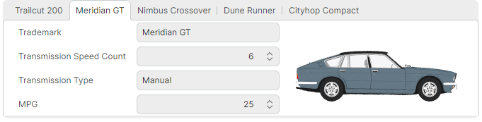

- `LargestContent` — 所有选项卡的宽度与最宽的可见选项卡标题一致。

    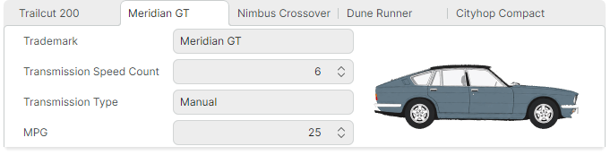

[`TabSize`](../../API/Eremex.AvaloniaUI.Controls/MxTabControl/TabSize.md) 属性允许您为所有选项卡应用固定宽度。此属性在以下情况下生效：

- [`TabSizeMode`](../../API/Eremex.AvaloniaUI.Controls/TabSizeMode.md) 属性设置为 `Explicit` 时
- [`TabSizeMode`](../../API/Eremex.AvaloniaUI.Controls/TabSizeMode.md) 属性为 `Default` 且 [`TabStripLayoutType`](../../API/Eremex.AvaloniaUI.Controls/TabStripLayoutType.md) 为 `Stretch` 时。


### 选项卡图标和文本折叠 {#tab-icons-and-text-collapse}

当选项卡控件的宽度（垂直方向时为高度）受限时，选项卡标题可以隐藏文本，只显示图标。可以使用 [`TabIconDisplayMode`](../../API/Eremex.AvaloniaUI.Controls/TabIconDisplayMode.md) 和 [`TabHeaderCollapseThreshold`](../../API/Eremex.AvaloniaUI.Controls/MxTabControl/TabHeaderCollapseThreshold.md) 属性控制此行为。

[`TabIconDisplayMode`](../../API/Eremex.AvaloniaUI.Controls/TabIconDisplayMode.md) 属性决定选项卡图标何时可见：

- `Always`（默认）— 在标题文本旁显示图标，文本折叠后图标仍保持可见。
- `WhenTextCollapsed` — 仅在标题文本折叠时显示图标。文本可见时，图标隐藏。
- `Never` — 从不显示图标。


[`TabHeaderCollapseThreshold`](../../API/Eremex.AvaloniaUI.Controls/MxTabControl/TabHeaderCollapseThreshold.md) 属性指定标题长度（以设备无关像素为单位），当标题长度小于或等于该值时，标题文本将折叠（由图标替换）。值为 `0` 时禁用以图标替换文本。


## 重新排列选项卡 {#tab-re-ordering}

如果 [`MxTabControl.TabDragMode`](../../API/Eremex.AvaloniaUI.Controls/MxTabControl/TabDragMode.md) 属性设置为 `Reorder`，用户可以通过拖放重新排列选项卡。

处理 [`TabItemStartDragging`](../../API/Eremex.AvaloniaUI.Controls/MxTabControl/TabItemStartDragging.md) 和 [`TabItemCompleteDragging`](../../API/Eremex.AvaloniaUI.Controls/MxTabControl/TabItemCompleteDragging.md) 事件，可以在拖动选项卡时取消拖动操作或执行其他操作。

## “关闭”按钮 {#close-buttons}

TabControl 支持内置的“关闭选项卡”（'x'）按钮。根据 [`MxTabControl.CloseButtonShowMode`](../../API/Eremex.AvaloniaUI.Controls/MxTabControl/CloseButtonShowMode.md) 属性的设置，这些按钮可以显示在选项卡中和/或选项卡标题区域中。

默认情况下，“关闭选项卡”按钮不执行任何操作。您需要使用以下任一方法实现“关闭”按钮的操作：

- 处理 [`MxTabControl.CloseButtonClick`](../../API/Eremex.AvaloniaUI.Controls/MxTabControl/CloseButtonClick.md) 事件。
- 使用 [`MxTabItem.CloseCommand`](../../API/Eremex.AvaloniaUI.Controls/MxTabItem/CloseCommand.md) 成员指定命令。

## “新建选项卡”按钮 {#new-tab-button}

将 [`MxTabControl.NewButtonShowMode`](../../API/Eremex.AvaloniaUI.Controls/MxTabControl/NewButtonShowMode.md) 属性设置为 `InHeaderPanel` 可显示“新建选项卡”（'+'）按钮。默认情况下，单击此按钮不执行任何操作。可以使用以下成员指定操作：

- [`MxTabControl.NewButtonClick`](../../API/Eremex.AvaloniaUI.Controls/MxTabControl/NewButtonClick.md) 事件。
- [`MxTabControl.NewCommand`](../../API/Eremex.AvaloniaUI.Controls/MxTabControl/NewCommand.md) 命令。

## 选项卡标题区域中的自定义控件 {#custom-controls-in-the-tab-header-area}

可以使用 [`ControlBoxContent`](../../API/Eremex.AvaloniaUI.Controls/MxTabControl/ControlBoxContent.md) 和 [`ControlBoxContentTemplate`](../../API/Eremex.AvaloniaUI.Controls/MxTabControl/ControlBoxContentTemplate.md) 属性向选项卡标题区域添加自定义控件。

### 示例 {#example_2}

以下示例向选项卡标题区域添加“?”按钮。单击该按钮会执行 _HelpCommand_ 命令，当前所选选项卡的项将作为命令参数传递。

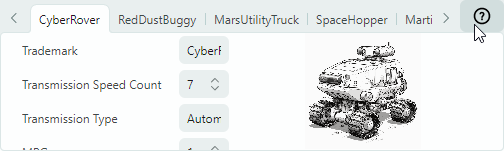

``` xml
xmlns:mx="https://schemas.eremexcontrols.net/avalonia"
x:Class="SampleTabControl.TabControlPageView"
xmlns:vm="using:SampleTabControl"
x:DataType="vm:TabControlPageViewModel"

<mx:MxTabControl ItemsSource="{Binding Cars}"
                SelectedItem="{Binding SelectedCar}"
                x:Name="TabControl"
    >
    <mx:MxTabControl.ControlBoxContent>
        <Button Command="{Binding HelpCommand}" 
         CommandParameter="{Binding $parent.SelectedItem}">
            <Image Width="20" Height="20"  
             Source="{SvgImage 'avares://SampleTabControl/Images/help-icon.svg'}"/>
        </Button>
    </mx:MxTabControl.ControlBoxContent>
    ...
</mx:MxTabControl>
```
``` csharp
public partial class TabControlPageViewModel : PageViewModelBase
{
    //...
    [RelayCommand]
    private void Help(object parameter)
    {
        //...
    }
}
```


<br>
<br>

<sup>*</sup> 本页面使用机器翻译技术翻译。
