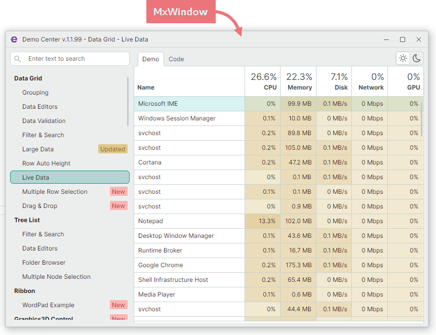
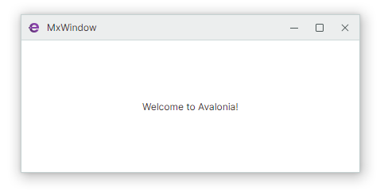
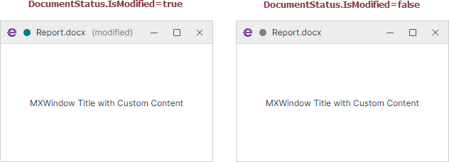
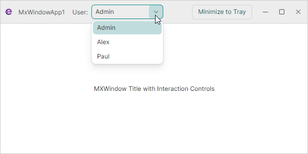

# MxWindow {#mxwindow}

如果您正在使用 Eremex Avalonia UI 控件,建议在应用程序的主窗口和其他窗口中使用 [`MxWindow`](../../API/Eremex.AvaloniaUI.Controls.Common/MxWindow.md) 组件。这可以使您在整个 Avalonia UI 项目中保持一致的用户界面。

[`MxWindow`](../../API/Eremex.AvaloniaUI.Controls.Common/MxWindow.md) 是一种窗口,它根据 [Eremex 视觉主题](../themes/index.md) 绘制其元素(背景、边框和标题栏)。



## 添加主题包并注册绘制主题 {#add-theme-package-and-register-a-paint-theme}

要使用 [`MxWindow`](../../API/Eremex.AvaloniaUI.Controls.Common/MxWindow.md) 和其他 Eremex Avalonia UI 控件,请引入包含 Eremex 绘制主题的[程序包](../../whats-included/assemblies.md)。下面的主题展示了如何在您的应用程序中注册绘制主题: 

- [注册 Eremex 绘制主题](../themes/register-an-eremex-paint-theme.md)。


## 创建 MxWindow {#create-mxwindow}

[`MxWindow`](../../API/Eremex.AvaloniaUI.Controls.Common/MxWindow.md) 是标准 Avalonia UI `Window` 组件的派生类。您可以将现有应用程序中的 `Window` 组件无缝替换为 [`MxWindow`](../../API/Eremex.AvaloniaUI.Controls.Common/MxWindow.md),以使用 Eremex 绘制主题。以下 XAML 代码展示了一个示例 [`MxWindow`](../../API/Eremex.AvaloniaUI.Controls.Common/MxWindow.md) 对象声明:

``` xml
<mx:MxWindow 
    xmlns:mx="https://schemas.eremexcontrols.net/avalonia"
    Title="MxWindow"
    ...
>

</mx:MxWindow>
```

[Eremex 项目模板](../../whats-included/project-templates.md)允许您创建带有 Eremex Controls 的新 Avalonia UI 应用程序。这些模板创建的新项目中,主窗口由 [`MxWindow`](../../API/Eremex.AvaloniaUI.Controls.Common/MxWindow.md) 组件封装。



## MxWindow 设置 {#mxwindow-settings}

[`MxWindow`](../../API/Eremex.AvaloniaUI.Controls.Common/MxWindow.md) 在标准 `Window` 组件公开的设置基础上扩展了以下选项,用于指定标题栏中标准按钮的可见性和图形:

- [`ShowCloseButton`](../../API/Eremex.AvaloniaUI.Controls.Common/MxWindow/ShowCloseButton.md) — 指定关闭按钮的可见性。
- [`ShowMaximizeButton`](../../API/Eremex.AvaloniaUI.Controls.Common/MxWindow/ShowMaximizeButton.md) — 指定最大化按钮的可见性。
- [`ShowMinimizeButton`](../../API/Eremex.AvaloniaUI.Controls.Common/MxWindow/ShowMinimizeButton.md) — 指定最小化按钮的可见性。

- [`CloseButtonGlyph`](../../API/Eremex.AvaloniaUI.Controls.Common/MxWindow/CloseButtonGlyph.md) — 关闭按钮的图形。
- [`MaximizeButtonGlyph`](../../API/Eremex.AvaloniaUI.Controls.Common/MxWindow/MaximizeButtonGlyph.md) — 最大化按钮的图形。
- [`MinimizeButtonGlyph`](../../API/Eremex.AvaloniaUI.Controls.Common/MxWindow/MinimizeButtonGlyph.md) — 最小化按钮的图形。
- [`RestoreButtonGlyph`](../../API/Eremex.AvaloniaUI.Controls.Common/MxWindow/RestoreButtonGlyph.md) — 还原按钮的图形。

## 向 MxWindow 标题栏添加自定义内容 {#add-custom-content-to-the-mxwindow-title-bar}

[`MxWindow`](../../API/Eremex.AvaloniaUI.Controls.Common/MxWindow.md) 允许您将自定义控件（标签、下拉列表、按钮、状态指示器）放置在窗口标题栏中、系统窗口按钮（控制框）的左侧。有两个属性控制此区域：

- [`MxWindow.Header`](../../API/Eremex.AvaloniaUI.Controls.Common/MxWindow/Header.md) — 获取或设置标题栏中显示的自定义内容。如果设置了 [`Header`](../../API/Eremex.AvaloniaUI.Controls.Common/MxWindow/Header.md)，它将替代窗口的 `Title` 属性。
- [`MxWindow.HeaderTemplate`](../../API/Eremex.AvaloniaUI.Controls.Common/MxWindow/HeaderTemplate.md) — 获取或设置定义 [`Header`](../../API/Eremex.AvaloniaUI.Controls.Common/MxWindow/Header.md) 对象呈现方式的模板。

[`ActualHeader`](../../API/Eremex.AvaloniaUI.Controls.Common/MxWindow/ActualHeader.md) 属性返回最终显示的内容：如果设置了 [`Header`](../../API/Eremex.AvaloniaUI.Controls.Common/MxWindow/Header.md)，则返回 [`Header`](../../API/Eremex.AvaloniaUI.Controls.Common/MxWindow/Header.md) 对象，否则返回 `Title`。


### 示例 - 在标题栏中显示文档状态 {#example-display-a-document-status-in-a-title-bar}

此示例使用通过 [`HeaderTemplate`](../../API/Eremex.AvaloniaUI.Controls.Common/MxWindow/HeaderTemplate.md) 指定的自定义模板，从分配给 [`Header`](../../API/Eremex.AvaloniaUI.Controls.Common/MxWindow/Header.md) 属性的 _DocumentStatus_ 对象呈现窗口标题。

_DocumentStatus_ 对象包含文件名和修改标志。[`HeaderTemplate`](../../API/Eremex.AvaloniaUI.Controls.Common/MxWindow/HeaderTemplate.md) 将该对象呈现为一个彩色指示器，后跟文件名。



窗口 XAML

```xml
<mx:MxWindow ...
        xmlns:mx="https://schemas.eremexcontrols.net/avalonia"
        xmlns:mxcommon="clr-namespace:Eremex.AvaloniaUI.Controls.Common;assembly=Eremex.Avalonia.Controls"
        xmlns:vm="using:MxWindowApp10.ViewModels"
        x:DataType="vm:MainWindowViewModel"
        Title="MxWindowApp1"
        Header="{Binding DocumentStatus}">

    <mxcommon:MxWindow.HeaderTemplate>
        <DataTemplate x:DataType="vm:DocumentStatus">
            <StackPanel Orientation="Horizontal" VerticalAlignment="Center" Spacing="8">
                <!-- Teal dot when modified -->
                <Ellipse Width="10" Height="10" VerticalAlignment="Center"
                         Fill="Teal"
                         IsVisible="{Binding IsModified}" />

                <!-- Gray dot when not modified -->
                <Ellipse Width="10" Height="10" VerticalAlignment="Center"
                         Fill="Gray"
                         IsVisible="{Binding !IsModified}" />

                <TextBlock Text="{Binding FileName}" VerticalAlignment="Center" />

                <TextBlock Text="(modified)"
                           VerticalAlignment="Center"
                           IsVisible="{Binding IsModified}"
                           Foreground="Gray" />

            </StackPanel>
        </DataTemplate>
    </mxcommon:MxWindow.HeaderTemplate>

    <TextBlock Text="MXWindow Title with Custom Content" HorizontalAlignment="Center" VerticalAlignment="Center"/>
</mx:MxWindow>
```

ViewModel

```csharp
using CommunityToolkit.Mvvm.ComponentModel;

namespace MxWindowApp10.ViewModels;

public partial class MainWindowViewModel : ViewModelBase
{
    [ObservableProperty]
    private DocumentStatus documentStatus;

    public MainWindowViewModel()
    {
        DocumentStatus = new DocumentStatus
        {
            FileName = "Report.docx",
            IsModified = true
        };
    }
}

public partial class DocumentStatus : ObservableObject
{
    [ObservableProperty]
    private string fileName;

    [ObservableProperty]
    private bool isModified;
}
```


### 示例 - 在标题栏中显示交互控件 {#example-display-interaction-controls-in-a-title-bar}

此示例使用 [`HeaderTemplate`](../../API/Eremex.AvaloniaUI.Controls.Common/MxWindow/HeaderTemplate.md) 属性显示原始窗口标题，并向标题栏添加交互控件。[`Header`](../../API/Eremex.AvaloniaUI.Controls.Common/MxWindow/Header.md) 属性未设置。

此示例中的标题栏显示以下项：

- 原始窗口标题，读取自 `MxWindow.Title` 属性
- “User: ”标签和绑定到 ViewModel 中 `Accounts` 和 `SelectedAccount` 属性的账户选择器（[`ComboBoxEditor`](../../API/Eremex.AvaloniaUI.Controls.Editors/ComboBoxEditor.md)）
- 右侧的“Minimize to Tray”按钮



选择账户会自动更新 ViewModel 中的 `SelectedAccount` 属性。要响应该选择，请使用为可观察属性 `SelectedAccount` 生成的 `OnSelectedAccountChanged` 分部方法。


窗口 XAML

```xml
<mx:MxWindow ...
             xmlns:vm="using:MxWindowApp1.ViewModels"
             xmlns:mx="https://schemas.eremexcontrols.net/avalonia"
             xmlns:mxcommon="clr-namespace:Eremex.AvaloniaUI.Controls.Common;assembly=Eremex.Avalonia.Controls"
             xmlns:mxe="https://schemas.eremexcontrols.net/avalonia/editors"
             x:DataType="vm:MainWindowViewModel"
             Title="MxWindowApp1"
             >

    <Design.DataContext>
        <vm:MainWindowViewModel/>
    </Design.DataContext>

    <mxcommon:MxWindow.HeaderTemplate>
        <DataTemplate>
            <DockPanel LastChildFill="False" VerticalAlignment="Center">
                <Label DockPanel.Dock="Left"
                       VerticalAlignment="Center"
                       Content="{Binding $parent[mxcommon:MxWindow].Title}" />

                <Label DockPanel.Dock="Left"
                       VerticalAlignment="Center"
                       Content="User: " Margin="8,0,0,0"/>

                <mxe:ComboBoxEditor DockPanel.Dock="Left"
                                    x:Name="accountComboBox"
                                    Margin="0,0,8,0"
                                    VerticalAlignment="Center"
                                    ItemsSource="{Binding $parent[mxcommon:MxWindow].DataContext.Accounts}"
                                    DisplayMember="Name"
                                    EditorValue="{Binding $parent[mxcommon:MxWindow].DataContext.SelectedAccount, Mode=TwoWay}"
                                    SelectionMode="Single"
                                    MinWidth="140" />

                <Button DockPanel.Dock="Right"
                        x:Name="btnMinimize"
                        VerticalAlignment="Center"
                        Content="Minimize to Tray"
                        Click="btnMinimizeB_Click" />
            </DockPanel>
        </DataTemplate>
    </mxcommon:MxWindow.HeaderTemplate>

    <TextBlock Text="MXWindow Title with Interaction Controls" HorizontalAlignment="Center" VerticalAlignment="Center"/>
</mx:MxWindow>
```

窗口代码隐藏

``` cs
using Eremex.AvaloniaUI.Controls.Common;
using MxWindowApp1.ViewModels;

namespace MxWindowApp1.Views;

public partial class MainWindow : MxWindow
{
    public MainWindow()
    {
        this.DataContext = new MainWindowViewModel();
        InitializeComponent();
    }

    private void btnMinimizeB_Click(object sender, Avalonia.Interactivity.RoutedEventArgs e)
    {
        //...
    }
}
```

ViewModel

```cs
using CommunityToolkit.Mvvm.ComponentModel;
using System.Collections.ObjectModel;

namespace MxWindowApp1.ViewModels;

public partial class MainWindowViewModel : ViewModelBase
{

    [ObservableProperty]
    private ObservableCollection<Account> accounts;

    [ObservableProperty]
    private Account selectedAccount;
    
    public MainWindowViewModel()
    {
        Accounts = new ObservableCollection<Account>
        {
            new Account(1, "Admin"),
            new Account(2, "Alex"),
            new Account(3, "Paul"),
        };

        SelectedAccount = Accounts[0];
    }

    partial void OnSelectedAccountChanged(Account value)
    {
        // Runs whenever the user picks a different account
        if (value.Name == "Admin")
        {
            //...
        }
    }
}

public partial class Account : ObservableObject
{
    public Account(int accountId, string name)
    {
        AccountId = accountId;
        Name = name;
    }

    [ObservableProperty]
    private int accountId;

    [ObservableProperty]
    private string name;
}
```


<br>
<br>

<sup>*</sup> 本页面使用机器翻译技术翻译。
