# 激活和管理本地许可证 {#activate-and-manage-local-licenses}

本地许可证是一种绑定到单台计算机（或工作站）的软件许可证。本主题介绍如何在开发者的计算机上部署和管理本地许可证。

## 许可证管理工具 {#license-management-utilities}

EMX Controls 库的所有许可证类型（本地许可证和[网络许可证](activate-and-manage-network-licenses.md)）均通过来自 [Guardant](https://guardant.com) 的两款工具进行管理：_Guardant Control Center_ 和 _Guardant License Wizard_。您可以通过以下链接下载这些工具：

- [Guardant License Management Redistributables (Windows)](../resources/Guardant_Redistributable_Windows.zip)
- [Guardant License Management Redistributables (Linux)](../resources/Guardant_Redistributable_Linux.zip)


**_Guardant Control Center_**

许可证管理服务。

_安装文件_：

- Windows：`grdcontrol-x.x.msi`
- Linux：`grdcontrol-x.x_amd64.deb`、`grdcontrol-x.x.x86_64.rpm`

!!! Note

    开发者的计算机上必须安装并运行 _Guardant Control Center_，以管理许可证并监控其使用情况。请勿卸载、停止或禁用该服务；否则 EMX Controls 库无法验证其许可证，并会显示试用版消息。

**_Guardant License Wizard_**

一个图形界面和命令行工具，可用于添加、更新和转移许可证。

_可执行文件_：

- Windows：`license_wizard.exe`
- Linux：`license_wizard`

要获取所有命令行选项的信息，请运行以下命令：

<code>license_wizard --help</code>


## 使用软件密钥在线激活许可证 (Guardant DL) {#online-license-activation-using-a-software-key-guardant-dl}

### 从命令行 {#from-the-command-line}

```
license_wizard --console --activate &lt;LICENSE-KEY&gt; --host https://getlicense.guardant.ru
```

### 从界面 {#from-the-ui}

1. 确保已安装并运行 _Guardant Control Center_。

2. 运行 _Guardant License Wizard_。

    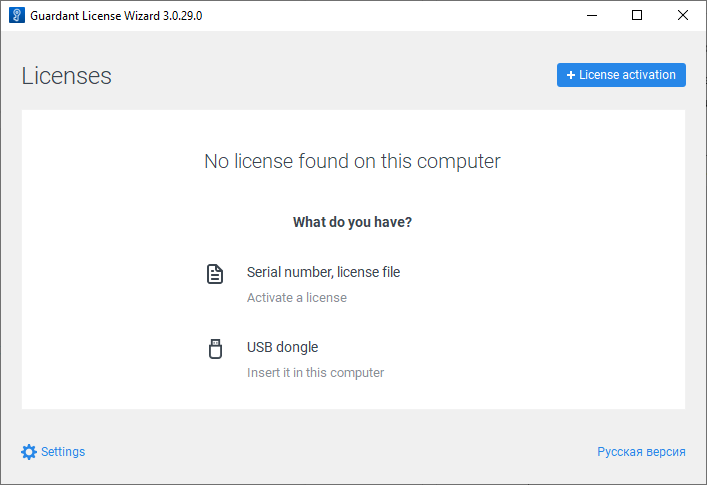
    
3. 点击 **Settings**，并确保 **Server address** 属性设置为 _https://getlicense.guardant.ru_。
   
     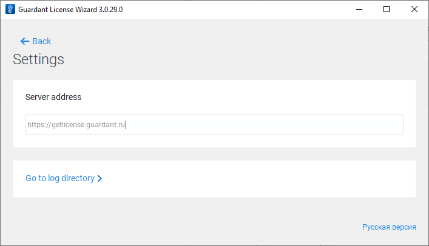

	 然后点击 **Back** 返回上一页。

4. 点击 **License Activation** 按钮以添加新的许可证密钥。

5. 指定要在其上注册许可证的计算机。

    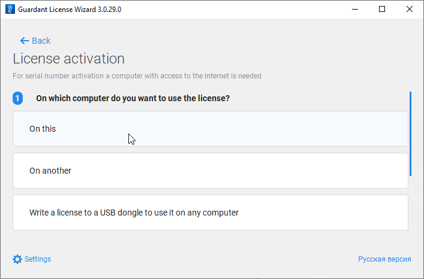

6. 在 **Serial Number** 字段中输入您的许可证密钥。

    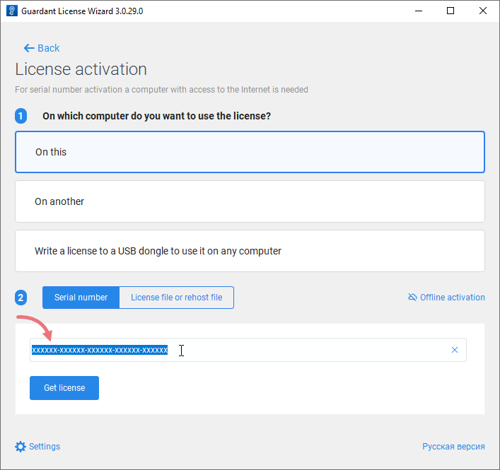

	
7. 点击 **Get license**。

    如果许可证激活成功，向导将显示已授权产品的相关信息。

    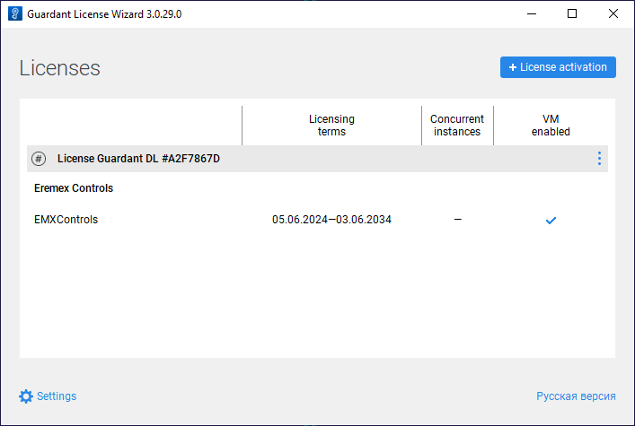


## 使用软件密钥离线激活许可证 (Guardant DL) {#offline-license-activation-using-a-software-key-guardant-dl}

如果计算机无法访问互联网，您仍然可以通过离线流程激活软件密钥。此激活方式包括以下步骤：

- 步骤 1. 在无法访问互联网的计算机上生成请求文件。
- 步骤 2. 在另一台可以访问互联网的计算机上，根据请求文件获取许可证文件。
- 步骤 3. 将许可证文件导入回离线计算机。

下面详细说明这些步骤。

1. 确保离线计算机和可以访问互联网的计算机上都已安装并运行 _Guardant Control Center_。

2. 在离线计算机上运行 _Guardant License Wizard_。

    

3. 点击 **License activation**。

    
4. 选择 **On this** 以指定要在其上注册许可证的计算机。

    

5. 点击 **Offline activation** 按钮。

    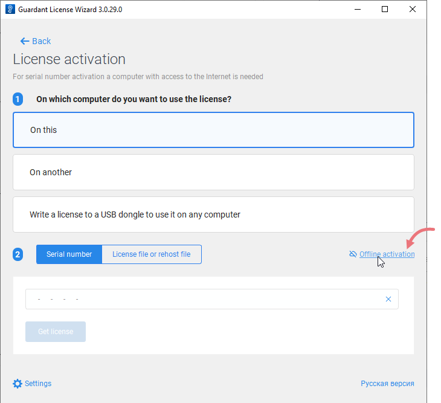

6. 点击 **Save** 将新许可证的请求保存到文件中。

    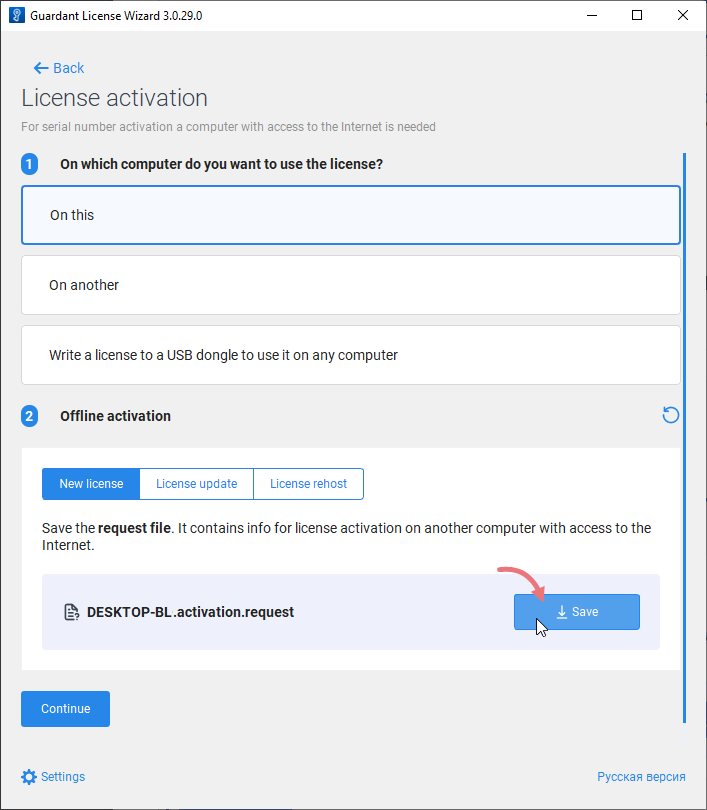

7. 在另一台可以访问互联网的计算机上，运行 _Guardant License Wizard_。

8. 点击 **Settings**，并确保 **Server address** 属性设置为 _https://getlicense.guardant.ru_。然后点击 **Back** 返回上一页。

9. 在 Licenses 页面中，点击 **License Activation** 按钮。

    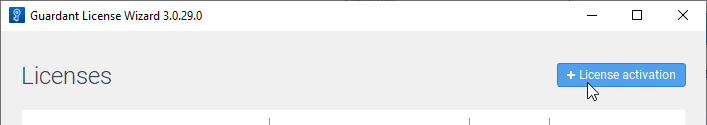

10. 选择 **On another** 以指定要为其激活许可证的计算机。然后点击“Continue”。

    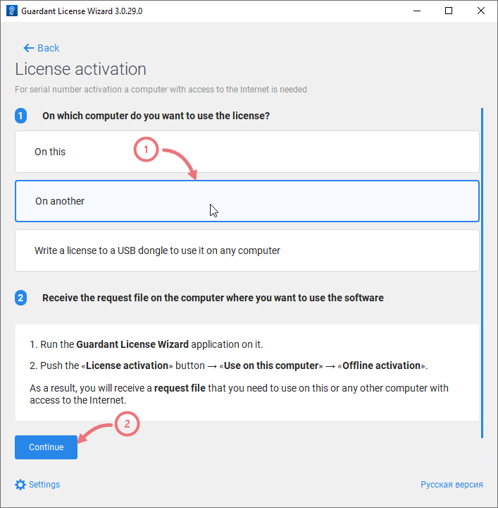

11. 加载在目标计算机上生成的许可证请求。

    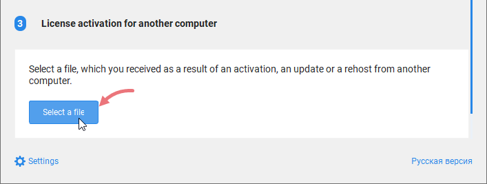

12. 输入您的许可证编号，然后点击 **Activate a new license**。

    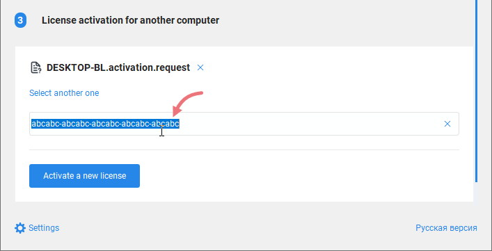

13. 保存许可证文件（“_*.license_”）。

    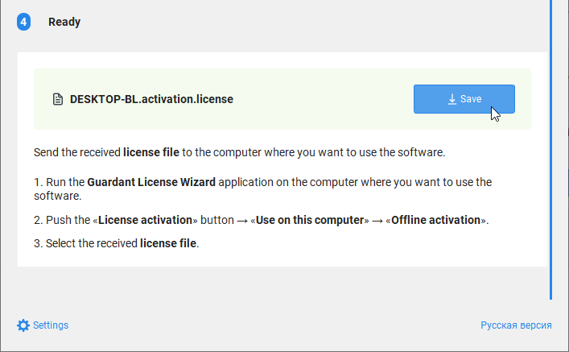

14. 返回目标计算机。

15. 运行 _Guardant License Wizard_，并切换到 **License activation** 页面。

16. 选择 **On this** 以指定用于许可证激活的计算机。然后点击 **License file or rehost file**，并加载生成的许可证文件（“_*.license_”）。

    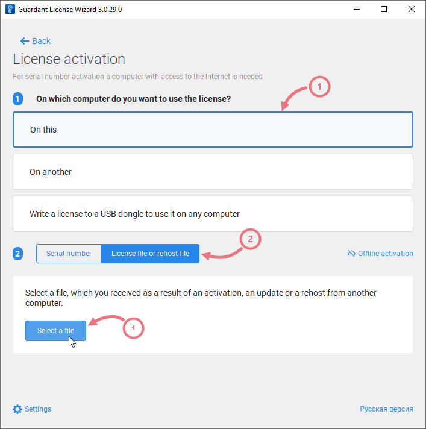

17. 激活许可证。


## 在线更新许可证 {#online-update-of-the-license}

### 从命令行 {#from-the-command-line_1}

```
license_wizard --console --update &lt;LICENSE-KEY&gt; --host https://getlicense.guardant.ru
```

### 从界面 {#from-the-ui_1}

1. 运行 _Guardant License Wizard_。

    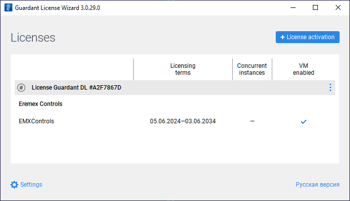

2. 点击 **Settings**，并确保 **Server address** 属性设置为 _https://getlicense.guardant.ru_。然后点击 **Back** 返回上一页。

3. 在 Licenses 页面中，点击省略号（“...”）按钮，然后点击“Check updates”。

    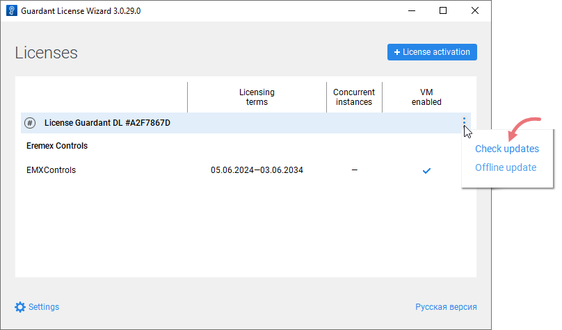

	
4. 如果在服务器上找到许可证更新，请点击出现的 _Install Updates_ 链接。

5. 操作成功后，向导将更新已注册的许可证。


## 切换许可证 {#switch-between-licenses}

如果您的计算机上注册了两个或更多许可证，可以按照以下方式为项目选择所需的许可证。

1. 如果 `emxLicense.cs` 文件缺失，请先生成项目。生成后，该文件将引用找到的第一个许可证。

    `emxLicense.cs` 文件中 `SetRuntimeLicenseOwner` 方法的第三个参数指定了许可证 ID。

    <!-- TODO
    screenshots
    <image> -->

2. 运行 _Guardant License Wizard_ 以查看已安装的许可证。

    <!--TODO <image> -->

3. 找到所需许可证的 ID（在许可证标题后显示的十六进制数字）。

4. 将 `SetRuntimeLicenseOwner` 方法中的许可证 ID 替换为新的 ID。

    <!-- TODO
    code
    -->

5. 重新生成项目。

<sup>*</sup> 本页面使用机器翻译技术翻译。
