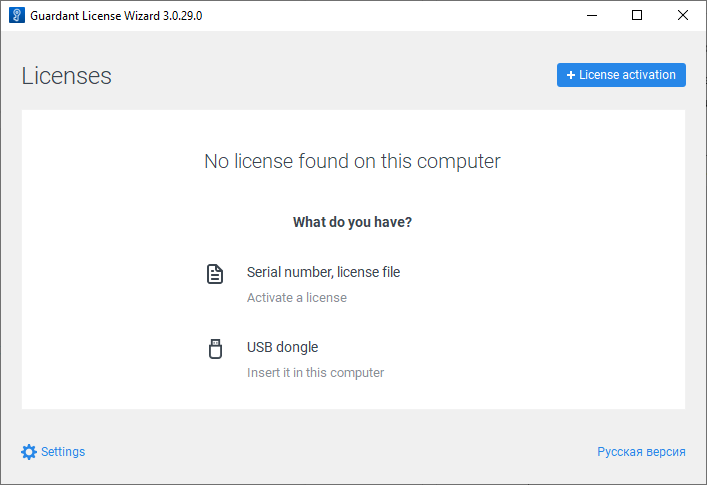
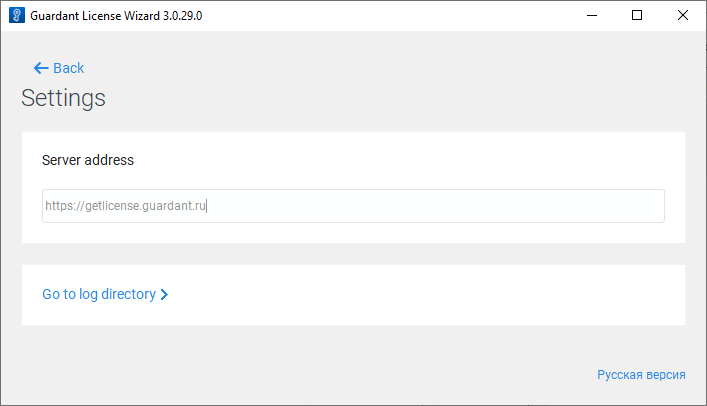
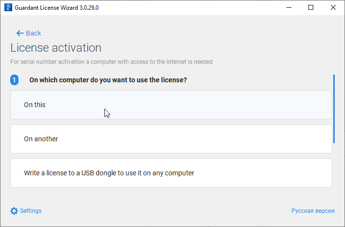
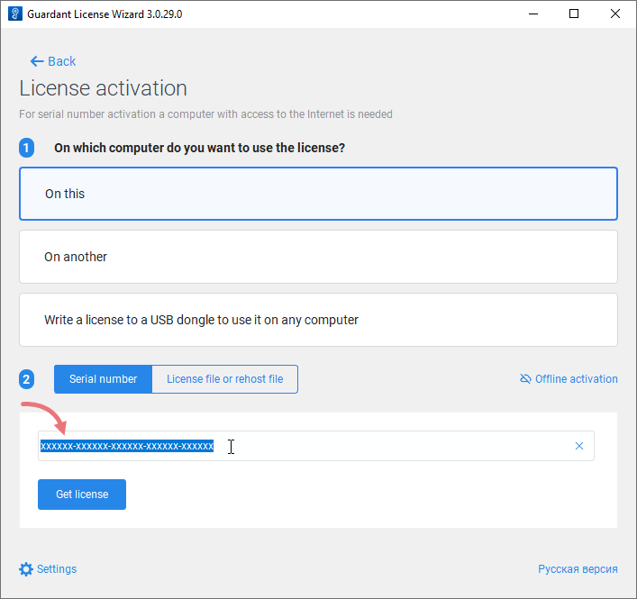
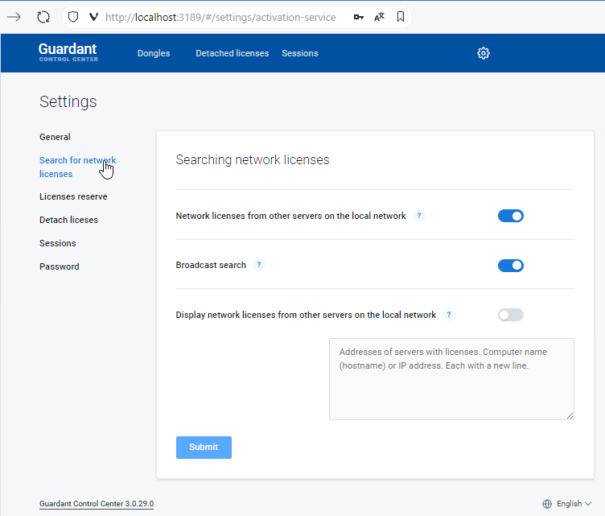
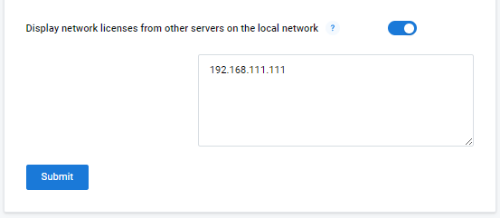

# 激活和管理网络许可证 {#activate-and-manage-network-licenses}

网络许可证允许局域网中的多个用户共享一组许可证席位。网络许可证应安装在服务器上，该服务器必须保持开机并连接到网络。服务器承载许可证池，客户端计算机从中获取许可证。

## 许可证管理工具 {#license-management-utilities}

EMX Controls 库的所有许可证类型（[本地许可证](activate-and-manage-local-licenses.md)和网络许可证）均通过来自 [Guardant](https://guardant.com) 的两款工具进行管理：_Guardant Control Center_ 和 _Guardant License Wizard_。您可以通过以下链接下载这些工具：

- [Guardant License Management Redistributables (Windows)](../resources/Guardant_Redistributable_Windows.zip)
- [Guardant License Management Redistributables (Linux)](../resources/Guardant_Redistributable_Linux.zip)


**_Guardant Control Center_**

许可证管理服务。

_安装文件_：

- Windows：`grdcontrol-x.x.msi`
- Linux：`grdcontrol-x.x_amd64.deb`、`grdcontrol-x.x.x86_64.rpm`

!!! Note

    服务器和客户端计算机上都必须安装并运行 _Guardant Control Center_，以管理许可证并监控其使用情况。请勿卸载、停止或禁用该服务；否则 EMX Controls 库无法验证其许可证，并会显示试用版消息。

**_Guardant License Wizard_**

一个图形界面和命令行工具，可用于添加、更新和转移许可证。

_可执行文件_：

- Windows：`license_wizard.exe`
- Linux：`license_wizard`

要获取所有命令行选项的信息，请运行以下命令：

<code>license_wizard --help</code>


## 设置网络许可证 {#set-up-network-licenses}

要配置网络许可证，请按照以下步骤操作：

1. [在服务器和客户端计算机上安装 _Guardant Control Center_ (GCC)](#install-guardant-control-center-gcc)。
2. [在服务器上激活网络许可证](#activate-a-network-license-on-the-server)。
3. [为客户端提供对网络许可证的访问](#provide-client-access-to-the-network-license)。

以下各节详细介绍如何配置和使用网络许可证。

## 安装 Guardant Control Center (GCC) {#install-guardant-control-center-gcc}

要使用网络许可证，请在服务器和所有客户端计算机上安装 _Guardant Control Center_。安装后，GCC 作为后台服务运行。您可以通过端口 `3189` 访问其 Web 界面。例如，要在 Windows 上访问本地 GCC 服务，请转到 [http://localhost:3189/](http://localhost:3189/)。Web 界面的默认密码为 `admin`。


## 在服务器上激活网络许可证 {#activate-a-network-license-on-the-server}

安装 GCC 后，必须在服务器计算机上激活网络许可证。

### 使用软件密钥在线激活许可证 (Guardant DL) {#online-license-activation-using-a-software-key-guardant-dl}

#### 从命令行 {#from-the-command-line}

```
license_wizard --console --activate &lt;LICENSE-KEY&gt; --host https://getlicense.guardant.ru
```

#### 从界面 {#from-the-ui}

1. 启动 _Guardant License Wizard_。

    

2. 点击 **Settings**，并确保 **Server address** 字段设置为 _https://getlicense.guardant.ru_。

    

    然后点击 **Back** 返回上一页。

3. 点击 **License Activation** 按钮以添加新的许可证密钥。

4. 当询问要在哪台计算机上注册许可证时，选择 **On this**。

    

5. 在 **Serial Number** 字段中输入您的许可证密钥，然后点击 **Get a license**。

    

激活成功后，将显示已激活的 EMX Controls 产品及其网络限制。

### 使用软件密钥离线激活许可证 (Guardant DL) {#offline-license-activation-using-a-software-key-guardant-dl}

如果用于分发许可证的服务器无法访问互联网，您仍然可以通过离线流程激活软件密钥。此激活方式包括以下步骤：

- 步骤 1. 在无法访问互联网的服务器上生成请求文件。
- 步骤 2. 在另一台可以访问互联网的计算机上，根据请求文件获取许可证文件。
- 步骤 3. 将许可证文件导入回离线服务器。

离线激活流程的详细说明请参阅以下主题：

- [离线激活 Eremex Controls 许可证](activate-and-manage-local-licenses.md#offline-license-activation-using-a-software-key-guardant-dl)


## 为客户端提供对网络许可证的访问 {#provide-client-access-to-the-network-license}

服务器上有许可证后，请配置客户端计算机，使其能够找到许可证服务器。

确保客户端计算机上已安装并运行 _Guardant Control Center_。客户端需要它才能与服务器通信。

默认情况下，GCC 使用广播搜索自动发现同一子网中的许可证服务器。如果客户端和服务器位于同一局域网中，网络许可证应能被自动发现。

如果自动发现失败（例如由于防火墙规则、VPN 或位于不同子网），请手动指定服务器地址，如下所示：

1. 在客户端计算机上打开 GCC Web 界面（[http://localhost:3189/](http://localhost:3189/)）。

    默认密码：`admin`。

2. 点击设置按钮（），然后选择 **Search for network licenses**。

    


3. 启用 **Display network licenses from other servers on the local network** 选项，并添加承载许可证的 GCC 服务器的 IP 地址。

    

4. 点击 **Submit**。

    现在，客户端将直接向指定服务器查询网络许可证。


## 验证网络许可证 {#verify-the-network-license}

打开 GCC Web 界面 [http://localhost:3189/#/dongles/list](http://localhost:3189/#/dongles/list)。您应该能看到可用的网络许可证。

<sup>*</sup> 本页面使用机器翻译技术翻译。
