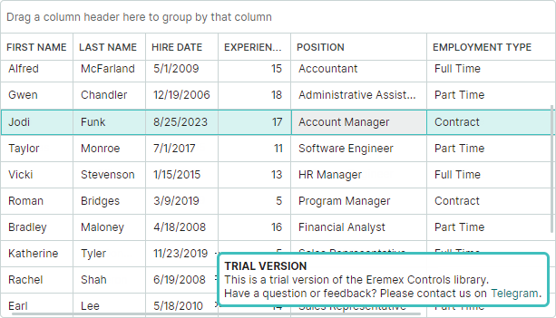
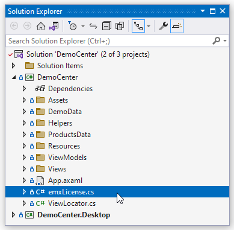

# 许可与产品评估 {#licensing-and-product-evaluation}

本文档介绍产品评估、许可模式，并解答有关 Eremex Controls 库许可的常见问题。

如果您正在开发开源项目，并希望在其中使用 Eremex Controls 库，可以申请免费的非商业许可证。请参阅[面向开源项目的免费非商业许可证](#free-non-commercial-licenses-for-open-source-projects)。

## 产品评估 {#product-evaluation}

Eremex Controls 库提供免费的 60 天试用版，让您可以在自己的项目和环境中评估该产品。与已激活的许可证相比，试用版没有任何功能限制。

使用试用版期间，Eremex 控件会显示试用消息。




## 许可模式 {#licensing-model}

Eremex Controls 库的许可模式在[最终用户许可协议 (EULA)](eula.md)中进行了说明。

每个 Eremex Controls 许可证提供一年的产品更新和技术支持。每位使用该产品的开发人员都需要单独的许可证。

在许可证有效期内，您可以使用 Eremex Controls 库创建新项目，也可以将现有项目升级到库的新版本。


### 许可证类型 {#license-types}

#### 年度许可证 {#annual-license}

- 包含自购买之日起一年的更新和技术支持。
- 许可证到期后，您仍可以__生成和分发在许可证有效期内创建的应用程序__。

    唯一的要求是，您不得更改现有项目中的程序集名称或 Eremex Controls 库的主版本号。否则，控件将重新显示试用消息。不过，即使在许可证到期后，您仍然可以自由更新项目中库的次版本号（XX.Y.**z**）。

- 许可证到期后，如需开发新项目，必须购买新的许可证。

#### 永久许可证 {#perpetual-license}

- 包含自购买之日起一年的更新和技术支持。
- 第一年结束后，您将永久保留__基于已授权版本生成和分发应用程序（包括现有和新建的应用程序）__的权利。
- 如需在第一年之后继续获得更新和技术支持，您必须购买“Update Subscription Renewal for 1 Year”（一年期更新订阅续订）产品。

#### 一年期更新订阅续订（Update Subscription Renewal for 1 Year） {#update-subscription-renewal-for-1-year}

该产品可将更新和技术支持的访问权限延长一年。它仅面向持有有效永久许可证的用户提供。


### 运行时和调试期间的试用消息 {#trial-messages-at-runtime-and-during-debugging}

如果缺少有效的许可证信息或许可证信息无效，则在运行时和调试会话期间会显示试用消息。

由于调试是开发过程中不可或缺的一部分，因此需要有效的开发者许可证。
如果您在工作中使用两台或三台计算机，可以在这些设备上注册您的有效许可证。一个开发者许可证最多可以激活三次。由于许可证与硬件绑定，您可以将这些激活次数用于多台计算机，也可以将其保留用于将来的硬件配置变更（例如更换硬盘）。


## 许可证文件 {#license-file}

在预生成阶段，Eremex Controls 的许可证管理器会生成 `emxLicense.cs` 文件，其中包含唯一的许可证运行时密钥。该密钥用于在运行时进行许可证校验。如果许可证信息缺失或无效，Eremex 控件会显示试用消息。

许可证运行时密钥包含以下设置的信息：

- 程序集名称
- 项目中使用的 Eremex Controls 库的主版本号（**XX.Y**.z）。

在生成阶段，`emxLicense.cs` 文件会在项目目录中创建，并自动作为编译项包含在项目中。



以下是自动生成的、定义运行时密钥的 `emxLicense.cs` 文件示例：

``` csharp
// This file is auto-generated. Please do not change it.
using System.Runtime.CompilerServices;
using Eremex.AvaloniaUI.Controls.License;

namespace DemoCenter;
public class LicenseProvider
{
#pragma warning disable CA2255 // The 'ModuleInitializer' attribute should not be used in libraries
	[ModuleInitializer]
#pragma warning restore CA2255 // The 'ModuleInitializer' attribute should not be used in libraries
    public static void RegisterLicense()
	{
        ControlsLicenseManager.SetRuntimeLicenseOwner(new LicenseProvider(),"", 
        "61 5C D0 DA 5E 85 40 27 D0 33 A1 27 5E A7 49 C0 55 B8 3F 84 29 15 30 E0 
        08 57 73 0B 33 D6 BF 34 51 3D AC 02 BD 11 BF C3");
	}
}
```

如果生成的 `emxLicense.cs` 文件未自动包含到项目中（例如，由于 IDE 设置的原因），请手动将该文件添加为编译项。


## 面向开源项目的免费非商业许可证 {#free-non-commercial-licenses-for-open-source-projects}

我们支持开源社区，为非商业性质的开源项目免费提供 Eremex Controls。如果您维护着一个开源项目，并希望在其中使用我们的库，可以通过以下服务申请免费许可证。

- [申请 EMX Controls 开源许可计划](https://eremexcontrols.net/open-source-licensing/)

!!! note "注意"

    这种许可方式仅适用于非商业性质的开源项目。

要获得免费的开源许可证，您的项目必须满足以下条件：

- 项目必须公开托管在 GitHub 上，并包含有效的 `README.md` 文件。
- README 文件中必须包含指向我们网站的链接：[https://eremexcontrols.net/](https://eremexcontrols.net/)。
- 项目引用了 EMX Controls 库。
- 项目使用以下开源许可证之一进行授权：MIT、Apache 2.0、BSD 2-Clause、BSD 3-Clause、ISC 或 MSPL。

EMX Controls 开源许可证与您的项目名称及库的主版本号严格绑定。如果您重命名项目或升级到库的新主版本，则需要通过我们的服务重新获取许可证。

请注意，对于免费许可证，技术支持可能会受到限制。


## 常见问题 {#faq}


#### 如果我在多台计算机上工作怎么办？ {#what-if-i-work-on-multiple-computers}

一个许可证最多可以激活三次。由于许可证与硬件绑定，您可以在其他计算机上激活它，也可以将激活次数保留用于将来的硬件升级（例如更换硬盘）。

#### 在 CI 环境中生成项目是否需要额外的许可证？ {#do-i-need-an-additional-license-to-build-projects-in-a-ci-environment}

不需要。许可证仅用于编写代码的开发环境。持续集成（CI）环境只编译项目而不编写代码，因此不需要额外的许可证席位。请确保您的自动化生成管道不会更改程序集名称或 Eremex Controls 库的目标主版本号。

#### 我可以通过远程 RDP 连接开发应用程序吗？ {#can-i-develop-applications-over-a-remote-rdp-connection}

通过远程桌面连接（RDP）进行开发时，本地的自动许可证管理器可能无法在项目中生成许可证文件，从而导致显示试用消息。如果您的工作流程主要依赖远程开发环境，请联系我们的支持团队，商讨适合这种场景的其他许可证类型。


#### 许可证到期后，我的项目还能继续生成和运行而不显示试用消息吗？ {#will-my-project-continue-to-build-and-run-without-trial-messages-after-my-license-expires}

可以。许可证赋予您在有效期内创建新项目和升级现有项目的权利。

许可证到期后：

- 您的现有项目将继续编译和运行，且不会显示试用消息。

    如果您使用的是年度许可证，则不得更改项目中的程序集名称，也不得升级 Eremex Controls 库的主版本号（**XX.Y**.z）。

- 如果您持有永久许可证，可以基于已授权版本的 Eremex Controls 库创建新项目。
- 许可证到期后，您可以放心地更新现有项目中的次版本号（XX.Y.**z**），因为它不参与许可证有效性检查。


#### 为什么我的项目会显示试用消息？ {#why-does-my-project-display-a-trial-message}

在以下情况下，Eremex 控件可能会在运行时和调试会话期间显示试用消息：

- 项目不包含带有有效许可证运行时密钥的 `emxLicense.cs` 文件。
- 应用程序当前引用的 Eremex Controls 库的主版本号与许可证运行时密钥中编码的版本不匹配。
- 项目当前的程序集名称已被修改，与许可证运行时密钥中编码的程序集名称不再匹配。
- 在调试会话期间：
    - 如果本地计算机上没有已激活的有效开发者许可证。由于调试是开发过程中不可或缺的一部分，因此工作站上必须具有已激活的有效开发者许可证。
    - 如果 [Guardant Control Center](activate-and-manage-local-licenses.md)（许可证管理服务）未安装或未运行。

<br>

<sup>*</sup> 本页面使用机器翻译技术翻译。
