# 版本 1.4 {#version-14}

## 1.4.38 {#1438}

### DataGrid 和 TreeList {#datagrid-and-treelist}

#### 已修复的问题 {#fixed-issues}

- 如果在 `StartDrag` 事件处理程序中取消拖放操作，会引发异常。
- 在 `StartDrag` 事件处理程序中分配给 `e.Data.DataTransfer` 的对象，在 `DragOver` 事件处理程序中无法访问。
- 在 `CheckedList` 模式下，列筛选器不显示“(Select All)”项的标题。

### 图表 {#charts}

#### 已修复的问题 {#fixed-issues_1}

- 显示十字线时，如果系列仅包含值为 `NaN` 的点，会引发异常。
- PolarChart — 当起点和终点相同时，内部区域未被填充。
- 当图表在 _Y_ 轴上显示 `DateTime` 值且 `AlwaysShowZeroLevel` 选项设置为 `true` 时，会引发异常。
- PolarChart 和 SmithChart — [`CrosshairSeriesLabelMode.None`](../API/Eremex.AvaloniaUI.Charts/CrosshairSeriesLabelMode.md) 选项不起作用。

### 窗口和消息框 {#windows-and-message-boxes}

#### 已修复的问题 {#fixed-issues_2}

- `MxMessageBox` — 当 [`MessageBoxIcon`](../API/Eremex.AvaloniaUI.Controls/MessageBoxIcon.md) 参数设置为 `None`、`Question` 或 `Warning` 以外的值时，显示的图标不正确。

## 1.4.34 {#1434}

### Avalonia 12 支持 {#avalonia-12-support}

此版本为 Eremex Controls 库带来了对 Avalonia 12 的全面支持。 Avalonia 12 在性能、稳定性和平台可靠性方面实现了显着改进。此更新确保 Eremex Controls 套件与新版本 Avalonia 框架中引入的更改顺利集成。

有关 Avalonia 12 中重大更改的详细信息，请参阅：
[https://docs.avaloniaui.net/docs/avalonia12-breaking-changes](https://docs.avaloniaui.net/docs/avalonia12-breaking-changes)。

### DataGrid 和 TreeList {#datagrid-and-treelist_1}

#### 行拖放增强功能 {#row-drag-and-drop-enhancements}

##### 行预览 {#row-previews}

DataGrid 和 TreeList 现在在[拖放操作](../controls/datagrid/row-drag-and-drop.md)期间显示行预览，在您重新排序或移动数据时为您提供视觉反馈。

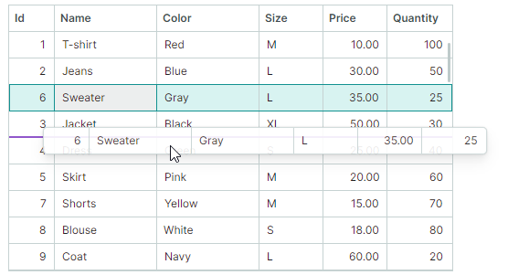

当您拖动多行时，行预览会显示正在拖动的对象的数量。

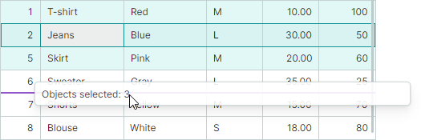

##### 行拖动手柄 {#row-drag-handles}

该版本添加了新的拖动模式，其中使用特殊的拖动手柄来拖动行。拖动手柄显示在行左侧的行指示器区域中。

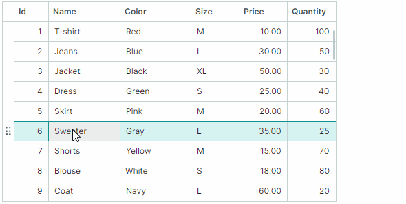

当启用拖放功能时，拖动手柄可简化单元格编辑器的激活。以前，用户通过单击并拖动任何行单元格来启动行拖放。然而，这种行为与在单元格内按下鼠标时激活单元格编辑器的要求（许多人表示）相矛盾。新的基于拖动手柄的模式解决了这个问题：

- 默认情况下，单击单元格即可激活单元格编辑器。
- 要拖动行，请使用专用的行拖动手柄。

###### 相关 API {#related-api}

- [`DataGridControl.RowDragMode`](../API/Eremex.AvaloniaUI.Controls.DataGrid/DataGridControl/RowDragMode.md)
- [`DataGridControl.RowIndicatorWidth`](../API/Eremex.AvaloniaUI.Controls.DataGrid/DataGridControl/RowIndicatorWidth.md)
- [`TreeListControl.RowDragMode`](../API/Eremex.AvaloniaUI.Controls.TreeList/TreeListControl/RowDragMode.md)
- [`TreeListControl.RowIndicatorWidth`](../API/Eremex.AvaloniaUI.Controls.TreeList/TreeListControl/RowIndicatorWidth.md)

##### 重大更改 - 在应用程序之间拖动行 {#breaking-change-drag-rows-between-applications}

从版本 1.4 开始，要允许在应用程序之间拖动行，请为开始拖放操作的控件启用新的 `UsePlatformRowDragDrop` 属性。请注意，在基于平台的行拖动操作期间不会显示行预览。

v1.4 之前的版本不需要任何额外的选项即可在应用程序之间启用行拖放。

##### 文档 {#documentation}

- [Data Grid - Row Drag-and-Drop](../controls/datagrid/row-drag-and-drop.md)
- [Tree List - Node Drag-and-Drop](../controls/treelist/node-drag-and-drop.md)

#### 列标题拖动视觉增强 {#column-header-dragging-visual-enhancements}

要隐藏列，用户可以将其列标头拖离标头面板一小段距离并将其放置在那里。为了提供有关此操作的清晰视觉提示，”隐藏列”提示现在显示在拖动的列标题上方。

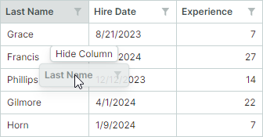

此外，在拖动操作期间，列标头的预览现在显示为半透明并带有阴影效果。

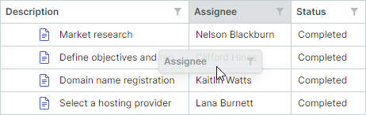

#### 最适合 {#best-fit}

DataGrid 和 TreeList 控件现在支持最佳适配功能。此功能允许用户自动将列大小调整到理想的最小宽度，以完整显示单元格内容。

要应用最佳拟合，用户可以双击列标题的右边缘或从列的上下文菜单中选择”最佳拟合”命令。用户还可以一次将”最佳适合”应用到所有列，以确保所有内容保持完全可见。

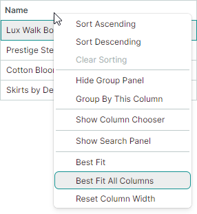

控件包括 [`BestFitMode`](../API/Eremex.AvaloniaUI.Controls.DataControl/BestFitMode.md) 属性，用于指定在最佳拟合操作期间测量哪些行值：

- `Fast` 模式 – 测量唯一行值的宽度。这可以提高大多数标准场景中的最佳拟合性能。

- `Full` 模式 – 测量所有行值的宽度，包括重复值。此模式比”快速”慢，但在使用单元模板或验证错误时可以正确计算列宽度。

##### 相关 API {#related-api_1}

- [`DataGridControl.AllowBestFit`](../API/Eremex.AvaloniaUI.Controls.DataGrid/DataGridControl/AllowBestFit.md)
- [`DataGridControl.BestFitMode`](../API/Eremex.AvaloniaUI.Controls.DataGrid/DataGridControl/BestFitMode.md)
- [`DataGridControl.BestFitMode`](../API/Eremex.AvaloniaUI.Controls.DataGrid/DataGridControl/BestFitMode.md)
- [`DataGridControl.BestFit`](../API/Eremex.AvaloniaUI.Controls.DataGrid/DataGridControl/BestFit.md)
- [`DataGridControl.BestFitAllColumns`](../API/Eremex.AvaloniaUI.Controls.DataGrid/DataGridControl/BestFitAllColumns.md)
- [`GridColumn.AllowBestFit`](../API/Eremex.AvaloniaUI.Controls.DataControl/ColumnBase/AllowBestFit.md)
- [`GridColumn.BestFitMode`](../API/Eremex.AvaloniaUI.Controls.DataControl/ColumnBase/BestFitMode.md)
- [`GridColumn.BestFitMode`](../API/Eremex.AvaloniaUI.Controls.DataControl/ColumnBase/BestFitMode.md)
- [`TreeListControl.AllowBestFit`](../API/Eremex.AvaloniaUI.Controls.TreeList/TreeListControl/AllowBestFit.md)
- [`TreeListControl.BestFitMode`](../API/Eremex.AvaloniaUI.Controls.TreeList/TreeListControl/BestFitMode.md)
- [`TreeListControl.BestFitMode`](../API/Eremex.AvaloniaUI.Controls.TreeList/TreeListControl/BestFitMode.md)
- [`TreeListControl.BestFit`](../API/Eremex.AvaloniaUI.Controls.TreeList/TreeListControl/BestFit.md)
- [`TreeListControl.BestFitAllColumns`](../API/Eremex.AvaloniaUI.Controls.TreeList/TreeListControl/BestFitAllColumns.md)
- [`TreeListColumn.AllowBestFit`](../API/Eremex.AvaloniaUI.Controls.DataControl/ColumnBase/AllowBestFit.md)
- [`TreeListColumn.BestFitMode`](../API/Eremex.AvaloniaUI.Controls.DataControl/ColumnBase/BestFitMode.md)
- [`TreeListColumn.BestFitMode`](../API/Eremex.AvaloniaUI.Controls.DataControl/ColumnBase/BestFitMode.md)

##### 文档 {#documentation_1}

- [最佳调整（Best Fit）](../controls/datagrid/columns.md#best-fit)
- [最佳适应（Best Fit）](../controls/treelist/columns.md#best-fit)

#### 重置用户对列宽的更改 {#reset-user-changes-to-column-width}

用户更改列宽度（通过拖动或使用”最佳拟合”）后，_重置列宽_命令将出现在列上下文菜单中。此命令重置用户对列宽度所做的更改，恢复用户修改之前应用于 XAML 或代码隐藏中的列的原始宽度。

##### 相关 API {#related-api_2}

- [`DataGridControl.AllowResetColumnWidth`](../API/Eremex.AvaloniaUI.Controls.DataGrid/DataGridControl/AllowResetColumnWidth.md)
- [`DataGridControl.ResetColumnWidth`](../API/Eremex.AvaloniaUI.Controls.DataGrid/DataGridControl/ResetColumnWidth.md)
- [`TreeListControl.AllowResetColumnWidth`](../API/Eremex.AvaloniaUI.Controls.TreeList/TreeListControl/AllowResetColumnWidth.md)
- [`TreeListControl.ResetColumnWidth`](../API/Eremex.AvaloniaUI.Controls.TreeList/TreeListControl/ResetColumnWidth.md)

#### 已修复的问题 {#fixed-issues_3}

- TreeList - 如果 [`ExpandNodesOnFiltering`](../API/Eremex.AvaloniaUI.Controls.TreeList/TreeListControlBase/ExpandNodesOnFiltering.md) 为 `true`，则在过滤数据时引发 `StackOverflowException`。
- TreeList - 当节点集合更改时，自动筛选行中的活动编辑器将关闭。
- DataGrid 和 TreeList - `Cmd+A` 快捷键不适用于 Mac。

### Cartesian Chart - 十字线增强 {#cartesian-chart-crosshair-enhancements}

Cartesian Chart 控件扩展了其公共 API，让您能够对十字线标签的行为和外观进行更精细的控制。

#### 新的十字线标签显示模式 {#new-crosshair-label-display-mode}

[`CrosshairOptions.SeriesLabelMode`](../API/Eremex.AvaloniaUI.Charts/CrosshairOptions/SeriesLabelMode.md) 属性指定是否以及如何组合多个十字线标签。该属性的默认值现在是 `Smart`：

- `Smart` 模式 — 每个系列都显示自己的十字线标签。当标签重叠时，它们会合并为一个标签。
  
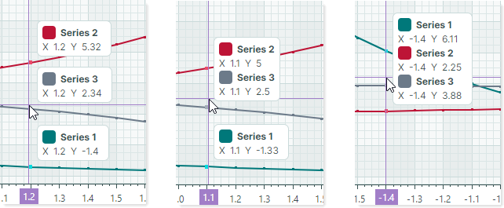

#### 十字线系列排序 {#crosshair-series-sorting}

当多个系列组合在单个十字线标签中时，您可以使用新的 [`CrosshairOptions.SeriesLabelItemSortMode`](../API/Eremex.AvaloniaUI.Charts/CrosshairOptions/SeriesLabelItemSortMode.md) 属性来指定标签中系列的显示顺序：

- `By Series` 顺序 — 按系列添加到 [`CartesianChart.Series`](../API/Eremex.AvaloniaUI.Charts/CartesianChart/Series.md) 集合中的顺序对系列进行排序。

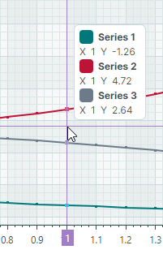

- `By Value` 顺序 — 按 _Y_ 值对系列进行排序。

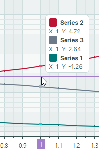

#### 仅包含光标附近的系列 {#include-only-series-near-the-cursor}

以下属性允许您仅显示光标附近数据点的十字线标签。

- [`CrosshairOptions.MaxPickDistance`](../API/Eremex.AvaloniaUI.Charts/CrosshairOptions/MaxPickDistance.md) — 指定搜索要包含在十字线标签中的数据点的范围。

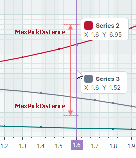

#### 十字线显示延迟 {#crosshair-show-delay}

- [`CrosshairOptions.SeriesLabelShowDelay`](../API/Eremex.AvaloniaUI.Charts/CrosshairOptions/SeriesLabelShowDelay.md) — 指定显示十字线系列标签之前的延迟（以毫秒为单位）。

#### 显示和隐藏十字线 API {#show-and-hide-crosshair-api}

- `ShowCrosshair(Point position)`
- [`HideCrosshair()`](../API/Eremex.AvaloniaUI.Charts/CartesianChart/HideCrosshair.md)

#### 更新的十字线模板 {#updated-crosshair-template}

图表控件的十字线模板进行了改造，优化了结构，支持新的系列排序功能，并在不同场景下实现一致的视觉外观。

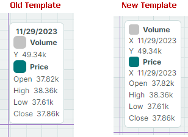

模板更改包括：

- [`CrosshairAllSeriesLabelControlData`](../API/Eremex.AvaloniaUI.Charts/CrosshairAllSeriesLabelControlData.md) 类现在包含 `ObservableCollection<CrosshairSeriesLabelItem> SeriesItems` 集合，而不是 `CrosshairAllSeriesLabelGroup` 集合。
- `CrosshairAllSeriesLabelGroup` 类别已被删除。
- `CrosshairAllSeriesLabelSeriesItem` 类别已重命名为 [`CrosshairSeriesLabelItem`](../API/Eremex.AvaloniaUI.Charts/CrosshairSeriesLabelItem.md)。此类包含有关系列参数和参数前缀的信息。
- `CrosshairAllSeriesLabelSeriesValueItem` 类别已重命名为 [`CrosshairSeriesLabelSeriesValueItem`](../API/Eremex.AvaloniaUI.Charts/CrosshairSeriesLabelSeriesValueItem.md)。
- [`CrosshairSingleSeriesLabelControlData`](../API/Eremex.AvaloniaUI.Charts/CrosshairSingleSeriesLabelControlData.md) 类不再继承自 `CrosshairAllSeriesLabelSeriesValueItem`。 [`CrosshairSingleSeriesLabelControlData`](../API/Eremex.AvaloniaUI.Charts/CrosshairSingleSeriesLabelControlData.md) 现在公开 [`CrosshairSeriesLabelItem`](../API/Eremex.AvaloniaUI.Charts/CrosshairSeriesLabelItem.md) 类型的 [`SeriesItem`](../API/Eremex.AvaloniaUI.Charts/CrosshairSingleSeriesLabelControlData/SeriesItem.md) 属性。

#### 文档 {#documentation_2}

- [Crosshair](../controls/charts/crosshair.md)

### Docking UI {#docking-ui}

#### 已修复的问题 {#fixed-issues_4}

- 在某些情况下，浮动面板停靠时会引发异常。
- 当显示启用了 `OverlayDismissEventPassThrough` 属性的菜单时，不会激活停靠项。

### 重大变化 {#breaking-changes}

- 对 `CommunityToolkit.Mvvm ` 包的依赖已被删除。如果您的项目需要此包，请显式添加对 `CommunityToolkit.Mvvm` 的引用。
- [`DataControlCommands`](../API/Eremex.AvaloniaUI.Controls.DataControl/DataControlCommands.md)、[`DataGridControlCommands`](../API/Eremex.AvaloniaUI.Controls.DataControl/DataGridControlCommands.md)、[`TreeListCommands`](../API/Eremex.AvaloniaUI.Controls.TreeList/TreeListCommands.md) 和编辑器命令现在包含 `ICommand`，而不是 CommunityToolkit 的 `IRelayCommand`。

 
 

* 本页面使用机器翻译技术翻译。
